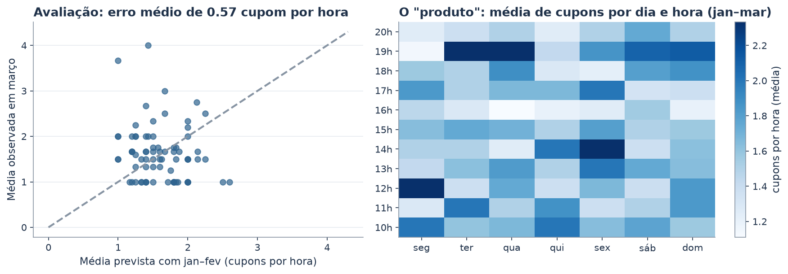
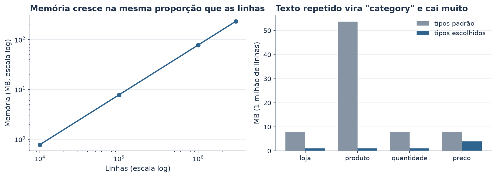
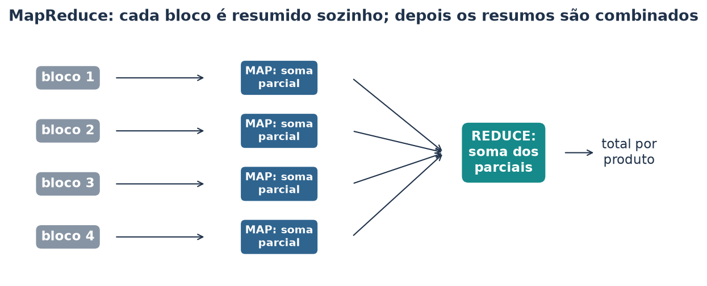
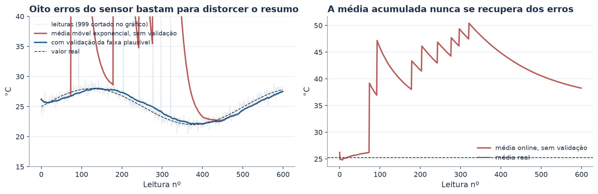
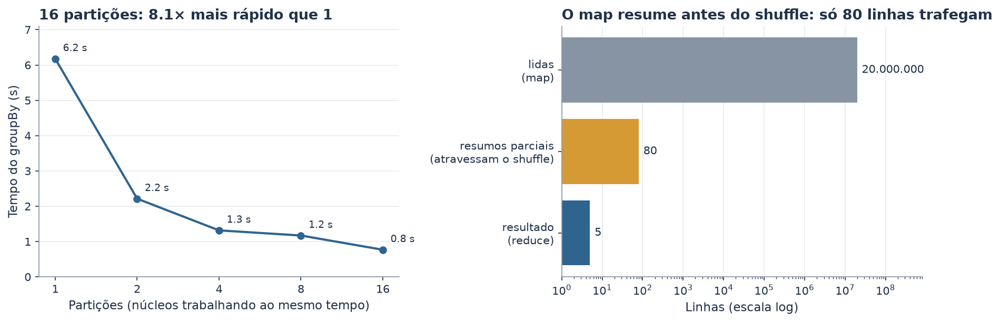
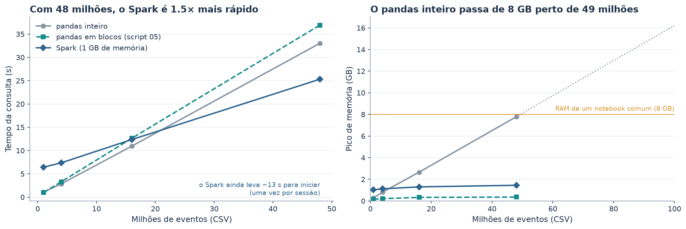
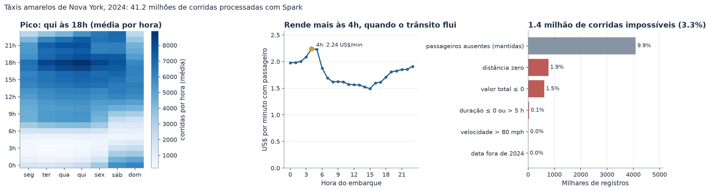
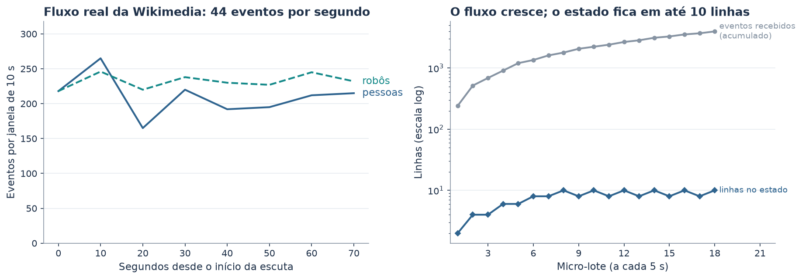

# 01 · O que é Ciência de Dados (e o que é Big Data)

**Pergunta inicial:** "quantos pães vendemos ontem?" e "devemos abrir mais um caixa às 19h?" usam os mesmos dados. Por que só a segunda é uma pergunta de Ciência de Dados?

Esta unidade dá o mapa do curso antes de entrarmos no código. Ela responde cinco perguntas: o que diferencia Ciência de Dados de uma consulta a um banco de dados; que áreas ela combina; o que é um produto de dados; o que muda quando os dados ficam grandes, variados, rápidos e pouco confiáveis (Big Data); e quando vale trocar o pandas por uma ferramenta de Big Data como o Apache Spark. Os scripts 01 a 07 são curtos e servem para *ver* cada ideia acontecendo; a sintaxe deles será explicada nas unidades seguintes. Os scripts 08 a 12 usam o Spark em problemas reais: um ano de corridas de táxi em Nova York (41 milhões de linhas) e o fluxo ao vivo de edições da Wikipédia.

Pré-requisitos: [00 · Como começar](../00_como_comecar/). Se ainda não sabe Python, leia os scripts como receitas e execute; volte a eles depois da unidade 03. Os scripts 08 a 12 precisam de uma instalação extra, descrita em [Instalação do Spark](#instalação-do-spark).

## 1. Consulta ou pergunta?

Ferramentas tradicionais (planilhas, bancos de dados) respondem **consultas**: a resposta já está nos dados e só precisa ser contada ou filtrada. "Quantas unidades de cosméticos foram vendidas em 5 de janeiro?" tem uma resposta exata.

Ciência de Dados trata de **perguntas** cuja resposta não está escrita em lugar nenhum: é preciso comparar, medir a variação, lidar com incerteza e, no fim, decidir algo e verificar se a decisão funcionou. "Em que horário devemos reforçar os caixas?" é desse tipo.

O script [01_consulta_ou_pergunta.py](01_consulta_ou_pergunta.py) faz as duas coisas com as mesmas mil vendas de um supermercado. A consulta devolve um número. A pergunta revela uma surpresa:


O horário de maior faturamento foi 13h em janeiro, 15h em fevereiro e 19h em março. Quem olhasse só março diria "reforce às 19h". Quem olha os três meses percebe que três meses de dados ainda não sustentam essa decisão. **Perceber o que os dados ainda não permitem dizer já é um resultado.**

## 2. Três áreas e um processo

Ciência de Dados não é uma técnica: é a combinação de três tipos de conhecimento.


- **Estatística** traz a inferência, a modelagem e, principalmente, a medida da incerteza.
- **Computação** traz algoritmos, armazenamento e processamento em escala.
- **Domínio do problema** diz o que medir, como interpretar e que decisão está em jogo.

Ciência de Dados também **não** é: só fazer muitos cálculos; só aplicar estatística clássica; só rodar algoritmos de aprendizagem de máquina; só lidar com volumes enormes (isso é Big Data, que *processa*; Ciência de Dados *descobre*).

O trabalho segue um processo que volta ao começo. Cada caixa corresponde a unidades deste repositório:


## 3. Quem faz isso: o cientista de dados

As definições conhecidas apontam na mesma direção: alguém melhor em estatística que a maioria dos programadores e melhor em programação que a maioria dos estatísticos, capaz de explicar as implicações práticas de um resultado. Na prática, o perfil é "em T": base ampla em estatística, programação, visualização e comunicação, e profundidade em uma ou duas delas. Por isso projetos reais são feitos em equipe, e a composição da equipe deve seguir o problema. Mesmo a melhor equipe gera pouco valor sem os dados certos.

## 4. Produto de dados

Um **produto de dados** é algo que aprende com dados e entrega valor de forma repetida: recomendação de filmes, filtro de spam, previsão de demanda. Ele melhora em um ciclo de retroalimentação: o uso gera novos dados, que atualizam o produto.

O script [03_produto_de_dados.py](03_produto_de_dados.py) constrói um produto mínimo: uma função que aprende, com as vendas de janeiro e fevereiro, quantos cupons a loja recebe em cada dia da semana e hora, e sugere quantos caixas abrir. Antes de usar, ele é **avaliado** em março, que não foi visto no treino.



O erro médio é de cerca de 0,6 cupom por hora quando a média observada é 1,6: um erro de mais de um terço. Com três meses e pouco mais de um cupom por hora, esse produto ainda não deveria ser colocado em uso. A lição vale para o curso inteiro: **todo modelo é avaliado em dados que não viu antes de orientar uma decisão.**

## 5. Big Data: os cinco Vs

Os avanços em aquisição, armazenamento, transmissão e processamento fizeram os dados crescerem mais rápido que a capacidade dos sistemas tradicionais. Big Data descreve esse cenário por características:

| V | O que significa | Em pandas e Python | Com Spark |
|---|---|---|---|
| **Volume** | Dados grandes demais para a memória de um computador comum | [04](04_volume.py), [05](05_mapreduce.py) | [08](08_spark_primeiros_passos.py), [09](09_pandas_ou_spark.py), [10](10_taxis_nova_york.py) |
| **Variedade** | Fontes e formatos diferentes: tabelas, documentos aninhados, texto, imagem | [06](06_variedade.py) | [10](10_taxis_nova_york.py) (Parquet + CSV) |
| **Velocidade** | Dados que chegam em fluxo contínuo e precisam ser resumidos na hora | [07](07_velocidade_e_veracidade.py) | [11](11_fluxo_wikipedia.py), [12](12_janelas_atrasos_e_falhas.py) |
| **Veracidade** | Nem todo dado é confiável; o desafio cresce com o número de fontes | [07](07_velocidade_e_veracidade.py) | [10](10_taxis_nova_york.py), [12](12_janelas_atrasos_e_falhas.py) |
| **Valor** | O valor cresce com o volume, mas mais devagar que a quantidade de dado irrelevante | (discussão) | [10](10_taxis_nova_york.py) (o que os números ainda não dizem) |

### Volume

[04_volume.py](04_volume.py) gera tabelas sintéticas de 10 mil a 3 milhões de linhas e mede a memória. Ela cresce na mesma proporção que as linhas: 3 milhões de vendas ocupam cerca de 230 MB. Escolher bem os tipos de dados ajuda muito: guardar o nome do produto como `category` em vez de texto reduz a tabela de 78 MB para 7 MB.



### MapReduce

Quando a tabela não cabe na memória, a saída é dividir o trabalho. [05_mapreduce.py](05_mapreduce.py) grava um arquivo de 2 milhões de linhas e o lê em blocos. Cada bloco é resumido sozinho (**map**); depois os resumos são combinados (**reduce**). O resultado é idêntico ao cálculo direto.



Nem toda conta se divide assim. Soma e contagem se combinam; a média precisa carregar soma **e** contagem de cada bloco; a mediana não se obtém de medianas parciais. É exatamente essa ideia que ferramentas como Hadoop (armazenamento distribuído HDFS e processamento MapReduce), HBase (banco orientado a colunas), MongoDB (banco de documentos) e Spark/PySpark (processamento em memória e em fluxo) levam para dezenas ou milhares de máquinas. A [seção 6](#6-por-que-ferramentas-de-big-data) mostra como.

### Variedade

[06_variedade.py](06_variedade.py) descreve o mesmo cliente de três formas: uma tabela (estruturado), um documento JSON com campos aninhados e opcionais (semiestruturado) e comentários em texto livre (não estruturado). Para analisar, quase sempre transformamos tudo em tabela: `json_normalize` "achata" o documento e uma contagem de palavras transforma texto em colunas. Essa contagem é a matéria-prima do classificador de textos da [unidade 10](../10_naive_bayes/).

### Velocidade e veracidade

[07_velocidade_e_veracidade.py](07_velocidade_e_veracidade.py) simula 600 leituras de um sensor com 8 erros grosseiros (valor 999). Uma média "online" é atualizada a cada leitura sem guardar as anteriores (memória constante, como exige um fluxo). Mas os 8 erros bastam para arrastar o resumo; uma regra simples de validação (descartar o fisicamente impossível) recupera o resultado.



## 6. Por que ferramentas de Big Data?

Os scripts 04 a 07 usam pandas e Python puro porque os dados ainda cabem num computador. Um computador tem três limites: memória, núcleos e disco. Quando os dados passam deles, há dois caminhos:

- **Escalar verticalmente:** comprar uma máquina maior. É simples, mas tem teto, e o preço cresce mais rápido que a capacidade.
- **Escalar horizontalmente:** usar muitas máquinas comuns. Não tem teto, mas cria três problemas novos: dividir o trabalho, mover dados pela rede sem congestioná-la e sobreviver a falhas (com mil máquinas, alguma quebra todo dia).

Ferramentas de Big Data existem para resolver esses três problemas por você. Cada uma cuida de uma parte:

| Problema | Ferramentas | Onde aparece aqui |
|---|---|---|
| Guardar arquivos maiores que um disco | HDFS, armazenamento em nuvem (S3, GCS): o *data lake* | resumo particionado por mês (10) |
| Ler só o que a pergunta precisa | Parquet, ORC (formatos colunares e comprimidos) | táxis de Nova York (10) |
| Processar em paralelo, em várias máquinas | Apache Spark; antes dele, Hadoop MapReduce | 08, 09, 10 |
| Transportar eventos que chegam sem parar | Apache Kafka | a pasta de entrada do fluxo (11) |
| Processar o fluxo com estado e tolerância a falhas | Spark Structured Streaming, Apache Flink | 11, 12 |
| Consultar com SQL | Spark SQL, Hive, Trino | os planos de execução (08, 10) |

**Como o Spark trabalha.** Um programa principal (o *driver*) divide os dados em **partições** e entrega cada uma a um **executor**. Num cluster, os executores são máquinas; no seu notebook (`local[*]`), são os núcleos do processador. O código é o mesmo nos dois casos. Há dois tipos de operação. As **transformações** (`select`, `where`, `groupBy`, `join`) só montam um plano, e as **ações** (`count`, `collect`, `write`) executam esse plano. Isso é a *avaliação preguiçosa*: antes de executar, o Spark vê o plano inteiro e o otimiza, lendo só as colunas necessárias, filtrando o mais cedo possível e escolhendo como juntar tabelas. Quando linhas de partições diferentes precisam se encontrar (num `groupBy` ou num `join`), elas atravessam a rede. Essa etapa é o **shuffle**, a mais cara de todas.

**Quando não usar.** O Spark leva de 10 a 15 segundos só para começar e traz uma máquina virtual Java inteira para administrar. Se os dados cabem com folga na memória, o pandas é mais simples e, como o script 09 mostra, mais rápido. Entre os dois existem ferramentas de uma máquina só que também usam todos os núcleos e leem Parquet, como DuckDB e Polars. O Spark se justifica em três casos: os dados não cabem em uma máquina; o mesmo código precisa rodar num cluster; ou os dados chegam em fluxo e o processamento não pode parar nem perder nada.

### Instalação do Spark

Os scripts 01 a 07 só precisam do ambiente da unidade 00. Os scripts 08 a 12 também precisam do Spark, que roda na máquina virtual Java (JVM). Confira os requisitos antes de começar:

| Requisito | Para quê | Quanto |
|---|---|---|
| Python 3.11 ou mais novo, com o ambiente da [unidade 00](../00_como_comecar/) ativado | o PySpark 4 não funciona com versões anteriores | — |
| Bibliotecas `pyspark` e `pyarrow` | o Spark, e a leitura de Parquet pelo pandas | cerca de 450 MB |
| Java 17 ou 21 | o Spark roda na JVM | cerca de 300 MB |
| Memória | o Spark usa de 1 a 3,5 GB; o script 09 mede o pandas até cerca de 8 GB e pula o tamanho que não couber | 8 GB de RAM ou mais |
| Disco livre | dados baixados e gerados, guardados fora do repositório | cerca de 4,5 GB no pico |
| Internet | o script 10 baixa 693 MB na primeira vez; o 11 ouve um fluxo ao vivo; no Windows, a primeira sessão baixa um arquivo de 9 KB | na primeira execução, e sempre no 11 |

Os comandos abaixo são executados **na pasta principal do repositório, com o ambiente ativado** (o `(.venv)` aparece no começo da linha do terminal).

**1. Instale as bibliotecas.** O `requirements-bigdata.txt` já inclui tudo o que está no `requirements-basico.txt`:

```powershell
pip install -r requirements-bigdata.txt
```

**2. Instale o Java 17**, de um destes jeitos:

- Em qualquer sistema, sem precisar de administrador (o caminho recomendado):

  ```powershell
  pip install install-jdk
  python -c "import jdk; jdk.install('17')"
  ```

  O Java fica em `~/.jdk` (no Windows, `C:\Users\<seu usuário>\.jdk`). Não é preciso configurar `JAVA_HOME` nem o `PATH`: o `spark_ambiente.py` procura o Java ali.
- No Windows ou no macOS, com o instalador do Eclipse Temurin 17 em <https://adoptium.net>. Depois de instalar, feche e abra o terminal.
- No Linux (Ubuntu ou Debian): `sudo apt install openjdk-17-jdk`.

Se você já tem um Java 8 ou 11, inclusive com `JAVA_HOME` apontando para ele, não precisa removê-lo: o módulo o ignora e procura um Java 17 ou mais novo.

**3. Confira a instalação:**

```powershell
python 01_conceitos_e_big_data/spark_ambiente.py
```

A saída deve terminar assim (os números e o caminho mudam de um computador para outro):

```
Python 3.12.10 | PySpark 4.3.0 | Java 17
Sessao criada em 10.0 s, com 16 nucleos
Dados grandes e caches ficam em: C:\Users\<seu usuário>\ciencia-de-dados-big-data
Gravar e ler Parquet: ok (10 grupos)
Tudo pronto para os scripts 08 a 12.
```

Antes dessas linhas, o Java imprime `WARNING: Using incubator modules: jdk.incubator.vector`. Pode ignorar.

**O que o [spark_ambiente.py](spark_ambiente.py) faz.** Todos os scripts de Spark começam com `from spark_ambiente import iniciar_spark`, por isso ele precisa ficar na mesma pasta que eles. O módulo:

- encontra o Java (em `JAVA_HOME`, no `PATH` ou em `~/.jdk`);
- cria a sessão do Spark com configurações adequadas a um computador pessoal;
- esconde as mensagens internas do Java;
- no Windows, dispensa o `winutils.exe` e o `hadoop.dll`, dois programas nativos que o Hadoop (a biblioteca que o Spark usa para ler e gravar arquivos) costuma exigir. Em vez deles, usa um sistema de arquivos escrito só em Java ([hadoop-bare-naked-local-fs](https://github.com/globalmentor/hadoop-bare-naked-local-fs), 9 KB). Esse arquivo é baixado do Maven Central na primeira execução, conferido pelo SHA-256 e guardado na pasta `jars` do PySpark, dentro do seu ambiente virtual;
- funciona mesmo com espaços ou acentos no caminho, como num nome de usuário "Maria Conceição".

Para fazer seus próprios testes com Spark, crie o script nesta pasta e comece do mesmo jeito: `spark = iniciar_spark('meu_teste')`.

### Como rodar os scripts 08 a 12

Execute na ordem, a partir da pasta principal. Por exemplo:

```powershell
python 01_conceitos_e_big_data/08_spark_primeiros_passos.py
```

Cada script imprime os resultados e grava sua figura em `figuras/`, como nas outras unidades.

| Script | Dados que usa | Tempo* | Opções úteis |
|---|---|---|---|
| 08 | gerados pelo próprio Spark, na memória; nada vai para o disco | 40 s | — |
| 09 | gera até 3,8 GB de CSV sintético e apaga tudo no fim | 5 min | `--tamanhos 1 4 16`: menos tempo e disco, bom para começar num notebook de 8 GB; `--manter-dados`: não apaga os CSV |
| 10 | baixa 693 MB da TLC de Nova York na primeira vez e os guarda para as próximas | 1 min, mais o download | `--meses 3`: baixa e processa só 3 meses (160 MB) |
| 11 | ouve o fluxo ao vivo da Wikimedia; precisa de internet | 2 min | `--segundos 60`: ouve por menos tempo; `--simulado`: usa um fluxo simulado, sem internet |
| 12 | 1,08 milhão de leituras simuladas, apagadas no fim | 2 min | — |

\* Medido num notebook com 16 núcleos e 32 GB de RAM; em máquinas mais modestas, conte com mais tempo.

As opções vêm depois do nome do script:

```powershell
python 01_conceitos_e_big_data/09_pandas_ou_spark.py --tamanhos 1 4 16
```

O comando `python scripts/executar_todos.py 01_conceitos_e_big_data` roda a unidade inteira, incluindo os scripts de Spark: cerca de 12 minutos, mais o download do script 10 na primeira vez. Sem o PySpark instalado, os scripts 08 a 12 aparecem como `PULADO`, sem contar como erro.

### Onde ficam os dados

Nada do que os scripts 08 a 12 baixam ou geram vai para o repositório. Tudo fica em `~/ciencia-de-dados-big-data` (no Windows, `C:\Users\<seu usuário>\ciencia-de-dados-big-data`):

```
ciencia-de-dados-big-data/
├── _spark/          configuração de log e pasta de trabalho do Spark (poucos KB)
├── taxis/           script 10: viagens/ (12 arquivos Parquet, 693 MB), taxi_zone_lookup.csv e
│                    resumo_por_hora/; fica guardado para as próximas execuções
├── cliques/         script 09: CSV temporários (até 3,8 GB), apagados no fim
├── wikipedia/       script 11: arquivos do fluxo, apagados no fim
└── camaras_frias/   script 12: leituras simuladas, apagadas no fim
```

Para usar outro lugar (outro disco, por exemplo), defina a variável `CIENCIA_DADOS_BIG_DATA` no terminal antes de rodar os scripts. Ela vale enquanto aquele terminal estiver aberto:

```powershell
$env:CIENCIA_DADOS_BIG_DATA = "D:\big-data"
```

No Linux ou no macOS: `export CIENCIA_DADOS_BIG_DATA=/caminho/da/pasta`.

Quando terminar a unidade, apague a pasta para liberar espaço:

```powershell
Remove-Item -Recurse -Force "$HOME\ciencia-de-dados-big-data"
```

No Linux ou no macOS: `rm -rf ~/ciencia-de-dados-big-data`. A origem e os termos de uso das duas bases reais (táxis de Nova York e fluxo da Wikimedia) estão em [dados/README.md](../dados/README.md#bases-baixadas-durante-a-execução).

### Problemas comuns

| Mensagem | Causa provável | O que fazer |
|---|---|---|
| `No module named 'pyspark'` | ambiente não ativado ou bibliotecas não instaladas | ative o `.venv` e rode `pip install -r requirements-bigdata.txt` |
| `Nao encontrei o Java 17 (ou mais novo)` | não há Java, ou só há Java 8 ou 11 | instale o Java 17 (passo 2), feche e abra o terminal |
| `Java gateway process exited before sending its port number` | Spark iniciado sem o `spark_ambiente.py`, ou Java antigo no `PATH` | rode `spark_ambiente.py`; nos seus scripts, crie a sessão com `iniciar_spark` |
| `HADOOP_HOME and hadoop.home.dir are unset` (Windows) | sessão criada sem o `spark_ambiente.py` | crie a sessão com `iniciar_spark`, como nos scripts 08 a 12 |
| `Nao consegui baixar ... hadoop-bare-naked-local-fs` | primeira execução no Windows sem internet, ou rede que bloqueia o Maven Central | conecte-se e rode de novo; depois da primeira vez, não precisa mais |
| `OutOfMemoryError: Java heap space` | uma conta que reúne dados demais num só lugar, como a mediana exata da atividade 2 | use uma aproximação ou dê mais memória ao Spark: `iniciar_spark('nome', memoria='4g')` |
| erro de download no script 10 | sem internet, ou site da TLC fora do ar | rode de novo: os meses já baixados não são baixados outra vez |
| `Fluxo real indisponivel; usando o simulado` (script 11) | sem internet, ou rede que bloqueia o fluxo | o script continua com dados simulados; os números não serão os da Wikipédia real |
| `PULADO: precisaria de ~X GB de RAM` (script 09) | o pandas inteiro não caberia na memória deste computador | é esperado: faz parte do experimento |

## 7. Spark na prática

### Primeiros passos: o MapReduce automático

[08_spark_primeiros_passos.py](08_spark_primeiros_passos.py) refaz o script 05 em Spark, com 20 milhões de vendas geradas pelo próprio Spark, em paralelo, sem passar pela memória do Python. Quatro coisas aparecem:

- **Avaliação preguiçosa.** Definir o `groupBy` leva 0,13 s e não calcula nada; executar o plano, com a ação `collect`, leva 2,9 s.
- **O plano é um MapReduce.** `explain()` mostra, de baixo para cima: `Range` (cada partição gera suas linhas); `HashAggregate(partial_sum, partial_avg)`, o *map*, em que cada partição resume sozinha e, para a média, carrega soma **e** contagem, como no script 05; `Exchange`, o *shuffle*; e `HashAggregate(sum, avg)`, o *reduce*. Ninguém escreveu esse MapReduce: o Spark o deduziu do `groupBy`.
- **Só os resumos viajam.** Dos 20 milhões de linhas, apenas 80 (16 partições × 5 produtos) atravessam o shuffle.
- **Paralelismo.** A mesma conta com 60 milhões de linhas leva 6,2 s com 1 partição e 0,8 s com 16: 8,1 vezes mais rápido. O ganho não chega a 16 porque parte do trabalho não se divide (planejar, juntar os resultados) e os núcleos de um notebook não são todos iguais.



O script termina com a mediana, que, como o script 05 mostrou, não se divide. A mediana exata (`F.median`) precisa reunir num só lugar todos os valores distintos de cada grupo. No teste feito para este material, com 20 milhões de preços e 2 GB de memória, ela estourou a memória do Java (`OutOfMemoryError`). Já `percentile_approx` guarda de cada partição só um resumo de tamanho fixo e chega a 25,49–25,50, quando o valor teórico é 25,50.

### pandas ou Spark? Um experimento honesto

[09_pandas_ou_spark.py](09_pandas_ou_spark.py) responde a uma pergunta de uma loja on-line com registros de navegação: *em que hora do dia cada categoria transforma mais visitas em compras?* Os registros chegam como arquivos CSV, como os logs de um servidor; cada linha é um evento (visualização, carrinho ou compra). São dados sintéticos com quatro padrões plantados de propósito. A mesma conta é feita de três jeitos, para 1, 4, 16 e 48 milhões de eventos (o maior ocupa 2,65 GB), cada medida em um processo separado:

- **pandas inteiro:** lê tudo para a memória e agrupa, como na unidade 03;
- **pandas em blocos:** lê um pedaço por vez e soma os resumos, que é o MapReduce do script 05 usando um núcleo só;
- **Spark:** lê os arquivos em paralelo, com a memória do Java limitada a 1 GB.

| 48 milhões de eventos | Tempo da consulta | Pico de memória |
|---|---|---|
| pandas inteiro | 33,0 s | 7,8 GB |
| pandas em blocos | 36,9 s | 0,36 GB |
| Spark | 25,3 s (mais 13 s para iniciar) | 1,5 GB |



Os três métodos chegam exatamente ao mesmo resumo, e o resumo reencontra os padrões plantados: games converte 5,05% às 22h, mercado 4,53% às 9h, moda 3,93% às 21h e eletrônicos 3,88% às 12h, contra no máximo 2,35% nas demais categorias. A comparação mostra três coisas, todas verdadeiras ao mesmo tempo:

1. **Com dados pequenos, o pandas ganha.** Com 1 milhão de eventos, ele leva 1,1 s; o Spark leva 6,4 s, mais 13 s para iniciar. Com 16 milhões, os três ainda empatam.
2. **A memória do pandas inteiro cresce na proporção dos dados**: com 48 milhões de eventos ela chega a 7,8 GB, o tamanho da RAM de muitos notebooks. Ler em blocos resolve a memória, mas usa um núcleo só e fica ainda mais lento.
3. **O Spark junta as duas vantagens.** A memória fica limitada pela configuração (entre 1,0 e 1,5 GB em todos os tamanhos) e o trabalho é dividido entre os 16 núcleos. Com 48 milhões de eventos, ele foi 1,5 vez mais rápido que o pandas em blocos e 1,3 vez mais rápido que o pandas inteiro. Num cluster, a mesma conta se dividiria entre máquinas.

Os tempos variam alguns segundos de uma execução para outra. Com 48 milhões de eventos, a ordem entre os três métodos se manteve nas três execuções feitas para este material; com 16 milhões, ela mudou de uma execução para outra.

O script se protege: se a medida anterior do pandas inteiro indicar que a próxima não cabe em 70% da RAM, ele não tenta e marca o ponto como "não coube". Num notebook de 8 GB, isso acontece já com 48 milhões de eventos.

### Um problema real: um ano de táxis em Nova York

[10_taxis_nova_york.py](10_taxis_nova_york.py) baixa os registros oficiais da [Taxi & Limousine Commission](https://www.nyc.gov/site/tlc/about/tlc-trip-record-data.page) de 2024: 12 arquivos Parquet, 693 MB e **41.169.720 corridas** com 19 colunas. Lidas inteiras no pandas, elas ocupariam cerca de 15 GB de memória; o script mede 1,1 GB para um mês e multiplica por 12. A pergunta vem de uma cooperativa de taxistas: onde e quando concentrar motoristas?

**Primeiro, a veracidade.** Antes de qualquer média, o script conta os registros impossíveis:

| Problema | Corridas |
|---|---|
| distância zero | 776.305 |
| valor total menor ou igual a zero (estornos, cancelamentos) | 614.406 |
| duração negativa ou acima de 5 horas | 36.068 |
| velocidade acima de 80 milhas por hora | 13.245 |
| data fora de 2024 | 56 |

Sem contar a mesma corrida duas vezes, são 1,37 milhão de corridas impossíveis (3,3%), descartadas. Outras 4,1 milhões (9,9%) não informam o número de passageiros. Isso não torna a corrida impossível, então elas ficam. Em 41 milhões de linhas, 3% de registros impossíveis são mais de um milhão: o bastante para distorcer qualquer média por minuto ou por milha.



**As respostas.**

- **Quando há mais corridas.** O pico médio é quinta-feira às 18h, com 8.906 corridas por hora, e o vale é terça às 3h, com 187. À meia-noite de sábado e de domingo há cerca de 6 mil corridas por hora, quase o mesmo que às 13h de um dia útil.
- **Quando cada minuto rende mais.** Uma corrida rende mais por minuto às 4h (US$ 2,24 por minuto, a 18 mph em média) do que às 15h (US$ 1,49, a 9 mph). Quem decide o rendimento de cada minuto ao volante é o trânsito, não a demanda.
- **Os aeroportos.** JFK e LaGuardia lideram a receita por zona de embarque, com US$ 155 milhões e US$ 86 milhões no ano. Os três aeroportos da região somam 7,9% das corridas e 21,2% da receita.

Esses números ainda não são uma decisão, e aqui entra o quinto V, o **valor**. O tempo que o motorista passa na fila do aeroporto, por exemplo, não aparece em nenhum registro de corrida. Mais linhas não respondem ao que os dados não medem, o mesmo cuidado da seção 1.

**O que o Spark fez sem que pedíssemos.** O plano da consulta por zona, impresso pelo script, mostra três otimizações:

- **Leu só 5 das 19 colunas do Parquet** (*column pruning*). Num formato colunar, colunas que a consulta não usa nem saem do disco.
- **Empurrou os filtros `trip_distance > 0` e `total_amount > 0` para dentro da leitura** (*predicate pushdown*). O Parquet guarda o mínimo e o máximo de cada bloco, e os blocos que não passam no filtro são pulados.
- **Juntou as corridas com a tabela de zonas por *broadcast*.** A tabela de zonas é um CSV de 265 linhas (variedade de formatos); ela vai inteira para cada núcleo, e as 41 milhões de linhas não precisam de shuffle.

O resultado é gravado como um *data lake* em miniatura: um resumo por data e hora, particionado por mês (pastas `mes=1`, `mes=2` e assim por diante). Quem precisa só de julho abre só a pasta de julho. Os 693 MB viram 0,2 MB de resumo.

Tudo isso levou 34 s neste notebook de 16 núcleos, com pico de 3,2 GB de memória: os 2 GB configurados para o heap do Java, mais a memória fora do heap e o Python. Com só 3 meses, o pico foi de 2,8 GB; quadruplicar os dados quase não mudou a memória. O pandas precisaria de 15 GB para o ano lendo todas as colunas, ou de 7 GB lendo só as que a consulta usa. Repare que essa segunda economia vem do **formato** colunar, não do Spark: o pandas também se beneficia do Parquet. O que o Spark acrescenta é não precisar que tudo caiba na memória ao mesmo tempo.

## 8. Dados em fluxo contínuo

Até aqui os dados estavam parados: um arquivo que se lê do começo ao fim. Esse é o processamento em **lote**. Muitos dados nunca param: cliques, transações, sensores, edições. Num **fluxo**, a pergunta deixa de ser "qual o total?" e passa a ser "qual o total *até agora*, e como atualizá-lo sem reler tudo?". O script 07 respondeu isso à mão, com a média online.

O Spark Structured Streaming faz o mesmo com o código de DataFrame que se usa em lote: basta trocar `spark.read` por `spark.readStream`, e o Spark passa a tratar a fonte como uma tabela que nunca termina. A cada poucos segundos ele processa só o que chegou (um **micro-lote**) e atualiza os resumos guardados no **estado**.

| | Lote | Fluxo |
|---|---|---|
| Dados | parados, com fim | chegando, sem fim |
| Pergunta | "quanto foi?" | "quanto está sendo?" |
| Resposta em | minutos a horas | segundos |
| Dificuldade principal | volume | atraso, ordem de chegada, estado, falhas |
| No Spark | `spark.read` | `spark.readStream` |

### Um fluxo real: as edições da Wikipédia

[11_fluxo_wikipedia.py](11_fluxo_wikipedia.py) ouve o [Wikimedia EventStreams](https://stream.wikimedia.org/v2/stream/recentchange), um fluxo público e ao vivo com todas as alterações em todos os projetos da Wikimedia. A arquitetura é a de um sistema real, em miniatura:

```
fluxo ao vivo -> produtor (thread Python) -> pasta de entrada (o papel do Kafka) -> Spark Structured Streaming -> resultados
```

O produtor grava a cada 2 s um arquivo com os eventos que chegaram, guardando só campos técnicos: nada de nomes de usuários, títulos ou comentários. A cada 5 s, o Spark processa só os arquivos novos e atualiza duas consultas: eventos por janela de 10 s, separando pessoas e robôs, e o total acumulado por wiki. Num sistema de produção, a pasta seria um tópico do Kafka, e só a linha de leitura mudaria (`spark.readStream.format('kafka')`).

Numa execução de 90 s em novembro de 2026, chegaram 3.970 eventos, cerca de 44 por segundo ou 3,8 milhões por dia. Robôs fizeram 52% deles. O Wikimedia Commons (o acervo de imagens) concentrou 39% dos eventos, e a Wikipédia em inglês, 20%. O primeiro micro-lote levou 7 s, porque ainda aquecia o Java; os outros levaram 0,57 s em média, bem menos que os 5 s entre lotes. Ou seja, o processamento acompanha o fluxo. Os números mudam a cada execução, porque o fluxo é real; sem internet, o script usa um fluxo simulado no mesmo formato.



O painel da direita mostra o ponto central do processamento em fluxo: os eventos recebidos crescem sem parar, mas o estado fica em no máximo 10 linhas. Isso acontece por causa da **marca d'água** (*watermark*) de 30 s. Ela avisa ao Spark que, passados 30 s do fim de uma janela, nenhum evento novo vai alterá-la; a janela é fechada e esquecida.

### Tempo do evento, atrasos e falhas

O fluxo da Wikipédia é bem-comportado. Na prática, os dados chegam atrasados, fora de ordem e às vezes no meio de uma falha. [12_janelas_atrasos_e_falhas.py](12_janelas_atrasos_e_falhas.py) simula 1.000 câmaras frias de uma rede de supermercados, cada uma enviando a temperatura a cada 10 s durante 3 horas: 1,08 milhão de leituras. A regra de negócio é alertar quando a média de um minuto passa de 8 °C, temperatura a partir da qual carne e leite começam a se perder. Há 40 incidentes simulados (porta esquecida aberta, compressor falhando). Metade deles acontece nas 150 câmaras de lojas do interior, ligadas por satélite, cujo equipamento junta as leituras e as envia a cada 15 minutos. Por isso, 12,8% das leituras chegam depois de uma leitura mais recente.

Duas ideias organizam o problema:

- **Tempo do evento × tempo de chegada.** A janela "10h05 a 10h06" é definida pelo momento da leitura, não pelo momento em que ela chegou. Uma leitura das 10h05 que chega às 10h18 ainda pertence àquela janela.
- **Marca d'água.** Quanto tempo esperar pelos atrasados? Esperar pouco fecha as janelas cedo e economiza memória, mas descarta o que chega depois. Esperar muito encontra tudo, mas guarda mais janelas abertas.

O script processa a mesma sequência de chegadas com três marcas d'água e compara cada uma com o processamento em lote feito depois que tudo chegou (154 minutos-câmara em alerta, 70 deles em lojas via satélite):

| Marca d'água | Minutos em alerta encontrados (conexão normal) | (via satélite) | Leituras descartadas por atraso | Estado máximo |
|---|---|---|---|---|
| 1 minuto | 99% | 73% | 16.182 | 6.238 linhas |
| 5 minutos | 99% | 93% | 6.691 | 10.025 linhas |
| 20 minutos | 100% | 100% | 0 | 24.964 linhas |
| nenhuma | — | — | — | 180.000 linhas, e crescendo |


Com 1 minuto de espera, 27% dos minutos em alerta das lojas via satélite simplesmente não existem para o sistema. A marca d'água não é um detalhe técnico: é uma decisão de negócio, que troca completude por memória e por rapidez do alerta. Aqui, conhecer o atraso máximo da rede (15 minutos) diz qual valor escolher.

**Falhas.** O script também simula uma queda. Metade dos arquivos chega, a consulta para e, depois que chega o resto, ela é reiniciada apontando para o mesmo **checkpoint**, a pasta onde o Spark registra o que já leu, o estado e o que já gravou. A retomada lê exatamente as 486.701 leituras válidas que chegaram depois da falha, e o resultado final (154 alertas) é idêntico ao do fluxo sem falha. Nada foi perdido nem gravado duas vezes. Fazer isso à mão, com pandas, exigiria guardar todo o histórico e recalcular tudo a cada lote: 1,08 milhão de leituras em 3 horas e mais 360 mil por hora, para sempre. Com marca d'água de 20 minutos, o Spark guardou no máximo 25 mil linhas.

## Atividades curtas

1. Em `05_mapreduce.py`, acrescente o cálculo da **variância** por MapReduce. Dica: cada bloco precisa devolver contagem, soma e soma dos quadrados.
2. Em `08_spark_primeiros_passos.py`, troque `F.percentile_approx('preco', 0.5, 1000)` por `F.median('preco')` e execute. O que aconteceu, e por quê? Depois reduza `n` para 2 milhões e compare o tempo das duas medianas.
3. Execute `09_pandas_ou_spark.py` no seu computador. A partir de que tamanho o pandas inteiro deixa de caber? O Spark continua mais rápido que o pandas em blocos com 48 milhões de eventos?
4. Em `10_taxis_nova_york.py`, acrescente uma pergunta: qual a gorjeta média, em porcentagem da tarifa (`tip_amount / fare_amount`), por hora do embarque, nas corridas pagas com cartão (`payment_type = 1`)? Quantas colunas o Spark passa a ler do Parquet?
5. Em `12_janelas_atrasos_e_falhas.py`, acrescente uma marca d'água de 15 minutos. O resultado confirma que o atraso máximo da rede indica o valor certo?

## Problemas de interpretação

1. Uma empresa diz: "temos 10 terabytes de dados de clientes, então qualquer modelo que treinarmos será confiável". Explique em três frases por que volume não garante veracidade nem valor, usando os scripts 03, 07 e 10 como exemplos.
2. Um colega afirma: "no script 09, com 1 milhão de eventos, o Spark foi quase seis vezes mais lento que o pandas; logo, o Spark é uma ferramenta ruim". Responda em três frases, usando os números dos scripts 09 e 10.

## Para lembrar

- Consulta tem resposta exata; pergunta de Ciência de Dados tem incerteza e termina em decisão.
- Ciência de Dados = estatística + computação + domínio do problema.
- Produto de dados aprende com dados e precisa ser avaliado em dados novos antes de ser usado.
- Big Data: volume, variedade, velocidade, veracidade, valor. MapReduce divide o trabalho em resumos parciais combináveis.
- Ferramentas de Big Data resolvem os problemas de escalar horizontalmente: dividir o trabalho, mover dados e sobreviver a falhas.
- No Spark, transformações montam um plano e ações o executam; um `groupBy` vira map, shuffle e reduce, e só os resumos atravessam a rede.
- Formatos colunares (Parquet) permitem ler só as colunas e os blocos necessários, no Spark e no pandas.
- Se os dados cabem com folga na memória, pandas (ou DuckDB, ou Polars) é mais simples. O Spark vale quando não cabem, quando é preciso um cluster ou quando os dados chegam em fluxo.
- Em fluxo, o tempo do evento não é o tempo de chegada. A marca d'água troca completude por memória e rapidez, e o checkpoint permite retomar sem perder nem repetir.

## Relação com o livro

Capítulo 1 (Conceitos de Ciência de Dados: 1.1 o que é, 1.2 o cientista de dados, 1.3 aplicações) e capítulo 2 (Big Data: 2.1 explosão de dados, 2.2 o que é Big Data, 2.3 mais Vs, 2.4 perspectivas). Os scripts 08 a 12 vão além do livro e aplicam o Apache Spark a dados reais e em fluxo.

## Próxima etapa

[02 · Python do zero](../02_python/)
