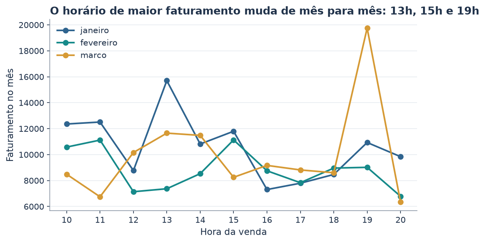
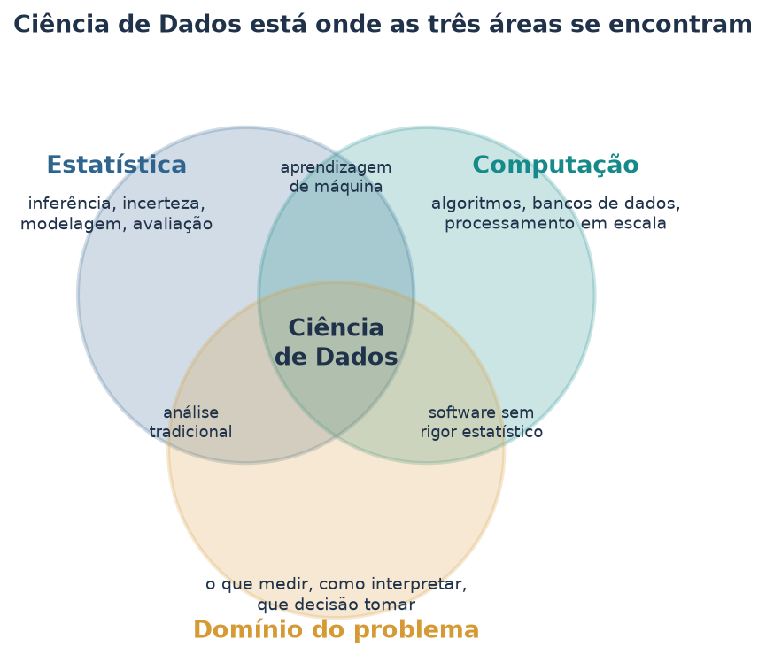
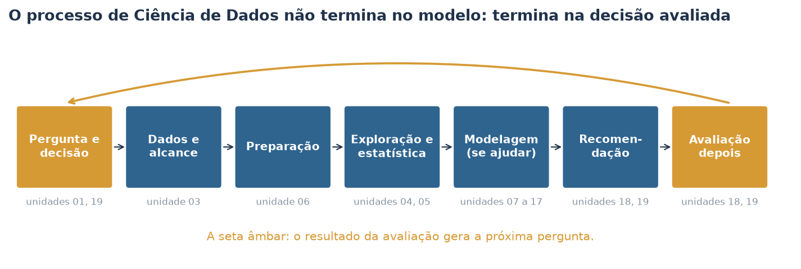

# 01 · O que é Ciência de Dados (e o que é Big Data)

**Pergunta inicial:** "quantos pães vendemos ontem?" e "devemos abrir mais um caixa às 19h?" usam os mesmos dados. Por que só a segunda é uma pergunta de Ciência de Dados?

Esta unidade dá o mapa do curso antes de entrarmos no código. Ela responde quatro perguntas: o que diferencia Ciência de Dados de uma consulta a um banco de dados; que áreas ela combina; o que é um produto de dados; e o que muda quando os dados ficam grandes, variados, rápidos e pouco confiáveis (Big Data). Os scripts são curtos e servem para *ver* cada ideia acontecendo; a sintaxe deles será explicada nas unidades seguintes.

Pré-requisitos: [00 · Como começar](../00_como_comecar/). Se ainda não sabe Python, leia os scripts como receitas e execute; volte a eles depois da unidade 03.

## 1. Consulta ou pergunta?

Ferramentas tradicionais (planilhas, bancos de dados) respondem **consultas**: a resposta já está nos dados e só precisa ser contada ou filtrada. "Quantas unidades de cosméticos foram vendidas em 5 de janeiro?" tem uma resposta exata.

Ciência de Dados trata de **perguntas** cuja resposta não está escrita em lugar nenhum: é preciso comparar, medir a variação, lidar com incerteza e, no fim, decidir algo e verificar se a decisão funcionou. "Em que horário devemos reforçar os caixas?" é desse tipo.

O script [01_consulta_ou_pergunta.py](01_consulta_ou_pergunta.py) faz as duas coisas com as mesmas mil vendas de um supermercado. A consulta devolve um número. A pergunta revela uma surpresa:

O horário de maior faturamento foi 13h em janeiro, 15h em fevereiro e 19h em março. Quem olhasse só março diria "reforce às 19h". Quem olha os três meses percebe que três meses de dados ainda não sustentam essa decisão. **Perceber o que os dados ainda não permitem dizer já é um resultado.**

## 2. Três áreas e um processo

Ciência de Dados não é uma técnica: é a combinação de três tipos de conhecimento.

- **Estatística** traz a inferência, a modelagem e, principalmente, a medida da incerteza.
- **Computação** traz algoritmos, armazenamento e processamento em escala.
- **Domínio do problema** diz o que medir, como interpretar e que decisão está em jogo.

Ciência de Dados também **não** é: só fazer muitos cálculos; só aplicar estatística clássica; só rodar algoritmos de aprendizagem de máquina; só lidar com volumes enormes (isso é Big Data, que *processa*; Ciência de Dados *descobre*).

O trabalho segue um processo que volta ao começo. Cada caixa corresponde a unidades deste repositório:

## 3. Quem faz isso: o cientista de dados

As definições conhecidas apontam na mesma direção: alguém melhor em estatística que a maioria dos programadores e melhor em programação que a maioria dos estatísticos, capaz de explicar as implicações práticas de um resultado. Na prática, o perfil é "em T": base ampla em estatística, programação, visualização e comunicação, e profundidade em uma ou duas delas. Por isso projetos reais são feitos em equipe, e a composição da equipe deve seguir o problema. Mesmo a melhor equipe gera pouco valor sem os dados certos.

## 4. Produto de dados

Um **produto de dados** é algo que aprende com dados e entrega valor de forma repetida: recomendação de filmes, filtro de spam, previsão de demanda. Ele melhora em um ciclo de retroalimentação: o uso gera novos dados, que atualizam o produto.

O script [03_produto_de_dados.py](03_produto_de_dados.py) constrói um produto mínimo: uma função que aprende, com as vendas de janeiro e fevereiro, quantos cupons a loja recebe em cada dia da semana e hora, e sugere quantos caixas abrir. Antes de usar, ele é **avaliado** em março, que não foi visto no treino.

O erro médio é de cerca de 0,6 cupom por hora quando a média observada é 1,6: um erro de mais de um terço. Com três meses e pouco mais de um cupom por hora, esse produto ainda não deveria ser colocado em uso. A lição vale para o curso inteiro: **todo modelo é avaliado em dados que não viu antes de orientar uma decisão.**

## 5. Big Data: os cinco Vs

Os avanços em aquisição, armazenamento, transmissão e processamento fizeram os dados crescerem mais rápido que a capacidade dos sistemas tradicionais. Big Data descreve esse cenário por características:

| V | O que significa | Script |
|---|---|---|
| **Volume** | Dados grandes demais para a memória de um computador comum | [04_volume.py](04_volume.py), [05_mapreduce.py](05_mapreduce.py) |
| **Variedade** | Fontes e formatos diferentes: tabelas, documentos aninhados, texto, imagem | [06_variedade.py](06_variedade.py) |
| **Velocidade** | Dados que chegam em fluxo contínuo e precisam ser resumidos na hora | [07_velocidade_e_veracidade.py](07_velocidade_e_veracidade.py) |
| **Veracidade** | Nem todo dado é confiável; o desafio cresce com o número de fontes | [07_velocidade_e_veracidade.py](07_velocidade_e_veracidade.py) |
| **Valor** | O valor cresce com o volume, mas mais devagar que a quantidade de dado irrelevante | (discussão) |

### Volume

[04_volume.py](04_volume.py) gera tabelas sintéticas de 10 mil a 3 milhões de linhas e mede a memória. Ela cresce na mesma proporção que as linhas: 3 milhões de vendas ocupam cerca de 230 MB. Escolher bem os tipos de dados ajuda muito: guardar o nome do produto como `category` em vez de texto reduz a tabela de 78 MB para 7 MB.

### MapReduce

Quando a tabela não cabe na memória, a saída é dividir o trabalho. [05_mapreduce.py](05_mapreduce.py) grava um arquivo de 2 milhões de linhas e o lê em blocos. Cada bloco é resumido sozinho (**map**); depois os resumos são combinados (**reduce**). O resultado é idêntico ao cálculo direto.

Nem toda conta se divide assim. Soma e contagem se combinam; a média precisa carregar soma **e** contagem de cada bloco; a mediana não se obtém de medianas parciais. É exatamente essa ideia que ferramentas como Hadoop (armazenamento distribuído HDFS e processamento MapReduce), HBase (banco orientado a colunas), MongoDB (banco de documentos) e Spark/PySpark (processamento em memória e em fluxo) levam para dezenas ou milhares de máquinas.

### Variedade

[06_variedade.py](06_variedade.py) descreve o mesmo cliente de três formas: uma tabela (estruturado), um documento JSON com campos aninhados e opcionais (semiestruturado) e comentários em texto livre (não estruturado). Para analisar, quase sempre transformamos tudo em tabela: `json_normalize` "achata" o documento e uma contagem de palavras transforma texto em colunas. Essa contagem é a matéria-prima do classificador de textos da [unidade 10](../10_naive_bayes/).

### Velocidade e veracidade

[07_velocidade_e_veracidade.py](07_velocidade_e_veracidade.py) simula 600 leituras de um sensor com 8 erros grosseiros (valor 999). Uma média "online" é atualizada a cada leitura sem guardar as anteriores (memória constante, como exige um fluxo). Mas os 8 erros bastam para arrastar o resumo; uma regra simples de validação (descartar o fisicamente impossível) recupera o resultado.

## Atividade curta

Em `05_mapreduce.py`, acrescente o cálculo da **variância** por MapReduce. Dica: cada bloco precisa devolver contagem, soma e soma dos quadrados.

## Problema de interpretação

Uma empresa diz: "temos 10 terabytes de dados de clientes, então qualquer modelo que treinarmos será confiável". Explique em três frases por que volume não garante veracidade nem valor, usando os scripts 03 e 07 como exemplos.

## Para lembrar

- Consulta tem resposta exata; pergunta de Ciência de Dados tem incerteza e termina em decisão.
- Ciência de Dados = estatística + computação + domínio do problema.
- Produto de dados aprende com dados e precisa ser avaliado em dados novos antes de ser usado.
- Big Data: volume, variedade, velocidade, veracidade, valor. MapReduce divide o trabalho em resumos parciais combináveis.

## Relação com o livro

Capítulo 1 (Conceitos de Ciência de Dados: 1.1 o que é, 1.2 o cientista de dados, 1.3 aplicações) e capítulo 2 (Big Data: 2.1 explosão de dados, 2.2 o que é Big Data, 2.3 mais Vs, 2.4 perspectivas).

## Próxima etapa

[02 · Python do zero](../02_python/)
