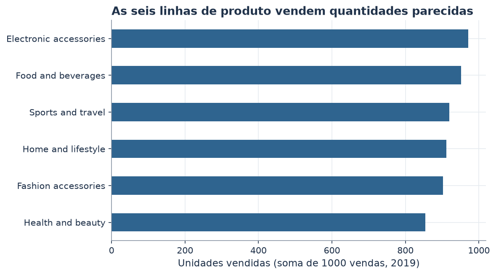

# 02 · Primeiros dados

**Pergunta inicial:** um supermercado com três filiais registrou mil vendas em três meses. Qual linha de produto vende mais unidades? Qual cidade fatura mais? E em que dia da semana?

Na unidade 01 você respondeu perguntas assim com laços e dicionários. Aqui a mesma lógica aparece com o `pandas`, a biblioteca que representa tabelas em Python. O ganho não é só escrever menos: é poder olhar a tabela inteira, perceber tipos errados e lacunas antes de tirar conclusões.

Pré-requisitos: [01 · Python do zero](../01_python/) (listas, dicionários, `for`).

Conceitos: `DataFrame` e `Series`; linhas, colunas e tipos; seleção, filtro e ordenação; `groupby`; valores ausentes (`NaN`); conversão de datas.

## Os dados

`dados/supermercado.csv` tem 1000 vendas de janeiro a março de 2019 em três cidades de Mianmar (Yangon, Mandalay, Naypyitaw). Cada linha é um cupom: filial, cidade, tipo de cliente, gênero, linha de produto, preço unitário, quantidade, imposto, total, data, hora, forma de pagamento e avaliação do cliente. É a mesma base do estudo de caso [03 · Vendas em supermercado](../10_estudos_de_caso/03_vendas_supermercado/), copiada aqui com nome simplificado para os primeiros exercícios.

`dados/Data.csv` tem 10 clientes com idade e renda, com duas lacunas. Serve para ver o que o `pandas` faz com valores ausentes.

## Scripts, na ordem

| Script | O que mostra |
|---|---|
| [01_ler_uma_tabela.py](01_ler_uma_tabela.py) | `read_csv`, `shape`, `head`, `dtypes`, `describe`, `value_counts` |
| [02_selecionar_filtrar_ordenar.py](02_selecionar_filtrar_ordenar.py) | Colunas, condições com `&` e `|`, `sort_values`, `loc` e `iloc`, coluna derivada |
| [03_agrupar_manual_e_pandas.py](03_agrupar_manual_e_pandas.py) | O mesmo agrupamento com laço e com `groupby`; primeiro gráfico de barras |
| [04_tipos_datas_e_ausencias.py](04_tipos_datas_e_ausencias.py) | `isna`, `dropna`, `fillna`; `to_datetime` e agrupamento por mês e dia da semana |

*Gerada por `03_agrupar_manual_e_pandas.py`. As seis linhas ficam entre 850 e 970 unidades: a diferença entre a maior e a menor é pequena perto do total de 5.510.*

## O que observar

Em `02`, a conferência `Total = Unit price × Quantity × 1,05` mostra que uma coluna pode ser função de outras. Isso parece detalhe, mas volta na unidade 05 (vazamento de dados) e no estudo de caso de vendas: um modelo que "prevê" o total a partir do preço e da quantidade não aprendeu nada sobre o mercado.

Em `04`, a média de idade foi calculada com 9 valores, não 10. O `pandas` ignora ausentes em silêncio. Saber quantos valores entraram em cada conta é parte da resposta.

## Atividade curta

Descubra a hora do dia com mais vendas (coluna `Time`). A resposta muda se você olhar o total faturado em vez do número de vendas?

## Problema de interpretação

Yangon tem mais vendas registradas que as outras cidades. Isso significa que a filial de Yangon é melhor? Pense no que a base não informa: tamanho da loja, dias de funcionamento, população atendida. Escreva uma frase que diga só o que os dados sustentam.

## Relação com as aulas e o livro

Aula 4 (Python) e início da aula 5 (preparação dos dados). Capítulo 3 do livro (3.2 Estatística Descritiva) para as medidas que aparecem em `describe`.

## Próxima etapa

[03 · Estatística](../03_estatistica/)
