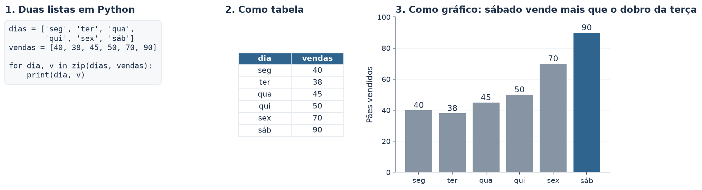

# 02 · Python do zero

**Pergunta inicial:** uma loja registrou as vendas de três produtos durante seis dias. Qual produto vendeu mais? E o sábado forte justifica comprar mais estoque?

Responder isso exige guardar valores, percorrer uma lista, somar por grupo e comparar. São exatamente as peças de Python que esta unidade apresenta. Não há bibliotecas aqui: tudo é feito com o que a linguagem já traz, para que você perceba depois o que o `pandas` passa a fazer por você.

Pré-requisitos: [00 · Como começar](../00_como_comecar/).

Conceitos: operadores, comparações, variáveis e tipos; textos, listas e dicionários; `if`, `for`, `while`; funções com `def` e `return`; leitura e escrita de arquivos.

## Scripts, na ordem

| Script | O que mostra |
|---|---|
| [01_operadores_e_variaveis.py](01_operadores_e_variaveis.py) | Contas, comparações, atribuição, tipos; um cálculo de faturamento |
| [02_textos_e_colecoes.py](02_textos_e_colecoes.py) | `str`, `list`, `dict`; contagem de vendas com `count` |
| [03_condicoes_e_repeticoes.py](03_condicoes_e_repeticoes.py) | `if/elif/else`, `for`, `while`; dias acima da meta |
| [04_funcoes_simples.py](04_funcoes_simples.py) | `def`, parâmetros, `return`; média e amplitude de duas lojas |
| [05_arquivos.py](05_arquivos.py) | `open`, `write`, `read`, `readlines`, `with` |
| [06_primeira_pergunta_com_dados.py](06_primeira_pergunta_com_dados.py) | Soma por grupo, filtro e média sem nenhuma biblioteca |

Os cinco primeiros cobrem a linguagem; o sexto junta tudo para responder à pergunta inicial. Todos usam `print()` nos pontos em que o resultado precisa aparecer quando o arquivo é executado inteiro, e não só no console.

## Como estudar

No Spyder ou no VS Code, selecione poucas linhas e execute só aquele trecho. Troque um número, execute de novo. Se a saída surpreender, essa é a parte que vale a pena entender.

A figura abaixo foi gerada por código a partir de uma lista como as deste script: cada passo transforma a lista em uma tabela e depois em um gráfico. É o caminho que as próximas unidades vão percorrer.

*Figura gerada por [figuras/fontes/lista_para_grafico.py](../figuras/fontes/lista_para_grafico.py). Dados inventados para o exemplo.*

## Atividade curta

Abra `06_primeira_pergunta_com_dados.py` e acrescente um quarto produto nos registros. Sem mudar mais nada, execute. O código continuou respondendo à pergunta? Por quê?

## Problema de interpretação

O sábado teve o maior total de vendas. Liste três informações que faltam para decidir se vale a pena aumentar o estoque do sábado seguinte (pense em promoções, feriados e produtos que podem sobrar). Guarde a resposta: ela volta nos estudos de caso de vendas.

Exercícios de revisão em [exercicios.md](exercicios.md).

## Próxima etapa

[03 · Primeiros dados](../03_primeiros_dados/)
