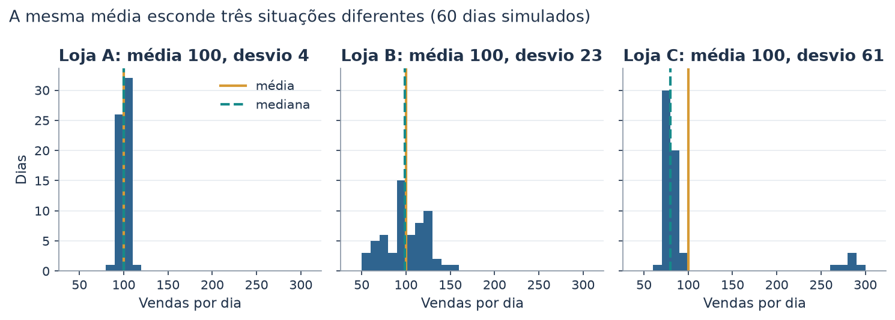
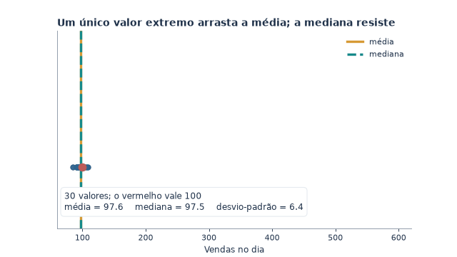

# 03 · Estatística

**Pergunta inicial:** duas lojas vendem, em média, 100 unidades por dia. Uma delas precisa de um estoque de segurança bem maior que a outra. Como isso é possível, se a média é a mesma?

A média resume, mas também esconde. Esta unidade apresenta as medidas que completam a história (mediana, quantis, desvio, intervalo interquartil), a ideia de distribuição e amostra, a correlação e os testes de hipótese. O fio condutor é distinguir três coisas que costumam ser confundidas: o tamanho de uma diferença, a evidência de que ela não é acaso (valor-p) e a sua relevância prática.

Pré-requisitos: [02 · Primeiros dados](../02_primeiros_dados/).

Conceitos: média, mediana, quantis, variância, desvio-padrão, coeficiente de variação, IQR; distribuição normal e uniforme; amostragem e semente; QQ-plot e teste de Shapiro-Wilk; correlação de Pearson e Spearman; teste t, Mann-Whitney, intervalo de confiança, d de Cohen.

## Scripts, na ordem

| Script | O que mostra | Dados |
|---|---|---|
| [01_medidas.py](01_medidas.py) | Medidas calculadas na mão, com `statistics` e com `pandas`; quartis e IQR | supermercado (reais) |
| [02_mesma_media_historias_diferentes.py](02_mesma_media_historias_diferentes.py) | Três lojas com média 100 e dispersões distintas; histogramas e boxplot | simulados (semente 42) |
| [03_distribuicoes_e_amostragem.py](03_distribuicoes_e_amostragem.py) | Densidade normal, amostra crescendo, Shapiro-Wilk, QQ-plot | simulados (semente 0) |
| [04_correlacao.py](04_correlacao.py) | Matriz de correlação, Pearson e Spearman, correlação sem causa | supermercado + simulado |
| [05_teste_de_hipoteses.py](05_teste_de_hipoteses.py) | Teste t, Welch, Mann-Whitney, IC 95%, tamanho do efeito | listas originais + supermercado |

Os scripts reaproveitam os trechos de `estatistica.py` (2019), que misturava gráficos e medidas em um só arquivo. A parte de gráficos (barras, pizza, histograma, linha, dispersão) foi para a [unidade 04](../04_visualizacao/).

## Figuras

*`02_mesma_media_historias_diferentes.py`. A média (âmbar) é 100 nas três lojas; a mediana (verde-petróleo tracejado) só se afasta na loja C, onde poucos dias excepcionais puxam a média. Dados simulados.*

*Animação gerada por [animacoes/fontes/media_e_mediana.py](../animacoes/fontes/media_e_mediana.py). Um valor extremo entra na amostra e cresce; acompanhe quem se move.*

## O que observar

Em `05`, membros e não membros do supermercado têm médias de gasto que diferem em poucas unidades, com p em torno de 0,6. A conclusão correta não é "membros gastam igual", e sim "esta amostra não dá evidência de diferença". Note também a diferença entre os dois tipos de pergunta: o teste responde se a diferença pode ser acaso; o d de Cohen responde se ela é grande.

Em `03`, o teste de Shapiro-Wilk com amostras pequenas raramente rejeita a normalidade. A ausência de evidência contra uma hipótese não é evidência a favor dela.

## Atividade curta

Calcule média, mediana e desvio-padrão do `Rating` por linha de produto. Alguma linha se destaca? Antes de responder "sim", olhe o tamanho da diferença e o número de vendas por linha.

## Problema de interpretação

Um relatório diz: "a diferença entre as lojas foi estatisticamente significativa (p = 0,03)". Liste o que você ainda precisa saber para decidir se vale a pena agir sobre essa diferença. Pense em tamanho do efeito, tamanho das amostras, custo da ação e no que mais poderia explicar a diferença.

## Relação com as aulas e o livro

Aula 5 (Estatística: análise de uma, duas e várias variáveis; inferência). Capítulo 3 do livro (3.2 Estatística Descritiva, 3.3 Probabilidade, 3.4 Inferência).

## Próxima etapa

[04 · Visualização](../04_visualizacao/)
