# 04 · Estatística

**Pergunta inicial:** duas lojas vendem, em média, 100 unidades por dia. Uma delas precisa de um estoque de segurança bem maior que a outra. Como isso é possível, se a média é a mesma?

Estatística é a ciência de coletar, organizar, analisar, apresentar e interpretar dados. Em Ciência de Dados ela tem um papel que nenhum algoritmo substitui: **dizer quanta confiança uma conclusão merece**. Esta unidade vai de uma variável sozinha até várias ao mesmo tempo, sempre com a mesma sequência: problema → resumo dos dados → gráfico → interpretação → (quando couber) teste.

Pré-requisitos: [03 · Primeiros dados](../03_primeiros_dados/).

## Roteiro

| Parte | Scripts | Pergunta |
|---|---|---|
| A. Uma variável | 01 a 04 | Que tipo de variável é? Onde está o centro, quanto espalha, que forma tem? |
| B. Da amostra para a população | 05, 07 | Quanto a média de uma amostra pode errar? Uma diferença é acaso? |
| C. Duas variáveis | 06, 08, 09 | Duas variáveis andam juntas? Dois avaliadores concordam? Duas medições diferem? |
| D. Várias variáveis | 10, 11 | Como ler três ou mais variáveis? Quando a tabela agregada engana? |
| E. Tempo até um evento | 12 | Como estimar duração quando parte dos casos ainda não terminou? |

Todos os scripts estão nesta pasta e gravam as figuras em `figuras/`. Dados reais: vendas do supermercado, alunos portugueses, bicicletas de Washington e um estudo médico publicado. Dados simulados aparecem quando é preciso conhecer a "verdade" para ver o que um método faz, e estão sempre marcados.

---

## Parte A · Uma variável

### 01 · Tipos de variáveis ([01_tipos_de_variaveis.py](01_tipos_de_variaveis.py))

A natureza da variável decide tudo o que vem depois:

| Tipo | Exemplo (alunos) | Como resumir | Como mostrar |
|---|---|---|---|
| Qualitativa nominal | escola (GP, MS) | frequências, proporções, moda | barras |
| Qualitativa ordinal | horas de estudo (<2h, 2–5h, ...) | frequências na ordem, mediana | barras na ordem natural |
| Quantitativa discreta | número de faltas | média, mediana, quantis | barras por valor, histograma |
| Quantitativa contínua | nota (0 a 20) | média, mediana, quantis, desvio | histograma, boxplot |

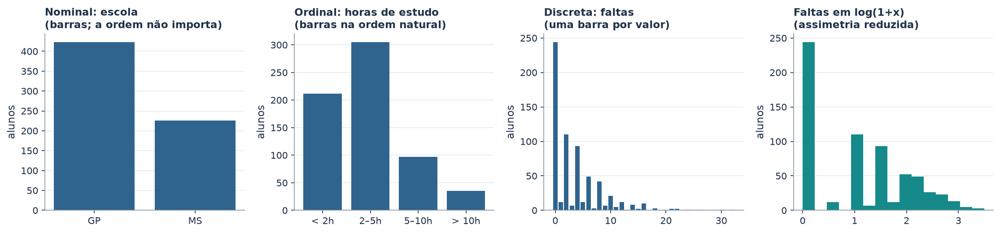

As faltas são muito assimétricas (assimetria 2,0): muitos alunos com 0 ou 2, poucos com 20 ou 30. Em escala `log(1 + x)` a assimetria cai para 0,2. **Transformar não é maquiar os dados**: é escolher uma escala em que o fenômeno fica legível e em que métodos que supõem simetria funcionam melhor.

### 02 · Medidas de centro e de dispersão ([02_medidas.py](02_medidas.py))

O script calcula cada medida três vezes (à mão, com `statistics` e com `pandas`) para mostrar que não há mágica. Para o valor das 1 000 vendas do supermercado:

| Medida | Valor | O que diz |
|---|---|---|
| Média | 323,0 | soma ÷ quantidade |
| Mediana | 253,8 | metade das vendas está abaixo |
| Quartis (Q1, Q3) | 124,4 e 471,4 | metade central das vendas |
| Intervalo interquartil (IQR) | 346,9 | largura da metade central; resiste a extremos |
| Desvio-padrão | 245,9 | distância típica até a média |
| Coeficiente de variação | 0,76 | desvio ÷ média; compara dispersões em escalas diferentes |

A média bem acima da mediana avisa que há vendas grandes puxando a média para cima: a distribuição é **assimétrica à direita**. Nesse caso, a mediana descreve melhor a venda "típica".

### 03 · A mesma média, três histórias ([03_mesma_media_historias_diferentes.py](03_mesma_media_historias_diferentes.py))

Três lojas simuladas, todas com média exatamente 100: uma estável (desvio 4), uma variável (desvio 23) e uma que quase sempre vende 80 mas tem alguns dias de 280 (desvio 61).

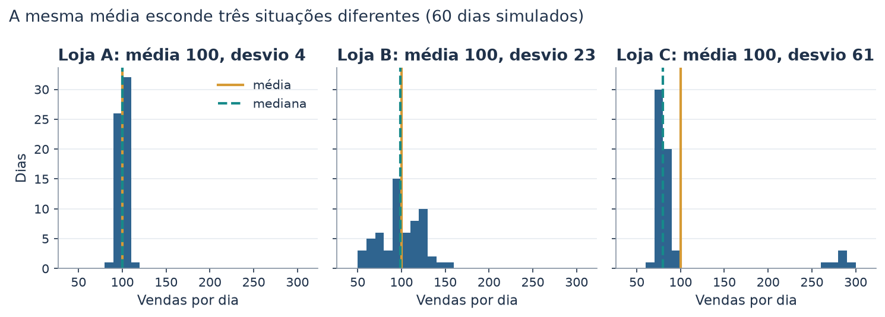

A loja C é a mais perigosa para o estoque, e a média não mostra isso. A mediana (80) e o desvio mostram. O boxplot resume as três de uma vez:

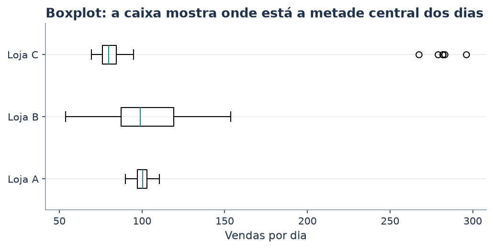

A caixa vai de Q1 a Q3, a linha interna é a mediana, as hastes vão até 1,5 IQR e os pontos isolados são valores atípicos.

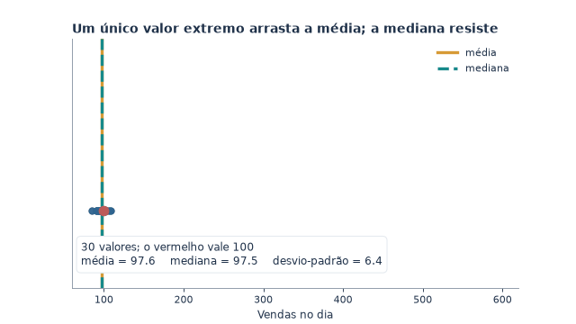

*Animação gerada por [animacoes/fontes/media_e_mediana.py](../animacoes/fontes/media_e_mediana.py).*

### 04 · Distribuições e amostragem ([04_distribuicoes_e_amostragem.py](04_distribuicoes_e_amostragem.py))

Uma distribuição de probabilidade descreve que valores são possíveis e com que frequência. A normal é definida por média μ (onde fica o centro) e desvio σ (quão larga é):

$$f(x) = \frac{1}{\sigma\sqrt{2\pi}}\, e^{-\frac{(x-\mu)^2}{2\sigma^2}}$$

O script escreve essa fórmula em Python e a desenha para vários μ e σ. Depois sorteia amostras de tamanhos 20, 200 e 5 000: só a maior revela a forma de sino.

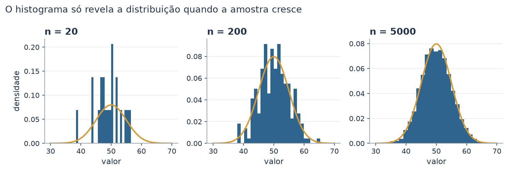

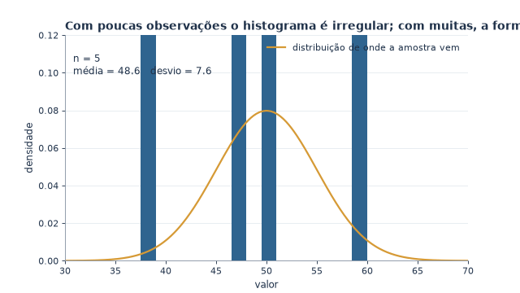

Para verificar se dados reais "parecem normais", há duas ferramentas: o **gráfico QQ** (quantis da amostra contra quantis teóricos; pontos sobre a reta indicam aderência) e o **teste de Shapiro-Wilk** (p pequeno é evidência contra a normalidade; p grande *não prova* normalidade, só indica falta de evidência contra).

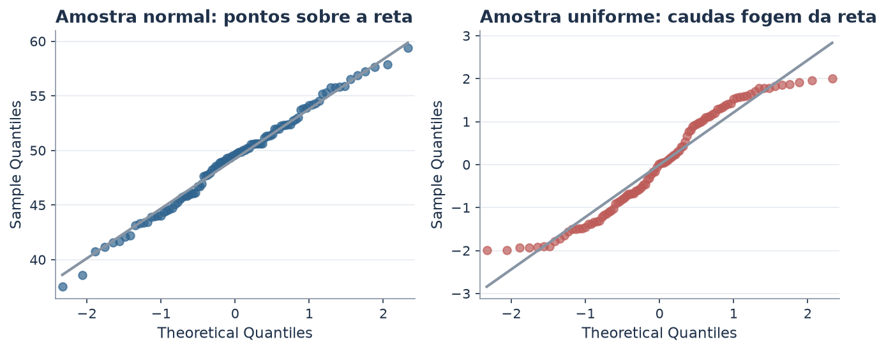

---

## Parte B · Da amostra para a população

### 05 · Desvio-padrão, erro-padrão e intervalo de confiança ([05_erro_padrao_e_intervalo.py](05_erro_padrao_e_intervalo.py))

Três medidas que se confundem com frequência. O script trata as 1 000 vendas como se fossem a população inteira (média verdadeira 323,0) e sorteia milhares de amostras:

- **Desvio-padrão** descreve os **dados**: as vendas variam cerca de 246 em torno da média, não importa o tamanho da amostra.
- **Erro-padrão** descreve a **estimativa**: a média de 10 vendas erra tipicamente 77; de 40, 39; de 160, 19. Ele encolhe com √n, exatamente como a teoria prevê (σ/√n).
- **Intervalo de confiança de 95%** é uma faixa calculada com uma amostra. Se o procedimento for repetido muitas vezes, cerca de 95% das faixas contêm o valor verdadeiro. Nos 50 intervalos sorteados, 46 (92%) acertaram, perto dos 95% esperados.

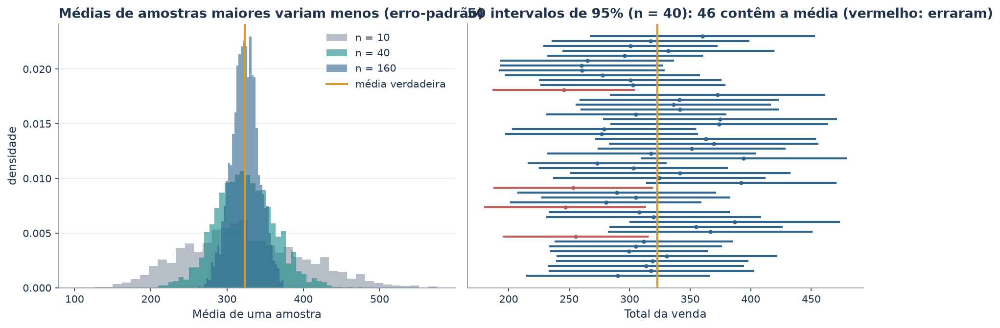

### 07 · Teste de hipóteses e tamanho do efeito ([07_teste_de_hipoteses.py](07_teste_de_hipoteses.py))

Um teste de hipóteses pergunta: *se não houvesse diferença nenhuma na população, quão surpreendente seria a diferença observada na amostra?* Essa surpresa é o **valor-p**. p pequeno (convencionalmente < 0,05) indica que o acaso explica mal o que vimos.

Mas o valor-p não diz se a diferença é **grande**. Para isso existe o **tamanho do efeito**, como o d de Cohen (diferença de médias em unidades de desvio-padrão). O script mostra dois casos:

| Comparação | Diferença | p | d de Cohen | Leitura |
|---|---|---|---|---|
| Acurácia de dois métodos (6 execuções cada) | 0,76 × 0,65 | 0,02 | 1,59 | diferença grande e pouco provável por acaso |
| Gasto de membros × não membros do supermercado (501 × 499) | 327,8 × 318,1 | 0,53 (Welch) | 0,04 | nada indica diferença; e mesmo que houvesse, seria minúscula |

Para os totais do supermercado, que são assimétricos, o script também usa o teste de **Mann-Whitney**, que não depende de normalidade (p = 0,59). Os intervalos de confiança das duas médias (306 a 350 e 297 a 340) se sobrepõem quase inteiros, coerente com o teste.

**Três coisas diferentes:** o valor-p mede compatibilidade com o acaso; o tamanho do efeito mede a magnitude; a relevância prática depende do custo e do benefício de agir. Uma diferença pode ser "significativa" e irrelevante (amostras enormes detectam efeitos minúsculos), ou grande e não significativa (amostras pequenas).

---

## Parte C · Duas variáveis

A leitura segue a combinação de tipos:

| Combinação | Base | Gráfico | Medida |
|---|---|---|---|
| quantitativa × quantitativa | pares de valores | dispersão | correlação |
| qualitativa × qualitativa | tabela de contingência | barras empilhadas 100% | qui-quadrado; κ de Cohen para concordância |
| mesma medida duas vezes | pares emparelhados | médias × diferenças | diferença média e limites |
| qualitativa × quantitativa | resumo por grupo | boxplots por grupo | teste t, Mann-Whitney, ANOVA |

### 06 · Correlação ([06_correlacao.py](06_correlacao.py))

O coeficiente de Pearson r vai de −1 a 1 e mede **associação linear**. No supermercado, quantidade e total têm r = 0,71 (esperado: o total é calculado a partir da quantidade); preço unitário e quantidade, r = 0,01 (quem compra itens caros não leva menos unidades).

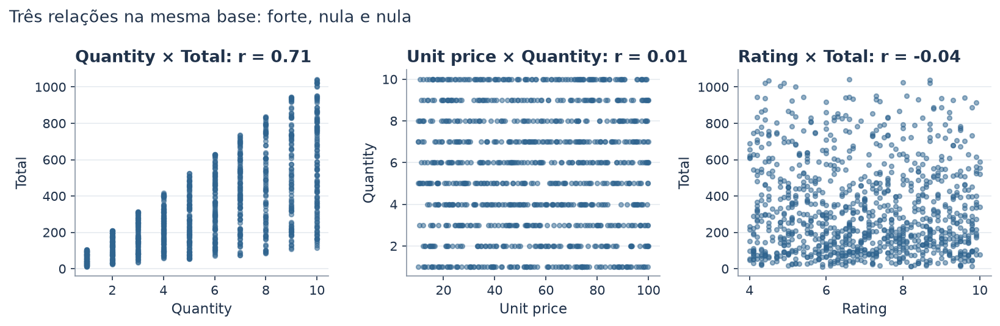

Spearman usa a ordem dos valores (postos) e resiste melhor a extremos e a relações curvas. E sempre: **correlação não é causa**. Duas variáveis podem andar juntas porque uma terceira move as duas:

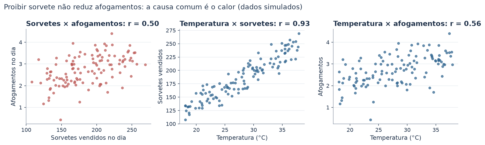

### 08 · Duas qualitativas: contingência e concordância ([08_duas_qualitativas.py](08_duas_qualitativas.py))

A **tabela de contingência** cruza as categorias. Entre os 649 alunos, a reprovação é de 8% na escola GP e 30% na MS. O **teste qui-quadrado** compara essas contagens com as esperadas se escola e situação final fossem independentes: χ² = 55,6, p ≈ 10⁻¹³. A associação é clara, mas não diz *por quê* (as escolas recebem alunos de perfis diferentes).

**Concordância** é outra pergunta: dois avaliadores classificam os mesmos casos; eles concordam além do que o acaso produziria? O **κ de Cohen** responde:

$$\kappa = \frac{p_{\text{observada}} - p_{\text{acaso}}}{1 - p_{\text{acaso}}}$$

Tratando a nota do 1º e do 2º período como dois "avaliadores" (baixo, médio, alto), a concordância observada é 78%, a esperada por acaso 39%, e κ = 0,63 (κ = 1 é perfeita; perto de 0, igual ao acaso).

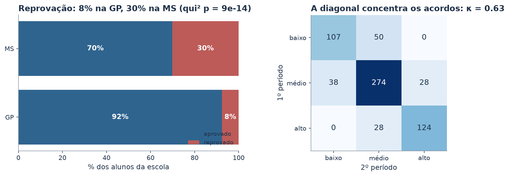

### 09 · Duas medições do mesmo indivíduo: médias e diferenças ([09_medias_e_diferencas.py](09_medias_e_diferencas.py))

Quando cada aluno tem duas notas, a pergunta "o 2º período é diferente do 1º?" se responde com as **diferenças** de cada aluno, não comparando as duas médias como se fossem grupos independentes. O gráfico de médias e diferenças (Tukey, também chamado Bland–Altman) coloca a média do par no eixo x e a diferença no eixo y.

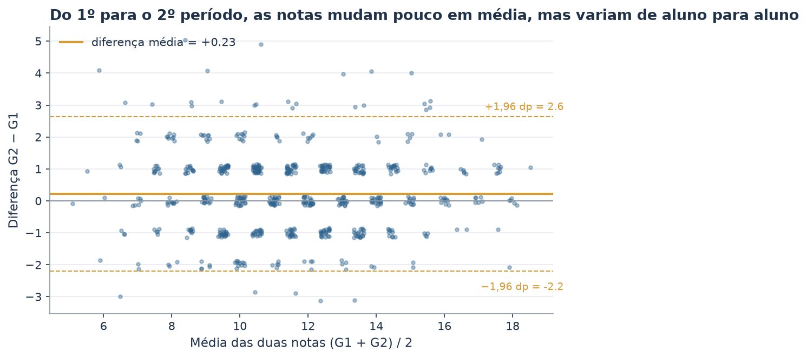

A diferença média é +0,23 ponto, e o teste t pareado indica que ela não é acaso (p < 0,001). Mas os limites de 95% vão de −2,2 a +2,6: um aluno individual pode subir ou cair mais de dois pontos. **Para decidir sobre um indivíduo, o que importa são os limites, não a média.** A diferença não depende do nível do aluno (r ≈ 0).

---

## Parte D · Várias variáveis

### 10 · Matriz de dispersão, perfis médios e ANOVA ([10_varias_variaveis.py](10_varias_variaveis.py))

Com quatro variáveis das bicicletas (temperatura, umidade, vento, aluguéis), a **matriz de dispersão** mostra todas as relações de uma vez: histogramas na diagonal, dispersões abaixo, correlações acima. A temperatura é a mais associada aos aluguéis (r = 0,63).

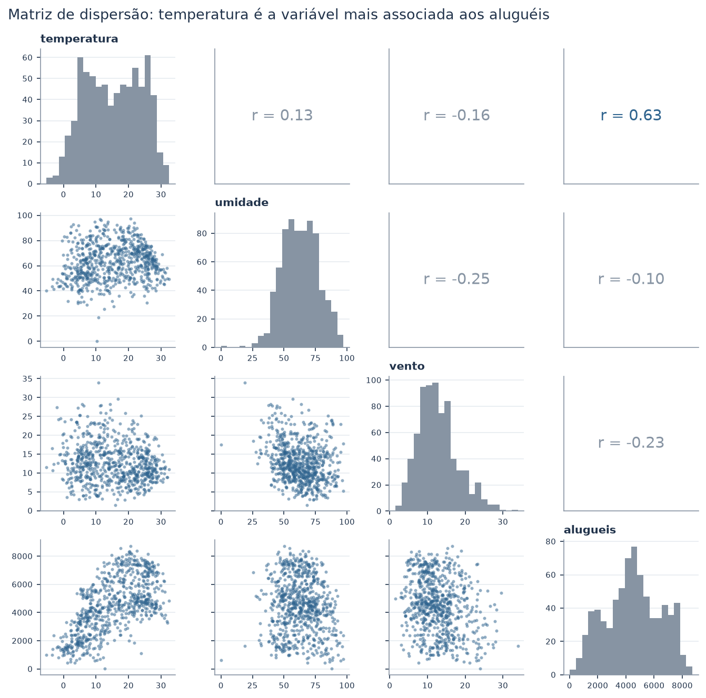

Uma terceira variável pode entrar na cor ou no tamanho do ponto (**dispersão simbólica**): dias úmidos ficam abaixo da nuvem.

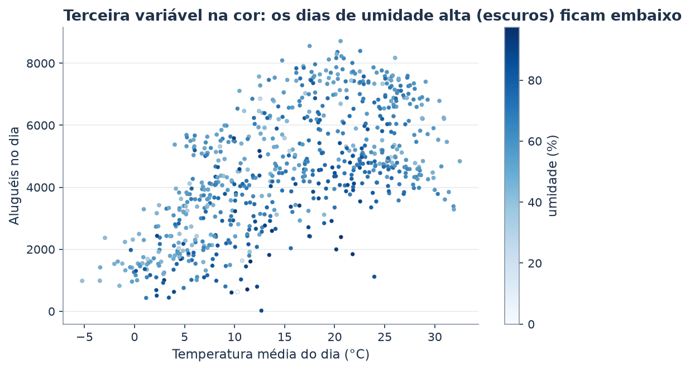

Quando duas variáveis **qualitativas** explicam uma quantitativa, o **gráfico de perfis médios** mostra uma linha por nível de um fator. Linhas paralelas sugerem **ausência de interação** (o efeito de um fator é o mesmo em todos os níveis do outro); linhas que se cruzam sugerem interação.

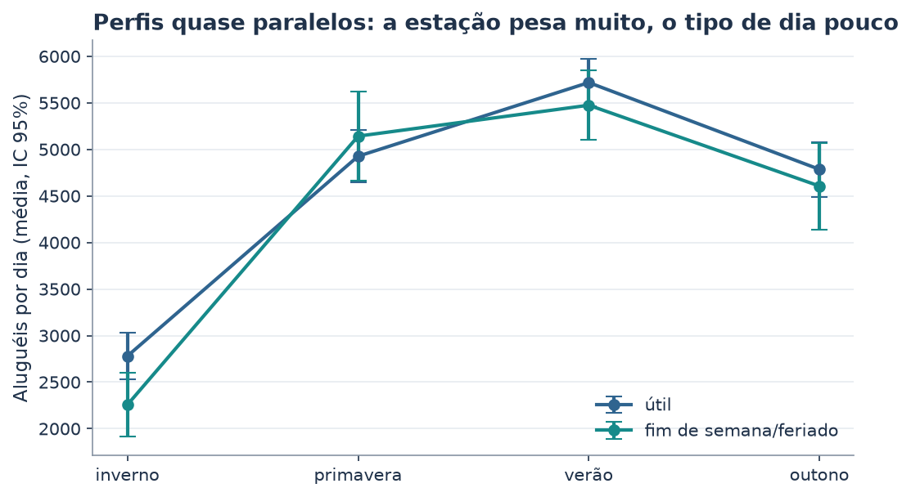

A **ANOVA de dois fatores** formaliza a leitura: estação com p < 0,001; tipo de dia p = 0,14; interação p = 0,21. As **comparações de Tukey** dizem *quais* estações diferem, controlando o erro de fazer muitas comparações: todas diferem do inverno; verão difere de primavera e outono; primavera e outono não diferem entre si (p = 0,38).

### 11 · Paradoxo de Simpson e Mantel–Haenszel ([11_simpson_e_mantel_haenszel.py](11_simpson_e_mantel_haenszel.py))

Um estudo médico real (Charig et al., *BMJ*, 1986) comparou dois tratamentos para cálculo renal:

| | Tratamento A | Tratamento B |
|---|---|---|
| Cálculos pequenos | 81/87 = **93%** | 234/270 = 87% |
| Cálculos grandes | 192/263 = **73%** | 55/80 = 69% |
| Total | 273/350 = 78% | 289/350 = **83%** |

A vence nos dois estratos e perde no total. O motivo: A foi usado sobretudo nos casos difíceis (cálculos grandes). O tamanho do cálculo influencia a escolha do tratamento **e** o resultado.

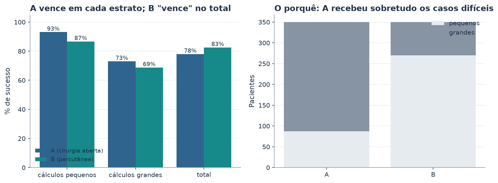

O método de **Mantel–Haenszel** combina as tabelas de cada estrato em uma razão de chances ajustada:

$$\widehat{OR}_{MH} = \frac{\sum_h a_h d_h / n_h}{\sum_h b_h c_h / n_h}$$

A razão de chances ingênua (tabela somada) é 0,75, favorecendo B; a ajustada é 1,45, favorecendo A, com IC 95% de 0,92 a 2,29. O teste de homogeneidade (p = 0,33) indica que é razoável combinar os estratos. Como o intervalo inclui 1, a vantagem de A também não é conclusiva; o que é conclusivo é que a tabela agregada inverte a direção.

**Lição:** antes de comparar grupos, pergunte o que mais difere entre eles.

---

## Parte E · Tempo até um evento

### 12 · Análise de sobrevivência ([12_sobrevivencia.py](12_sobrevivencia.py))

Em muitos problemas o interesse é o **tempo até um evento**: falha de um equipamento, cancelamento de um cliente, evasão de um aluno. A dificuldade é a **censura**: no fim do estudo, parte dos casos ainda não teve o evento. Ignorá-los ou tratá-los como falha distorce o resultado.

O estimador de **Kaplan–Meier** resolve isso. Em cada tempo em que ocorre um evento:

$$S(t) = S(t_{\text{anterior}}) \times \left(1 - \frac{\text{eventos em } t}{\text{em risco em } t}\right)$$

e os censurados saem do grupo em risco sem derrubar a curva. O script faz a conta à mão para 8 equipamentos (dados ilustrativos) e confere com o `statsmodels`. Depois compara dois grupos simulados com o **teste log-rank**.

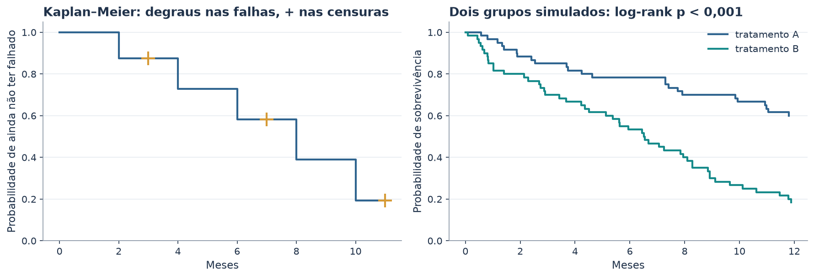

---

## Atividade curta

1. Em `02_medidas.py`, repita as medidas para `Rating`. Média e mediana ficam próximas? O que isso diz sobre a forma?
2. Em `08_duas_qualitativas.py`, troque `school` por `address` (urbano/rural). A associação com a reprovação é mais forte ou mais fraca?
3. Em `10_varias_variaveis.py`, troque o tipo de dia por `weathersit` (condição do tempo). Os perfis continuam paralelos?

## Problema de interpretação

Um relatório diz: "a diferença entre as lojas foi estatisticamente significativa (p = 0,03)". Liste o que você ainda precisa saber para decidir se vale a pena agir: tamanho do efeito, tamanho das amostras, intervalo de confiança, custo da ação e que outras variáveis diferem entre as lojas (lembre do paradoxo de Simpson).

## Relação com o livro

Capítulo 3 (Estatística): 3.1 Ciência do Estado (origem da área), 3.2 Estatística Descritiva (scripts 01 a 03, 06, 08 a 10), 3.3 Probabilidade (script 04), 3.4 Inferência (scripts 05, 07, 11, 12).

## Próxima etapa

[05 · Visualização](../05_visualizacao/)
