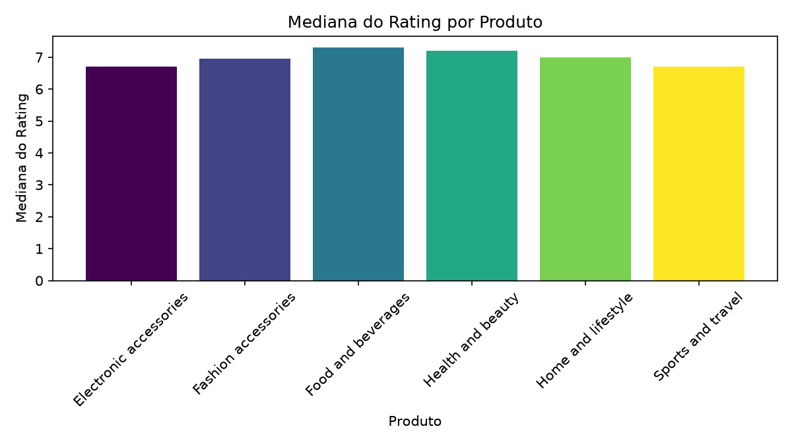
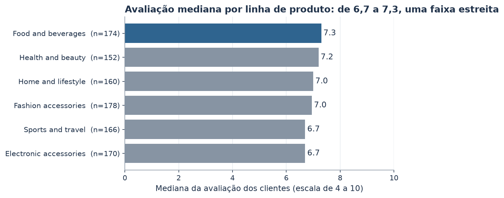
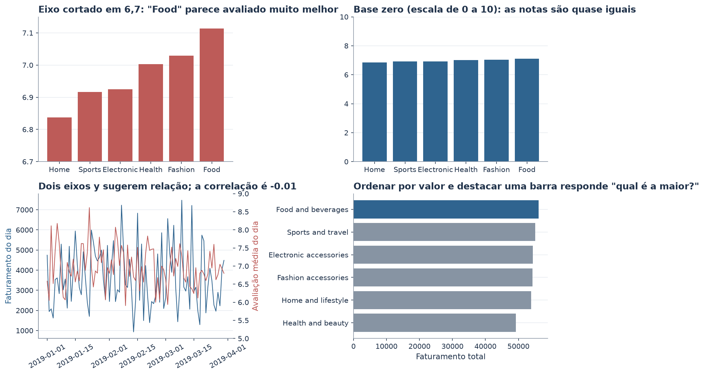

# 04 · Visualização

**Pergunta inicial:** seis linhas de produto têm avaliações medianas entre 6,7 e 7,3. Um gráfico pode fazer essa diferença parecer enorme ou irrelevante sem mudar um único número. Qual das duas versões é honesta?

Um gráfico é uma resposta a uma pergunta. Antes de escolher o tipo, vale perguntar: quero comparar categorias, acompanhar o tempo, ver a forma de uma distribuição ou a relação entre duas variáveis? Esta unidade apresenta os quatro gráficos que resolvem a maior parte das necessidades (barras, linhas, histograma/boxplot, dispersão) e as formas mais comuns de enganar o leitor com escalas, ordenação e eixos duplos.

Pré-requisitos: [03 · Estatística](../03_estatistica/).

Conceitos: tipo de gráfico por pergunta; base zero; ordenação; rótulo direto; realce seletivo com cor; agregação temporal; sobreposição de pontos; antes/depois de um gráfico real.

## Scripts, na ordem

| Script | Pergunta que o gráfico responde | Figuras |
|---|---|---|
| [01_barras_ou_pizza.py](01_barras_ou_pizza.py) | Qual categoria é maior? | `pizza_vs_barras.png`, `pagamentos.png` |
| [02_linhas_no_tempo.py](02_linhas_no_tempo.py) | Como algo mudou ao longo do tempo? | `linha_drugs.png`, `linha_mensal_vs_anual.png`, `linha_em_categorias.png` |
| [03_distribuicoes.py](03_distribuicoes.py) | Como os valores se espalham? | `histograma_bins.png`, `boxplot_por_produto.png` |
| [04_dispersao.py](04_dispersao.py) | Duas variáveis se relacionam? | `dispersao_iris.png`, `dispersao_sobreposicao.png` |
| [05_escalas_que_enganam.py](05_escalas_que_enganam.py) | Como o mesmo dado pode enganar? | `escalas_que_enganam.png` |
| [06_antes_e_depois.py](06_antes_e_depois.py) | O que muda quando se aplica o manual visual? | `antes_rating_por_produto.png`, `depois_rating_por_produto.png` |

Os quatro primeiros reescrevem os exemplos gráficos de `estatistica.py` (2019), substituindo os dados ilustrativos por dados reais quando isso ajuda.

## Antes e depois

| Antes (reprodução da figura original do material de aplicações) | Depois (regras do manual visual) |
|---|---|
|  |  |

Os números são idênticos. Na segunda versão, a ordenação responde "qual é a maior?" de imediato, a cor só aparece onde há algo a destacar, o título afirma o achado e a escala até 10 mostra que a diferença de 0,6 ponto é pequena. A lista completa das mudanças está comentada no fim do script `06`.

*`05_escalas_que_enganam.py`. O painel de cima à esquerda usa vermelho de propósito: é a versão que distorce.*

## O que observar

As regras aplicadas aqui vêm da aula de visualização da disciplina (slides baseados em Knaflic, *Storytelling com dados*): gráficos mais eficientes são pontos, linhas e barras; barras começam em zero; evite pizza quando barras comparam melhor; elimine o que compete pela atenção; use cor, tamanho e posição para dirigir o olhar; o título pode dizer o achado. O documento [materiais/manual_visual.md](../materiais/manual_visual.md) registra cada regra, a página da aula de onde vem e a figura deste repositório que a exemplifica.

## Atividade curta

Pegue `histograma_bins.png` e decida: para apresentar a distribuição do valor das vendas a um gerente, quantos intervalos você usaria? Justifique em uma frase.

## Problema de interpretação

Um colega apresenta o painel "eixo cortado em 6,7" para argumentar que a linha *Food and beverages* é a mais bem avaliada e merece mais espaço na loja. Escreva a objeção em duas frases, usando só o que está nos dados (incluindo o n de cada grupo).

## Relação com as aulas e o livro

Aula 17 (Visualização de Dados). No livro, as figuras dos capítulos 11 a 13 mostram os mesmos tipos de gráfico aplicados aos estudos de caso.

## Próxima etapa

[05 · Pré-processamento](../05_preprocessamento/)
