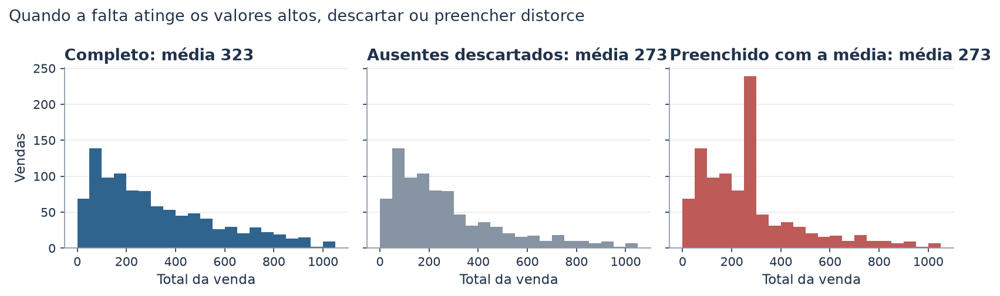
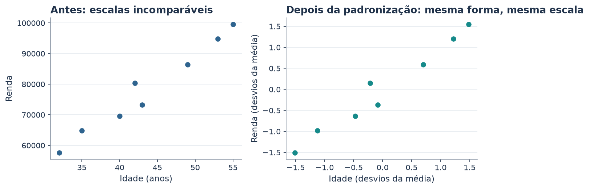

# 05 · Pré-processamento

**Pergunta inicial:** um sistema de vendas falhou justamente nas compras grandes e deixou 16% dos valores em branco. Se você preencher as lacunas com a média, a média fica certa?

Bases reais chegam com linhas repetidas, categorias escritas de três jeitos, datas como texto, lacunas e colunas que não podem entrar em um modelo. Esta unidade trata cada problema separadamente e termina com a regra que mais evita conclusões falsas: tudo o que é aprendido dos dados (média para preencher, escala, categorias) se aprende no treino e só depois se aplica ao teste.

Pré-requisitos: [02 · Primeiros dados](../02_primeiros_dados/) e [03 · Estatística](../03_estatistica/).

Conceitos: duplicatas e inconsistências; valores ausentes e o mecanismo da falta; codificação one-hot e de rótulos; padronização e min-max; variáveis derivadas de datas e de outras colunas; vazamento de dados.

## Scripts, na ordem

| Script | O que mostra |
|---|---|
| [01_inspecionar_e_duplicatas.py](01_inspecionar_e_duplicatas.py) | `duplicated`, `drop_duplicates`, `str.strip`, valores impossíveis |
| [02_valores_ausentes.py](02_valores_ausentes.py) | `SimpleImputer`; falta não aleatória distorce média e desvio |
| [03_categorias.py](03_categorias.py) | `OneHotEncoder` atual, `get_dummies`, `LabelEncoder`, ordinal |
| [04_escala.py](04_escala.py) | `StandardScaler`, `MinMaxScaler`; `fit` no treino, `transform` no teste |
| [05_datas_e_variaveis_derivadas.py](05_datas_e_variaveis_derivadas.py) | `to_datetime`, dia da semana, hora, `pd.cut`, colunas calculadas |
| [06_vazamento_de_dados.py](06_vazamento_de_dados.py) | Coluna derivada do alvo dá R² = 1; a pergunta honesta dá R² ≈ 0 |
| [07_preprocessamento_revisado.py](07_preprocessamento_revisado.py) | O `preprocessamento.py` de 2019 com APIs atuais e ordem correta |

O original usava `OneHotEncoder(categorical_features=[0])`, parâmetro removido do scikit-learn, e ajustava o imputador antes de separar treino e teste. O script 07 corrige as duas coisas e comenta por quê. A versão original está em [original/repositorio_2019/preprocessamento.py](../original/repositorio_2019/preprocessamento.py).

## Figuras

*`02_valores_ausentes.py`. A falta foi simulada só nas vendas acima do percentil 60. Descartar subestima a média; preencher com a média subestima a média e ainda encolhe o desvio.*

*`04_escala.py`. A forma da nuvem é a mesma; só a régua mudou.*

## O que observar

Em `06`, prever a quantidade comprada a partir do que se sabe do cliente dá R² perto de zero. Esse resultado "ruim" é o resultado verdadeiro: as variáveis disponíveis não explicam quanto cada pessoa leva. Modelos com R² = 1 nessa base estão usando colunas calculadas a partir do total. Reconhecer isso é mais útil que um número bonito.

## Atividade curta

Em `05`, crie a variável `Semana do ano` com `dt.isocalendar().week` e conte vendas por semana. Há semanas com muito menos vendas? A base cobre essas semanas por inteiro?

## Problema de interpretação

Uma equipe preencheu as rendas ausentes de uma pesquisa com a média e depois concluiu que "a desigualdade de renda é menor do que se pensava". Explique em duas frases por que o pré-processamento pode ter produzido essa conclusão.

## Relação com as aulas e o livro

Aula 6 (Pré-processamento: limpeza, integração, redução, transformação) e o trecho de vazamento de dados da aula 7. Capítulo 4 do livro (4.1 Limpeza, 4.2 Integração, 4.3 Redução, 4.4 Transformação).

## Próxima etapa

[06 · Classificação e avaliação](../06_classificacao_e_avaliacao/)
