# 05 · Visualização

**Pergunta inicial:** seis linhas de produto têm avaliações medianas entre 6,7 e 7,3. Um gráfico pode fazer essa diferença parecer enorme ou irrelevante sem mudar um único número. Qual das duas versões é honesta?

Encontrar o padrão certo não adianta se ninguém entende o gráfico que o mostra. Visualização tem dois usos: **exploratória** (você procura o que há de interessante, "procurar pérolas em ostras") e **explanatória** (você mostra a outra pessoa o que encontrou, "mostrar as pérolas"). Esta unidade trata das duas, com seis ideias:

1. Entender o contexto antes de desenhar: quem vai ler, o que essa pessoa deve fazer, que dados sustentam a ideia.
2. Escolher o gráfico pela pergunta.
3. Respeitar a escala (barras começam em zero; nada de eixo duplo para forçar relações).
4. Eliminar o que compete pela atenção (saturação).
5. Usar cor, tamanho e posição para dirigir o olhar (atributos pré-atentivos).
6. Contar uma história: começo, meio e fim, com títulos que afirmam o achado.

Pré-requisitos: [04 · Estatística](../04_estatistica/).

## Passo a passo

### 1. Contexto: quem, o quê, como

Antes do primeiro gráfico, responda em uma frase cada:

- **Quem** vai ler? (um gerente, um colega técnico, uma banca)
- **O quê** você quer que essa pessoa faça depois de ler? (aprovar, mudar um horário, investigar mais)
- **Como** os dados sustentam esse pedido? (qual comparação, qual número)

Um bom teste é a **Grande Ideia**: conseguir dizer o ponto principal em uma frase completa. Se não conseguir, ainda é hora de explorar, não de apresentar.

### 2. Escolher o gráfico pela pergunta

| Pergunta | Gráfico | Script |
|---|---|---|
| Qual categoria é maior? | barras (horizontais se os nomes forem longos), ordenadas | [01_barras_ou_pizza.py](01_barras_ou_pizza.py) |
| Como algo mudou no tempo? | linhas | [02_linhas_no_tempo.py](02_linhas_no_tempo.py) |
| Como os valores se espalham? | histograma, boxplot | [03_distribuicoes.py](03_distribuicoes.py) |
| Duas variáveis se relacionam? | dispersão | [04_dispersao.py](04_dispersao.py) |
| Só um ou dois números? | texto, sem gráfico | — |
| Muitos números com unidades diferentes? | tabela leve ou mapa de calor | [04_estatistica/10](../04_estatistica/10_varias_variaveis.py) |

**Pizza ou barras?** Ângulos e áreas são difíceis de comparar; comprimentos são fáceis. Com 10%, 15%, 30% e 45% a pizza até funciona; com três fatias de 31% a 35%, ninguém sabe qual é a maior. Barras ordenadas resolvem os dois casos.

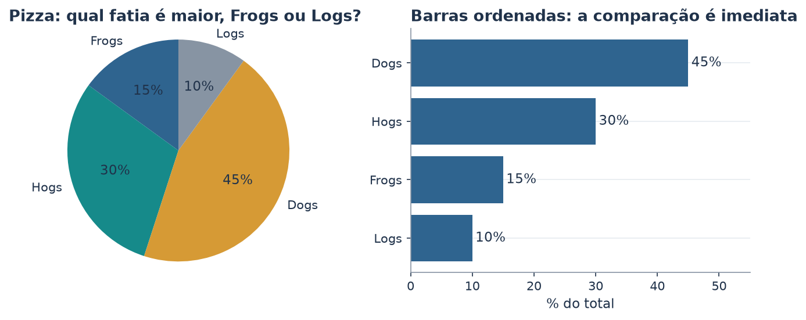

**Linhas só para coisas ordenadas.** Uma linha liga pontos consecutivos e sugere continuidade. Ligar cidades com uma linha inventa uma tendência que não existe.

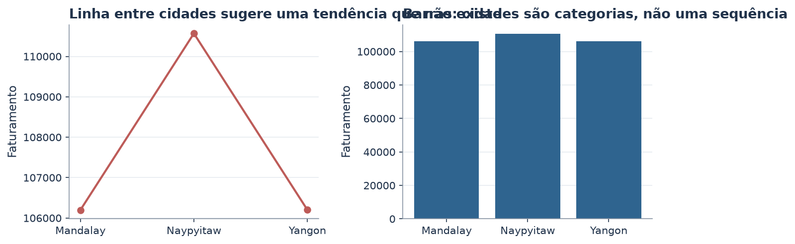

**Agregar muda o que se vê.** A mesma série mensal mostra a sazonalidade; somada por ano, mostra só a tendência. Escolha a agregação pela pergunta.

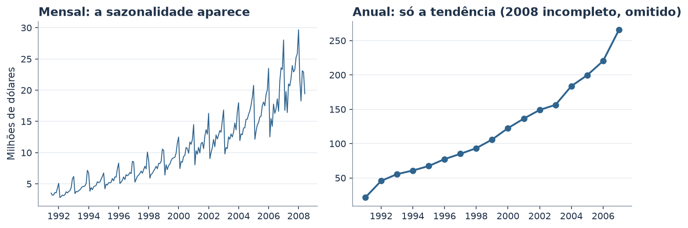

**Intervalos do histograma.** Poucos intervalos escondem a forma; muitos mostram ruído.

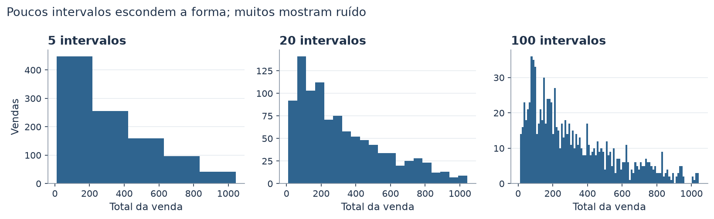

**Pontos sobrepostos.** Com muitos pontos, use tamanho pequeno e transparência para que a densidade apareça. Às vezes a dispersão revela a regra que gerou os dados: os "leques" abaixo são as quantidades de 1 a 10, porque total = preço × quantidade × 1,05.

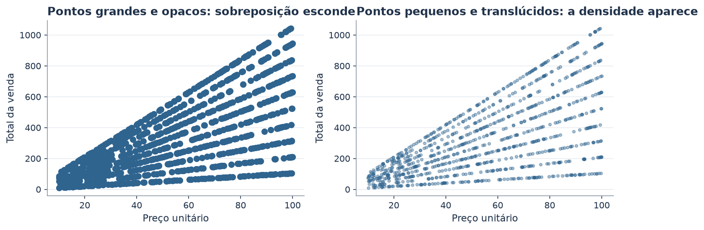

### 3. Escalas que enganam ([05_escalas_que_enganam.py](05_escalas_que_enganam.py))

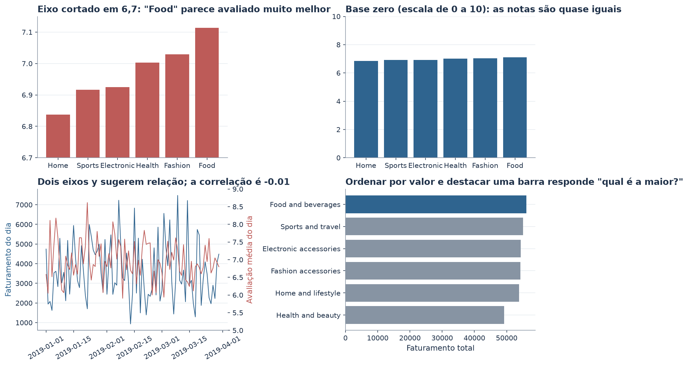

- **Barras começam em zero.** O comprimento da barra é o que o olho compara; cortar o eixo em 6,7 transforma 0,3 ponto em uma diferença dramática. (O painel em vermelho é, de propósito, a versão que distorce.)
- **Dois eixos y** permitem alinhar qualquer par de séries e sugerir relação. Faturamento e avaliação diárias têm correlação −0,01, mas no gráfico de eixo duplo parecem conversar. Use dois painéis ou uma dispersão.
- **Ordene pelo valor** quando a pergunta é "qual é o maior?"; use a ordem natural quando ela existe (horas, meses, faixas).

### 4. Eliminar a saturação ([07_atencao_e_saturacao.py](07_atencao_e_saturacao.py))

Cada elemento do gráfico (moldura, grade, marcador, legenda, cor) compete pela atenção. A percepção humana agrupa coisas próximas, parecidas, cercadas ou conectadas (princípios da Gestalt), e isso pode ajudar ou atrapalhar. O script limpa o mesmo gráfico em quatro passos, com os aluguéis mensais de bicicletas:

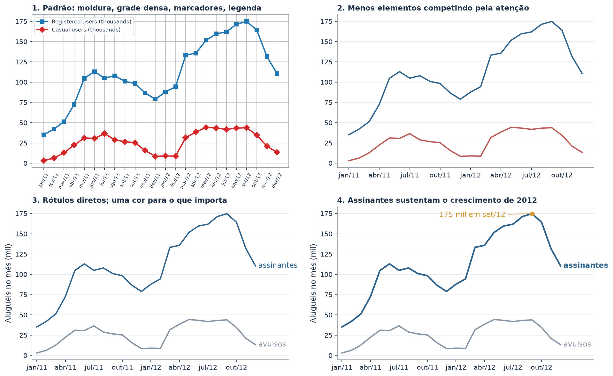

1. O padrão dos programas: moldura completa, grade nas duas direções, marcadores, legenda em caixa, 24 rótulos inclinados.
2. Sem moldura extra, grade só horizontal e clara, sem marcadores, rótulos a cada três meses.
3. Rótulo direto no fim de cada linha (o olho não precisa ir à legenda e voltar); a série secundária em cinza; unidade no eixo.
4. Título que afirma o achado e anotação no único ponto que importa.

Nenhum número mudou.

### 5. Dirigir a atenção: atributos pré-atentivos

Cor, tamanho, intensidade e posição são percebidos antes de qualquer leitura consciente. Quantos números 3 há na tabela da esquerda? E na da direita?

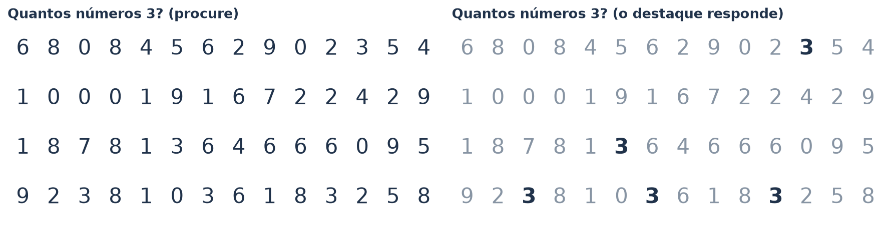

Use isso a favor do leitor: **cinza para o contexto, uma cor para o que importa**. Se tudo tem cor, nada se destaca.

### 6. Antes e depois com os mesmos dados ([06_antes_e_depois.py](06_antes_e_depois.py))

| Antes: escolhas comuns | Depois: as regras desta unidade |
|---|---|
| 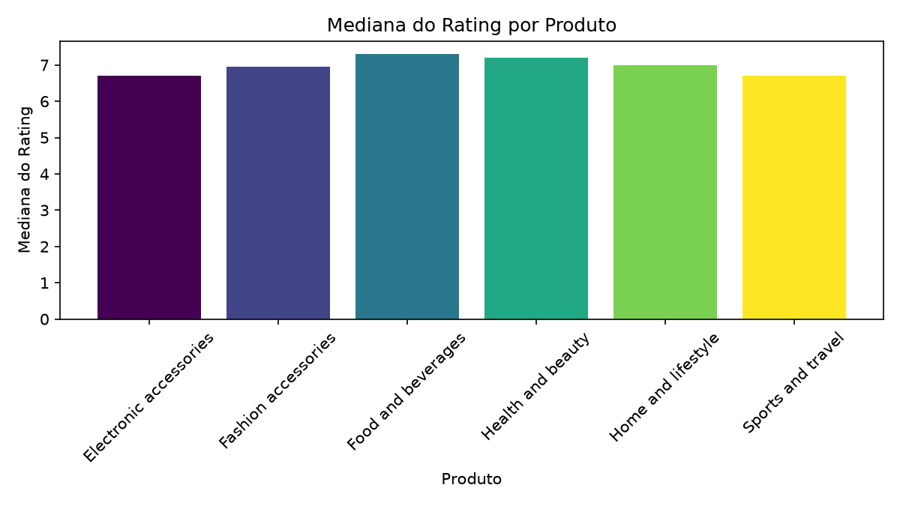 | 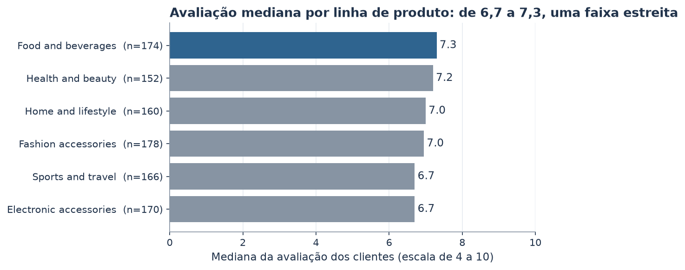 |

O que mudou e por quê:

- barras horizontais: nomes longos ficam legíveis sem girar a cabeça;
- ordenadas pelo valor: "qual é a maior?" se responde no primeiro olhar;
- uma cor para o destaque, cinza para o resto: a cor passa a significar algo;
- o título afirma o achado (a faixa é estreita) em vez de repetir o nome do eixo;
- a escala vai de 0 a 10: 0,6 ponto aparece como o que é, pouco;
- o *n* de cada grupo diz quantas vendas sustentam cada mediana.

### 7. Contar uma história ([08_contar_uma_historia.py](08_contar_uma_historia.py))

Uma história tem **início** (por que prestar atenção?), **meio** (o que os dados mostram) e **fim** (o que fazer com isso). Em vez de um gráfico com 48 barras agrupadas, o script apresenta os aluguéis por hora em quatro quadros, cada um acrescentando uma única informação, com um título que diz qual:

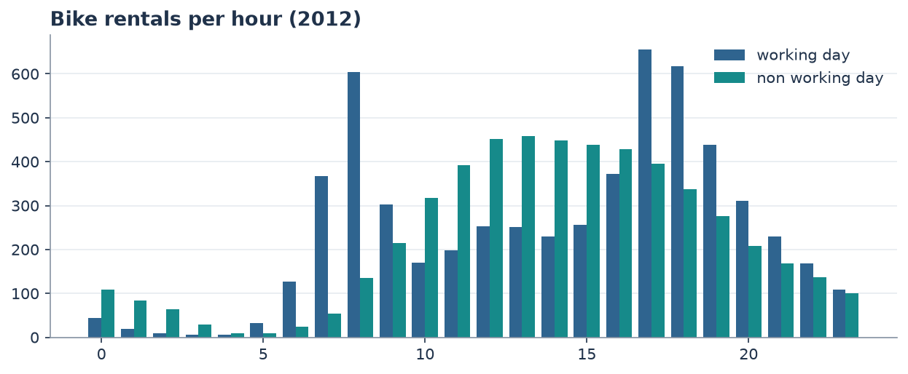

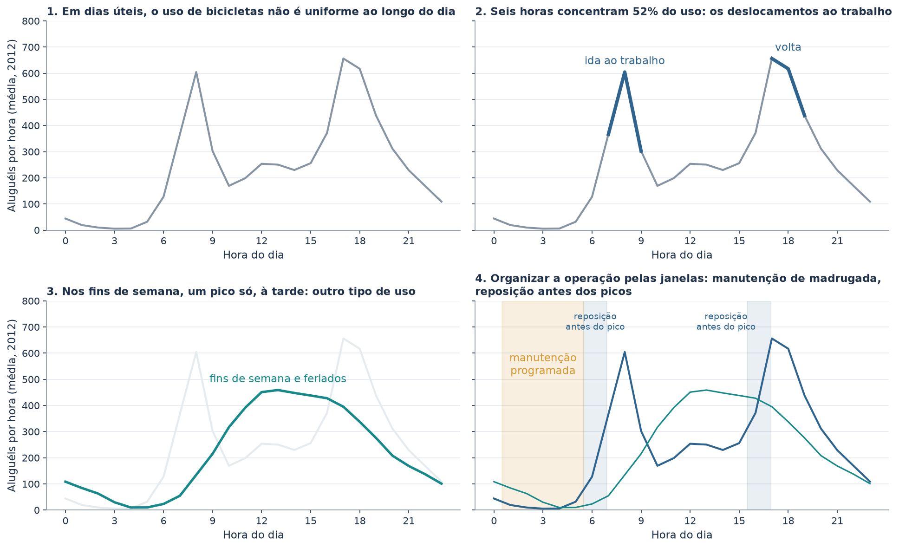

A Grande Ideia em uma frase: *o sistema é usado principalmente para ir e voltar do trabalho, e a operação deve seguir esse ritmo*. Três táticas ajudam: **repetição** (diga a ideia no início, mostre, repita no fim), **lógica vertical** (os títulos lidos em sequência já contam a história) e **storyboard reverso** (escreva primeiro as frases-título, depois faça os gráficos).

## Atividade curta

Pegue o gráfico de barras agrupadas `historia_antes.png` e escreva, antes de olhar a versão em quatro quadros, a frase que você colocaria como título. Depois compare.

## Problema de interpretação

Um colega apresenta o painel "eixo cortado em 6,7" para argumentar que a linha *Food and beverages* é a mais bem avaliada e merece mais espaço na loja. Escreva a objeção em duas frases, usando só o que está nos dados (incluindo o *n* de cada grupo).

## Para lembrar

As regras desta unidade valem para todas as figuras do repositório e estão reunidas, com a paleta de cores e a figura que exemplifica cada uma, em [materiais/manual_visual.md](../materiais/manual_visual.md). Uma referência de aprofundamento é o livro *Storytelling com Dados*, de Cole Nussbaumer Knaflic (Alta Books).

## Relação com o livro

As figuras dos capítulos 11 a 13 (estudos de caso) aplicam estes tipos de gráfico; os estudos de caso deste repositório ([18](../18_estudos_de_caso/)) usam todas as regras desta unidade.

## Próxima etapa

[06 · Pré-processamento](../06_preprocessamento/)
