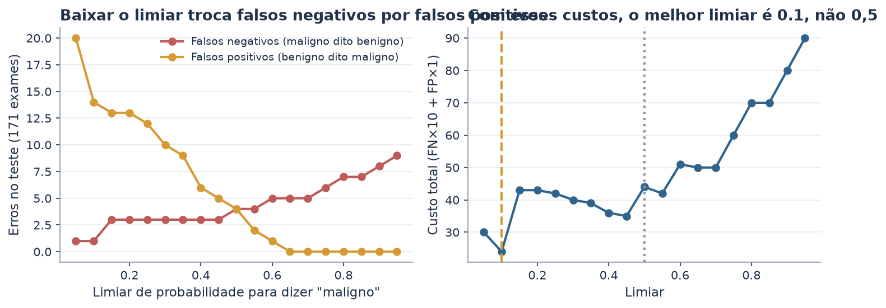
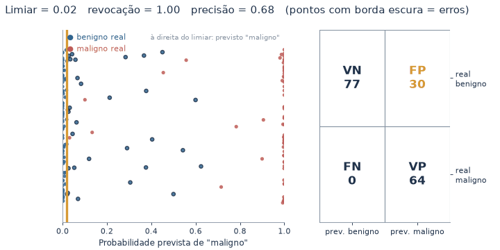
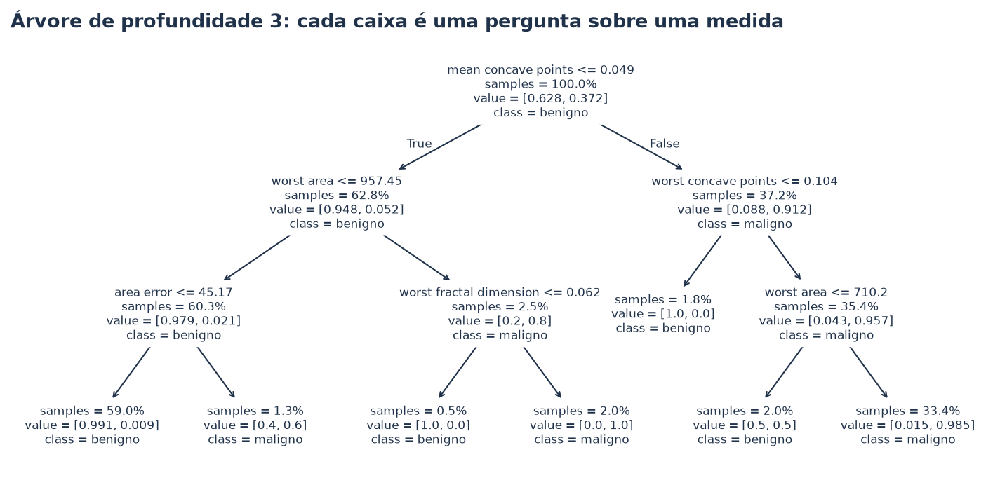

# 06 · Classificação e avaliação

**Pergunta inicial:** você confiaria em um modelo que acerta 93% dos casos? E se os 7% que ele erra forem exatamente os casos que importavam?

Classificar é prever uma categoria para um caso novo. O difícil não é treinar o modelo, é saber o que a medida de acerto permite afirmar. Esta unidade usa uma base real de exames (benigno ou maligno) para mostrar a separação treino/teste, a linha de base, três modelos, a matriz de confusão, as métricas que a resumem e a escolha do limiar quando os erros têm custos diferentes.

Pré-requisitos: [05 · Pré-processamento](../05_preprocessamento/).

Conceitos: descrição × predição; treino/teste estratificado; linha de base; regressão logística, árvore de decisão, floresta aleatória; sobreajuste; matriz de confusão; precisão, revocação, F1, AUC; limiar e custo do erro; desbalanceamento; validação cruzada.

## Os dados

Base de câncer de mama de Wisconsin (569 exames, 30 medidas de núcleos celulares, diagnóstico), distribuída com o scikit-learn. É real, pequena e não precisa de download. Neste material a classe positiva é "maligno", porque é o caso que não pode passar despercebido. Nenhum resultado aqui tem valor clínico; a base serve para aprender a avaliar.

## Scripts, na ordem

| Script | O que mostra |
|---|---|
| [01_descricao_x_predicao.py](01_descricao_x_predicao.py) | Médias por grupo (descrição) × acerto em casos novos (predição); linha de base e uma regra manual |
| [02_regressao_logistica.py](02_regressao_logistica.py) | Padronização no treino, ajuste, matriz de confusão, probabilidades, coeficientes |
| [03_arvore_e_floresta.py](03_arvore_e_floresta.py) | Árvore livre (sobreajuste) × árvore rasa; floresta; importância das variáveis |
| [04_metricas.py](04_metricas.py) | Precisão, revocação, F1, relatório por classe, curva ROC e AUC |
| [05_limiar_e_custo_do_erro.py](05_limiar_e_custo_do_erro.py) | Varrer o limiar; custos diferentes para FN e FP mudam a decisão |
| [06_desbalanceamento_e_validacao.py](06_desbalanceamento_e_validacao.py) | 7% de positivos: acurácia alta sem acertar nenhum; `class_weight`; validação cruzada estratificada |

## Figuras

*`05_limiar_e_custo_do_erro.py`. Com um falso negativo custando dez vezes um falso positivo (valores hipotéticos), o melhor limiar fica bem abaixo de 0,5.*

*Animação gerada por [animacoes/fontes/limiar_matriz_confusao.py](../animacoes/fontes/limiar_matriz_confusao.py).*

*`03_arvore_e_floresta.py`. Cada caixa é uma pergunta sobre uma medida; as folhas mostram a proporção de cada classe.*

## O que observar

- Em `01`, a linha de base acerta 63% sem olhar nenhuma medida. Toda acurácia precisa ser lida contra esse número.
- Em `03`, a árvore sem limite acerta 100% do treino e menos no teste. É o sobreajuste em sua forma mais simples.
- Em `05`, nada nos dados diz qual limiar usar. Os custos vêm do problema, e são eles que decidem.
- Em `06`, uma revocação de 0,75 com 8 positivos no teste significa 6 acertos. A validação cruzada mostra o quanto esse número oscila.

## Atividade curta

Em `05`, inverta os custos (FN = 1, FP = 10) e anote o novo limiar. Depois escreva, em uma frase, em que situação real essa inversão faria sentido.

## Problema de interpretação

Um relatório afirma: "o modelo atingiu 97% de acurácia, portanto pode substituir a análise humana". Escreva três perguntas que você faria antes de aceitar a conclusão (pense em linha de base, custo dos erros, como o teste foi separado e para quais casos o modelo erra).

## Relação com as aulas e o livro

Aulas 7 (Aprendizagem de Máquina: supervisão, avaliação, vazamento), 9 (K-NN), 10 (Naive Bayes), 11 (Regressão, incluindo logística), 12 (Árvores), 13 (MLP) e 14 (SVM). Capítulos 5 (Classificação) e 6 (Avaliação de Classificadores: 6.1 matriz de confusão e espaço ROC; 6.2 hold-out, k-fold, leave-one-out, bootstrap) do livro. K-NN, Naive Bayes, redes neurais e SVM não têm script próprio aqui; a mesma sequência (separar, treinar, medir contra a linha de base) se aplica a todos com a troca de uma linha.

## Próxima etapa

[07 · Agrupamento](../07_agrupamento/)
