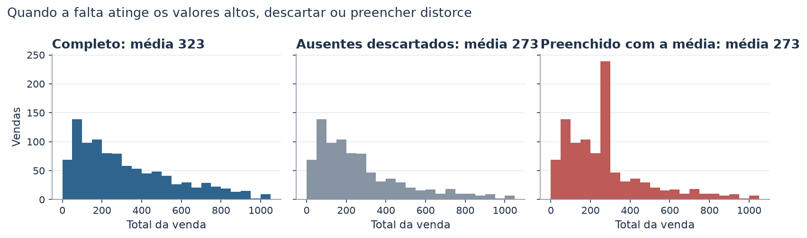
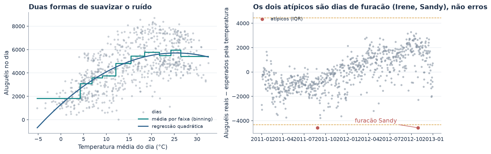
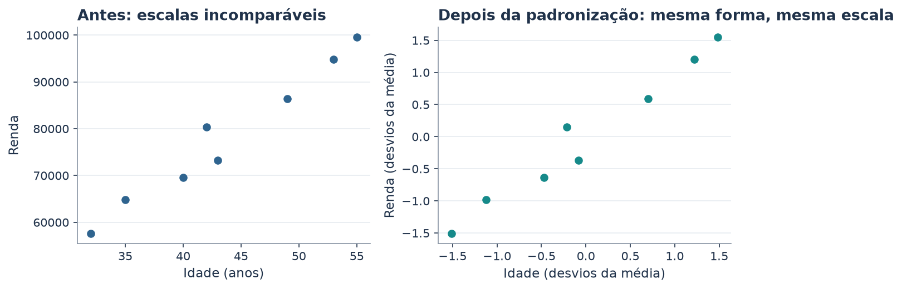
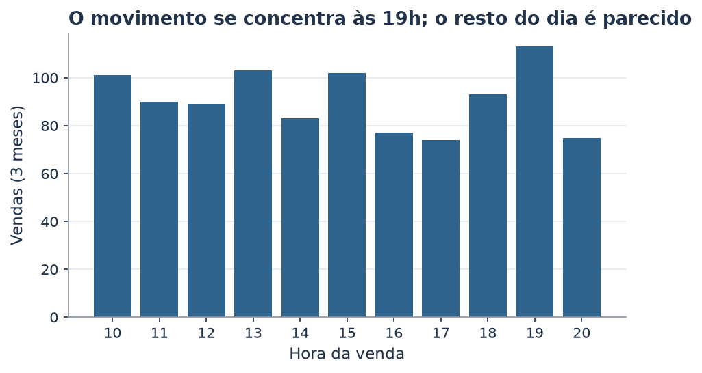
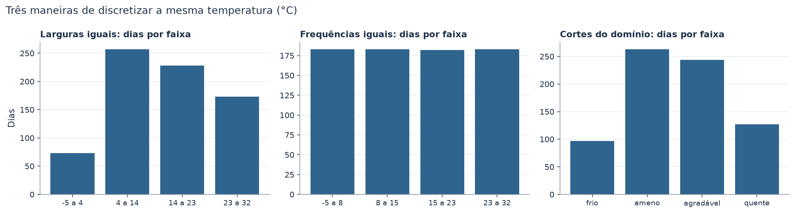
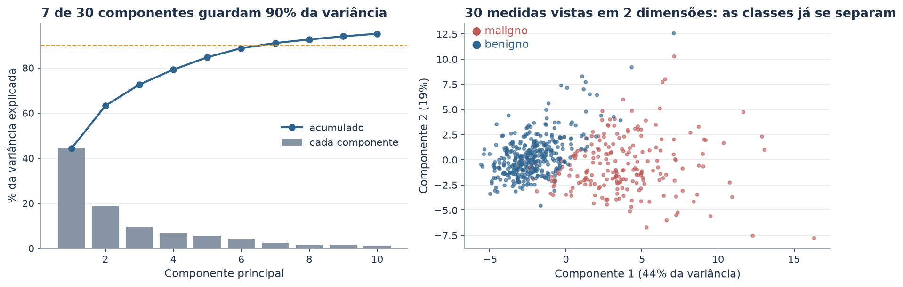

# 06 · Pré-processamento

**Pergunta inicial:** um sistema de vendas falhou justamente nas compras grandes e deixou 16% dos valores em branco. Se você preencher as lacunas com a média, a média fica certa?

No mundo real os dados chegam **incompletos** (valores faltando), **ruidosos** (erros de medição, valores atípicos) e **inconsistentes** (a mesma coisa escrita de jeitos diferentes, unidades misturadas, fontes que discordam). Dados de baixa qualidade produzem análises de baixa qualidade, por melhor que seja o método. Pré-processar não é uma etapa burocrática antes da "análise de verdade": as escolhas feitas aqui mudam as conclusões.

As tarefas se organizam em quatro grupos:

| Grupo | Problema | Scripts |
|---|---|---|
| **Limpeza** | duplicatas, inconsistências, ausentes, ruído, atípicos | 01, 02, 03 |
| **Integração** | juntar fontes: mesma entidade com nomes diferentes, unidades em conflito, redundância | 04 |
| **Transformação** | categorias em números, escala, datas, discretização, agregação, novos atributos | 05, 06, 07, 08 |
| **Redução** | menos colunas (PCA, seleção) ou menos linhas (amostragem) | 09 |

E uma regra que atravessa todos: **o que é aprendido dos dados (médias, escalas, categorias, atributos escolhidos) é aprendido só no treino** (scripts 10 e 11).

Pré-requisitos: [03 · Primeiros dados](../03_primeiros_dados/) e [04 · Estatística](../04_estatistica/).

---

## Limpeza

### 01 · Inspecionar, duplicatas e inconsistências ([01_inspecionar_e_duplicatas.py](01_inspecionar_e_duplicatas.py))

O script pega 10 clientes e acrescenta três defeitos típicos: uma linha repetida, a mesma região escrita como `Brazil`, `brazil` e ` USA ` (com espaços), e uma idade impossível (230). Cada um tem uma ferramenta:

- `duplicated()` / `drop_duplicates()` para linhas repetidas;
- `value_counts()` revela categorias escritas de jeitos diferentes; `str.strip()` e `str.upper()` padronizam;
- `describe()` mostra mínimos e máximos impossíveis; o valor é marcado como ausente, porque apagar a linha perderia as outras informações do cliente.

### 02 · Valores ausentes ([02_valores_ausentes.py](02_valores_ausentes.py))

Seis estratégias, da mais simples à mais elaborada:

1. ignorar a linha (bom quando são poucas e a falta é aleatória);
2. preencher manualmente (bases pequenas, com quem conhece os dados);
3. preencher com um valor global (`"desconhecido"`), que vira uma categoria própria;
4. preencher com média ou mediana (a mediana resiste a extremos);
5. preencher com média ou mediana **da classe** (cada grupo recebe um valor mais típico);
6. estimar o valor mais provável com um modelo (regressão, árvore).

A pergunta que decide entre elas é: **por que o valor falta?** O script simula uma falha que apaga 40% das vendas grandes:

A média verdadeira é 323. Descartando as lacunas, ela cai para 273; preenchendo com a média, continua 273 e ainda o desvio-padrão encolhe de 246 para 206, porque 160 valores idênticos são empilhados no centro. **Quando a falta não é aleatória, nenhuma fórmula de preenchimento conserta o problema**; o mínimo é contar os ausentes por grupo e relatar isso.

### 03 · Ruído e valores atípicos ([03_ruido_e_outliers.py](03_ruido_e_outliers.py))

Ruído é variação que não interessa; atípicos são valores muito diferentes do resto. Duas formas de **suavizar**:

- **binning**: ordenar, dividir em faixas e trocar cada valor pela média (ou pela borda mais próxima) da faixa. Com os preços 4, 8, 9, 15 | 21, 21, 24, 25 | 26, 28, 29, 34, a suavização pela média dá 9, 9, 9, 9 | 22,8 ... | 29,2 ...;
- **regressão**: ajustar uma curva e usar o valor ajustado.

Para **detectar** atípicos: pelo IQR (abaixo de Q1 − 1,5·IQR ou acima de Q3 + 1,5·IQR) ou pelo z-score (|z| > 3). O script procura atípicos não nos aluguéis de bicicleta, mas no **resíduo**: aluguéis reais menos os esperados para a temperatura do dia. Um dia frio com poucos aluguéis é normal; um dia ameno quase sem aluguéis é atípico.

Os dois atípicos são 27/08/2011 (furacão Irene) e 29/10/2012 (furacão Sandy). São dados **verdadeiros**. Apagar atípicos sem investigar pode esconder exatamente os dias que mais importam.

## Integração

### 04 · Juntar fontes ([04_integracao.py](04_integracao.py))

O script junta as vendas com um cadastro de filiais vindo de "outro sistema" e enfrenta os quatro problemas clássicos:

1. **Identificação de entidade**: a coluna se chama `Branch` em uma fonte e `cod_filial` na outra. Só os metadados (ou quem conhece os sistemas) dizem que são a mesma coisa.
2. **Tuplas duplicadas**: a filial C aparece duas vezes no cadastro; sem tratar, cada venda dela seria duplicada no merge. O argumento `validate='many_to_one'` faz o pandas reclamar se isso acontecer.
3. **Conflito de valores**: área em pés quadrados, meta em outra moeda. Comparar sem converter seria comparar maçãs com laranjas.
4. **Redundância**: atributos derivados de outros. Entre colunas numéricas, a correlação revela: `Tax 5%`, `Total`, `cogs` e `gross income` têm correlação 1,000 entre si (são múltiplos uns dos outros). Entre colunas nominais, o qui-quadrado revela: `Branch` e `City` são a mesma informação (cada filial fica em uma cidade).

## Transformação

### 05 · Categorias em números ([05_categorias.py](05_categorias.py))

Modelos fazem contas; "Brasil" e "Índia" não entram em uma conta. Trocar categorias sem ordem por 0, 1, 2 **inventa uma ordem** (Índia < EUA < Brasil?). O certo é a codificação **one-hot**: uma coluna 0/1 para cada categoria (`OneHotEncoder` ou `pd.get_dummies`). Categorias com ordem natural (P < M < G) podem virar números que respeitam a ordem. `handle_unknown='ignore'` evita erro quando aparece no teste uma categoria que não existia no treino.

### 06 · Escala ([06_escala.py](06_escala.py))

Idade varia em dezenas, renda em dezenas de milhares. Em uma distância entre dois clientes, a renda dominaria tudo. Duas transformações comuns:

$$z = \frac{x - \bar{x}}{s} \quad\text{(padronização)} \qquad\qquad x' = \frac{x - \min}{\max - \min} \quad\text{(min-max, entre 0 e 1)}$$

A forma da nuvem é a mesma; só a régua mudou. A média e o desvio usados na fórmula são **calculados no treino** e aplicados, sem recalcular, ao teste.

### 07 · Datas e atributos derivados ([07_datas_e_variaveis_derivadas.py](07_datas_e_variaveis_derivadas.py))

Data e hora chegam como texto. Convertidas (`pd.to_datetime`), viram fonte de novos atributos: dia da semana, hora, fim de semana, período do dia. Atributos também podem ser construídos combinando colunas (ticket por item, compra grande).

### 08 · Discretização, hierarquia e agregação ([08_discretizacao_e_agregacao.py](08_discretizacao_e_agregacao.py))

**Discretizar** é trocar um número por uma faixa. Três jeitos de cortar a temperatura em quatro faixas:

- larguras iguais: faixas fáceis de explicar, mas podem ficar quase vazias nas pontas;
- frequências iguais (quantis): cada faixa tem o mesmo número de dias;
- cortes do domínio (frio, ameno, agradável, quente): os mais fáceis de comunicar.

**Hierarquia de conceitos**: dia → mês → trimestre → ano. Subir na hierarquia é **agregar** (731 dias viram 24 meses, 8 trimestres, 2 anos). Um atributo **construído** ("dia agradável": entre 15 e 28 °C, céu limpo, umidade abaixo de 70%) separa 172 dias com média de 6 168 aluguéis dos demais, com 3 992.

## Redução

### 09 · Menos colunas, menos linhas ([09_reducao.py](09_reducao.py))

**PCA** (análise de componentes principais) cria novas variáveis, combinações das originais, ordenadas pela variância que explicam. As 30 medidas de núcleos celulares da base de câncer de mama são muito correlacionadas (raio, perímetro e área medem quase a mesma coisa): 7 componentes guardam 90% da variância e, só com 2, as classes já se separam no plano.

**Seleção de atributos** mantém as variáveis originais mais informativas (mais fáceis de interpretar que componentes). Como usa o alvo, é feita só no treino. **Amostragem** reduz linhas; a **estratificada** preserva a proporção das classes (37% de malignos na base, 36,7% na amostra estratificada de 60, 40% na simples).

## A regra que atravessa tudo

### 10 · Vazamento de dados ([10_vazamento_de_dados.py](10_vazamento_de_dados.py))

Vazamento acontece quando informação que não estaria disponível no momento de prever entra no treino. O script mostra três formas:

- **coluna derivada do alvo**: prever o total da venda usando o imposto (5% do total) dá R² = 1,00, um modelo que recebeu a resposta;
- **pré-processar antes de separar**: preencher, padronizar ou selecionar atributos com treino e teste juntos;
- **embaralhar dados com tempo**: o teste deve ser o futuro.

A pergunta honesta (prever a quantidade comprada com o que se sabe do cliente) dá R² ≈ 0 e erro igual ao de "prever a média". Esse resultado é verdadeiro: as variáveis disponíveis não explicam quanto cada pessoa leva.

### 11 · Pipeline completo ([11_pipeline_completo.py](11_pipeline_completo.py))

A sequência correta, de ponta a ponta: separar treino e teste → aprender no treino a média para imputar, as categorias e a escala → aplicar exatamente esses valores ao teste → juntar tudo. A unidade 07 usa a mesma ideia com `make_pipeline`, que garante essa ordem automaticamente dentro de cada dobra da validação cruzada.

## Atividade curta

1. Em `03`, remova os dois dias de furacão e reajuste a curva. Os coeficientes mudam muito?
2. Em `08`, crie faixas de umidade pelo domínio (seco, normal, úmido) e compare a média de aluguéis.

## Problema de interpretação

Uma equipe preencheu as rendas ausentes de uma pesquisa com a média e depois concluiu que "a desigualdade de renda é menor do que se pensava". Explique em duas frases por que o pré-processamento pode ter produzido essa conclusão.

## Relação com o livro

Capítulo 4 (Pré-processamento de Dados): 4.1 Limpeza (scripts 01 a 03), 4.2 Integração (04), 4.3 Redução (09), 4.4 Transformação (05 a 08). O vazamento de dados (10) se liga ao capítulo 6 (Avaliação de Classificadores).

## Próxima etapa

[07 · Aprendizagem de máquina e avaliação](../07_aprendizagem_de_maquina/)
