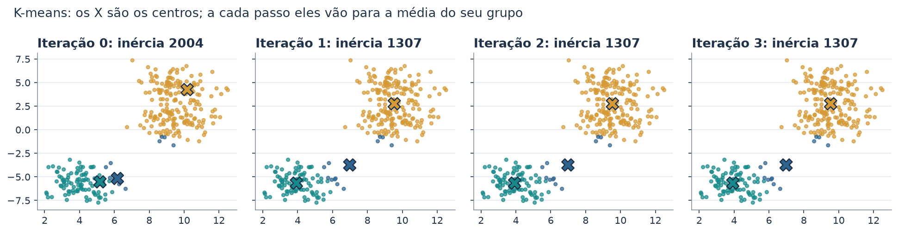
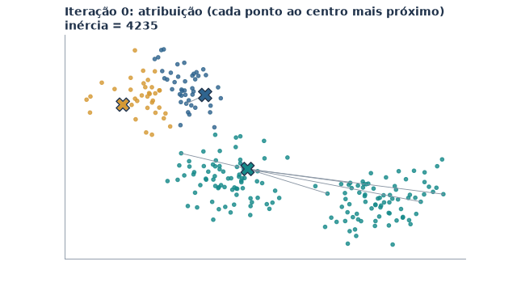
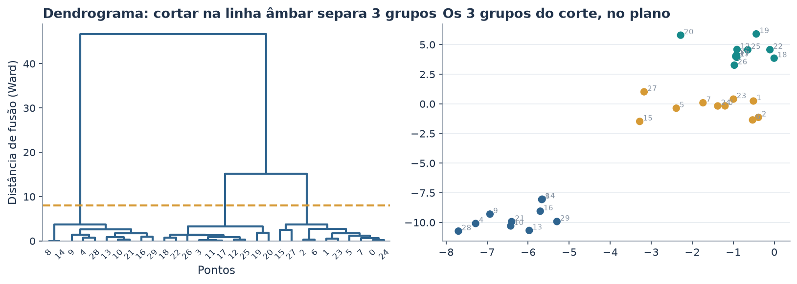
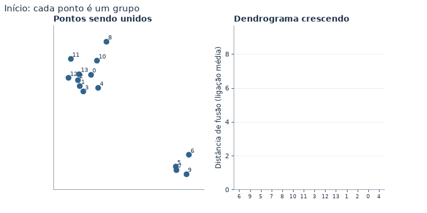

# 07 · Agrupamento

**Pergunta inicial:** se você pedir a um algoritmo que divida os clientes em três perfis, ele vai dividir. Como saber se esses três perfis existem ou se foram inventados pelo pedido?

Agrupar é procurar estrutura sem rótulos: nenhuma coluna diz a resposta certa. Isso torna o método útil para explorar e perigoso para concluir. Esta unidade mostra o k-means por dentro, o agrupamento hierárquico e o dendrograma, os critérios para escolher o número de grupos e, com o mesmo cuidado, os casos em que o algoritmo encontra grupos onde não há nenhum.

Pré-requisitos: [05 · Pré-processamento](../05_preprocessamento/) (escala) e [06 · Classificação e avaliação](../06_classificacao_e_avaliacao/) (para contrastar com a aprendizagem supervisionada).

Conceitos: k-means (atribuição e atualização, inércia, inicialização); cotovelo e silhueta; ligação hierárquica (Ward, single, complete, average), dendrograma e corte; efeito da escala; validação de uma partição.

## Scripts, na ordem

| Script | O que mostra | Dados |
|---|---|---|
| [01_kmeans_passo_a_passo.py](01_kmeans_passo_a_passo.py) | Quatro iterações feitas à mão; depois `KMeans` | sintéticos (semente fixa) |
| [02_escolher_k.py](02_escolher_k.py) | Inércia por k e silhueta por k | sintéticos |
| [03_hierarquico_e_dendrograma.py](03_hierarquico_e_dendrograma.py) | `linkage`, `dendrogram`, `fcluster`; comparação com k-means | sintéticos |
| [04_limites_de_interpretacao.py](04_limites_de_interpretacao.py) | Grupos em dados uniformes; escala decide; inicialização | sintéticos + Data.csv |
| [05_segmentar_vendas.py](05_segmentar_vendas.py) | Partição dos cupons do supermercado e leitura honesta do resultado | supermercado (reais) |

## Figuras

*`01_kmeans_passo_a_passo.py`. A inércia só diminui; quando os centros param, o algoritmo termina.*

*Animação gerada por [animacoes/fontes/kmeans_passo_a_passo.py](../animacoes/fontes/kmeans_passo_a_passo.py): atribuição e atualização alternadas, com as distâncias de alguns pontos desenhadas.*

*`03_hierarquico_e_dendrograma.py`. A altura de cada fusão é a distância entre os grupos unidos; cortar na linha tracejada dá três grupos.*

*Animação gerada por [animacoes/fontes/dendrograma_formacao.py](../animacoes/fontes/dendrograma_formacao.py).*

## O que observar

Em `05`, a silhueta fica abaixo de 0,25 para todo k. Os cupons do supermercado não formam grupos nítidos nessas variáveis; a partição em três é uma forma de organizar a descrição, não uma descoberta. O script diz isso com todas as letras, e é assim que um resultado de agrupamento deve ser relatado quando a validação não sustenta mais.

## Atividade curta

Em `02`, gere os dados com `cluster_std=2.5`. O cotovelo e a silhueta ainda apontam k = 4? Qual dos dois critérios degradou primeiro?

## Problema de interpretação

Uma apresentação mostra "quatro perfis de cliente descobertos por k-means" e propõe uma campanha para cada um. Liste o que você pediria para ver antes de aprovar as campanhas (silhueta, estabilidade com outras sementes, variáveis usadas e sua escala, se a base identifica clientes ou só compras).

## Relação com as aulas e o livro

Aula 8 (Aprendizado não supervisionado: hierárquico e particional). Capítulo 7 do livro (7.2 Algoritmos de Agrupamento: 7.2.1 Hierárquico, 7.2.2 Particional). Regras de associação (7.1) e mapas de Kohonen (7.3) não têm script nesta unidade.

## Próxima etapa

[08 · Séries temporais](../08_series_temporais/)
