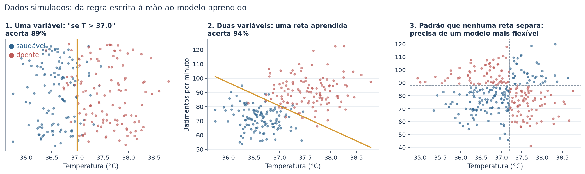
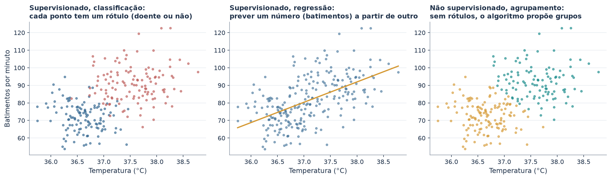
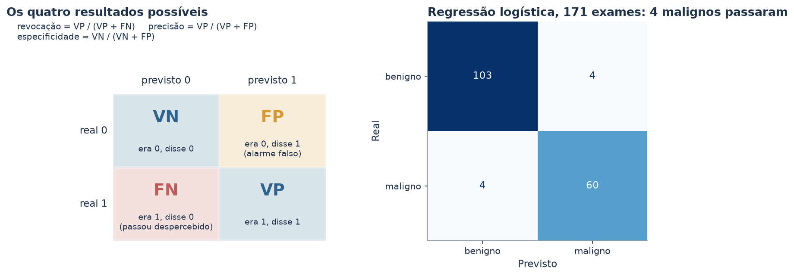
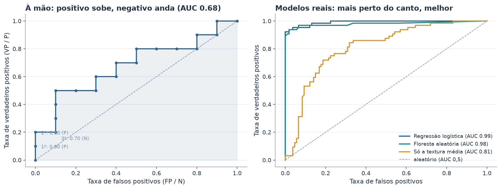
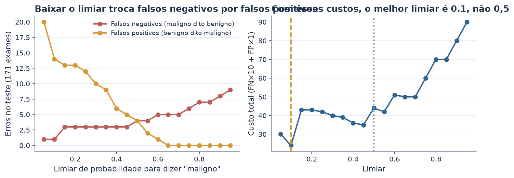
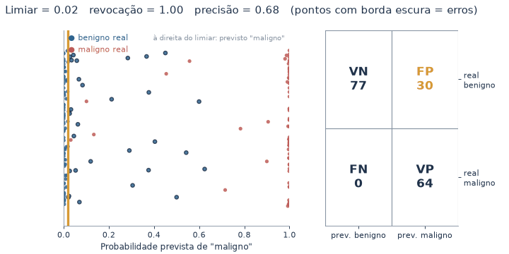
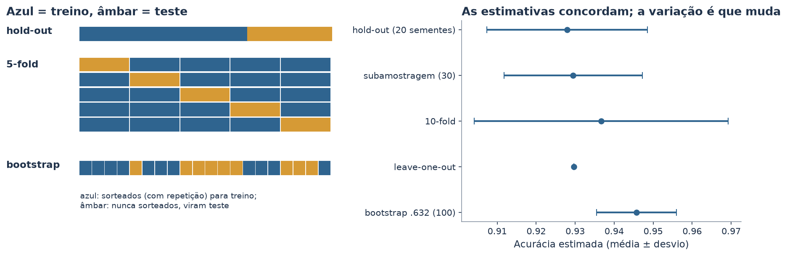
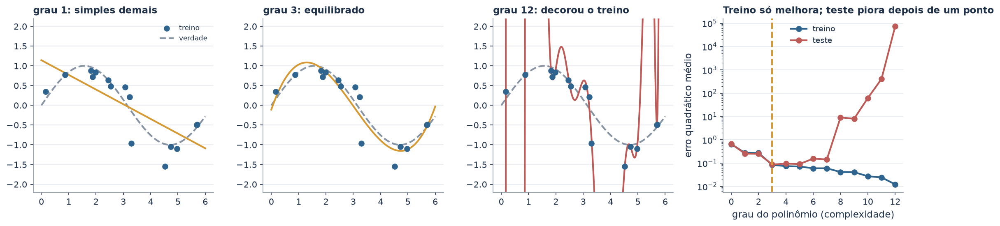
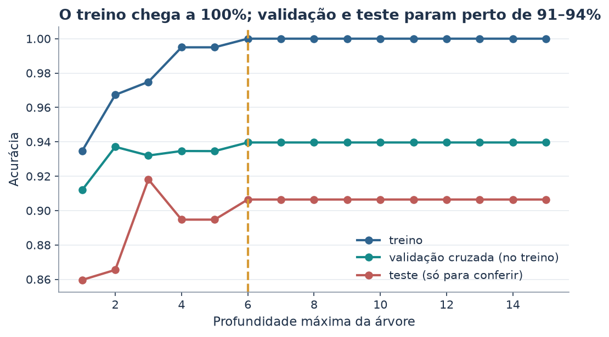
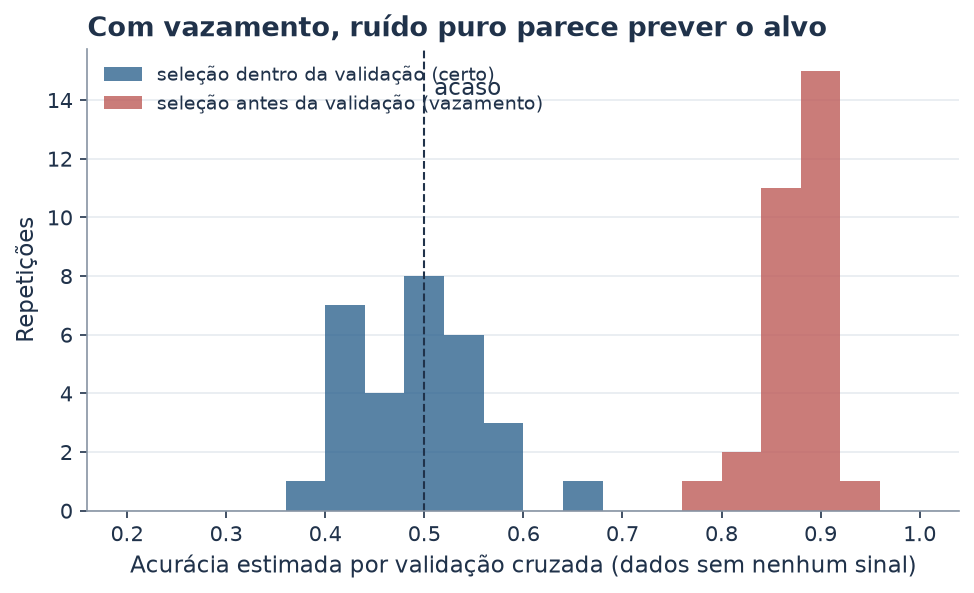

# 07 · Aprendizagem de máquina e avaliação de modelos

**Pergunta inicial:** você confiaria em um modelo que acerta 93% dos casos? E se os 7% que ele erra forem exatamente os casos que importavam?

Aprendizagem de máquina é o estudo de programas que **melhoram em uma tarefa com a experiência** (os dados), em vez de seguir regras escritas à mão. Esta unidade apresenta as ideias comuns a todos os algoritmos das unidades 08 a 14: tipos de aprendizado, como um modelo é induzido a partir de exemplos, e, sobretudo, **como saber se ele funciona**. Os algoritmos específicos vêm depois; aqui usamos regressão logística, árvores e floresta como exemplos.

Pré-requisitos: [06 · Pré-processamento](../06_preprocessamento/).

## Roteiro

| Script | Ideia | Figura |
|---|---|---|
| [01_descricao_x_predicao.py](01_descricao_x_predicao.py) | Descrever o passado × acertar casos novos; linha de base | — |
| [02_da_regra_ao_modelo.py](02_da_regra_ao_modelo.py) | Regra à mão → modelo aprendido; supervisionado × não supervisionado | `da_regra_ao_modelo.png`, `tipos_de_aprendizado.png` |
| [03_matriz_de_confusao_e_medidas.py](03_matriz_de_confusao_e_medidas.py) | VP, FP, FN, VN e as medidas derivadas, à mão e em dados reais | `matriz_de_confusao.png` |
| [04_curva_roc.py](04_curva_roc.py) | Curva ROC construída passo a passo; AUC | `curva_roc.png` |
| [05_limiar_e_custo_do_erro.py](05_limiar_e_custo_do_erro.py) | O mesmo modelo, decisões diferentes conforme o custo de cada erro | `limiar_e_custo.png` |
| [06_metodos_de_avaliacao.py](06_metodos_de_avaliacao.py) | Hold-out, subamostragem, k-fold, leave-one-out, bootstrap | `metodos_de_avaliacao.png` |
| [07_sobreajuste.py](07_sobreajuste.py) | Quando o modelo decora o treino | `sobreajuste_polinomios.png`, `sobreajuste_arvores.png` |
| [08_desbalanceamento.py](08_desbalanceamento.py) | 7% de positivos: acurácia alta sem acertar nenhum | — |
| [09_vazamento_na_validacao.py](09_vazamento_na_validacao.py) | Ruído puro "prevendo" o alvo por um erro de procedimento | `vazamento_na_validacao.png` |

Dados: principalmente a base de câncer de mama de Wisconsin (569 exames, 30 medidas de núcleos celulares, diagnóstico), que vem com o scikit-learn. A classe positiva é "maligno", o caso que não pode passar despercebido. Nenhum resultado aqui tem valor clínico.

---

## 1. Descrever não é prever ([01](01_descricao_x_predicao.py))

Médias por grupo **descrevem** o passado: tumores malignos têm raio médio 17,5; benignos, 12,2. Isso não diz quão bem acertaríamos um exame **novo**. Para medir isso, separamos os dados: o modelo aprende com o **treino** (398 exames) e é medido no **teste** (171) que nunca viu. `stratify=y` mantém a mesma proporção de malignos nas duas partes.

Antes de qualquer modelo, a **linha de base**: um "modelo" que sempre responde a classe mais comum acerta 63%. Toda acurácia precisa ser lida contra esse número. Uma regra escrita à mão ("raio > 15 → maligno") já acerta 88%.

## 2. Da regra ao modelo; tipos de aprendizado ([02](02_da_regra_ao_modelo.py))

Com pacientes simulados, o script mostra a progressão de um diagnóstico:

1. Uma variável: "se temperatura > 37,0, doente" acerta 89%.
2. Duas variáveis: a regra vira uma reta no plano, `a·temperatura + b·batimentos + c > 0`. Os coeficientes são **aprendidos** dos exemplos: 94%.
3. Quando a doença aparece com febre **ou** taquicardia, mas não as duas, nenhuma reta separa (65%). É preciso um modelo mais flexível (árvores, unidade 12; redes neurais, unidade 13).

Todo algoritmo tem um **viés indutivo**: a família de hipóteses que consegue representar (retas, árvores, regiões em torno de vizinhos) e a preferência entre elas (por exemplo, as mais simples). Não existe algoritmo melhor para tudo; a [unidade 16](../16_recomendacao_de_modelos/) explora isso.

| Tipo | Há resposta conhecida? | Tarefa | Exemplos neste repositório |
|---|---|---|---|
| Supervisionado: **classificação** | sim, uma categoria | prever a classe | unidades 09, 10, 11 (logística), 12, 13, 14 |
| Supervisionado: **regressão** | sim, um número | prever o valor | unidade 11; séries temporais (15) |
| **Não supervisionado** | não | agrupar, reduzir dimensão | unidade 08; PCA na unidade 06 |
| Semissupervisionado | só para parte dos exemplos | aproveitar os não rotulados | — |
| Por reforço | não; há recompensa | aprender por tentativa e erro | — |

## 3. Matriz de confusão e medidas ([03](03_matriz_de_confusao_e_medidas.py))

Toda classificação binária tem quatro resultados possíveis:

| Medida | Fórmula | Pergunta que responde |
|---|---|---|
| Acurácia | (VP + VN) / (P + N) | que fração acertei? |
| Taxa de erro | (FP + FN) / (P + N) | que fração errei? |
| Revocação (sensibilidade) | VP / P | dos positivos, quantos encontrei? |
| Especificidade | VN / N | dos negativos, quantos reconheci? |
| Precisão | VP / (VP + FP) | dos que chamei de positivo, quantos eram? |
| F_β | (1 + β²)·prec·rev / (β²·prec + rev) | equilíbrio entre precisão e revocação (β > 1 favorece a revocação) |

O script calcula tudo à mão para 7 casos (real: 0 0 0 0 0 1 1; previsto: 0 1 1 0 1 1 1): VP = 2, FN = 0, FP = 3, VN = 2. Esse classificador encontrou **todos** os positivos (revocação 1,0) ao custo de três alarmes falsos (precisão 0,4). Na base real, a regressão logística erra 4 malignos e 4 benignos em 171 exames.

## 4. Curva ROC e AUC ([04](04_curva_roc.py))

Um classificador probabilístico dá uma nota para cada caso; o rótulo depende de um corte (limiar). A curva ROC mostra **todos os cortes de uma vez**: taxa de verdadeiros positivos (VP/P) contra taxa de falsos positivos (FP/N). Para construí-la à mão:

1. ordene os casos pela probabilidade, da maior para a menor;
2. comece em (0, 0);
3. para cada caso: se for positivo, suba 1/P; se for negativo, ande 1/N para a direita.

A **AUC** (área sob a curva) resume a curva em um número e tem uma leitura direta: é a probabilidade de um positivo sorteado receber nota maior que um negativo sorteado. Nos 20 casos de exemplo, 0,68; na base real, 0,99 (logística), 0,98 (floresta) e 0,81 (usando só a textura média). A diagonal (AUC 0,5) é o acaso.

## 5. O limiar é uma decisão, não um detalhe técnico ([05](05_limiar_e_custo_do_erro.py))

Baixar o limiar troca falsos negativos por falsos positivos. Qual limiar usar depende de **quanto custa cada erro**, e isso não está nos dados: vem do problema.

Supondo (hipoteticamente) que deixar passar um maligno custa dez vezes um alarme falso, o limiar de menor custo é 0,1: 1 falso negativo e 14 falsos positivos, custo 24. O limiar padrão 0,5 dá 4 e 4, custo 44.

*Animação gerada por [animacoes/fontes/limiar_matriz_confusao.py](../animacoes/fontes/limiar_matriz_confusao.py).*

## 6. Métodos de estimação de desempenho ([06](06_metodos_de_avaliacao.py))

Todos seguem o paradigma "treinar em uma parte, testar em outra"; diferem em como as partes são formadas:

| Método | Como funciona | + | − |
|---|---|---|---|
| **Hold-out** | uma divisão, ex. 2/3 treino e 1/3 teste | barato; bom para bases grandes | depende da sorte da divisão |
| **Subamostragem aleatória** | hold-out repetido k vezes; média | mais estável | alguns casos nunca são testados |
| **k-fold** | k partes disjuntas; cada uma é teste uma vez | todos os casos são testados | k ajustes; caro para k grande |
| **Leave-one-out** | k = n; cada caso é o teste sozinho | sem aleatoriedade; bom para bases pequenas | n ajustes |
| **Bootstrap** | treino = n sorteios com reposição; teste = os nunca sorteados (≈ 36,8%) | simples, sem parâmetros | otimista; combina-se com a estimativa .632 |

A fração 36,8% vem de (1 − 1/n)ⁿ → e⁻¹ ≈ 0,368; no script, 36,5%. A estimativa .632 combina 0,632 × acurácia no teste + 0,368 × acurácia no treino.

Com uma árvore de profundidade 3, um único hold-out pode dar qualquer coisa entre 0,88 e 0,97, dependendo da semente. As médias dos métodos concordam (0,93 a 0,95); o que muda é a variação. **Um único número de acurácia esconde essa incerteza.**

## 7. Sobreajuste ([07](07_sobreajuste.py))

Um modelo flexível demais **decora** o treino, inclusive o ruído, e generaliza mal.

Com 15 pontos de uma senoide com ruído, o erro no treino só cai com o grau do polinômio (0,65 → 0,01), mas o erro no teste é mínimo no grau 3 (0,09) e explode depois (grau 12: 73 000). Nas árvores da base real o efeito é menor: o treino chega a 100% e a validação e o teste param em 91–94%.

A complexidade (grau, profundidade) é escolhida pela **validação dentro do treino**; o teste só confere no fim.

## 8. Classes desbalanceadas ([08](08_desbalanceamento.py))

Mantendo todos os 357 benignos e só 25 malignos (6,5%), "sempre benigno" acerta 93% sem encontrar **nenhum** maligno. Por isso, com classes raras, olhe revocação, precisão e F1, não a acurácia. `class_weight='balanced'` penaliza mais os erros na classe rara: na validação cruzada, a revocação média sobe de 0,88 para 0,96, com F1 de 0,93 para 0,90. Com 5 malignos por dobra, uma unidade a mais ou a menos muda muito a revocação; a variação entre dobras faz parte do resultado.

## 9. Vazamento na validação ([09](09_vazamento_na_validacao.py))

O exemplo mais instrutivo da unidade. Dados **sem nenhum sinal**: 100 casos, 5 000 colunas de ruído, alvo sorteado. Se as 20 colunas "mais associadas ao alvo" forem escolhidas com todos os dados e só depois a validação cruzada for feita, a acurácia estimada é 0,87. Se a seleção for feita dentro de cada dobra, só com o treino daquela dobra, é 0,50, o acaso.

Formas comuns de vazamento:

- **teste → treino**: normalizar, imputar, aplicar PCA ou selecionar atributos antes de separar;
- **atributo → alvo**: usar uma coluna que só existe depois do desfecho, ou que é calculada a partir dele;
- **futuro → passado**: embaralhar dados com tempo;
- **teste → teste**: usar estatísticas do próprio conjunto de teste para transformá-lo.

Como evitar: separar antes de qualquer etapa que aprende com dados; colocar tudo em um `Pipeline`; usar validação cruzada aninhada para escolher hiperparâmetros e estimar desempenho; respeitar a ordem do tempo; e perguntar sempre *esta informação existiria no momento de usar o modelo?*

## Atividade curta

1. Em `05`, inverta os custos (FN = 1, FP = 10). Para onde vai o limiar? Em que situação real essa inversão faria sentido?
2. Em `06`, troque a árvore por `LogisticRegression` dentro de um `make_pipeline` com `StandardScaler`. A variação entre métodos diminui?

## Problema de interpretação

Um relatório afirma: "o modelo atingiu 97% de acurácia, portanto pode substituir a análise humana". Escreva quatro perguntas que você faria antes de aceitar (linha de base, custo dos erros, como o teste foi separado, se houve seleção ou padronização antes da validação).

## Relação com o livro

Capítulo 6 (Avaliação de Classificadores): 6.1 Métricas de Avaliação (6.1.1 Matriz de Confusão, 6.1.2 Espaço ROC) e 6.2 Métodos de Avaliação (6.2.1 Hold-out, 6.2.2 Subamostragem Aleatória, 6.2.3 k-fold, 6.2.4 Leave-one-out, 6.2.5 Bootstrap). A introdução aos tipos de aprendizado abre o capítulo 5.

## Próxima etapa

[08 · Agrupamento](../08_agrupamento/)
