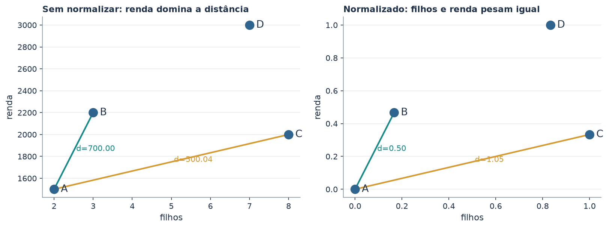
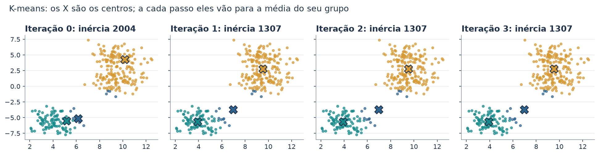
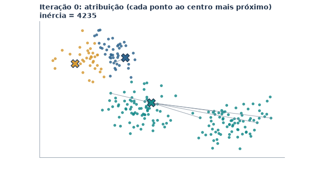
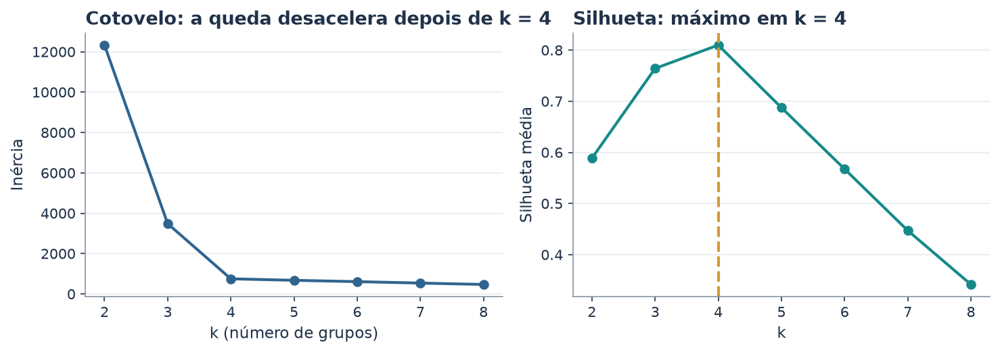
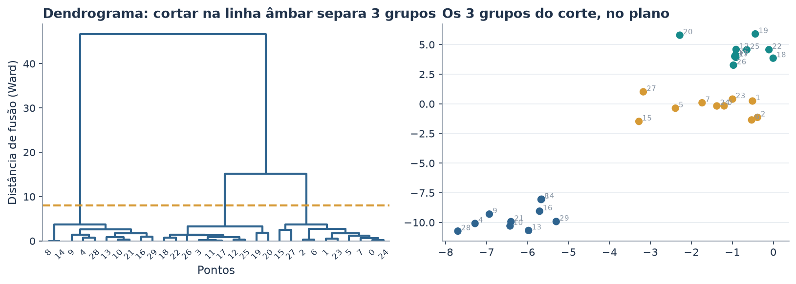
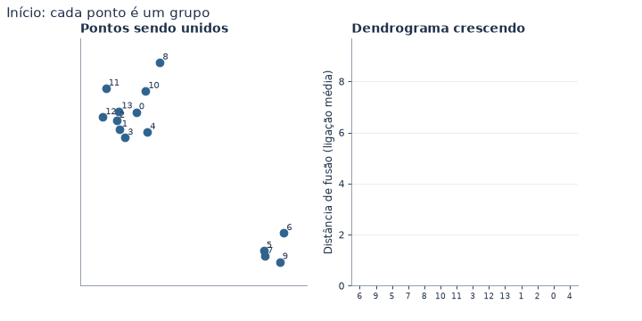
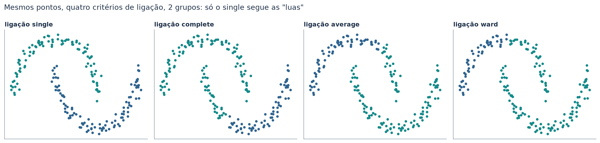
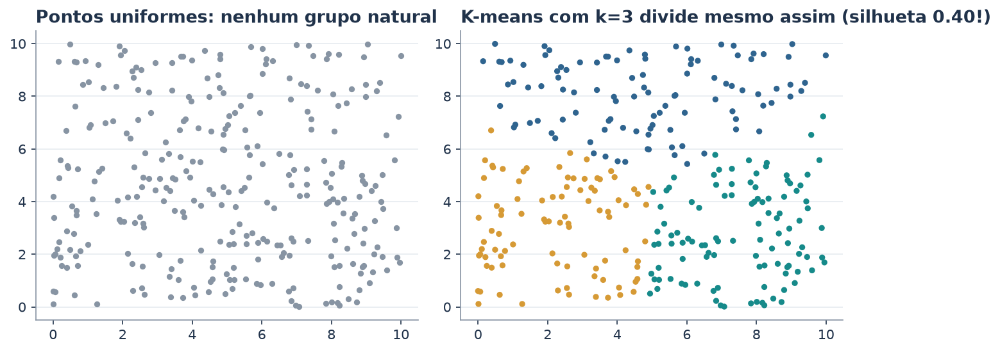
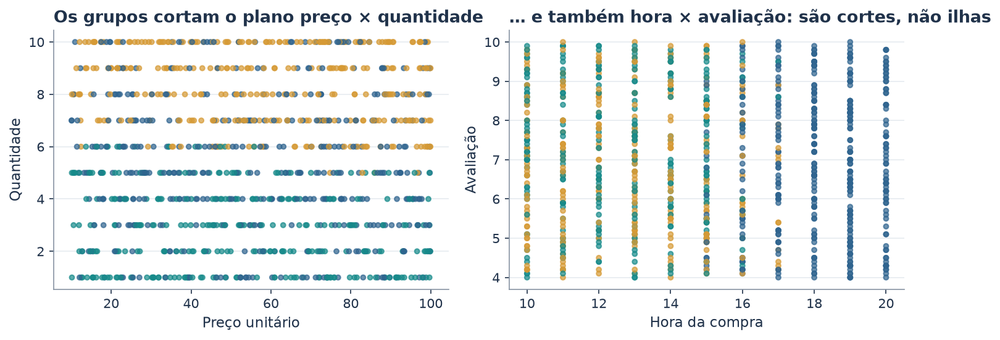

# 08 · Agrupamento (aprendizado não supervisionado)

**Pergunta inicial:** se você pedir a um algoritmo que divida os clientes em três perfis, ele vai dividir. Como saber se esses três perfis existem ou se foram inventados pelo pedido?

No aprendizado supervisionado (unidade 07), cada exemplo vinha com a resposta: adimplente ou inadimplente, maligno ou benigno. Em muitos problemas reais **não há rótulo**: rotular é caro, demorado ou simplesmente impossível. O aprendizado não supervisionado procura estrutura nos próprios dados. Agrupar (*clustering*) é formar grupos tais que objetos do mesmo grupo sejam parecidos e objetos de grupos diferentes, diferentes.

Isso torna o método útil para **explorar** e perigoso para **concluir**: o algoritmo sempre devolve grupos, existam eles ou não.

Pré-requisitos: [06 · Pré-processamento](../06_preprocessamento/) (escala) e [07 · Aprendizagem de máquina](../07_aprendizagem_de_maquina/).

## O processo, em seis etapas

1. **Selecionar atributos** que reflitam o objetivo (e remover os irrelevantes).
2. **Escolher uma medida de proximidade** e colocar os atributos na mesma escala.
3. **Definir o critério** do que é um bom grupo (uma função objetivo).
4. **Escolher o algoritmo** (hierárquico ou particional).
5. **Validar**: grupos não vazios, protótipos representativos, número de grupos adequado (silhueta, cotovelo, estabilidade).
6. **Interpretar** com tabelas e gráficos, e com conhecimento do domínio. Grupos só valem se fizerem sentido e forem úteis.

## Passo a passo

### 01 · Proximidade e normalização ([01_proximidade_e_normalizacao.py](01_proximidade_e_normalizacao.py))

A distância euclidiana entre dois objetos com *p* atributos é

$$d(a, b) = \sqrt{\sum_{j=1}^{p} (a_j - b_j)^2}$$

Com quatro famílias (filhos, renda), sem normalizar, A parece mais perto de C (d = 500) do que de B (d = 700), só porque a renda tem números maiores: os 6 filhos de diferença entre A e C quase não contam. Com normalização min-max, a conclusão se inverte: d(A, B) = 0,50 e d(A, C) = 1,05.

### 02 · K-means passo a passo ([02_kmeans_passo_a_passo.py](02_kmeans_passo_a_passo.py))

O k-means representa cada grupo por um **protótipo** (centro) e alterna dois passos até os centros pararem:

1. **atribuição**: cada objeto vai para o grupo do centro mais próximo;
2. **atualização**: cada centro vira a média dos objetos do seu grupo.

Ele minimiza a **inércia** (soma das distâncias ao quadrado de cada ponto ao seu centro), que nunca aumenta de um passo para o outro.

*Animação gerada por [animacoes/fontes/kmeans_passo_a_passo.py](../animacoes/fontes/kmeans_passo_a_passo.py).*

O resultado depende dos centros iniciais. Por isso o scikit-learn repete o algoritmo várias vezes (`n_init=10`) e guarda o de menor inércia; `random_state` torna tudo reproduzível.

### 03 · Quantos grupos? ([03_escolher_k.py](03_escolher_k.py))

- **Cotovelo**: a inércia sempre cai quando k cresce; procura-se o ponto em que a queda desacelera.
- **Silhueta**: para cada ponto, compara a distância média ao próprio grupo (*a*) com a distância média ao grupo vizinho mais próximo (*b*): s = (b − a) / max(a, b), de −1 a 1.

Em dados gerados com 4 grupos bem separados, os dois critérios apontam k = 4 (silhueta 0,81).

### 04 · Agrupamento hierárquico ([04_hierarquico_e_dendrograma.py](04_hierarquico_e_dendrograma.py))

O **aglomerativo** começa com cada objeto em um grupo e, a cada passo, junta os dois grupos mais próximos até sobrar um. O **divisivo** faz o contrário. O resultado é uma árvore, o **dendrograma**: a altura de cada junção é a distância entre os grupos unidos. Cortar a árvore em uma altura escolhe quantos grupos ficam, sem precisar fixar k antes.

A "distância entre grupos" precisa ser definida (critério de **ligação**):

| Ligação | Distância entre os grupos A e B | Efeito |
|---|---|---|
| single | menor distância entre um ponto de A e um de B | encadeia; segue formas alongadas |
| complete | maior distância entre um ponto de A e um de B | grupos compactos |
| average | média de todas as distâncias entre pontos de A e de B | intermediário |
| Ward | aumento da variância interna ao juntar | grupos compactos e de tamanho parecido |

### 05 · Limites da interpretação ([05_limites_de_interpretacao.py](05_limites_de_interpretacao.py))

Três armadilhas, cada uma com um experimento:

1. **Grupos onde não há grupo**: em pontos uniformemente espalhados, o k-means com k = 3 divide mesmo assim, e a silhueta dá 0,40. Uma silhueta "moderada" não prova nada; compare com a silhueta de dados sem estrutura do mesmo tamanho.
2. **A escala decide**: sem padronizar, os grupos dos clientes são definidos pela renda; padronizando, idade e renda pesam igual e os grupos mudam.
3. **O início importa**: com uma única inicialização, sementes diferentes dão inércias de 920 a 1 090.

### 06 · Em dados reais: há perfis de compra? ([06_segmentar_vendas.py](06_segmentar_vendas.py))

Com preço unitário, quantidade, avaliação e hora das 1 000 vendas do supermercado (padronizados), a silhueta fica abaixo de 0,25 para todo k, **abaixo** da referência de dados sem estrutura. A partição em três separa cupons baratos e pequenos, caros e grandes, e intermediários: uma forma de organizar a descrição, não uma descoberta. A base também identifica cupons, não clientes, então "perfil de cliente" seria uma afirmação que os dados não sustentam.

O estudo de caso [03 · Vendas em supermercado](../18_estudos_de_caso/03_vendas_supermercado/) retoma essa análise com agrupamento hierárquico.

## Atividade curta

Em `03_escolher_k.py`, gere os dados com `cluster_std=2.5`. O cotovelo e a silhueta ainda apontam k = 4? Qual dos dois critérios degradou primeiro?

## Problema de interpretação

Uma apresentação mostra "quatro perfis de cliente descobertos por k-means" e propõe uma campanha para cada um. Liste o que você pediria para ver antes de aprovar: silhueta comparada a uma referência sem estrutura, estabilidade com outras sementes, variáveis usadas e sua escala, se a base identifica clientes ou só compras.

## Relação com o livro

Capítulo 7 (Aprendizagem Não-Supervisionada): 7.2 Algoritmos de Agrupamento, 7.2.1 Hierárquico (scripts 04 e 06) e 7.2.2 Particional (02, 03, 05). O capítulo também trata de regras de associação (7.1) e mapas de Kohonen (7.3).

## Próxima etapa

[09 · K-vizinhos mais próximos](../09_knn/)
