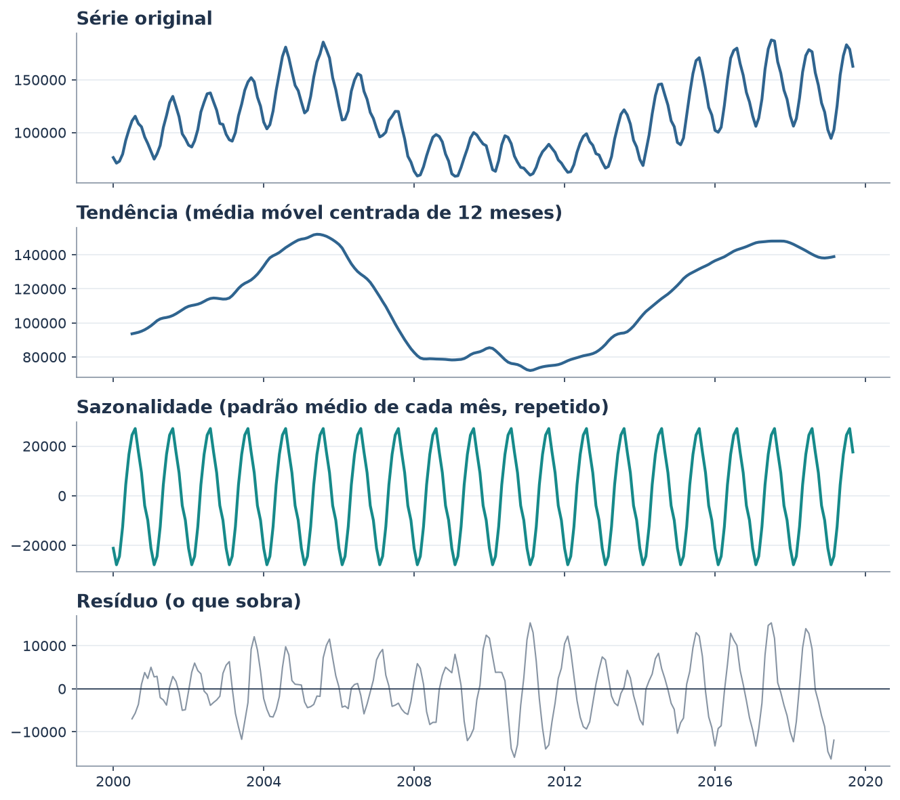
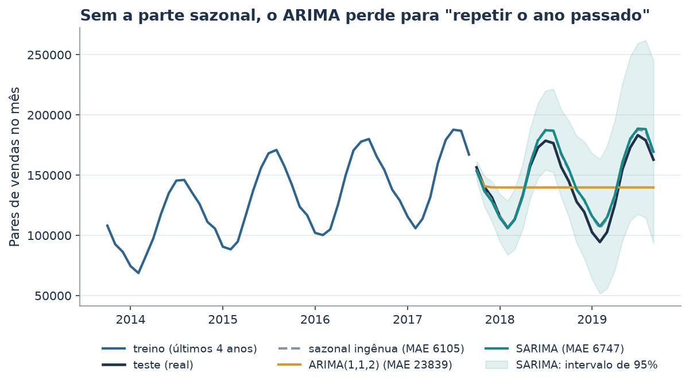
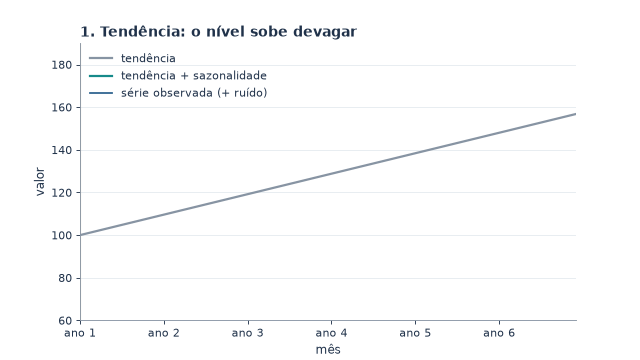

# 08 · Séries temporais

**Pergunta inicial:** as vendas de imóveis caíram de maio para junho. Isso é o começo de uma queda ou é só o que acontece todo ano nessa época?

Dados com data têm uma propriedade que os outros não têm: a ordem importa. Esta unidade mostra como separar o que é tendência, o que é calendário e o que é ruído, como avaliar uma previsão sem trapacear (treino no passado, teste no futuro) e como um modelo ARIMA se compara com a linha de base mais simples que existe, repetir o ano anterior.

Pré-requisitos: [03 · Estatística](../03_estatistica/) e [04 · Visualização](../04_visualizacao/) (gráfico de linhas, agregação).

Conceitos: frequência e índice temporal; média móvel; gráfico sazonal; decomposição aditiva e multiplicativa; separação cronológica; linhas de base (média, último valor, sazonal ingênua); MAE e MAPE; ARIMA e SARIMA; intervalo de previsão; validação por janelas.

## Os dados

`dados/SPCS20RPSNSA.csv`: pares de vendas de imóveis por mês em 20 cidades dos EUA, sem ajuste sazonal, de janeiro de 2000 a setembro de 2019 (FRED, série SPCS20RPSNSA). Já estava no repositório de 2019. `dados/Drugs.csv`: vendas mensais de antidiabéticos na Austrália, 1991 a 2008.

## Scripts, na ordem

| Script | O que mostra |
|---|---|
| [01_ler_e_visualizar.py](01_ler_e_visualizar.py) | `asfreq`, média móvel de 12 meses, gráfico sazonal (um ano por linha) |
| [02_decomposicao.py](02_decomposicao.py) | `seasonal_decompose` aditiva; multiplicativa em Drugs.csv |
| [03_treino_teste_cronologico.py](03_treino_teste_cronologico.py) | Últimos 24 meses como teste; três linhas de base; MAE e MAPE |
| [04_arima_revisado.py](04_arima_revisado.py) | ARIMA(1,1,2) com a API atual; SARIMA; intervalo de 95%; resíduos |
| [05_janelas_de_validacao.py](05_janelas_de_validacao.py) | Seis datas de corte; média e variação do erro |

O `series_temporais.py` de 2019 importava `ARIMA` de `statsmodels.tsa.arima_model` e usava `plot_predict`, ambos removidos. O script 04 refaz o mesmo modelo com `statsmodels.tsa.arima.model.ARIMA` e `get_forecast`, e acrescenta a comparação com a linha de base que faltava.

## Figuras

*`02_decomposicao.py`. O resíduo cresce em 2008 a 2010: o padrão sazonal médio não descreve bem o período da crise.*

*`04_arima_revisado.py`. O ARIMA sem componente sazonal perde de longe para "repetir o ano passado" (MAE 23 839 contra 6 105). O SARIMA chega perto, mas neste teste único ainda fica um pouco atrás (6 747). Só nas seis janelas do script 05 ele passa a vencer na média (7 132 contra 12 311), e é esse o número que vale.*

*Animação gerada por [animacoes/fontes/serie_componentes.py](../animacoes/fontes/serie_componentes.py).*

## O que observar

Em `03`, a linha de base sazonal tem erro bem menor que a média histórica e que repetir o último valor. Um modelo que não bate essa linha de base não aprendeu nada sobre a série. Em `05`, o erro muda de uma janela para outra; o número que se relata é a média (com a variação), não o melhor caso.

## Atividade curta

Em `04`, escolha a ordem do SARIMA olhando só o treino (por exemplo, comparando o AIC de duas ou três ordens com `modelo.aic`) e depois meça no teste uma única vez. Compare com o que acontece se você escolher a ordem olhando o MAE do teste.

## Problema de interpretação

Um relatório diz: "o modelo previu as vendas dos próximos 24 meses com erro de 5%". Que perguntas você faria sobre como esse erro foi medido (separação no tempo, quantas janelas, comparação com a linha de base, se a ordem do modelo foi escolhida com o teste)?

## Relação com as aulas e o livro

Aula 15 (Séries Temporais: fenômenos típicos, modelos, análise). Capítulo 8 do livro (8.1 Conceitos, 8.2 Modelos Gerais, 8.3 Modelos ARIMA).

## Próxima etapa

[09 · Redes sociais](../09_redes_sociais/)
