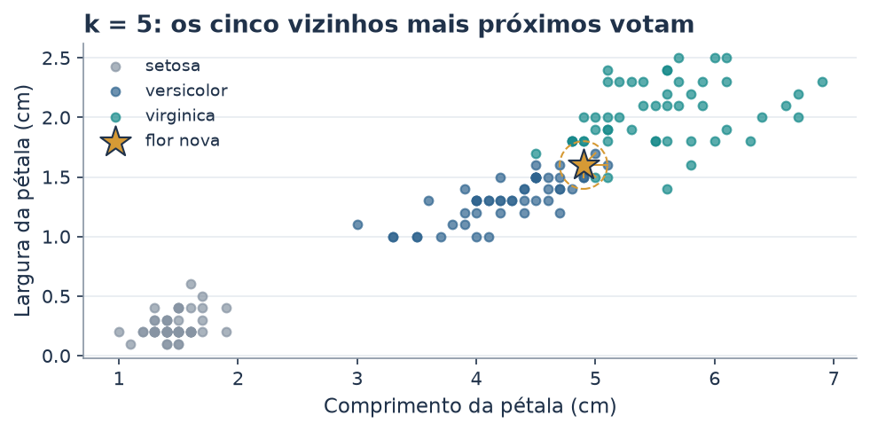
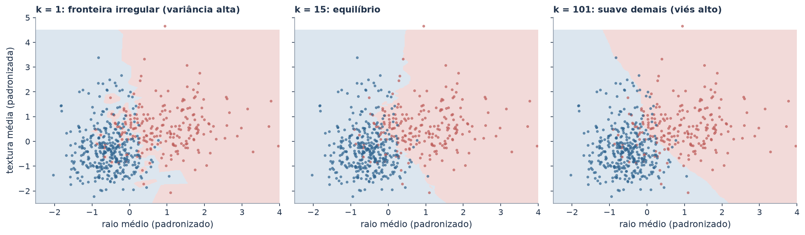
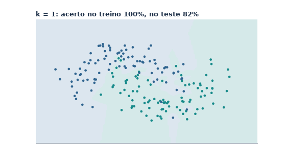
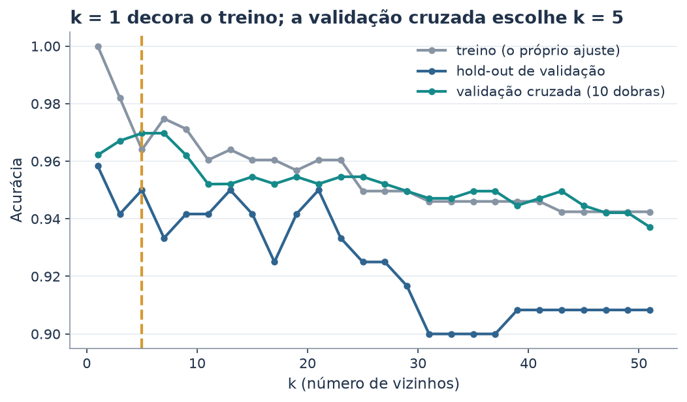
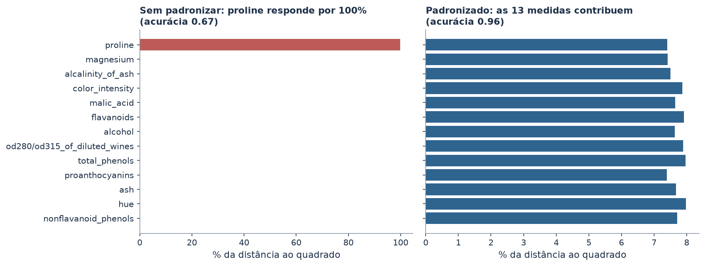
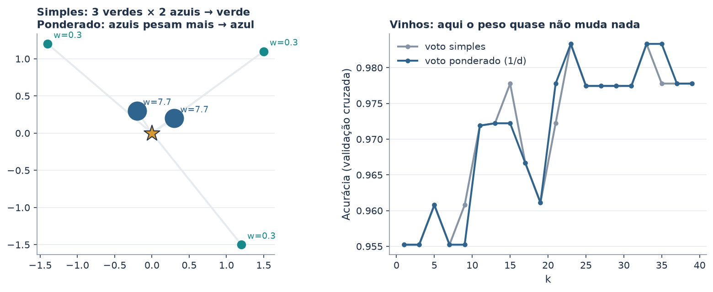
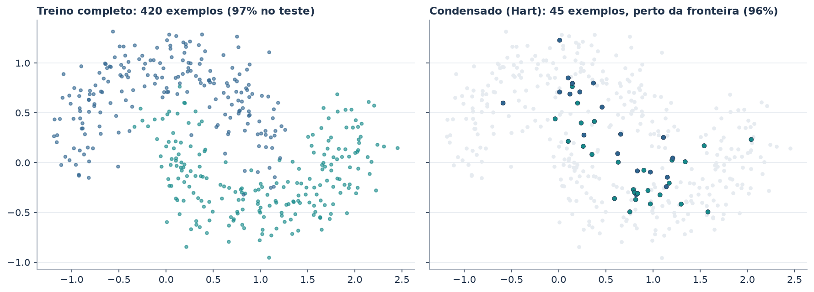
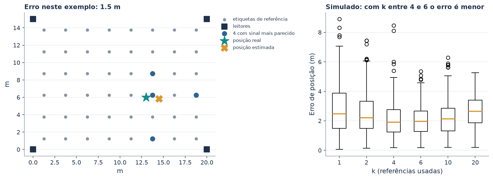

# 09 · K-vizinhos mais próximos (k-NN)

**Pergunta inicial:** é possível classificar algo novo sem construir nenhuma regra, só olhando para os casos mais parecidos que já conhecemos?

A maioria dos algoritmos constrói uma descrição geral e explícita (uma reta, uma árvore). O k-NN não constrói nada: ele **guarda os exemplos** e, quando chega um caso novo, procura os *k* exemplos mais parecidos e deixa que eles votem. É o método mais simples da família de **aprendizagem baseada em instâncias**: não paramétrico (não supõe nenhuma forma para os dados), local (cada classificação usa só a vizinhança do caso) e "preguiçoso" (todo o trabalho acontece na hora de classificar).

Pré-requisitos: [06 · Pré-processamento](../06_preprocessamento/) (escala) e [07 · Aprendizagem de máquina](../07_aprendizagem_de_maquina/) (validação).

## O algoritmo

**Treinamento:** guardar cada exemplo (x, c).

**Classificação** de um caso novo x_t:

1. calcular a distância de x_t a cada exemplo guardado (euclidiana: $d(a,b) = \sqrt{\sum_j (a_j - b_j)^2}$);
2. separar os *k* exemplos mais próximos;
3. devolver a classe mais frequente entre eles:

$$\hat{c}(x_t) = \arg\max_{c} \sum_{i=1}^{k} I(c = c_i)$$

Custo: para cada caso novo, *n* distâncias de *p* dimensões, ou seja O(n·p). Com milhões de exemplos, classificar fica caro.

## Passo a passo

### 01 · À mão ([01_knn_a_mao.py](01_knn_a_mao.py))

Uma flor de íris nova, com pétala de 4,9 × 1,6 cm. O script calcula a distância para as 150 flores conhecidas, ordena e vota. As 7 mais próximas são 4 versicolor e 3 virginica: a resposta é versicolor para k = 1, 3, 5 e 7, mas o placar aperta à medida que k cresce. A flor está na fronteira entre as duas espécies.

### 02 · Qual o melhor k? ([02_escolher_k.py](02_escolher_k.py))

- **k pequeno**: a fronteira acompanha cada exemplo, inclusive o ruído (variância alta). Com k = 1, o acerto no próprio treino é 100%, porque cada exemplo é vizinho de si mesmo.
- **k grande**: a fronteira fica suave demais e ignora detalhes (viés alto). No limite, k = n responde sempre a classe majoritária.

*Animação gerada por [animacoes/fontes/knn_variando_k.py](../animacoes/fontes/knn_variando_k.py).*

O k é escolhido por **validação** dentro do treino (hold-out ou validação cruzada), nunca pelo teste. Na base de câncer de mama, a validação cruzada de 10 dobras escolhe k = 5 (0,970); no teste, 0,942.

### 03 · A escala decide tudo ([03_escala_importa.py](03_escala_importa.py))

Como o k-NN é só distância, o atributo com números maiores manda. Na base de vinhos (13 medidas químicas), `proline` varia mais de 1 000 unidades e responde por quase toda a distância. Sem padronizar, o k-NN acerta 0,68, praticamente o mesmo que usando só `proline` (0,67): as outras 12 medidas não contavam. Padronizado, 0,96.

### 04 · Voto ponderado pela distância ([04_knn_ponderado.py](04_knn_ponderado.py))

Cada vizinho vota com peso $w_i = 1/d(x_t, x_i)^2$:

$$\hat{c}(x_t) = \arg\max_c \sum_{i=1}^{k} w_i\, I(c = c_i)$$

No exemplo pequeno, 3 vizinhos verdes distantes vencem 2 azuis colados no voto simples; no ponderado, os azuis pesam 15,4 contra 0,9 e vencem. Com ponderação, até se pode usar todos os exemplos: os distantes quase não contam (ao custo de mais cálculo).

Na base de vinhos, o voto ponderado empata com o simples. Nem toda variante "melhorada" melhora em todo problema.

### 05 · Condensação de Hart ([05_condensacao_de_hart.py](05_condensacao_de_hart.py))

Dá para guardar menos exemplos sem perder acerto? A **condensação de Hart** começa com um exemplo e percorre os demais: sempre que o 1-NN com o conjunto atual erra um exemplo, ele é acrescentado. Repete até uma passada sem erros. Os escolhidos ficam perto da fronteira, onde está a informação.

Com 45 de 420 exemplos (11%), o 1-NN acerta 0,956 no teste, contra 0,967 com todos.

### 06 · k-NN para prever números: localização ([06_knn_para_localizacao.py](06_knn_para_localizacao.py))

O k-NN também faz **regressão**: em vez de votar uma classe, faz a média (ponderada) dos valores dos vizinhos. Uma aplicação clássica é localizar etiquetas de radiofrequência dentro de prédios, onde o GPS não funciona. Etiquetas de referência têm posição conhecida; quatro leitores medem a força do sinal. Para uma etiqueta nova, procuram-se as *k* referências com **vetor de sinal** mais parecido ($E_r$ = distância euclidiana entre os sinais) e estima-se a posição como média ponderada:

$$W_r = \frac{1/E_r^2}{\sum_c 1/E_c^2} \qquad (x, y) = \sum_{r=1}^{k} W_r\,(x_r, y_r)$$

O script simula o sinal com um modelo simples de propagação. O erro mediano cai de 2,5 m (k = 1) para 1,9 m (k = 4) e volta a subir com k = 20.

## Vantagens e desvantagens

| + | − |
|---|---|
| modela fronteiras complexas com aproximações locais simples | classificar é lento: O(n·p) por caso |
| nenhuma informação do treino é perdida | depende de escolher bem a distância e a escala |
| um só parâmetro principal (k) | sofre com muitos atributos irrelevantes |

## Atividade curta

Em `02_escolher_k.py`, troque a padronização por `MinMaxScaler`. O k escolhido muda? E a acurácia?

## Problema de interpretação

Um sistema de recomendação diz: "clientes parecidos com você compraram X". Explique, com o vocabulário desta unidade, que escolhas definem quem é "parecido" e como cada escolha pode mudar a recomendação.

## Relação com o livro

Capítulo 5 (Classificação), seção 5.1 (K-Vizinhos Mais Próximos).

## Próxima etapa

[10 · Naive Bayes](../10_naive_bayes/)
