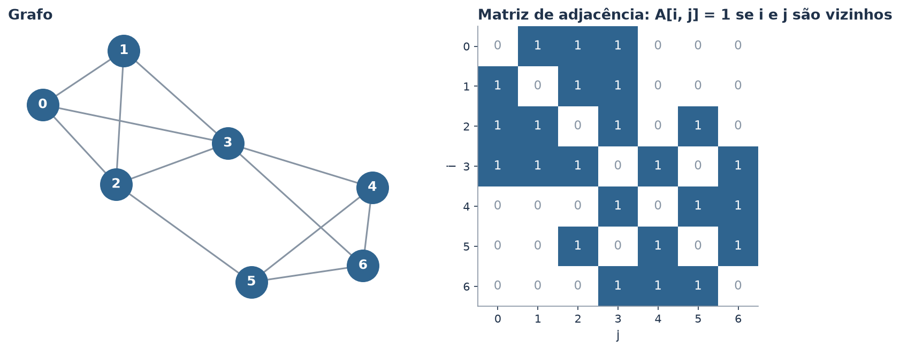
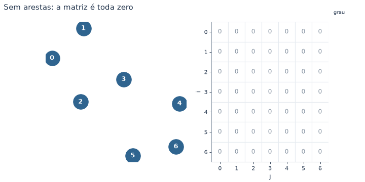
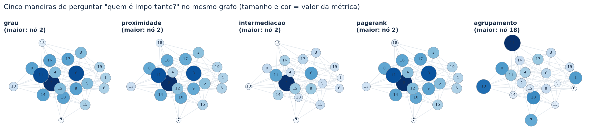
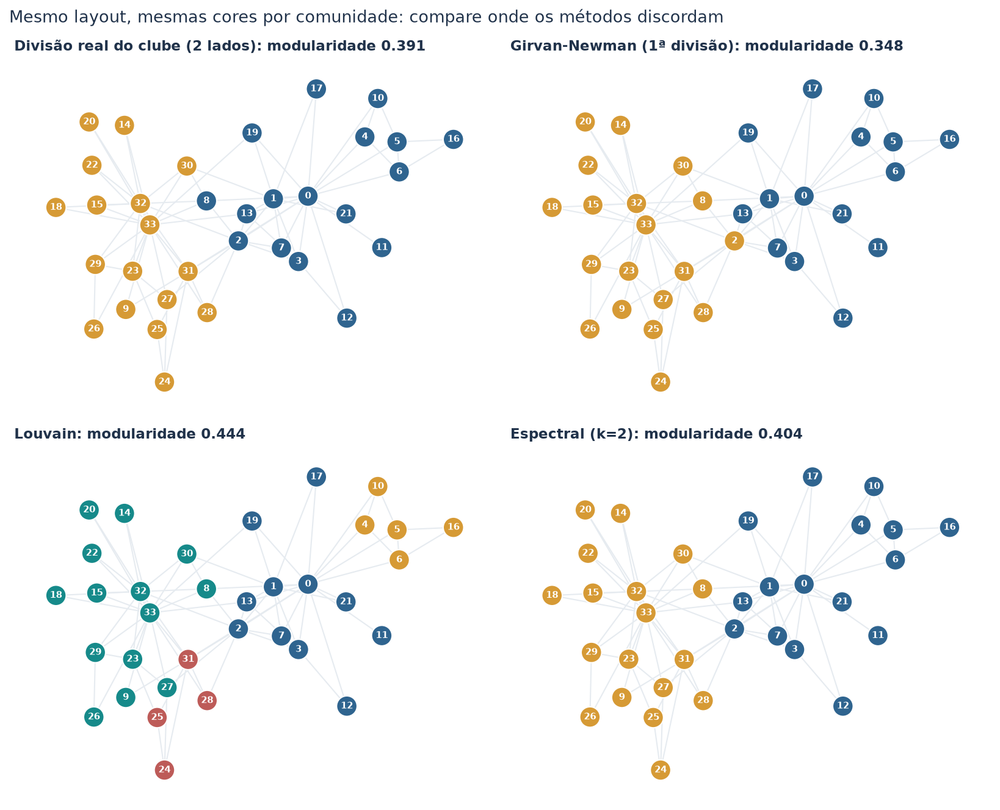

# 09 · Redes sociais

**Pergunta inicial:** em um grupo de 34 pessoas, quem é a mais importante? A resposta muda conforme "importante" signifique ter mais contatos, estar perto de todos ou ser a ponte entre dois lados. Como decidir qual definição serve à sua pergunta?

Esta é uma **aula** de análise de redes, baseada no capítulo 9 do livro (9.1 Rede Social e Grafo; 9.2 Análise Estrutural, com métricas locais e globais; 9.3 Detecção de Comunidades). Os dados são pequenos, construídos à mão ou clássicos (clube de karatê de Zachary), porque o objetivo é ver o que cada métrica calcula. Isso não é um estudo de caso: nenhuma recomendação sai daqui. Quem quiser aplicar os conceitos a uma rede observacional real encontra o estudo [07 · Votações na Wikipédia](../10_estudos_de_caso/07_votacoes_wikipedia/), que tem pergunta, dados e limitações próprios.

Pré-requisitos: [01 · Python do zero](../01_python/) (dicionários, laços) e [07 · Agrupamento](../07_agrupamento/) (ideia de partição e de validação).

Conceitos: nó, aresta, grafo direcionado e não direcionado; grau, grau de entrada e saída; matriz de adjacência; centralidades de grau, proximidade, intermediação e PageRank; coeficiente de agrupamento; densidade, diâmetro, caminho médio, componentes, pontes; cliques; comunidades (Girvan-Newman, Louvain, espectral) e modularidade.

## Scripts, na ordem

| Script | Seção do livro | Origem | O que mostra |
|---|---|---|---|
| [01_grafo_manual.py](01_grafo_manual.py) | 9.1 | `grafoMatriz.py` | Grafo de 7 nós com arestas fixas; grau; versão direcionada |
| [02_matriz_de_adjacencia.py](02_matriz_de_adjacencia.py) | 9.1 | `grafoMatriz.py` | Matriz do mesmo grafo; soma das linhas = grau; A² e vizinhos em comum; saída em LaTeX |
| [03_metricas_locais.py](03_metricas_locais.py) | 9.2.1 | `metricasLocais.py` | Cinco métricas no mesmo grafo, mesma figura, mesmo layout |
| [04_metricas_globais.py](04_metricas_globais.py) | 9.2.2 | novo | Densidade, diâmetro, caminho médio, agrupamento médio, pontes, distribuição de grau |
| [05_cliques.py](05_cliques.py) | 9.2 | `clique.py` | Cliques construídos e cliques encontrados pelo algoritmo |
| [06_comunidades.py](06_comunidades.py) | 9.3.1 a 9.3.3 | `comunidades_karate.py` | Girvan-Newman, Louvain e espectral comparados pela modularidade e pela divisão real |

Os scripts originais estão em [original/aplicacao_zip/Capitulos/Redes sociais/](../original/aplicacao_zip/Capitulos/Redes%20sociais/). Correções feitas: o título de `grafoMatriz.py` dizia "6 nós e 8 arestas" para um grafo de 7 nós e 12 arestas; `metricasLocais.py` e `comunidades_karate.py` usavam layouts sem semente, então a figura mudava a cada execução; `clique.py` sorteava as arestas extras sem semente. `comunidades_karate.py` dependia de `python-louvain` e `node2vec`; o Louvain passou a vir do `networkx` e o K-means sobre *embeddings* foi retirado da aula (continua disponível no original para quem instalar as dependências).

## Figuras

*`02_matriz_de_adjacencia.py`. Cada 1 na matriz é uma aresta; a soma de uma linha é o grau do nó.*

*Animação gerada por [animacoes/fontes/matriz_adjacencia_construcao.py](../animacoes/fontes/matriz_adjacencia_construcao.py).*

*`03_metricas_locais.py`. Neste grafo denso as quatro centralidades apontam o mesmo nó; o coeficiente de agrupamento aponta outro, porque mede algo diferente: quão fechado é o círculo do nó, não quão central ele é. No clube de karatê (exercício do script) as centralidades passam a discordar.*

*`06_comunidades.py`. Louvain encontra mais comunidades e modularidade maior que a divisão real em dois lados; modularidade alta não significa "acertou".*

## O que observar

Em `03`, as cinco métricas discordam sobre quem é o nó central. Isso não é defeito: cada uma responde a uma pergunta diferente (quem tem mais contatos, quem alcança todos mais rápido, por quem passam os caminhos, quem é citado por nós importantes, quem vive em um grupo fechado). Antes de calcular, decida qual pergunta importa.

Em `06`, os dados do clube de karatê são adequados para demonstrar algoritmos. Eles não sustentam nenhuma decisão sobre pessoas reais, e o mesmo vale para qualquer rede pequena ou sintética.

## Atividade curta

Em `01`, acrescente um nó 7 ligado só ao nó 6. Recalcule as métricas do script 03 nesse grafo. Qual métrica do nó 6 mudou mais?

## Problema de interpretação

Alguém propõe "remover o usuário de maior PageRank para desarticular a rede". Usando o script 04 (componentes após remover um nó) e o 03 (intermediação), explique por que o nó de maior PageRank pode não ser o que mais desconecta a rede, e por que nenhuma dessas métricas autoriza conclusões sobre a intenção das pessoas.

## Relação com as aulas e o livro

Aula 18 (Análise de Redes Sociais: conceitos básicos, análise estrutural, detecção de comunidades). Capítulo 9 do livro, seções 9.1 a 9.3.

## Próxima etapa

[10 · Estudos de caso](../10_estudos_de_caso/)
