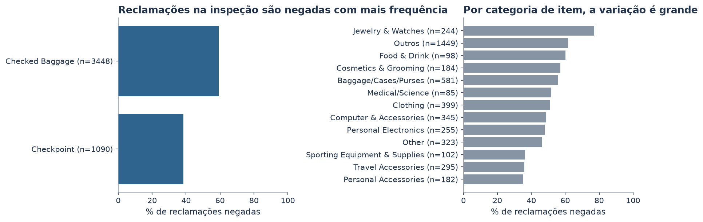
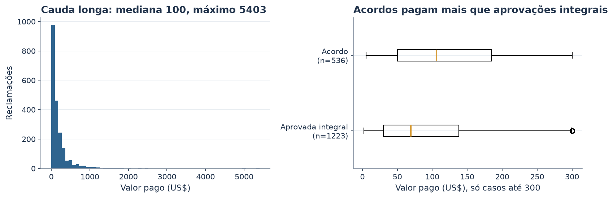

# Estudo de caso 1 · Reclamações por perdas em aeroportos (TSA)

**Relação com o livro.** Baseado no capítulo 11 — Aplicação 1: Reclamações por Perdas, de *Ciência de Dados: da teoria à prática*. As quatro etapas seguem as seções 11.1 (Análise Descritiva), 11.2 (Pré-processamento), 11.3 (Análise das Reclamações) e 11.4 (Análise dos Valores Recebidos). Capítulos teóricos de apoio: 3 (Estatística), 4 (Pré-processamento), 5 (Classificação) e 6 (Avaliação de Classificadores). Origem no material do autor: `Aplicacao/TSA/leitura.py` e `dados/claims-data-2015-as-of-feb-9-2016.xlsx`, preservados em [original/aplicacao_zip/TSA/](../../original/aplicacao_zip/TSA/).

## 1. Situação e pergunta

Passageiros que têm bens perdidos ou danificados durante a inspeção de segurança nos aeroportos dos Estados Unidos podem registrar uma reclamação na TSA (Transportation Security Administration). Cada reclamação é analisada e termina negada, aprovada integralmente ou em acordo. Quem gerencia essa fila precisa decidir **em que ordem analisar os casos** e **quanto esperar pagar**. As perguntas deste estudo:

- Os desfechos variam com o tipo de reclamação, o local do incidente, a companhia aérea e a categoria do item?
- Quando há pagamento, quanto se paga, e de que isso depende?
- Um modelo poderia apoiar a análise humana, sem substituí-la?

## 2. Dados e alcance

`dados/claims-data-2015-as-of-feb-9-2016.xlsx`: 8 667 reclamações recebidas em 2015 (atualização de fevereiro de 2016), publicadas pela TSA (dados abertos do governo dos EUA). Colunas: número da reclamação, data de recebimento, data do incidente, aeroporto (código e nome), companhia aérea, tipo, local, categoria do item, valor pago (*Close Amount*) e desfecho (*Disposition*).

O que a base **não** tem: o valor pedido, as evidências apresentadas, quem analisou, o motivo da decisão. O traço `-` marca informação ausente em várias colunas; 2 066 reclamações não têm desfecho registrado.

## 3. Etapas, scripts e figuras

| Etapa no repositório | Seção do livro | Arquivo Python | Pergunta respondida | Figura |
|---|---|---|---|---|
| Conhecer os dados | 11.1 | [01_conhecer_os_dados.py](01_conhecer_os_dados.py) | O que cada coluna registra? Quantos casos têm desfecho? | `figuras/01_desfechos_e_locais.png`, `figuras/01_reclamacoes_por_mes.png` |
| Preparar os dados | 11.2 | [02_preparar_os_dados.py](02_preparar_os_dados.py) | O que cada filtro remove e o que sobra para analisar? | `figuras/02_filtros_aplicados.png` |
| Analisar desfechos | 11.3 | [03_analisar_desfechos.py](03_analisar_desfechos.py) | Em que situações as reclamações são negadas? Um modelo antecipa isso? | `figuras/03_taxa_negativa_por_grupo.png`, `figuras/03_importancia_variaveis.png` |
| Analisar valores recebidos | 11.4 | [04_analisar_valores_recebidos.py](04_analisar_valores_recebidos.py) | Quanto se paga quando se paga? | `figuras/04_distribuicao_valores.png`, `figuras/04_importancia_valor.png` |
| Avaliar uma decisão | (síntese) | [05_avaliar_uma_decisao.py](05_avaliar_uma_decisao.py) | Ordenar a fila pelo modelo ajudaria? Como medir? | `figuras/05_ganho_na_fila.png` |
| Complemento avançado | 11.3 | [06_shap_opcional.py](06_shap_opcional.py) | Explicações SHAP da floresta (requer `pip install shap`) | `figuras/06_shap_beeswarm.png` (não gerada no ambiente básico) |

Execute na ordem; o script 02 grava `dados/reclamacoes_preparadas.csv`, usado pelos seguintes.

## 4. O que a análise encontrou

**Preparação (11.2).** Seguindo o material original, ficam os casos com desfecho, tipo, local e companhia informados, das cinco companhias com mais reclamações (Southwest, Delta, American, UAL, USAir): 4 542 registros, 52% da base. As conclusões valem para esse recorte.

**Desfechos (11.3).** 54% das reclamações do recorte foram negadas. A taxa varia com o local (59% na bagagem despachada, 38% na inspeção), com a categoria do item (77% para joias e relógios, 35% para acessórios pessoais) e pouco com a companhia (53% a 57%). Regressão logística, árvore e floresta aleatória acertam cerca de 63% no teste, contra 54% da linha de base, com AUC em torno de 0,65. É um ganho real, mas pequeno: o desfecho depende de informações que a base não registra.

**Valores (11.4).** 2 078 casos tiveram pagamento. A distribuição tem cauda longa: mediana de US$ 100, média de US$ 191, máximo de US$ 5 403. Acordos pagam mais que aprovações integrais (medianas de 150 e 81). Por categoria, computadores lideram (mediana US$ 400) e acessórios de viagem ficam em US$ 15. Prever o valor dos casos abaixo de US$ 300 com floresta aleatória reduz o erro médio de 64 (prever a mediana) para 55: pouco.

## 5. Recomendação proporcional à evidência

Percebemos que a chance de pagamento varia com o local, a categoria do item e o tempo até o registro, e que um modelo com essas variáveis ordena os casos um pouco melhor que o acaso. Isso sugere que a fila de análise pode ser **ordenada** para que os casos com mais chance de ressarcimento sejam vistos primeiro. Não sugere, em hipótese alguma, negar ou aprovar pedidos automaticamente: a acurácia de 63% condenaria quase quatro em cada dez decisões.

A decisão candidata é ordenar a fila pela probabilidade prevista de pagamento. No teste, revisar metade da fila nessa ordem alcança 61% dos casos que terminam pagos, contra 50% em ordem aleatória. Após três meses, o efeito poderia ser avaliado pelo tempo mediano até o pagamento (métrica principal), acompanhando a taxa de negativa e o tempo dos casos negados (métricas auxiliares). A ação seria considerada bem-sucedida se o tempo até o pagamento caísse sem que o tempo dos demais casos subisse. Esses são critérios propostos, não resultados.

## 6. Incertezas e limites

- Recorte de um ano e cinco companhias; casos sem desfecho (24% da base) ficaram de fora e podem não ser parecidos com os demais.
- Não há valor pedido nem evidências: duas reclamações iguais nas colunas podem ser muito diferentes.
- A variável "dias até registrar" pode refletir prazos regulamentares, não a qualidade do pedido. Importância em floresta não é causa.
- A classe "negada" é a maioria; acurácia sozinha engana. Por isso as tabelas trazem revocação, precisão e AUC.

## 7. Atividades

1. **Reprodução.** Rode os scripts 01 a 05 e confira os números deste README.
2. **Variação.** Em `02`, mantenha todas as companhias (não só as cinco) e refaça `03`. As taxas de negativa por local mudam?
3. **Pergunta aberta.** O valor pago depende do aeroporto? Agrupe por `Airport Code` com n ≥ 50.
4. **Crítica.** A recomendação de ordenar a fila pode prejudicar quem tem menor chance prevista de pagamento (seus casos esperam mais). Que métrica acrescentaria para vigiar isso, e que limite de espera você fixaria?

## Diferenças em relação ao material original

O `leitura.py` original usava `train_test_split` sem semente e sem estratificação, não tinha linha de base, gerava figuras SHAP para os três classificadores e, na regressão de valores, não comparava com a mediana. As figuras originais estão em [original/aplicacao_zip/TSA/figuras/](../../original/aplicacao_zip/TSA/figuras/); as novas seguem o [manual visual](../../materiais/manual_visual.md) e trazem os mesmos recortes (todos os valores, só pagos, até US$ 300).
