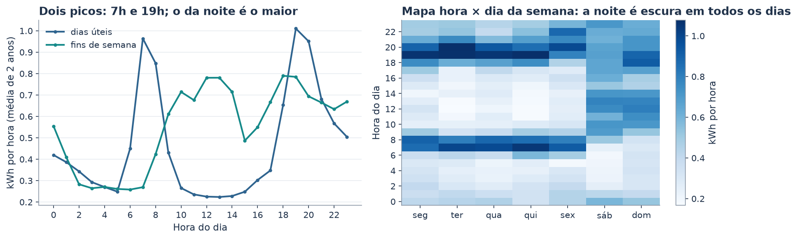
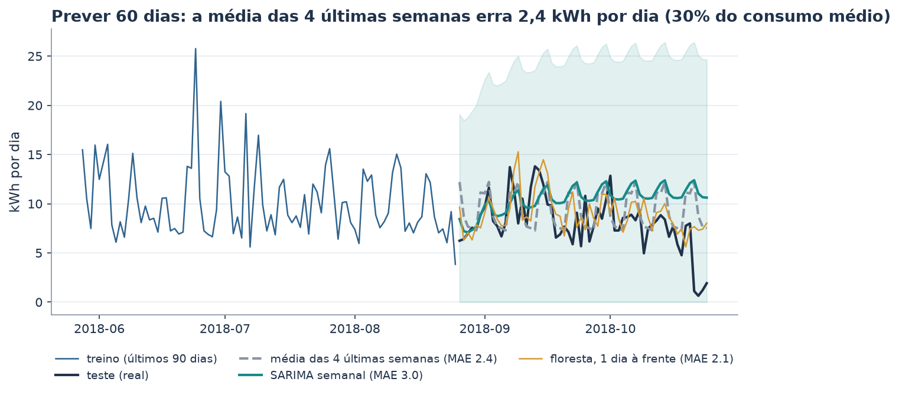

# Estudo de caso 2 · Energia doméstica

**Relação com o livro.** Baseado no capítulo 12 — Aplicação 2: Energia Doméstica, de *Ciência de Dados: da teoria à prática*. As etapas seguem as seções 12.1 (Análise Descritiva), 12.2 (Pré-processamento), 12.3 (Análise do Uso de Energia) e 12.4 (Recomendação de Uso). Capítulos teóricos de apoio: 3 (Estatística), 4 (Pré-processamento) e 8 (Séries Temporais). Origem no material do autor: `Aplicacao/Series Temporais/analise.py`, `dados/D202.csv` e `dados/D202.xlsx`, preservados em [original/aplicacao_zip/Series Temporais/](../../original/aplicacao_zip/Series%20Temporais/).

## 1. Situação e pergunta

Uma residência recebe da concessionária o registro do consumo elétrico a cada 15 minutos, com o custo de cada intervalo. Quem mora ali quer gastar menos e precisa decidir **o que mudar e como saber se a mudança funcionou**. Perguntas:

- Em que horas, dias e meses o consumo se concentra?
- O custo é proporcional ao consumo ou a tarifa muda com a hora?
- O histórico permite prever os próximos dias melhor que uma regra simples?
- Que teste honesto mediria o efeito de uma mudança de hábito?

## 2. Dados e alcance

`dados/D202.csv`: 70 368 intervalos de 15 minutos, de 22/10/2016 a 24/10/2018 (733 dias), com consumo em kWh (`USAGE`) e custo em dólares (`COST`). As colunas `TYPE`, `UNITS` e `NOTES` são constantes ou vazias. O arquivo veio com o material do livro; a residência fica nos Estados Unidos (o inverno de dezembro a fevereiro é o período de maior consumo e as mudanças de horário de verão aparecem como dias de 92 ou 100 intervalos).

O que a base **não** tem: quais aparelhos estão ligados, temperatura externa, quantas pessoas estão em casa, tarifa contratada. Tudo o que se conclui sobre "hábitos" é inferência a partir do horário.

## 3. Etapas, scripts e figuras

| Etapa no repositório | Seção do livro | Arquivo Python | Pergunta respondida | Figura |
|---|---|---|---|---|
| Conhecer os dados | 12.1 | [01_conhecer_os_dados.py](01_conhecer_os_dados.py) | O que cada coluna registra? Há dias incompletos? | `figuras/01_consumo_diario.png` |
| Preparar os dados | 12.2 | [02_preparar_os_dados.py](02_preparar_os_dados.py) | Data e hora viram instante; custo vira número; a tarifa é constante? | `figuras/02_tarifa_implicita.png` |
| Procurar padrões | 12.3 | [03_procurar_padroes.py](03_procurar_padroes.py) | Quando o consumo se concentra? | `figuras/03_perfil_horario.png`, `figuras/03_consumo_por_mes.png` |
| Prever consumo | 12.3 / 12.4 | [04_prever_consumo.py](04_prever_consumo.py) | O histórico prevê melhor que repetir a semana? | `figuras/04_previsao_60_dias.png` |
| Avaliar uma decisão | 12.4 | [05_avaliar_uma_decisao.py](05_avaliar_uma_decisao.py) | Quanto renderia reduzir o consumo noturno? Como testar? | `figuras/05_cenarios_e_variacao.png` |

O script 02 grava `dados/energia_por_hora.csv` e `dados/energia_por_dia.csv`, usados pelos seguintes.

## 4. O que a análise encontrou

**Tarifa (12.2).** O custo total dividido pelo consumo total dá US$ 0,202 por kWh, e a tarifa implícita diária fica entre 0,19 e 0,21 em quase todos os dias. Não há sinal de tarifa horária: reduzir custo é reduzir kWh. Por isso a coluna `Valor = Uso × Custo` do script original, que multiplicava kWh por dólares, não foi mantida.

**Padrões (12.3).** Há dois picos, às 7h e às 19h, e o da noite é o maior; a faixa das 18h às 23h responde por 37% do consumo. O desenho se repete nos sete dias da semana. Dezembro e janeiro consomem cerca de 20 kWh por dia; maio e outubro, 7 a 8.

**Previsão (12.3).** Com os últimos 60 dias como teste, a média das quatro últimas semanas por dia da semana erra 2,4 kWh por dia; repetir a última semana erra 2,8; um SARIMA semanal, 3,0; uma floresta com defasagens, prevendo um dia à frente com o dia anterior real, 2,1. O consumo médio no teste é 8,0 kWh com desvio de 2,8: os erros são da ordem da variação diária, porque o que move o consumo de um dia para o outro (clima, presença) não está na base.

## 5. Recomendação proporcional à evidência

Percebemos que a noite concentra 37% do consumo em todos os dias da semana e que a tarifa é constante. Isso sugere que uma mudança de hábito concentrada na faixa das 18h às 23h é onde há mais a ganhar, embora a base não diga qual aparelho causa o pico. Em cenário aritmético (não previsão), reduzir o consumo noturno em 10% equivaleria a cerca de 160 kWh e US$ 32 por ano, 3,7% da conta.

A recomendação é escolher uma mudança específica (deslocar lavanderia ou cozimento, revisar aquecimento) e aplicá-la por oito semanas. Após esse período, o efeito seria avaliado pelo consumo médio semanal na faixa noturna, comparado às oito semanas anteriores e ao mesmo período do ano anterior (métrica principal), acompanhando o consumo total diário (métrica auxiliar, para verificar se o consumo só mudou de horário). A ação seria considerada bem-sucedida se a faixa noturna caísse pelo menos 10% sem aumento equivalente nas demais. A variação natural entre semanas do mesmo mês é de 25%; uma mudança de 3 a 4% da semana só se distingue dela com várias semanas de comparação.

## 6. Incertezas e limites

- Uma única residência, dois anos. Nada aqui se generaliza para outras casas.
- Sem temperatura externa, uma queda de consumo pode ser clima, viagem ou hábito. A comparação com o mesmo período do ano anterior reduz, mas não elimina, essa confusão.
- Seis dias com menos de 2 kWh (casa vazia ou falha) ficaram na base e puxam médias para baixo.
- O script original ajustava um modelo de "valor" em função do uso e do custo e estimava reduções de até 90%; como o valor era uma função do próprio custo, aquelas curvas não mediam nada além da aritmética.

## 7. Atividades

1. **Reprodução.** Rode os scripts 01 a 05 e confira os números deste README.
2. **Variação.** Em `04`, mude o horizonte para 14 dias e para 120 dias. Qual método resiste melhor?
3. **Pergunta aberta.** O pico das 7h é maior em dias úteis ou em fins de semana? O que isso sugere?
4. **Crítica.** A recomendação propõe oito semanas de teste. Em que estação você faria o teste, e por quê isso importa para a comparação?

## Diferenças em relação ao material original

O `analise.py` usava `seaborn`, `pmdarima.auto_arima` (não incluído no ambiente básico), separava treino e teste sem respeitar a ordem do tempo em parte das funções e não tinha linha de base. As figuras originais (perfil por hora, por dia, por mês, decomposição) estão em [original/aplicacao_zip/Series Temporais/figuras/](../../original/aplicacao_zip/Series%20Temporais/figuras/). Os perfis foram refeitos com médias por hora em vez de somas, para que faixas com quantidades diferentes de dias fiquem comparáveis; o desenho dos dois picos é o mesmo.
