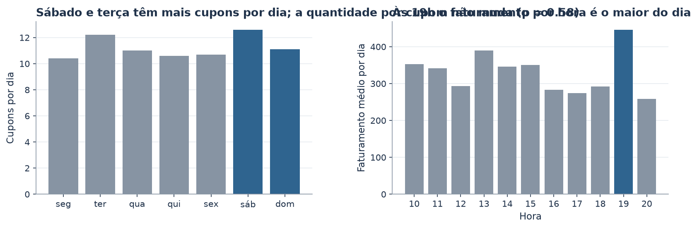
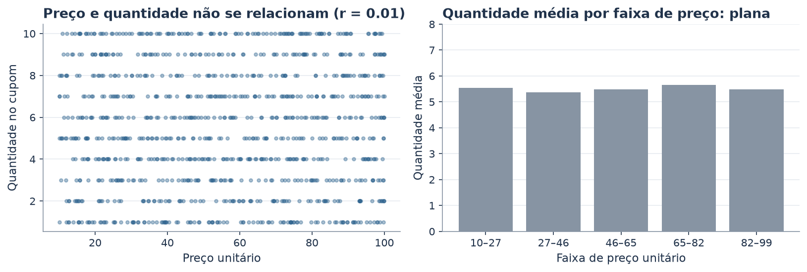

# Estudo de caso 3 · Vendas em supermercado

**Relação com o livro.** Baseado no capítulo 13 — Aplicação 3: Vendas em Supermercado, de *Ciência de Dados: da teoria à prática*. As etapas seguem as seções 13.1 (Análise Descritiva), 13.2 (Análise Temporal de Vendas), 13.3 (Perfis de Vendas) e 13.4 (Maximização das Vendas). Capítulos teóricos de apoio: 3 (Estatística), 7 (Aprendizagem Não-Supervisionada, agrupamento hierárquico) e 8 (Séries Temporais). Origem no material do autor: `Aplicacao/Vendas/analise.py`, `dados/supermarket_sales - Sheet1.csv` e `estatisticas_produtos.txt`, preservados em [original/aplicacao_zip/Vendas/](../../original/aplicacao_zip/Vendas/).

## 1. Situação e pergunta

Um supermercado com três filiais quer organizar melhor a operação e pensa em mexer nos preços. Com três meses de cupons, o que dá para decidir? Perguntas:

- Em quais linhas de produto a demanda varia mais? Há diferença entre filiais?
- Há períodos de maior movimento (dia da semana, hora)?
- Os cupons se agrupam em perfis com comportamento distinto?
- Os dados permitem dizer o que aconteceria com o faturamento se os preços subissem?

## 2. Dados e alcance

`dados/supermarket_sales - Sheet1.csv`: 1 000 cupons de 1º de janeiro a 30 de março de 2019, três filiais (Yangon, Mandalay, Naypyitaw, em Mianmar). Colunas: filial, cidade, tipo de cliente (membro ou não), gênero, linha de produto, preço unitário, quantidade, imposto, total, data, hora, pagamento, `cogs`, margem bruta, `gross income` e avaliação do cliente. Base pública amplamente usada em cursos; o material original não registra a origem primária.

Conferências que mudam a leitura: `Total = Unit price × Quantity × 1,05` exatamente; `gross income` é idêntico ao imposto de 5%; a "margem bruta" é a constante 4,76%. A base **não** mede custo real, margem líquida, estoque nem ruptura, e identifica cupons, não clientes. A mesma base, com nome simplificado, serve às unidades 02 a 07 da trilha.

## 3. Etapas, scripts e figuras

| Etapa no repositório | Seção do livro | Arquivo Python | Pergunta respondida | Figura |
|---|---|---|---|---|
| Conhecer os dados | 13.1 | [01_conhecer_os_dados.py](01_conhecer_os_dados.py) | O que cada coluna significa? Preço, quantidade e avaliação diferem por linha? | `figuras/01_distribuicoes_por_linha.png`, `figuras/01_mediana_avaliacao.png` |
| Análise temporal | 13.2 | [02_analise_temporal.py](02_analise_temporal.py) | Há padrão semanal ou horário? | `figuras/02_decomposicao_semanal.png`, `figuras/02_dia_da_semana_e_hora.png` |
| Perfis de vendas | 13.3 | [03_perfis_de_vendas.py](03_perfis_de_vendas.py) | Os cupons formam perfis? Como a codificação das categorias muda o resultado? | `figuras/03_dendrograma_perfis.png` |
| Maximização das vendas | 13.4 | [04_maximizar_vendas.py](04_maximizar_vendas.py) | O que o experimento de +10% no preço mede de fato? | `figuras/04_preco_x_quantidade.png` |
| Avaliar uma decisão | (síntese) | [05_avaliar_uma_decisao.py](05_avaliar_uma_decisao.py) | Que decisão os dados sustentam e como medir? | `figuras/05_participacao_por_hora_filial.png` |

O script 01 grava `dados/resumo_por_linha_de_produto.csv` (equivalente ao `estatisticas_produtos.txt` original) e o 03 grava `dados/perfis.csv`, usado pelo 04.

## 4. O que a análise encontrou

**Descritiva (13.1).** As seis linhas de produto têm preços médios entre 53 e 57, quantidade média entre 5,1 e 5,7 e avaliação mediana entre 6,7 e 7,3. As três filiais faturam quase o mesmo (106 a 111 mil). Nada aqui separa uma linha ou uma filial das outras.

**Temporal (13.2).** A decomposição semanal da quantidade média por cupom tem amplitude de cerca de uma unidade, e o teste de Kruskal-Wallis entre dias da semana dá p = 0,58: o "pico sazonal" do script original não se distingue do acaso. O que se distingue é a hora: às 19h o faturamento médio por hora é o maior do dia (446 por dia, contra 258 às 20h). Sábado e terça têm mais cupons por dia (12,6 e 12,2) que segunda (10,4).

**Perfis (13.3).** Com as variáveis numéricas (preço, quantidade, avaliação, hora), o corte em dois perfis separa cupons de itens baratos e compras menores (352) de itens caros e compras maiores (648); filial, linha de produto e tipo de cliente se distribuem igual nos dois. A silhueta é 0,13: uma partição conveniente, não grupos naturais. A versão original codificava cidade e filial como 0, 1, 2 e, por isso, tendia a separar por cidade, um artefato da codificação (concordância entre as duas versões: ARI ≈ 0).

**Maximização (13.4).** Reproduzimos o experimento do livro: uma floresta prevê o total a partir de preço, produto, filial e cliente; com preço 10% maior, a mediana prevista sobe (de 184 para 206 no perfil 1, de 361 para 399 no perfil 2; Wilcoxon p < 0,001). Mas o total é `preço × quantidade × 1,05`, e a quantidade por cupom é a mesma em todas as faixas de preço (correlação 0,01): o modelo só repete a fórmula. A base não tem o mesmo produto vendido a preços diferentes, logo não informa elasticidade. Esse resultado não autoriza aumentar preços.

## 5. Recomendação proporcional à evidência

Percebemos que, nas três filiais, as 19h concentram a maior fatia do faturamento (12%, com faixa de 10% a 15% por reamostragem) e que 17h e 20h são as horas mais fracas; sábado e terça têm mais cupons. Isso sugere que o horário importa mais que o mix de produtos para organizar a operação. Recomendamos (1) escalar caixas e reposição para o fim da tarde e a noite, sobretudo aos sábados, e (2) testar uma ação comercial nas horas fracas em uma única filial, mantendo as outras duas como comparação. A decisão se apoia na participação por hora com faixa de incerteza e nos cupons por dia da semana. Após oito semanas, o efeito seria avaliado pelo faturamento por hora na faixa testada da filial com ação, contra as outras filiais e contra as oito semanas anteriores (métrica principal), acompanhando ticket médio e avaliação (auxiliares). A ação seria considerada bem-sucedida se o aumento na faixa testada superasse a variação observada entre semanas nas filiais sem ação. Critérios propostos, não resultados.

O que a base **não** sustenta: mudanças de preço, compras de estoque, ações por "perfil de cliente".

## 6. Incertezas e limites

- Três meses, mil cupons: cerca de 90 cupons por hora do dia e 11 por dia. Diferenças pequenas são ruído.
- Não há custo, margem real, estoque nem identificação de clientes.
- O agrupamento tem silhueta baixa em qualquer versão; os perfis descrevem, não descobrem.
- O experimento de preço do livro é reproduzido para mostrar o que ele mede; a conclusão aqui é oposta à leitura ingênua dele.

## 7. Atividades

1. **Reprodução.** Rode os scripts 01 a 05 e confira os números.
2. **Variação.** Em `03`, agrupe com `Total` incluído entre as variáveis. Os perfis mudam? Por que isso era esperado?
3. **Pergunta aberta.** A forma de pagamento muda com a hora ou com a filial? Use `pd.crosstab` com `normalize`.
4. **Crítica.** A recomendação testa a ação em uma filial e usa as outras como comparação. O que poderia tornar as filiais incomparáveis nesse período, e como você verificaria isso antes de concluir?

## Diferenças em relação ao material original

O `analise.py` usava `seaborn`, codificava categorias como inteiros antes do agrupamento, não reportava a silhueta, não comparava a decomposição semanal com um teste e tratava o aumento previsto do total como evidência a favor do reajuste de preço. As figuras originais (dendrograma, decomposição, mediana do rating, importância por grupo, variação da mediana com o ajuste) estão em [original/aplicacao_zip/Vendas/figuras/](../../original/aplicacao_zip/Vendas/figuras/). A figura da mediana de avaliação foi refeita como exemplo "antes e depois" em [04_visualizacao](../../04_visualizacao/README.md).
