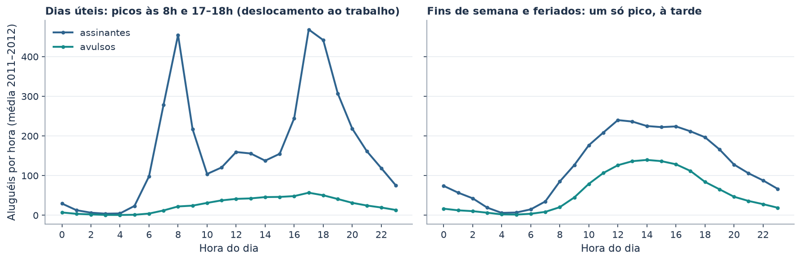
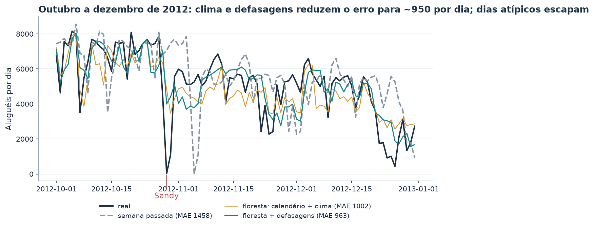

# Estudo de caso 4 · Mobilidade urbana: bicicletas compartilhadas

**Relação com o livro.** Aplicação adicional — não corresponde a um capítulo de aplicação do livro *Ciência de Dados: da teoria à prática*. Fundamentação teórica: capítulos 3 (Estatística), 4 (Pré-processamento) e 8 (Séries Temporais); a floresta aleatória vem do capítulo 5. É uma extensão deste repositório com dados reais.

## 1. Situação e pergunta

A operadora de um sistema de bicicletas compartilhadas precisa dimensionar equipe, manutenção e redistribuição de bicicletas ao longo do dia e da semana. Perguntas:

- Em quais dias e horários a demanda é maior? Assinantes e usuários avulsos se comportam igual?
- Quanto o clima e a estação do ano pesam?
- Com calendário e clima, é possível prever os aluguéis do dia melhor que repetir a semana anterior?
- Que decisão operacional os dados sustentam, e o que falta para ir além?

## 2. Dados e alcance

*Bike Sharing Dataset*, UCI Machine Learning Repository (id 275), licença CC BY 4.0, acessado em 23/11/2026: <https://archive.ics.uci.edu/dataset/275/bike-sharing-dataset>. Dados do Capital Bikeshare (Washington D.C.), 2011 e 2012, agregados por dia (`day.csv`, 731 linhas) e por hora (`hour.csv`, 17 379 linhas), com clima acrescentado pelos autores (Fanaee-T e Gama, 2013). Dicionário em [dados/Readme.txt](dados/Readme.txt). Temperatura, umidade e vento vêm normalizados; os scripts os convertem para °C, % e km/h.

O que a base **não** tem: estações, bicicletas disponíveis, viagens não realizadas por falta de bicicleta ou vaga. Ela mede uso realizado, para a cidade inteira. Nada aqui permite recomendar remanejamento entre estações.

## 3. Etapas, scripts e figuras

| Etapa | Arquivo Python | Pergunta respondida | Figura |
|---|---|---|---|
| Conhecer os dados | [01_conhecer_os_dados.py](01_conhecer_os_dados.py) | O que cada coluna significa? Como o uso evoluiu? | `figuras/01_serie_diaria.png` |
| Padrões de demanda | [02_padroes_de_demanda.py](02_padroes_de_demanda.py) | Quando se usa mais? Quanto pesa o clima? | `figuras/02_perfil_horario.png`, `figuras/02_clima_e_mes.png` |
| Prever a demanda | [03_prever_demanda.py](03_prever_demanda.py) | Modelos superam a linha de base no último trimestre de 2012? | `figuras/03_previsao_trimestre.png` |
| Avaliar uma decisão | [04_avaliar_uma_decisao.py](04_avaliar_uma_decisao.py) | Que janelas operacionais os dados mostram? Como medir? | `figuras/04_janelas_de_capacidade.png` |

## 4. O que a análise encontrou

**Padrões.** Em dias úteis há dois picos, às 8h e às 17h e 18h, e as faixas 7–9h e 17–19h concentram 52% dos aluguéis; em fins de semana há um pico único às 13h, com participação maior dos usuários avulsos. O uso médio diário foi de 3 406 em 2011 e 5 600 em 2012. A temperatura tem correlação 0,63 com o uso diário; dias de chuva ou neve leve têm cerca de um terço do uso de dias limpos.

**Previsão.** Com treino até setembro de 2012 e teste de outubro a dezembro (92 dias), repetir o mesmo dia da semana anterior erra 1 458 aluguéis por dia; a média dos sete dias anteriores, 1 043; um modelo linear com calendário e clima, 957; a floresta com defasagens, 963. A média do trimestre é 5 165 por dia, logo o melhor erro é cerca de 18%. Linear e floresta empatam porque a relação com a temperatura é quase linear. O furacão Sandy (29 e 30 de outubro) e os feriados continuam mal previstos. O clima usado é o observado; na prática viria da previsão do tempo, e o erro seria maior.

## 5. Recomendação proporcional à evidência

Percebemos que, em dias úteis, metade dos aluguéis acontece em seis horas do dia e que entre 0h e 5h o uso é quase nulo; nos fins de semana o movimento se concentra à tarde. Isso sugere organizar a operação em torno dessas janelas: manutenção programada de madrugada, reforço de redistribuição e equipe antes das 7h e das 16h em dias úteis e antes das 11h nos fins de semana, com a previsão diária (erro de ~18%) para dimensionar o volume.

O que **não** se pode recomendar: realocar bicicletas entre estações específicas. A base não tem estações nem registra demanda não atendida; nos picos, o uso observado pode estar limitado pela oferta. A avaliação proposta exige dados por estação da operadora: após três meses, medir a fração de horas de pico em que estações centrais ficaram sem bicicleta ou sem vaga (métrica principal) e as viagens por bicicleta por dia (auxiliar), comparando com o mesmo trimestre do ano anterior. Sem esses dados a métrica não existe, e a recomendação é um ponto de partida para coleta, não uma conclusão.

## 6. Incertezas e limites

- Dois anos de uma cidade; o sistema cresceu 64% entre eles, o que confunde sazonalidade com tendência.
- Clima observado, não previsto; eventos (furacão, feriados) escapam a qualquer modelo com estas variáveis.
- Horas sem nenhum aluguel não aparecem em `hour.csv` (165 horas); as médias por hora consideram só as presentes.

## 7. Atividades

1. **Reprodução.** Rode os quatro scripts e confira os números.
2. **Variação.** Em `03`, treine só com 2012 (descarte 2011). O erro no teste melhora ou piora? Por quê?
3. **Pergunta aberta.** Em que horas os usuários avulsos superam os assinantes? O que isso sugere sobre preço e comunicação?
4. **Crítica.** A recomendação assume que o padrão de 2012 se repete. Que dado você pediria para verificar isso antes de mudar escalas de trabalho?
