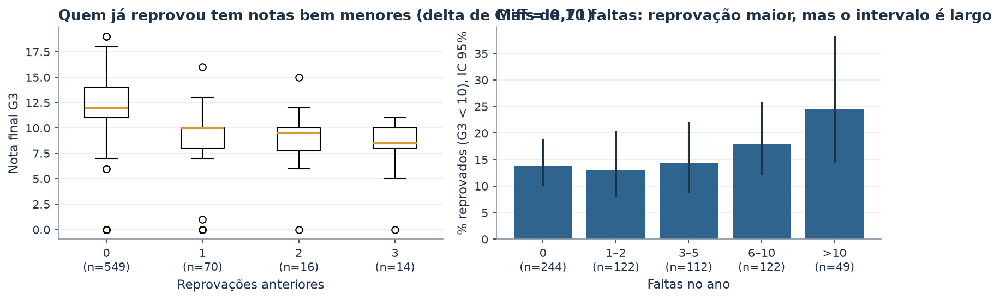
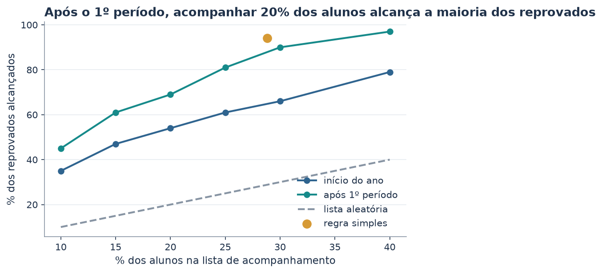

# Estudo de caso 5 · Educação: frequência, desempenho e acompanhamento

**Relação com o livro.** Aplicação adicional — não corresponde a um capítulo de aplicação do livro *Ciência de Dados: da teoria à prática*. Fundamentação teórica: capítulos 3 (Estatística, comparação de grupos e inferência), 5 (Classificação) e 6 (Avaliação de Classificadores). É uma extensão deste repositório com dados reais.

## 1. Situação e pergunta

Uma escola quer identificar cedo os alunos que correm risco de reprovar, para oferecer acompanhamento antes do fim do ano. Perguntas:

- Que características observáveis no início do ano aparecem associadas à nota final?
- Faltas importam tanto quanto se supõe?
- Um modelo, ou uma regra simples, consegue montar uma lista curta de acompanhamento com boa cobertura?
- Como fazer isso sem rotular alunos nem confundir associação com causa?

## 2. Dados e alcance

*Student Performance*, UCI Machine Learning Repository (id 320), licença CC BY 4.0, acessado em 23/11/2026: <https://archive.ics.uci.edu/dataset/320/student-performance>. Alunos do ensino secundário de duas escolas portuguesas no ano letivo 2005–2006 (Cortez e Silva, 2008): `student-por.csv` (português, 649 alunos) e `student-mat.csv` (matemática, 395). Trinta variáveis sociais, familiares e escolares, faltas e as notas dos três períodos (G1, G2, G3, de 0 a 20). Dicionário em [dados/student.txt](dados/student.txt). Os scripts usam a turma de português, maior.

O que a base **não** tem: motivo das faltas, renda, histórico de anos anteriores, o que a escola fez. É um retrato de um ano, em duas escolas, há vinte anos. Não descreve escolas brasileiras.

## 3. Etapas, scripts e figuras

| Etapa | Arquivo Python | Pergunta respondida | Figura |
|---|---|---|---|
| Conhecer os dados | [01_conhecer_os_dados.py](01_conhecer_os_dados.py) | Como se distribuem notas e faltas? O que significa G3 = 0? | `figuras/01_notas_e_faltas.png` |
| Comparar grupos | [02_comparar_grupos.py](02_comparar_grupos.py) | Que grupos têm notas diferentes, com que tamanho de efeito? | `figuras/02_grupos.png` |
| Prever risco | [03_prever_risco.py](03_prever_risco.py) | No início do ano e após o 1º período, quem corre risco? | `figuras/03_risco.png` |
| Avaliar uma decisão | [04_avaliar_uma_decisao.py](04_avaliar_uma_decisao.py) | Lista de acompanhamento: tamanho, cobertura, como medir | `figuras/04_lista_de_acompanhamento.png` |

O script 03 grava `dados/probabilidades_validacao.csv` (probabilidades fora da amostra), usado pelo 04.

## 4. O que a análise encontrou

**Grupos.** 100 dos 649 alunos (15%) terminam com G3 < 10. A diferença mais forte é com reprovações anteriores: mediana 12 contra 10, delta de Cliff 0,71 (Mann-Whitney p < 0,001). Querer seguir para o ensino superior tem efeito parecido (0,66). Faltas importam menos: mais de 5 faltas dá delta 0,16, e a taxa de reprovação só sobe de forma visível acima de 10 faltas (24%, com intervalo de 15% a 38% por serem 49 alunos). Quem recebe apoio escolar tem nota **menor**, porque o apoio é dado a quem já tem dificuldade: a associação não mede o efeito do apoio.

**Risco.** Com validação cruzada estratificada (5 dobras) e sem usar notas, a regressão logística alcança AUC 0,79 e a floresta 0,84. Após o 1º período, com G1 e faltas, a AUC sobe para 0,92 e 0,93. G2 não entra em nenhum modelo: sua correlação com G3 é 0,92, e usá-la seria prever a nota final com a própria nota final.

**Lista.** Após o 1º período, acompanhar os 20% de maior probabilidade alcança 69% dos reprovados; 30%, 90%. Uma regra transparente (reprovou antes **ou** G1 < 10) coloca 29% dos alunos na lista e alcança 94 dos 100 reprovados. O modelo não supera a regra o bastante para justificar a perda de transparência.

## 5. Recomendação proporcional à evidência

Percebemos que reprovações anteriores, a intenção de não seguir estudando e, após o 1º período, a nota G1 são as variáveis mais associadas à reprovação. Isso sugere que o acompanhamento preventivo pode começar cedo com uma lista curta. Recomendamos, como hipótese a testar, acompanhar após o 1º período os alunos com reprovação anterior ou G1 < 10, com contato ativo e reforço; a lista é um convite ao apoio, não um rótulo, e exige revisão humana. Após o ano letivo seguinte, o efeito seria avaliado pela taxa de reprovação dos alunos da lista comparada à de alunos de perfil semelhante em anos anteriores (métrica principal), acompanhando frequência e evolução de G1 para G3 (auxiliares). A ação seria considerada bem-sucedida se a taxa de reprovação da lista ficasse abaixo da histórica do mesmo perfil. Sem comparação, uma queda pode ser apenas um ano mais fácil. A ação é uma hipótese; nada aqui demonstra que acompanhar causa aprovação.

## 6. Incertezas, limites e ética

- Duas escolas portuguesas, 2005–2006. Não generalizar para o Brasil nem para hoje.
- A coluna de faltas é o total do ano; "faltas até o 1º período" é uma aproximação otimista.
- Quinze alunos com G3 = 0 provavelmente abandonaram; eles contam como reprovados.
- Nenhum aluno individual deve ser rotulado a partir deste exemplo; a lista não pode ser divulgada nem usada para selecionar quem fica na escola.

## 7. Atividades

1. **Reprodução.** Rode os quatro scripts e confira os números.
2. **Variação.** Repita `02` e `03` com `student-mat.csv`. As variáveis mais associadas são as mesmas?
3. **Pergunta aberta.** A escola MS tem coeficiente positivo de risco. É a escola ou a composição dos alunos (endereço rural, escolaridade dos pais)? Compare os grupos dentro de cada escola.
4. **Crítica.** A regra "G1 < 10" só existe após o 1º período. Que regra você proporia para o primeiro mês de aula, e com que cobertura?
