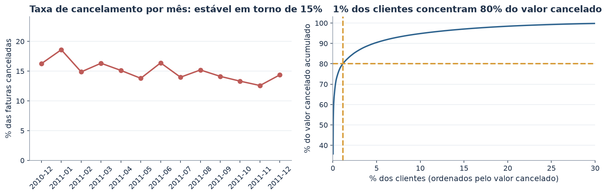
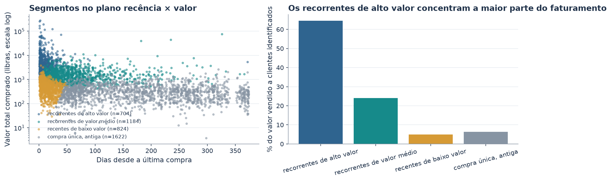

# Estudo de caso 6 · Varejo on-line: cancelamentos e comportamento de compra

**Relação com o livro.** Aplicação adicional — não corresponde a um capítulo de aplicação do livro *Ciência de Dados: da teoria à prática*. Fundamentação teórica: capítulos 3 (Estatística), 4 (Pré-processamento) e 7 (Aprendizagem Não-Supervisionada, agrupamento particional). É uma extensão deste repositório com dados reais.

## 1. Situação e pergunta

Um varejista on-line do Reino Unido, com muitos clientes atacadistas, vê 15% das suas faturas serem canceladas e quer saber se isso é um problema e o que fazer. Perguntas:

- Quanto do valor os cancelamentos levam, e eles se concentram em meses, países, clientes ou produtos?
- Que segmentos de clientes têm maior recorrência e valor, e onde estão os cancelamentos?
- A pergunta "como reduzir o abandono de carrinho?" pode ser respondida com esta base?

## 2. Dados e alcance

*Online Retail*, UCI Machine Learning Repository (id 352), licença CC BY 4.0, acessado em 23/11/2026: <https://archive.ics.uci.edu/dataset/352/online-retail>. 541 909 linhas (itens de fatura) de 1º/12/2010 a 9/12/2011: número da fatura, código e descrição do produto, quantidade, data e hora, preço unitário em libras, cliente e país. O arquivo original é um `.xlsx` de 23 MB; `dados/online_retail.csv.gz` (7 MB) é a mesma tabela convertida sem alteração de linhas, para que os scripts rodem em segundos. Faturas cujo número começa com `C` são cancelamentos, com quantidades negativas.

O que a base **não** tem: carrinhos abandonados, frete, custo dos produtos, margem, motivo do cancelamento, estoque. "Cancelamento" é uma fatura estornada, não um carrinho que o cliente deixou de fechar. 25% das linhas não têm cliente identificado e ficam fora das análises por cliente.

## 3. Etapas, scripts e figuras

| Etapa | Arquivo Python | Pergunta respondida | Figura |
|---|---|---|---|
| Conhecer os dados | [01_conhecer_os_dados.py](01_conhecer_os_dados.py) | O que é uma linha? Quantos cancelamentos, ausentes e códigos que não são produtos? | `figuras/01_vendas_por_mes.png` |
| Preparar os dados | [02_preparar_os_dados.py](02_preparar_os_dados.py) | Separar vendas de cancelamentos e montar tabelas por fatura e por cliente | (gera `dados/faturas.csv`, `dados/clientes.csv`, `dados/itens_cancelados.csv`) |
| Cancelamentos | [03_cancelamentos.py](03_cancelamentos.py) | Onde estão os cancelamentos e quanto valem? | `figuras/03_cancelamentos.png` |
| Segmentos de clientes | [04_segmentos_de_clientes.py](04_segmentos_de_clientes.py) | Recência, frequência e valor: que segmentos existem? | `figuras/04_segmentos.png` |
| Avaliar uma decisão | [05_avaliar_uma_decisao.py](05_avaliar_uma_decisao.py) | Que ação a evidência sustenta e como medir? | `figuras/05_cancelado_por_segmento.png` |

## 4. O que a análise encontrou

**Preparação.** Saem 2 995 linhas de códigos que não são produtos (postagem, descontos, taxas), 2 485 com preço zero ou negativo; ficam 536 429 linhas (99%), 19 773 faturas de venda e 3 422 de cancelamento, 4 334 clientes com compras.

**Cancelamentos.** 14,8% das faturas, mas só 4,7% do valor vendido: a fatura cancelada mediana tem 1 item e 15 libras, contra 15 itens e 303 libras nas vendas. A taxa é estável mês a mês (13% a 19%). 35% dos clientes têm algum cancelamento, mas 50 clientes (1,2%) concentram 80% do valor cancelado, e esses 50 respondem por 21% do valor vendido. Dois produtos dominam o valor cancelado por serem pedidos gigantes estornados no mesmo dia (80 995 unidades de "Paper craft, little birdie"; 74 494 de "Medium ceramic top storage jar"), um lembrete de que extremos de uma base costumam ser erros de digitação ou testes.

**Segmentos.** Com recência, frequência e valor em escala logarítmica e k-means (k = 4, silhueta 0,33), surgem: recorrentes de alto valor (704 clientes, mediana de 10 compras e 3 708 libras, 64% do valor vendido a clientes identificados), recorrentes de valor médio (1 184), recentes de baixo valor (824) e compra única antiga (1 622). A taxa de cancelamento sobre o vendido fica entre 1,5% e 6,7% nos quatro: o valor cancelado vem de quem mais compra porque compra mais, não porque cancela proporcionalmente mais.

## 5. Recomendação proporcional à evidência

Percebemos que os cancelamentos são pequenos, estáveis e concentrados em poucos grandes compradores. Isso sugere que são parte da relação com atacadistas (ajustes e trocas), não um sinal de desistência; a base não registra carrinhos, frete ou motivos, e nada aqui fala de "abandono" ou de "custo da entrega". Recomendamos, como hipótese operacional, uma etapa de confirmação de pedido (quantidades e variantes) antes do faturamento para os 50 clientes com maior valor estornado, em vez de campanhas gerais. Em cenário aritmético, reduzir em 20% os estornos desses clientes equivale a 75 mil libras no ano, 0,7% do vendido. Após 90 dias, o efeito seria avaliado pela razão valor cancelado / valor vendido desses clientes, comparada aos 90 dias anteriores e aos demais clientes recorrentes (métrica principal), acompanhando o tempo entre pedido e faturamento e a frequência de compra (auxiliares, para verificar se a conferência atrasa ou afasta). A ação seria considerada bem-sucedida se a queda da razão no grupo tratado superasse a variação do grupo de comparação, sem queda da frequência. Critérios propostos, não resultados.

## 6. Incertezas e limites

- Um ano de um varejista; dezembro de 2010 e de 2011 estão incompletos.
- "Valor" é receita bruta; não há custo nem margem.
- Os segmentos têm silhueta moderada e dependem da transformação logarítmica e de k; são descrição, não descoberta.
- Dois pedidos gigantes estornados distorcem qualquer total por produto; o script 03 os mostra em vez de escondê-los.

## 7. Atividades

1. **Reprodução.** Rode os scripts 01 a 05 e confira os números.
2. **Variação.** Em `03`, repita a análise por país usando valor em vez de número de faturas. A Alemanha continua liderando?
3. **Pergunta aberta.** Em que dia da semana e hora se concentram as compras? E os cancelamentos acontecem no mesmo dia da compra?
4. **Crítica.** A recomendação foca 50 clientes. Que risco há em tratar os maiores clientes de forma diferente, e como a métrica auxiliar de frequência ajuda a vigiar isso?
