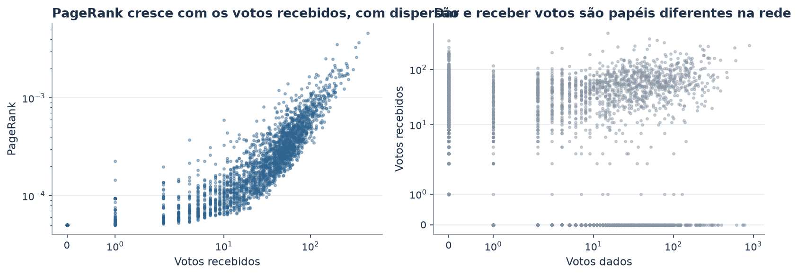
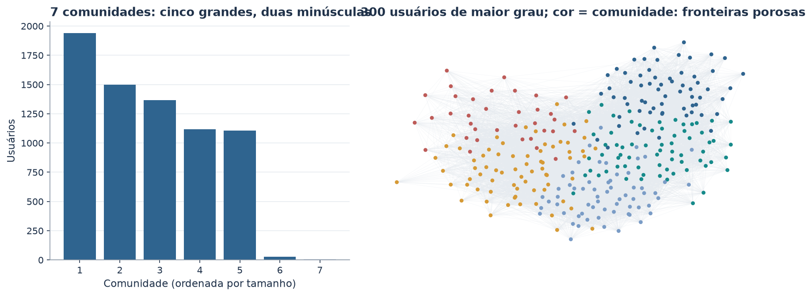

# Estudo de caso 7 · Votações para administrador na Wikipédia

**Relação com o livro.** Aplicação adicional — não corresponde a um capítulo de aplicação do livro *Ciência de Dados: da teoria à prática*. Fundamentação teórica: capítulo 9 (Análise de Redes Sociais: 9.1 rede e grafo, 9.2 análise estrutural, 9.3 detecção de comunidades). A [unidade 09](../../09_redes_sociais/) é a aula; este é o caso com dados observacionais reais. Faça a aula antes.

## 1. Situação e pergunta

Na Wikipédia em inglês, usuários votam para decidir quem se torna administrador. Alguém responsável pela integridade do processo quer saber se há padrões de votação que mereçam atenção. Perguntas:

- Que padrões estruturais caracterizam a rede de votos (quem vota, quem recebe, quão concentrado)?
- Há usuários centrais segundo definições diferentes, e elas concordam?
- Há comunidades, e quão nítidas são?
- O que a estrutura permite concluir sobre comportamento, e o que **não** permite?

## 2. Dados e alcance

*Wikipedia vote network*, Stanford SNAP: <https://snap.stanford.edu/data/wiki-Vote.html> (Leskovec, Huttenlocher e Kleinberg, 2010). `dados/Wiki-Vote.txt` veio com o material do livro e confere com o arquivo do SNAP: 7 115 usuários e 103 689 arcos. Um arco A → B significa que **A votou na eleição de B** para administrador, até janeiro de 2008. Não é amizade, não é "seguir", não é influência.

O que a base **não** tem: a direção do voto (a favor ou contra), a data, o resultado da eleição. Por isso, nenhuma métrica aqui diz se alguém foi aprovado, se votou bem, ou se agiu em conjunto com outros.

## 3. Etapas, scripts e figuras

| Etapa | Seção do livro | Arquivo Python | Pergunta respondida | Figura |
|---|---|---|---|---|
| Conhecer a rede | 9.1 | [01_conhecer_a_rede.py](01_conhecer_a_rede.py) | Quantos votam, quantos recebem, quão concentrado? | `figuras/01_distribuicao_grau.png` |
| Centralidades | 9.2 | [02_centralidades.py](02_centralidades.py) | Quem é central e as definições concordam? | `figuras/02_centralidades.png` |
| Comunidades | 9.3 | [03_comunidades.py](03_comunidades.py) | Há comunidades? Quão porosas? | `figuras/03_comunidades.png` |
| Avaliar uma decisão | (síntese) | [04_avaliar_uma_decisao.py](04_avaliar_uma_decisao.py) | Que uso é legítimo e que dados faltam? | `figuras/04_criterio_exploratorio.png` |

Os scripts 02 e 03 gravam `dados/centralidades.csv` e `dados/comunidades.csv`, usados pelo 04. A intermediação é aproximada com 400 fontes amostradas (semente fixa); o cálculo exato levaria vários minutos.

## 4. O que a análise encontrou

**Estrutura.** 4 734 usuários só votaram, 1 005 só receberam votos e 1 376 fizeram as duas coisas. A mediana de votos dados é 2 e a de recebidos é 0; os máximos são 893 e 457. A reciprocidade é 6% e a densidade 0,002. As distribuições de grau têm cauda longa.

**Centralidades.** PageRank acompanha de perto os votos recebidos (correlação de Spearman 0,99; 36 dos 50 primeiros em comum). Votos dados é outra coisa: correlação 0,01 com votos recebidos e só 8 usuários em comum entre os 50 primeiros. Intermediação fica no meio (0,74 com recebidos, 0,48 com dados). "Central" depende da pergunta.

**Comunidades.** Louvain sobre o maior componente (7 066 usuários, sem direção) encontra cinco comunidades grandes (1 108 a 1 941 usuários) e duas minúsculas, com modularidade 0,43, bem acima dos 0,13 de uma rede aleatória com os mesmos graus. Mas as comunidades são porosas: só 38% a 58% das arestas de cada uma ficam dentro dela, e 64% dos votos ficam na própria comunidade.

## 5. O que é legítimo recomendar

Percebemos que a estrutura, sozinha, não separa comportamento coordenado de participação normal por área de interesse: votar sempre nas mesmas eleições é compatível com as duas coisas. Não há decisão sobre usuários a tomar com estes dados, e nenhuma métrica autoriza nomear ou acusar alguém.

O que a análise sustenta é (1) um critério transparente para escolher por onde começar uma revisão exploratória (130 usuários com 30 ou mais votos e mais de 90% deles dentro da própria comunidade, entre 870 com 30 ou mais votos) e (2) o desenho da coleta que responderia à pergunta: data de cada voto, direção (apoio ou oposição) e resultado da eleição. Com datas e direção, "votos em bloco no mesmo intervalo?" vira uma hipótese testável: a fração de eleições em que um subconjunto fixo de usuários vota no mesmo sentido em menos de uma hora, comparada com a esperada ao acaso dado o volume de cada um (métrica principal), e o tempo mediano entre votos do mesmo grupo (auxiliar). Antes da coleta, não há critério de sucesso a declarar.

## 6. Incertezas e limites

- Recorte histórico (até 2008) sem datas: a rede mistura anos de atividade.
- As comunidades dependem do algoritmo e da semente; outra semente dá fronteiras diferentes.
- A intermediação é aproximada.
- Centralidade descreve posição; nunca intenção.

## 7. Atividades

1. **Reprodução.** Rode os quatro scripts e confira os números.
2. **Variação.** Em `03`, troque a semente do Louvain. Quantas comunidades aparecem e quanto muda a modularidade?
3. **Pergunta aberta.** Os 1 005 usuários que só receberam votos (candidatos que nunca votaram) estão concentrados em alguma comunidade?
4. **Crítica.** O critério exploratório do script 04 usa dois limiares (30 votos, 90%). Argumente por que qualquer escolha de limiar é arbitrária e proponha como torná-la menos arbitrária sem os dados que faltam.
