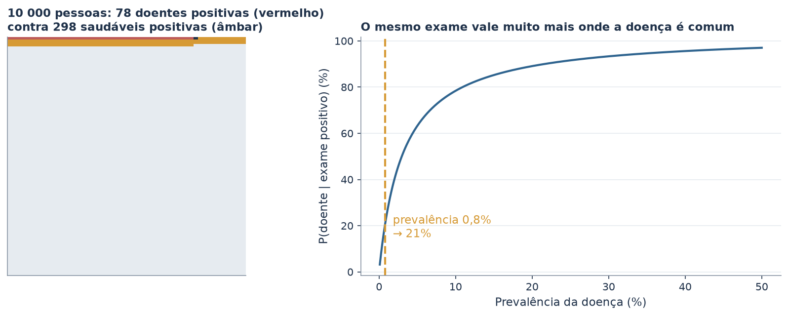
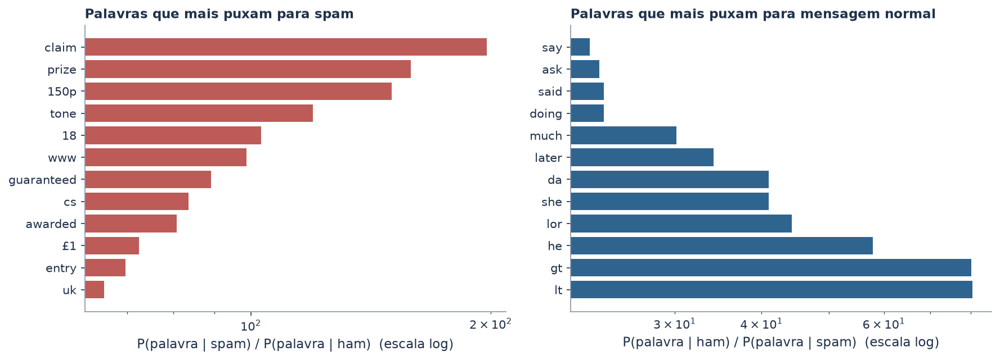
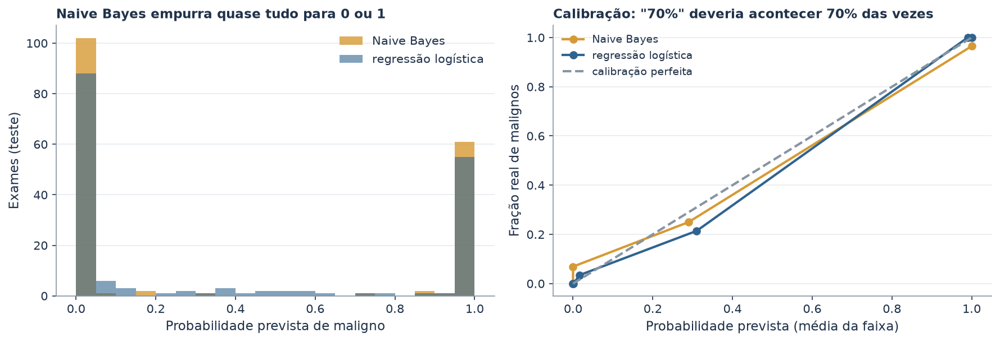

# 10 · Naive Bayes

**Pergunta inicial:** um exame acerta 98% dos doentes e 97% dos saudáveis. Ele deu positivo. Qual a chance de você estar doente? (Resposta: cerca de 21%, se a doença atingir 0,8% da população.)

O classificador Naive Bayes parte de uma ideia de probabilidade: escolher a classe **mais provável dado o que observamos**. Para calcular isso, usa o teorema de Bayes e uma simplificação "ingênua" (*naive*) que torna o cálculo possível. É rápido, funciona bem com muitos atributos e é um dos melhores métodos para texto. Suas probabilidades, porém, não devem ser levadas ao pé da letra.

Pré-requisitos: [04 · Estatística](../04_estatistica/) (probabilidade) e [07 · Aprendizagem de máquina](../07_aprendizagem_de_maquina/).

## Da probabilidade condicional ao classificador

Dois eventos são **dependentes** quando saber de um muda o que sabemos do outro (estar doente e ter um sintoma). A probabilidade conjunta se escreve

$$P(E, F) = P(E \mid F)\,P(F) = P(F \mid E)\,P(E)$$

Igualando as duas formas sai o **teorema de Bayes**, que "inverte" a condição:

$$P(c \mid D) = \frac{P(D \mid c)\,P(c)}{P(D)}$$

- $P(c)$: probabilidade **a priori** da classe (antes de ver os dados);
- $P(D \mid c)$: **verossimilhança** (quão compatíveis os dados são com a classe);
- $P(c \mid D)$: probabilidade **a posteriori** (depois de ver os dados).

A classe de **máximo a posteriori** (MAP) é a que maximiza $P(D \mid c)\,P(c)$; o denominador $P(D)$ é o mesmo para todas as classes e pode ser ignorado.

## Passo a passo

### 01 · O teorema na prática ([01_teorema_de_bayes.py](01_teorema_de_bayes.py))

Com prevalência 0,8%, sensibilidade 98% e especificidade 97%:

| | Conta | Valor |
|---|---|---|
| P(positivo e doente) | 0,98 × 0,008 | 0,0078 |
| P(positivo e saudável) | 0,03 × 0,992 | 0,0298 |
| P(doente \| positivo) | 0,0078 ÷ (0,0078 + 0,0298) | **0,21** |

A classe MAP é "saudável", mesmo com o exame positivo. Em 10 000 pessoas: 80 doentes, 78 positivos verdadeiros e 298 positivos falsos.

O mesmo exame vale muito mais onde a doença é comum: o **a priori** importa.

### 02 · Naive Bayes à mão ([02_naive_bayes_a_mao.py](02_naive_bayes_a_mao.py))

Com vários atributos $a_1, \ldots, a_n$, estimar $P(a_1, \ldots, a_n \mid c)$ exigiria ver cada combinação de valores muitas vezes. A suposição ingênua resolve: **dada a classe, os atributos são independentes**, então

$$\hat{c}_{NB} = \arg\max_c\; P(c) \prod_{i=1}^{n} P(a_i \mid c)$$

e cada termo é só uma contagem. A tabela de 10 dias (temperatura, vento, nebulosidade, feriado → ir à praia) permite fazer tudo à mão. Para um dia quente, de vento forte, muito nublado e sem feriado:

- **sem suavização**, nenhum dia de praia foi muito nublado: $P(\text{muito nublado} \mid \text{sim}) = 0$ e o produto inteiro zera. Um único valor nunca visto veta a classe;
- **com suavização** (estimativa-m ou de Laplace, $P(a_i \mid c) = \frac{n_c + m\,p}{n + m}$, aqui equivalente a somar 1 a cada contagem), as pontuações ficam 0,0125 para "sim" e 0,0625 para "não": a resposta é "não", com 83%.

### 03 · Filtro de spam com SMS reais ([03_filtro_de_spam.py](03_filtro_de_spam.py))

Base *SMS Spam Collection* (5 574 mensagens, 13,4% spam). Cada mensagem vira um **saco de palavras**: a ordem é ignorada e conta-se quantas vezes cada palavra aparece. Para cada classe:

$$P(w_k \mid c) = \frac{n_k + 1}{n + |\text{Vocabulário}|}$$

onde $n_k$ é quantas vezes a palavra apareceu nas mensagens da classe e $n$ o total de palavras da classe. Para classificar, soma-se o logaritmo dessas probabilidades (o produto de centenas de números pequenos estoura para zero no computador).

O script faz isso à mão e depois com `CountVectorizer` + `MultinomialNB`. Os dois acertam 98,4% no teste (linha de base: 86,6%). Dos 224 spams do teste, 203 são pegos (revocação 0,91); das 1 449 mensagens normais, só 5 vão para o spam (precisão 0,98).

As palavras mais indicativas de spam são *claim*, *prize*, *150p*, *guaranteed*, *awarded*. Note que o vocabulário é aprendido **só no treino**.

### 04 · Atributos numéricos e o problema das probabilidades ([04_naive_bayes_gaussiano.py](04_naive_bayes_gaussiano.py))

Com atributos numéricos, o Naive Bayes gaussiano modela cada atributo, em cada classe, por uma normal (aprende média e variância). Na base de câncer de mama ele acerta 0,94 (logística: 0,98).

O problema está nas probabilidades: 94% delas ficam abaixo de 1% ou acima de 99%, e 9 exames recebem mais de 99% de confiança na classe errada. Raio, perímetro e área medem quase a mesma coisa; tratados como independentes, a mesma evidência é contada três vezes. **Use a classe que o Naive Bayes escolhe; não use o valor da probabilidade.**

## Quando usar

| + | − |
|---|---|
| muito rápido para treinar e classificar | supõe independência condicional (quase nunca verdadeira) |
| funciona bem com muitos atributos (texto) | probabilidades mal calibradas, perto de 0 e 1 |
| precisa de pouco dado para estimar cada termo | valor nunca visto zera a classe (exige suavização) |

Aplicações típicas: filtragem de spam, classificação de documentos e de sentimento, previsões em tempo real, sistemas de recomendação.

## Atividade curta

Em `03_filtro_de_spam.py`, troque `alpha=1.0` por `0.1` e por `5`. A revocação de spam sobe ou desce? Por quê?

## Problema de interpretação

Uma empresa usa um Naive Bayes que diz "99,7% de chance de fraude" para bloquear cartões automaticamente. Explique, com o resultado do script 04, por que esse número não deveria ser lido como probabilidade, e o que você mediria antes de automatizar o bloqueio.

## Relação com o livro

Capítulo 5 (Classificação), seção 5.2 (Naive Bayes); a base probabilística está no capítulo 3 (3.3 Probabilidade).

## Próxima etapa

[11 · Regressão](../11_regressao/)
