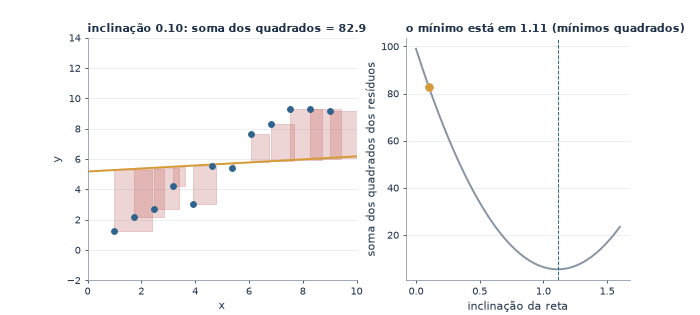
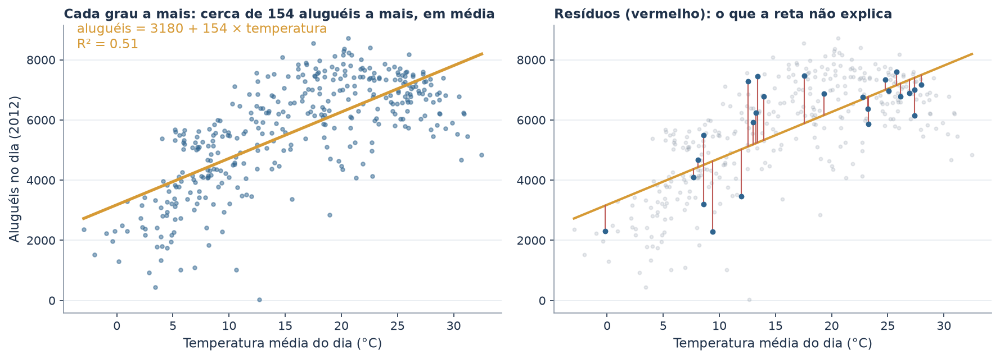
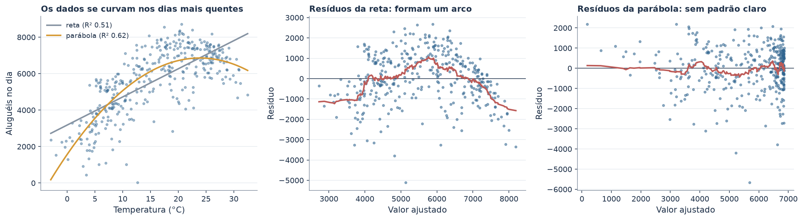
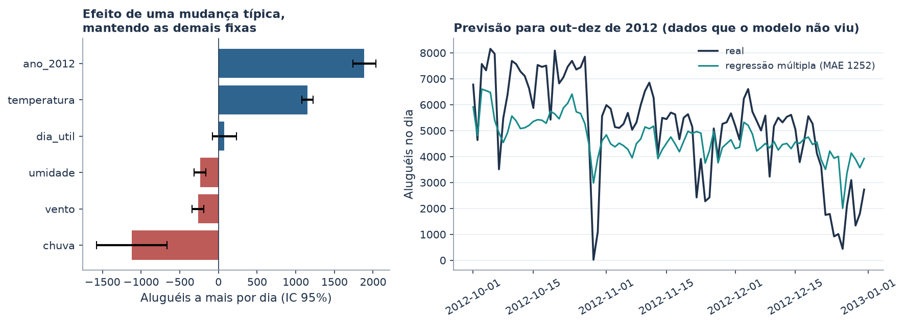
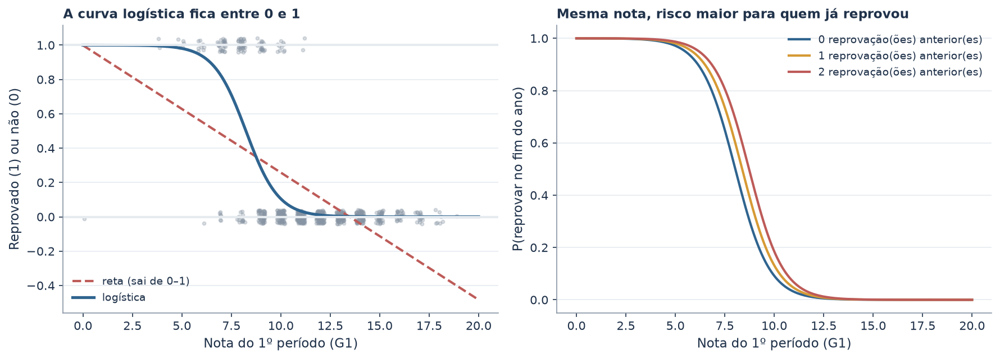

# 11 · Regressão

**Pergunta inicial:** uma loja quer saber se o investimento em propaganda surte efeito e quão rápido as vendas crescem com ele. Como transformar uma nuvem de pontos em um número que responda "quanto, em média"?

A análise de regressão estuda a relação entre uma **variável dependente** (a resposta) e uma ou mais **variáveis independentes** (explicativas), por meio de um modelo matemático. Serve para quantificar efeitos, prever valores, selecionar variáveis e identificar observações atípicas. Esta unidade vai da regressão linear simples à múltipla e termina na **regressão logística**, que adapta a ideia para respostas do tipo sim/não e é um dos classificadores mais usados.

Pré-requisitos: [04 · Estatística](../04_estatistica/) (correlação) e [07 · Aprendizagem de máquina](../07_aprendizagem_de_maquina/).

## Passo a passo

### 01 · Regressão linear simples, à mão ([01_regressao_simples_a_mao.py](01_regressao_simples_a_mao.py))

O modelo é

$$Y_i = \alpha + \beta x_i + \varepsilon_i$$

com α o intercepto, β a inclinação e ε o erro aleatório (média zero, variância σ²), que reúne tudo o que influencia Y e não está no modelo. O **método dos mínimos quadrados** escolhe α e β que minimizam a soma dos quadrados dos resíduos $SQ = \sum (y_i - \alpha - \beta x_i)^2$. Derivando e igualando a zero:

$$\hat\beta = \frac{\sum x_i y_i - n\bar x \bar y}{\sum x_i^2 - n \bar x^2} \qquad \hat\alpha = \bar y - \hat\beta \bar x$$

*Animação gerada por [animacoes/fontes/minimos_quadrados.py](../animacoes/fontes/minimos_quadrados.py).*

Com os aluguéis diários de bicicleta em 2012 e a temperatura do dia, o script calcula as fórmulas à mão e confere com `numpy.polyfit`: **cada grau a mais está associado, em média, a 154 aluguéis a mais**. O R² (fração da variação explicada) é 0,51, igual ao quadrado da correlação de Pearson, como sempre acontece na regressão simples.

### 02 · Diagnóstico pelos resíduos ([02_diagnostico_de_residuos.py](02_diagnostico_de_residuos.py))

Um R² razoável não garante que a reta seja o modelo certo. O gráfico de **resíduos × valores ajustados** deveria ser uma nuvem sem padrão em torno de zero. Aqui ele forma um **arco**: a reta superestima os dias frios (resíduo médio −992) e os muito quentes (−1 112) e subestima os amenos (+772).

Uma parábola corrige: R² sobe para 0,62, os resíduos perdem o padrão, e o modelo diz algo novo: o uso cresce com a temperatura até cerca de 24 °C e **cai** acima disso. No gráfico de resíduos procure: curvatura (relação não linear), funil (variância que cresce com o nível) e pontos isolados muito longe de zero.

### 03 · Regressão múltipla ([03_regressao_multipla.py](03_regressao_multipla.py))

Com *k* variáveis, o modelo é $y = \beta_0 + \beta_1 x_1 + \cdots + \beta_k x_k + \varepsilon$, ou, em forma matricial, $y = X\beta + \varepsilon$. A solução de mínimos quadrados é

$$\hat\beta = (X^\top X)^{-1} X^\top y$$

desde que $X^\top X$ tenha inversa (nenhuma variável é combinação linear exata das outras). O script calcula isso com `numpy` e confere com `statsmodels`, que dá também erro-padrão, intervalo de confiança e valor-p.

**Como ler um coeficiente:** "mantidas as demais variáveis fixas, um dia de chuva tem, em média, cerca de 1 100 aluguéis a menos". É uma associação condicional, não uma garantia de efeito causal. O coeficiente de dia útil tem p = 0,32: no total diário, não há evidência de diferença entre dias úteis e não úteis (a diferença está na distribuição ao longo do dia, como mostra a unidade 05).

**Avaliação no futuro:** treinado até setembro de 2012, o modelo erra em média 1 252 aluguéis por dia em outubro a dezembro, contra 2 007 de uma linha de base (a média de julho a setembro).

**Multicolinearidade:** temperatura e sensação térmica têm correlação 0,99. Com as duas no modelo, o coeficiente da temperatura cai de 151 para 94 e o erro-padrão sobe de 6 para 48: o modelo não consegue separar o efeito de duas variáveis que andam juntas.

### 04 · Regressão logística ([04_regressao_logistica.py](04_regressao_logistica.py))

Quando a resposta é binária (reprovou ou não; pagador ou não), uma reta prevê "probabilidades" fora de [0, 1]: com a nota do 1º período, a reta dá 1,0 para nota 0 e −0,41 para nota 19. A regressão logística modela o **logito** (logaritmo da chance) como linear:

$$\log\frac{p}{1-p} = \beta_0 + \beta_1 x \qquad\Longleftrightarrow\qquad p = \frac{1}{1 + e^{-(\beta_0 + \beta_1 x)}}$$

Com os 649 alunos portugueses:

| Nota G1 | P(reprovar) | Chance p/(1−p) |
|---|---|---|
| 6 | 0,94 | 15,2 |
| 8 | 0,57 | 1,34 |
| 10 | 0,11 | 0,12 |
| 12 | 0,01 | 0,01 |

A leitura natural é pela **razão de chances**, $e^{\beta}$: cada ponto a mais em G1 multiplica a chance de reprovar por 0,30. Incluindo reprovações anteriores, cada uma multiplica a chance por 1,50 (IC 95% de 1,03 a 2,19), mantida a mesma nota. A logística dá probabilidades, e o rótulo vem de um limiar, escolhido pelo custo dos erros (unidade 07).

## Para lembrar

- β na regressão simples: mudança média em Y por unidade de X. Na múltipla: o mesmo, **mantendo as demais fixas**.
- R² mede ajuste, não validade: olhe os resíduos e avalie em dados que o modelo não viu.
- Variáveis muito correlacionadas tornam os coeficientes instáveis.
- Regressão logística: o coeficiente se lê como razão de chances.
- Dados longitudinais (o mesmo indivíduo medido várias vezes) violam a independência dos erros e pedem modelos específicos.

## Atividade curta

Em `03_regressao_multipla.py`, acrescente o termo quadrático da temperatura (`temperatura**2`) e veja se o erro no teste cai.

## Problema de interpretação

Um gestor lê no modelo que "dias úteis não têm efeito" (p = 0,32) e propõe reduzir a frota nos dias úteis. Explique, com o que esta unidade e a unidade 05 mostraram, por que essa conclusão não segue do coeficiente.

## Relação com o livro

Regressão aparece no capítulo 3 (Estatística) como ferramenta de inferência e no capítulo 8 (8.2.3 Modelo de Regressão) para séries temporais; a regressão logística como classificador se relaciona ao capítulo 5 (Classificação).

## Próxima etapa

[12 · Árvores de decisão](../12_arvores_de_decisao/)
