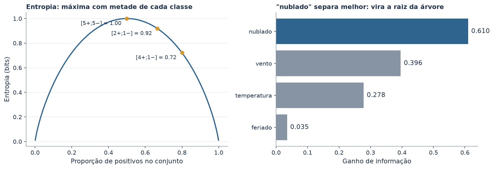
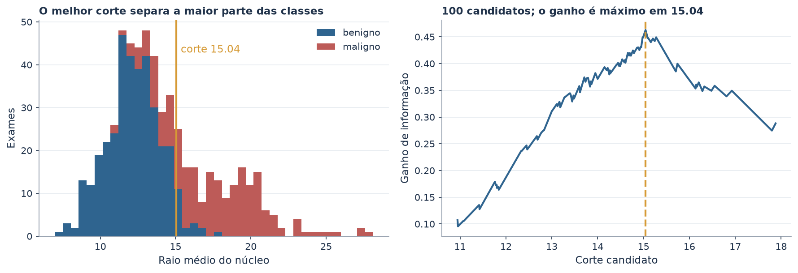
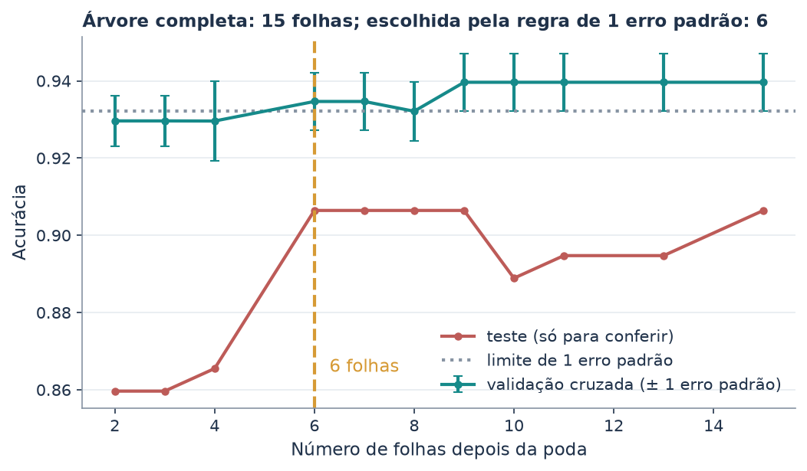
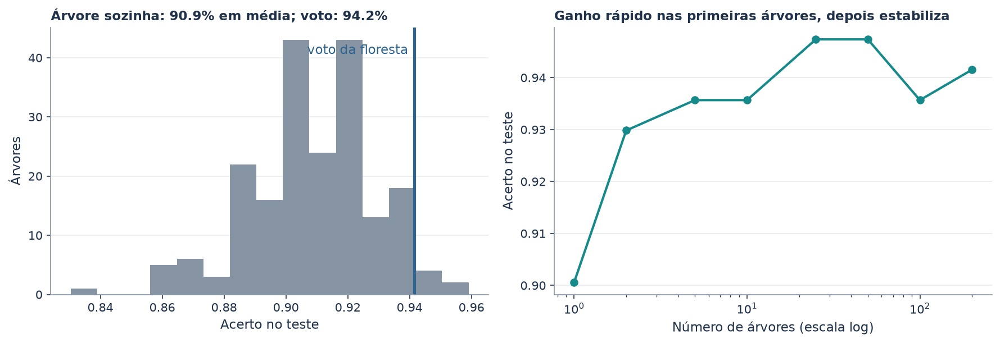
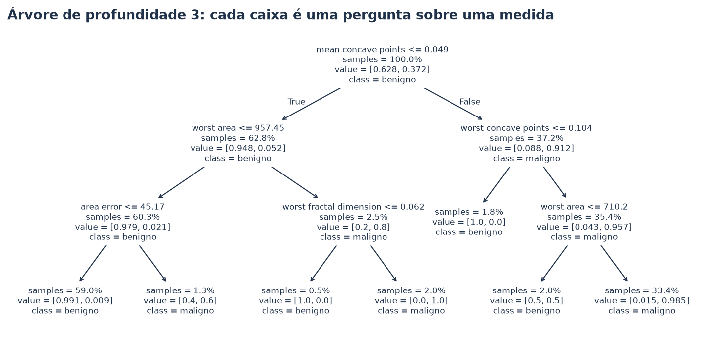
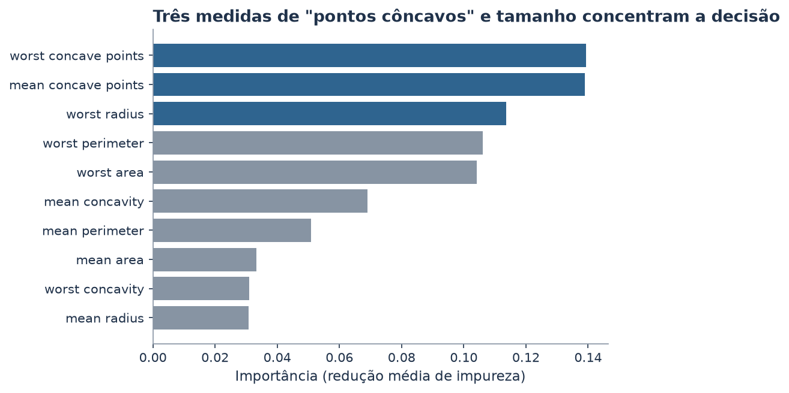

# 12 · Árvores de decisão

Uma árvore de decisão classifica um exemplo fazendo uma sequência de perguntas simples: *o céu está muito nublado?*, *o raio do núcleo passa de 15?*. Cada pergunta é um **nó**, cada resposta é um **ramo** e cada ponto final é uma **folha** com a classe prevista. O caminho da raiz até uma folha pode ser lido como uma regra "SE … E … ENTÃO …", o que torna a árvore um dos modelos mais fáceis de explicar para quem não é da área.

A pergunta central desta unidade: **como o algoritmo decide qual pergunta fazer primeiro?** E a segunda: **até onde deixar a árvore crescer?**

| Script | O que faz | Figura |
|---|---|---|
| `01_entropia_e_ganho.py` | Calcula entropia e ganho de informação à mão, numa tabela de 10 dias | `entropia_e_ganho.png` |
| `02_id3_a_mao.py` | Implementa o algoritmo ID3 em ~20 linhas e extrai as regras | (saída no terminal) |
| `03_atributo_continuo.py` | Mostra como a árvore escolhe o corte de uma variável numérica | `atributo_continuo.png` |
| `04_sobreajuste_e_poda.py` | Poda por custo-complexidade e regra de 1 erro padrão | `poda.png` |
| `05_arvore_legivel_e_floresta.py` | Árvore rasa legível, floresta aleatória e importância | `arvore_rasa.png`, `floresta_voto.png`, `importancia_floresta.png` |

Animação: [`animacoes/geradas/arvore_particionando.gif`](../animacoes/geradas/) mostra a árvore dividindo o plano, uma folha por vez.

---

## Passo 1 · Medir a "bagunça" de um conjunto: entropia

Antes de escolher uma pergunta, precisamos de uma medida de quão misturadas estão as classes num grupo de exemplos. A **entropia** faz isso:

$$\text{Entropia}(S) = -p_{+}\log_2 p_{+} - p_{-}\log_2 p_{-}$$

em que $p_{+}$ e $p_{-}$ são as proporções de positivos e negativos em $S$.

| Conjunto | Entropia | Leitura |
|---|---|---|
| [5+; 5−] | 1,000 | mistura máxima: não dá para chutar melhor que uma moeda |
| [3+; 4−] | 0,985 | quase tão misturado quanto o anterior |
| [2+; 1−] | 0,918 | já há uma classe dominante |
| [4+; 0−] | 0,000 | puro: todos da mesma classe |



A curva da esquerda mostra a entropia em função da proporção de positivos: zero nas pontas (grupos puros), máxima no meio.

## Passo 2 · Escolher a pergunta que mais reduz a bagunça: ganho de informação

A tabela de 10 dias tem 5 dias de praia e 5 sem praia (entropia 1). Para cada atributo, dividimos os dias pelos seus valores e calculamos quanto a entropia **média ponderada** caiu:

$$\text{Ganho}(S, A) = \text{Entropia}(S) - \sum_{v} \frac{|S_v|}{|S|}\,\text{Entropia}(S_v)$$

Resultado do script `01`:

| Atributo | Divisão | Ganho |
|---|---|---|
| **nublado** | muito: 4 dias, todos "não" · pouco: 5 "sim" e 1 "não" | **0,610** |
| vento | forte: 2 "sim" e 5 "não" · fraco: 3 "sim" | 0,396 |
| temperatura | frio: 1 "sim" e 4 "não" · quente: 4 "sim" e 1 "não" | 0,278 |
| feriado | não: 3 "sim" e 4 "não" · sim: 2 "sim" e 1 "não" | 0,035 |

"Nublado" vence porque cria um grupo inteiramente puro (os 4 dias muito nublados) e deixa o outro quase puro. "Feriado" quase não muda nada: os dois grupos continuam misturados. **O atributo de maior ganho vira a raiz.**

## Passo 3 · Repetir em cada ramo: o algoritmo ID3

O ID3 aplica o Passo 2 de novo dentro de cada ramo, só com os dias que chegaram ali e só com os atributos ainda não usados. Para quando o nó fica puro ou quando acabam os atributos. O script `02` faz isso numa função recursiva e imprime a árvore:

```
nublado = muito  -> nao  (4 dias)
nublado = pouco
    vento = fraco  -> sim  (3 dias)
    vento = forte
        feriado = nao  -> sim  (2 dias)
        feriado = sim  -> nao  (1 dia)
```

Três observações que valem para qualquer árvore:

1. **Nem todo atributo é usado.** A temperatura nunca aparece: depois de nebulosidade, vento e feriado, todos os dias já estão separados.
2. **As regras saem prontas.** Por exemplo: *SE nublado = pouco E vento = fraco ENTÃO praia = sim*.
3. **A última regra se apoia em um único dia.** "Feriado = sim → não" foi aprendida de um caso só. Uma árvore que cresce até todas as folhas ficarem puras tende a decorar casos isolados (Passo 5).

## Passo 4 · Variáveis numéricas: procurar o melhor corte

Com uma variável contínua, a árvore pergunta "valor < c?". Os cortes candidatos são os pontos médios entre valores vizinhos **onde a classe muda**.

- No exemplo pequeno (temperaturas 20, 24, 30, 32, 35, 37), há dois candidatos: 27 (ganho 0,459) e 36 (ganho 0,191). A árvore escolhe "temperatura < 27".
- Na base real de câncer de mama (569 exames), o raio médio do núcleo tem 100 cortes candidatos. O de maior ganho é **15,04** (ganho 0,463):

| | benigno | maligno |
|---|---|---|
| raio < 15,04 | 346 | 51 |
| raio ≥ 15,04 | 11 | 161 |



Uma única pergunta já acerta 507 de 569 exames (89%). A curva da direita mostra que o ganho sobe, atinge o pico em 15,04 e volta a cair.

## Passo 5 · Árvores grandes decoram: sobreajuste e poda

Deixada livre, a árvore no câncer de mama cresce até **15 folhas** e acerta **100% do treino**, mas **90,6% do teste**. Para encontrar um tamanho melhor, usamos a **poda por custo-complexidade**: um parâmetro $\alpha$ cobra um "preço" por folha, e cada aumento de $\alpha$ remove a subárvore que menos reduz o erro por folha removida. O script `04` testa todos os $\alpha$ do caminho de poda com validação cruzada de 5 dobras, **apenas no treino**:

| folhas | validação | erro padrão |
|---|---|---|
| 15 | 0,940 | 0,007 |
| 9 | 0,940 | 0,007 |
| 6 | 0,935 | 0,007 |
| 4 | 0,930 | 0,010 |
| 2 | 0,930 | 0,006 |

As diferenças são pequenas, da ordem de um erro padrão. Por isso usamos a **regra de 1 erro padrão**: entre as árvores cuja validação fica a menos de um erro padrão da melhor (limite 0,932), escolhemos a **menor**. O resultado é uma árvore de **6 folhas** com validação 0,935 e teste **0,906**, o mesmo acerto da árvore completa com menos da metade das regras.



Outra forma de controlar o tamanho é parar antes: `min_samples_leaf` exige um mínimo de exemplos por folha. Com 5, 10 ou 20, a árvore fica com 10, 7 ou 6 folhas e o teste varia entre 0,906 e 0,918. Com tantos empates, o critério de desempate deve ser a legibilidade.

## Passo 6 · Muitas árvores votando: floresta aleatória

Uma árvore sozinha é instável: pequenas mudanças nos dados mudam a raiz e, com ela, toda a árvore. A **floresta aleatória** treina muitas árvores, cada uma numa amostra com reposição do treino e, em cada nó, escolhendo entre poucas variáveis sorteadas. Depois, as árvores votam.

| Modelo | Treino | Teste |
|---|---|---|
| Árvore livre (profundidade 6) | 1,000 | 0,906 |
| Árvore rasa (profundidade 3) | 0,975 | 0,918 |
| Floresta (200 árvores) | 1,000 | **0,942** |



O histograma mostra as 200 árvores da floresta avaliadas uma a uma: acertam de 83,0% a 95,9%, com média de 90,9%. O voto atinge 94,2%. Algumas árvores isoladas superam o voto *neste* teste, mas não há como saber de antemão quais serão: o voto é a escolha estável. À direita, o acerto sobe rápido nas primeiras árvores e oscila em torno de 94% a partir de 5.





A importância mede quanto cada variável reduziu a impureza, em média, nas árvores. Ela diz **o que o modelo usou**, não **o que causa** o tumor. Variáveis muito correlacionadas (raio, perímetro e área) dividem a importância entre si.

## Para lembrar

- Entropia mede mistura; ganho de informação mede quanto uma pergunta reduz a mistura.
- O ID3 escolhe, em cada nó, o atributo de maior ganho e repete nos ramos.
- Variáveis contínuas viram perguntas "valor < corte"; os cortes candidatos ficam onde a classe muda.
- Árvores que crescem sem limite decoram o treino. Escolha o tamanho com validação no treino e, havendo empate, prefira a árvore menor.
- Floresta aleatória troca legibilidade por estabilidade e, em geral, acerto.

## Atividade

1. No script `01`, troque o dia 6 (quente, vento forte, pouco nublado, feriado, "não") para "sim". Qual atributo vira a raiz agora? Por quê?
2. No script `04`, mude `random_state` da divisão treino/teste para 1, 2 e 3. A árvore escolhida pela regra de 1 erro padrão continua com cerca de 6 folhas?
3. No script `05`, retire as três variáveis mais importantes e treine a floresta de novo. Quanto o acerto cai? O que isso diz sobre variáveis correlacionadas?

Próxima unidade: [13 · Redes neurais](../13_redes_neurais/)
