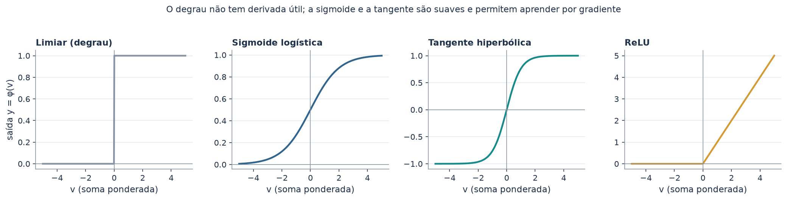
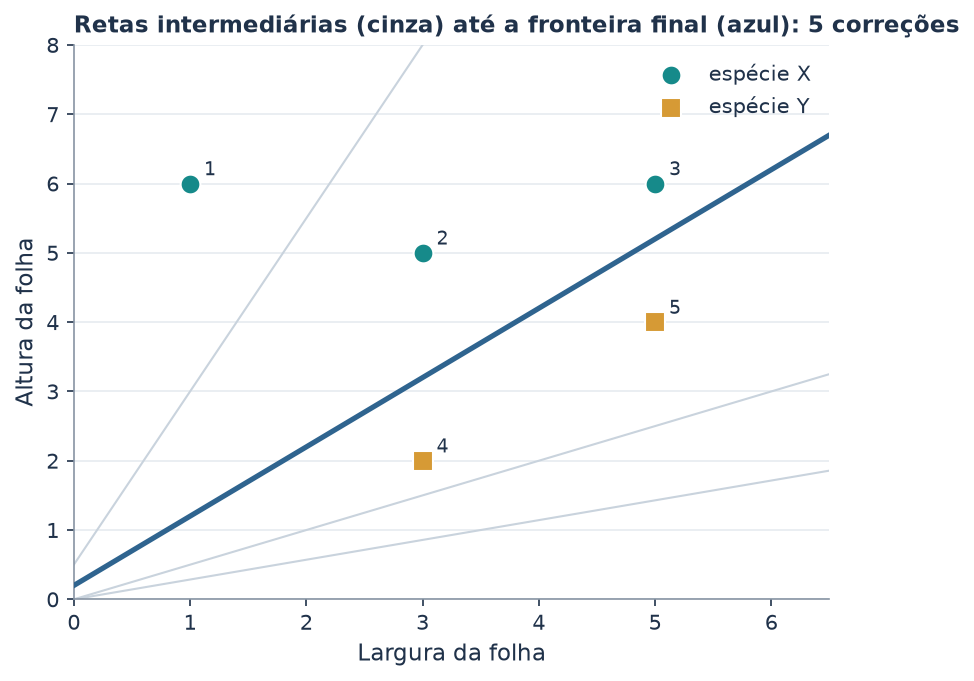
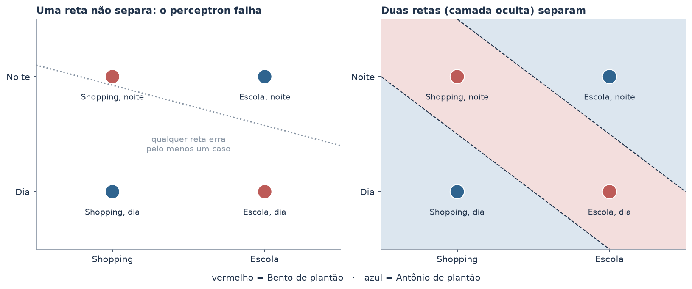
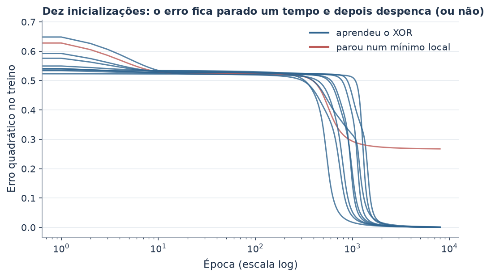
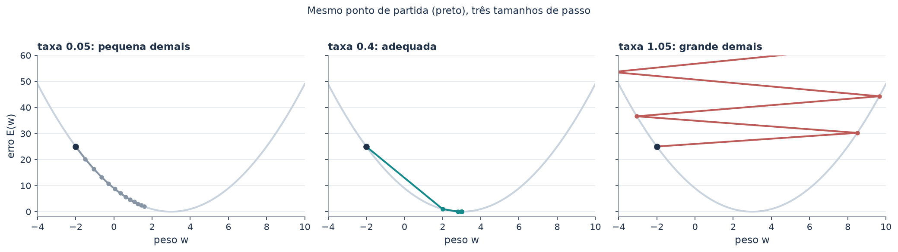
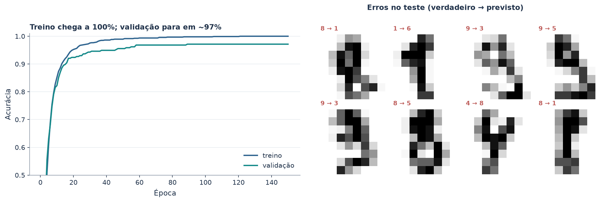

# 13 · Redes neurais

Uma rede neural artificial é formada por unidades simples, os **neurônios**, ligadas por **pesos**. Cada neurônio soma as entradas multiplicadas pelos pesos e passa o resultado por uma **função de ativação**. Sozinho, um neurônio só consegue traçar uma reta (ou um plano). Em camadas, os neurônios conseguem formar fronteiras curvas e resolver problemas que nenhuma reta resolve.

Esta unidade percorre a história do modelo na ordem em que ele foi inventado: o neurônio com pesos fixos (1943), o perceptron que aprende os pesos (1958), o limite do perceptron (XOR) e as redes de múltiplas camadas treinadas por retropropagação.

| Script | O que faz | Figura |
|---|---|---|
| `01_neuronio_artificial.py` | Neurônio de McCulloch e Pitts fazendo E, OU e NÃO-E; funções de ativação | `funcoes_de_ativacao.png` |
| `02_perceptron_regra_delta.py` | Perceptron aprendendo, passo a passo, a separar duas espécies de árvore | `perceptron_folhas.png` |
| `03_xor_e_camada_oculta.py` | O problema dos dois seguranças (XOR): o perceptron falha, duas camadas resolvem | `xor_camada_oculta.png` |
| `04_retropropagacao_a_mao.py` | Retropropagação escrita em NumPy, com a primeira atualização impressa | `retropropagacao_xor.png` |
| `05_taxa_de_aprendizagem.py` | Efeito do tamanho do passo no gradiente descendente | `taxa_de_aprendizagem.png` |
| `06_mlp_na_pratica.py` | Rede de múltiplas camadas (scikit-learn) em 1797 imagens de dígitos | `mlp_digitos.png` |

Animação: [`animacoes/geradas/perceptron_aprendendo.gif`](../animacoes/geradas/) mostra a reta do perceptron se movendo a cada erro.

---

## Passo 1 · O neurônio artificial

O neurônio biológico recebe sinais por sinapses que excitam ou inibem; quando a soma passa de um limite, ele dispara. O modelo artificial copia esses três elementos:

| Biológico | Artificial | Papel |
|---|---|---|
| Sinapses | Pesos $w_j$ | Excitar (peso positivo) ou inibir (peso negativo) cada entrada |
| Acúmulo no corpo celular | Soma $v = \sum_j w_j x_j + b$ | Agregar as entradas |
| Disparo | Ativação $y = \varphi(v)$ | Decidir a saída |

O **viés** $b$ funciona como um peso ligado a uma entrada fixa igual a +1 e define o "limite de disparo". Com pesos fixos iguais a 1, o script `01` mostra que só o viés muda a função lógica:

| Função | Pesos | Viés | Saídas para (0,0), (0,1), (1,0), (1,1) |
|---|---|---|---|
| E | 1, 1 | −1,5 | 0, 0, 0, 1 |
| OU | 1, 1 | −0,5 | 0, 1, 1, 1 |
| NÃO-E | −1, −1 | +1,5 | 1, 1, 1, 0 |

O degrau (limiar) é a ativação original. Sigmoide e tangente hiperbólica são versões suaves do degrau, com derivada em todo ponto, o que permite treinar por gradiente (Passo 4). A ReLU é a mais usada em redes profundas atuais.

## Passo 2 · O perceptron aprende os pesos: regra delta

No neurônio de 1943, alguém escolhia os pesos. O **perceptron** aprende os pesos a partir de exemplos rotulados. Para cada exemplo:

1. calcula a saída $y$;
2. calcula o erro $e = d - y$ ($d$ é a classe desejada);
3. corrige cada peso: $w_j \leftarrow w_j + \eta \, e \, x_j$, em que $\eta$ é a **taxa de aprendizagem**.

Se acertou ($e = 0$), nada muda. Se disse 1 quando era 0 ($e = -1$), os pesos andam na direção contrária ao exemplo; se disse 0 quando era 1, andam na direção do exemplo.

**Exemplo.** Um biólogo mediu cinco folhas de duas espécies:

| Folha | Largura | Altura | Espécie |
|---|---|---|---|
| 1 | 1 | 6 | X |
| 2 | 3 | 5 | X |
| 3 | 5 | 6 | X |
| 4 | 3 | 2 | Y |
| 5 | 5 | 4 | Y |

Começando com pesos zero e $\eta = 0{,}1$, o script `02` imprime cada exemplo apresentado. As correções acontecem assim:

| Época | Folha | Erro | Pesos depois | Viés |
|---|---|---|---|---|
| 1 | 4 (Y, previu X) | −1 | (−0,3; −0,2) | −0,1 |
| 2 | 1 (X, previu Y) | +1 | (−0,2; 0,4) | 0,0 |
| 2 | 4 (Y, previu X) | −1 | (−0,5; 0,2) | −0,1 |
| 3 | 2 (X, previu Y) | +1 | (−0,2; 0,7) | 0,0 |
| 3 | 4 (Y, previu X) | −1 | (−0,5; 0,5) | −0,1 |
| 4 | nenhum erro | | | |

A fronteira final é $-0{,}5\,\text{largura} + 0{,}5\,\text{altura} - 0{,}1 = 0$, ou seja, **altura = largura + 0,2**: folhas mais altas que largas são da espécie X.

**Teorema de convergência do perceptron:** se existe uma reta que separa as classes, a regra delta encontra uma em um número finito de correções. Aqui foram 5.

## Passo 3 · O limite do perceptron: o problema XOR

Dois seguranças alternam o plantão. Antônio fica no Shopping de dia e na Escola à noite; Bento, no Shopping à noite e na Escola de dia. Dado o local e o turno, quem está de plantão?

| Local | Turno | Segurança |
|---|---|---|
| Shopping | Dia | Antônio |
| Shopping | Noite | Bento |
| Escola | Dia | Bento |
| Escola | Noite | Antônio |

Codificando Shopping/Dia = 0 e Escola/Noite = 1, "é o Bento?" é exatamente o **ou exclusivo (XOR)**: 1 quando as entradas diferem. Os casos de Bento ficam em cantos opostos do quadrado, e **nenhuma reta separa os dois pares**. Treinado por 100 épocas, o perceptron nunca passa de 50% de acerto.

A saída é **combinar neurônios em camadas**. Um neurônio oculto calcula OU, outro calcula NÃO-E, e o neurônio de saída calcula E dos dois:

| Caso | OU | NÃO-E | Saída (E) | Bento? |
|---|---|---|---|---|
| Shopping, dia | 0 | 1 | 0 | não |
| Shopping, noite | 1 | 1 | 1 | sim |
| Escola, dia | 1 | 1 | 1 | sim |
| Escola, noite | 1 | 0 | 0 | não |

Cada neurônio oculto traça uma reta; a camada de saída combina as regiões. A **camada oculta transforma o problema** num espaço em que uma reta volta a ser suficiente.

## Passo 4 · Como uma rede de várias camadas aprende: retropropagação

Na rede montada à mão, escolhemos os pesos olhando o problema. Para aprender os pesos, precisamos saber **quanto cada peso contribuiu para o erro**, inclusive os pesos da camada oculta, que não têm uma "saída desejada" própria. A **retropropagação** resolve isso com a regra da cadeia:

1. **Propagação para frente:** calcula as saídas dos ocultos $y_j$ e da saída $o$.
2. **Erro na saída:** $e = d - o$.
3. **Gradiente local da saída:** $\delta_o = e \cdot o(1-o)$ (o termo $o(1-o)$ é a derivada da sigmoide).
4. **Gradiente local de cada oculto:** $\delta_j = y_j(1-y_j) \cdot \delta_o \cdot w_{oj}$, isto é, o erro da saída "volta" pelo peso que liga o oculto à saída.
5. **Atualização:** cada peso muda em $\eta \cdot \delta \cdot (\text{sinal que entra nele})$.

O script `04` imprime a primeira passagem do exemplo (0, 1) com $\eta = 0{,}5$:

| Grandeza | Valor |
|---|---|
| Saídas ocultas $y$ | (0,6256; 0,6785) |
| Saída $o$ | 0,5687 |
| Erro $e = 1 - 0{,}5687$ | +0,4313 |
| $\delta_o = e \cdot o(1-o)$ | +0,10580 |
| $\delta$ dos ocultos | (+0,01554; −0,00494) |
| Ajuste nos pesos oculto→saída, $\eta\,\delta_o\,y$ | (+0,0331; +0,0359) |

Depois de 8 000 épocas, a rede responde 0,020 / 0,982 / 0,977 / 0,018 para os quatro casos: aprendeu o XOR.

O gráfico mostra dez treinos, cada um começando de pesos sorteados diferentes. O erro fica num **platô** por centenas de épocas e depois despenca. Em 9 dos 10 treinos a rede aprendeu; em 1 (vermelho) ficou presa num **mínimo local**, com erro 0,27 que não cai mais. Na prática, treina-se a rede várias vezes, com inicializações diferentes, e fica-se com a melhor pela validação.

## Passo 5 · Taxa de aprendizagem

A retropropagação é um caso de **gradiente descendente**: andar contra a derivada do erro. A taxa $\eta$ é o tamanho do passo. O script `05` minimiza $E(w) = (w-3)^2$ começando de $w = -2$:

| Taxa | Depois de 12 passos | Leitura |
|---|---|---|
| 0,05 | $w = 1{,}59$ (falta 1,41) | converge, mas devagar |
| 0,40 | $w = 3{,}00$ | converge rápido |
| 1,05 | $w = -12{,}69$ | cada passo ultrapassa o mínimo e piora: diverge |

## Passo 6 · Uma rede de verdade: dígitos manuscritos

O script `06` treina uma rede com uma camada oculta em 1 797 imagens de dígitos (8×8 pixels = 64 entradas, 10 classes), separadas em treino (942), validação (315) e teste (540).

**Quantos neurônios ocultos?** Escolhemos pela validação:

| Neurônios ocultos | Treino | Validação |
|---|---|---|
| 2 | 0,558 | 0,556 |
| 5 | 0,924 | 0,857 |
| 10 | 0,996 | 0,949 |
| 32 | 1,000 | 0,959 |
| 64 | 1,000 | 0,975 |
| 128 | 1,000 | 0,975 |

Com 2 neurônios a rede não tem capacidade (erra treino e validação). A partir de 64 a validação para de melhorar; ficamos com 64.

**Resultado no teste:** rede com 64 ocultos 0,972; regressão logística 0,961. A rede erra 15 de 540 imagens. Neste conjunto, padronizar as entradas quase não muda o acerto (0,969 sem padronizar), porque todos os pixels já estão na mesma escala de 0 a 16. Com variáveis em escalas diferentes, padronizar é indispensável.

À esquerda, o acerto ao longo das épocas: o treino chega a 100%, a validação para em 97,1% (máximo na época 89). A distância entre as curvas é o sobreajuste. À direita, alguns erros: vários são dígitos que até uma pessoa hesitaria em ler.

## Para lembrar

- Neurônio = soma ponderada + viés + ativação. Um neurônio sozinho traça uma reta.
- O perceptron aprende pela regra delta e converge quando as classes são linearmente separáveis.
- Problemas como o XOR exigem camada oculta.
- A retropropagação distribui o erro da saída para as camadas anteriores pela regra da cadeia.
- Inicialização importa (mínimos locais) e a taxa de aprendizagem precisa ser escolhida (lenta × divergente).
- Escolha o tamanho da rede e o número de épocas pela validação, nunca pelo teste.

## Atividade

1. No script `02`, troque a taxa para 1,0. O perceptron converge? Em quantas correções? A reta final é a mesma?
2. No script `04`, troque a taxa para 0,1 e para 5,0. O que acontece com o platô e com o número de sementes que resolvem o XOR?
3. No script `06`, use duas camadas ocultas, `hidden_layer_sizes=(64, 32)`. A validação melhora?

Próxima unidade: [14 · Máquinas de vetores de suporte](../14_svm/)
