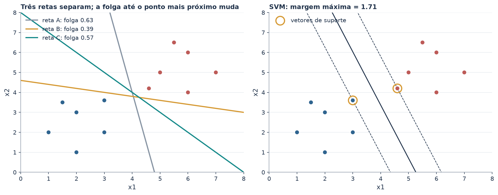
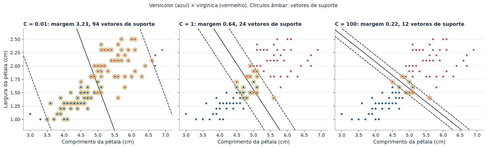
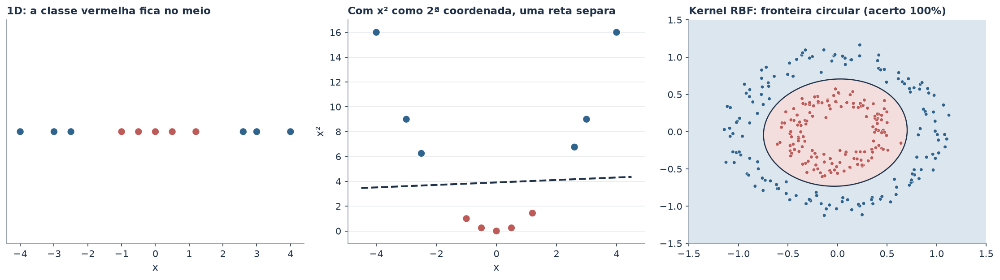
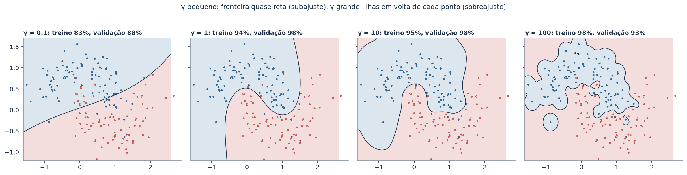
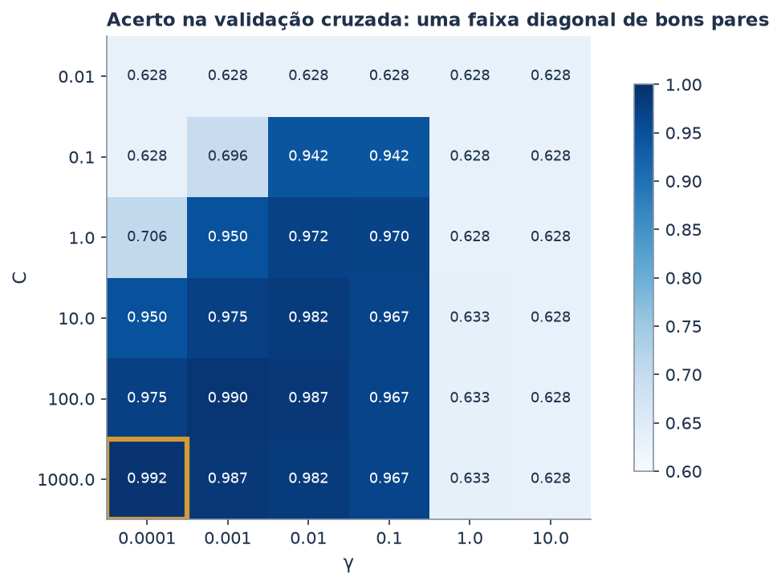

# 14 · Máquinas de vetores de suporte (SVM)

O perceptron (unidade 13) para na **primeira** reta que separa as classes. Mas, quando as classes são separáveis, existem infinitas retas que separam. Qual é a melhor? A **máquina de vetores de suporte** responde: a que deixa a **maior folga** (margem) até os pontos mais próximos de cada classe. Uma reta com folga grande tolera melhor pequenas variações em exemplos novos.

A SVM tem três ideias, uma por passo desta unidade:

1. **Margem máxima**: escolher a reta mais "folgada".
2. **Margem suave**: aceitar alguns erros quando as classes se sobrepõem, controlados pelo parâmetro $C$.
3. **Kernel**: separar classes que nenhuma reta separa, trabalhando implicitamente num espaço de dimensão maior.

| Script | O que faz | Figura |
|---|---|---|
| `01_margem_maxima.py` | Compara retas separadoras e encontra a de margem máxima | `margem_maxima.png` |
| `02_margem_suave.py` | Efeito de $C$ em duas espécies de íris que se sobrepõem | `margem_suave.png` |
| `03_mapeamento_e_kernel.py` | Mapeamento para dimensão maior e truque do kernel | `mapeamento_e_kernel.png` |
| `04_ajuste_de_C_e_gamma.py` | Efeito de $\gamma$ e busca em grade de $C$ e $\gamma$ em dados reais | `efeito_gamma.png`, `grade_C_gamma.png` |

---

## Passo 1 · Margem máxima e vetores de suporte

Uma reta (em geral, um **hiperplano**) é descrita por $\mathbf{w}\cdot\mathbf{x} + b = 0$. A distância de um ponto até ela é $(\mathbf{w}\cdot\mathbf{x} + b)/\lVert\mathbf{w}\rVert$. Com as classes codificadas como $y = +1$ e $y = -1$, a SVM exige

$$y_i(\mathbf{w}\cdot\mathbf{x}_i + b) \ge 1 \quad \text{para todo } i$$

e, sob essa exigência, a margem vale $2/\lVert\mathbf{w}\rVert$. **Maximizar a margem é o mesmo que minimizar $\lVert\mathbf{w}\rVert^2/2$**, um problema de otimização quadrática com solução única.

O script `01` usa 12 pontos. Primeiro mede três retas que separam as classes:

| Reta | Distância ao ponto mais próximo |
|---|---|
| A | 0,628 |
| B | 0,392 |
| C | 0,566 |

Todas acertam 100% do treino, mas B passa "raspando" num ponto. A SVM encontra $\mathbf{w} = (1{,}096;\ 0{,}411)$, $b = -5{,}767$, com **margem 1,709** (0,854 de cada lado), maior que a de qualquer uma das três.

Dois fatos que o script verifica numericamente:

- **Só os vetores de suporte importam.** Os pontos (3; 3,6) e (4,6; 4,2) são os únicos com $y(\mathbf{w}\cdot\mathbf{x}+b) = 1$; todos os outros têm valor maior. Retirando do treino o ponto (1; 2), que não é vetor de suporte, a reta não muda.
- **A decisão usa produtos internos.** Para um ponto novo, $f(\mathbf{x}) = \sum_i \alpha_i y_i (\mathbf{x}_i\cdot\mathbf{x}) + b$, somando só sobre os vetores de suporte. Para (4; 4), a conta manual dá 0,260, o mesmo valor do scikit-learn: classe +1.

## Passo 2 · Margem suave: o parâmetro C

Com dados reais, as classes costumam se sobrepor e nenhuma reta separa tudo. A SVM passa a permitir **violações** $\xi_i \ge 0$ (pontos dentro da margem ou do lado errado), cobrando por elas:

$$\min\ \tfrac{1}{2}\lVert\mathbf{w}\rVert^2 + C\sum_i \xi_i \quad\text{sujeito a}\quad y_i(\mathbf{w}\cdot\mathbf{x}_i + b) \ge 1 - \xi_i$$

$C$ é o preço de cada violação. O script `02` usa as pétalas de 100 flores de duas espécies de íris (versicolor e virginica), que se sobrepõem:

| C | Margem | Vetores de suporte | Acerto no treino | Validação cruzada |
|---|---|---|---|---|
| 0,01 | 3,23 | 94 | 0,92 | 0,950 |
| 0,1 | 1,31 | 50 | 0,95 | 0,940 |
| 1 | 0,64 | 24 | 0,95 | 0,950 |
| 10 | 0,36 | 15 | 0,95 | 0,940 |
| 100 | 0,22 | 12 | 0,94 | 0,930 |
| 1000 | 0,22 | 12 | 0,94 | 0,930 |

Leitura: $C$ pequeno deixa a margem larga e transforma quase todos os pontos em vetores de suporte; $C$ grande estreita a margem e a reta passa a depender de poucos pontos da fronteira. **Neste conjunto**, a validação varia pouco (0,93 a 0,95) entre os valores de $C$: a inclinação da reta muda, mas os mesmos casos difíceis continuam do lado errado. Não há como saber de antemão se $C$ fará diferença; é preciso medir (Passo 4).

## Passo 3 · Quando nenhuma reta serve: mapeamento e kernel

**Ideia do mapeamento.** No script `03`, 11 pontos numa linha têm a classe vermelha no meio. Nenhum ponto de corte separa (o melhor corte acerta 55%). Acrescentando $x^2$ como segunda coordenada, os pontos do meio ficam embaixo e os das pontas ficam em cima: uma reta passa a separar 100%.

**Truque do kernel.** A SVM só usa os dados por meio de produtos internos $\mathbf{x}_i\cdot\mathbf{x}_j$ (Passo 1). Se mapeamos $\mathbf{x} \to \varphi(\mathbf{x})$, precisamos de $\varphi(\mathbf{x}_i)\cdot\varphi(\mathbf{x}_j)$. Um **kernel** calcula esse número direto no espaço original, sem construir $\varphi$. O script verifica, para $\mathbf{a} = (1, 2)$ e $\mathbf{b} = (3, -1)$:

- construindo explicitamente o mapeamento de grau 2 em 6 dimensões, $\varphi(\mathbf{a})\cdot\varphi(\mathbf{b}) = 4{,}0$;
- com o kernel polinomial $(\mathbf{a}\cdot\mathbf{b} + 1)^2 = (1 + 1)^2 = 4{,}0$.

Mesmo número, sem sair de 2 dimensões. Kernels mais usados:

| Kernel | Fórmula | Parâmetros |
|---|---|---|
| Linear | $\mathbf{a}\cdot\mathbf{b}$ | — |
| Polinomial | $(\mathbf{a}\cdot\mathbf{b} + c)^d$ | grau $d$ |
| Gaussiano (RBF) | $\exp(-\gamma\lVert\mathbf{a}-\mathbf{b}\rVert^2)$ | alcance $\gamma$ |
| Sigmoide | $\tanh(\mathbf{a}\cdot\mathbf{b} + c)$ | — |

Nos dois círculos concêntricos (direita), a SVM linear acerta 55% e a SVM com kernel RBF acerta 100%, com fronteira circular.

## Passo 4 · Escolher C e γ com dados

O kernel RBF mede semelhança pela distância: $\gamma$ define até onde cada vetor de suporte "alcança". O script `04` mostra o efeito em duas luas entrelaçadas (180 pontos de treino, 120 de validação):

| γ | Treino | Validação | Vetores de suporte |
|---|---|---|---|
| 0,1 | 0,828 | 0,875 | 88 |
| 1 | 0,944 | 0,983 | 54 |
| 10 | 0,950 | 0,975 | 90 |
| 100 | 0,978 | 0,933 | 165 |

Com $\gamma = 0{,}1$, a fronteira é quase reta e erra a curvatura das luas (subajuste). Com $\gamma = 100$, cada ponto ganha sua "ilha" e o treino sobe enquanto a validação cai (sobreajuste).

**Busca em grade em dados reais.** Na base de câncer de mama (398 exames de treino, 171 de teste), testamos 36 pares $(C, \gamma)$ com validação cruzada de 5 dobras, **só no treino**, com padronização dentro do pipeline:

1. Os bons pares formam uma **faixa diagonal**: $\gamma$ menor pede $C$ maior. Com $\gamma \ge 1$, nenhum $C$ funciona (0,63 = sempre prever a classe majoritária).
2. O melhor par, $C = 1000$ e $\gamma = 0{,}0001$ (validação 0,992), caiu **no canto da grade**. Quando isso acontece, o ótimo pode estar fora dela; ampliamos a busca para $C$ até 100 000 e $\gamma$ até 0,000001, e o mesmo par continuou o melhor.
3. No teste, esse modelo acerta **0,953**. A distância para 0,992 é esperada: escolher o máximo entre 36 validações dá um número otimista. Por isso o teste fica separado desde o início.
4. Com os mesmos parâmetros e **sem padronizar**, o teste cai para 0,924: variáveis com valores grandes (área, na casa das centenas) dominam a distância.

## Para lembrar

- A SVM escolhe o hiperplano de margem máxima; só os vetores de suporte definem a fronteira.
- $C$ controla o equilíbrio entre margem larga e acerto no treino.
- Kernels permitem fronteiras não lineares sem construir o espaço transformado.
- $\gamma$ grande = fronteira muito recortada; $\gamma$ pequeno = fronteira suave.
- Ajuste $C$ e $\gamma$ por validação cruzada no treino; se o melhor par cair na borda da grade, amplie a grade.
- Padronize as variáveis antes de uma SVM com kernel RBF.

## Atividade

1. No script `01`, acrescente o ponto (4, 3) com classe −1. Ele vira vetor de suporte? Quanto a margem diminui?
2. No script `02`, troque o kernel para `'rbf'`. A validação cruzada melhora em relação ao linear?
3. No script `04`, troque a grade por valores mais finos em torno do melhor par (por exemplo, $C \in \{300, 1000, 3000\}$ e $\gamma \in \{0{,}00003; 0{,}0001; 0{,}0003\}$). O teste muda?

Próxima unidade: [15 · Séries temporais](../15_series_temporais/)
