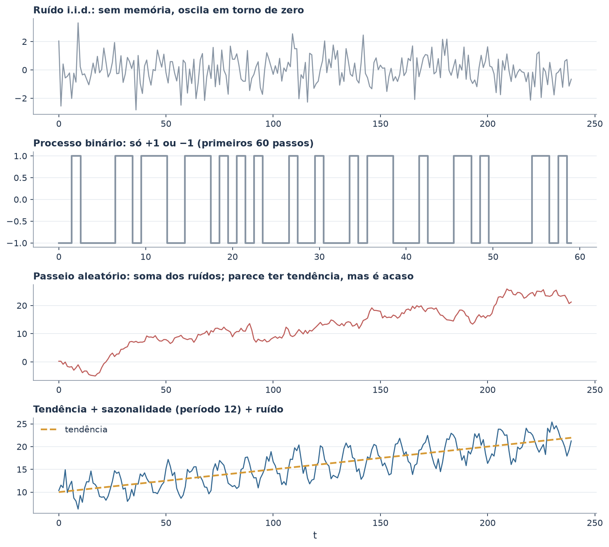
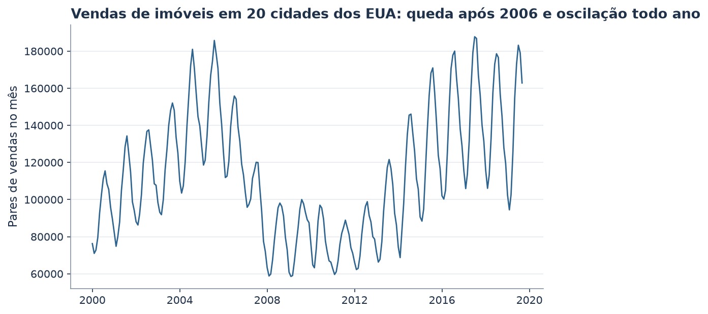
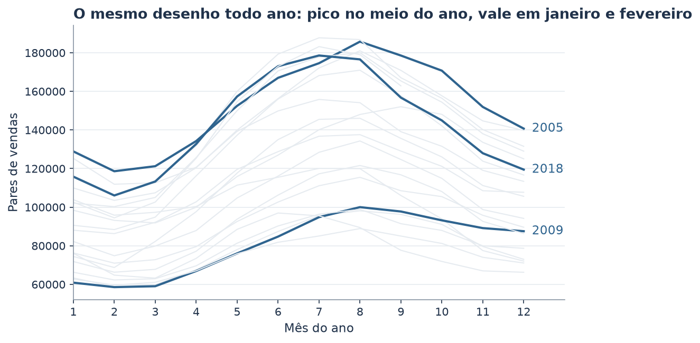
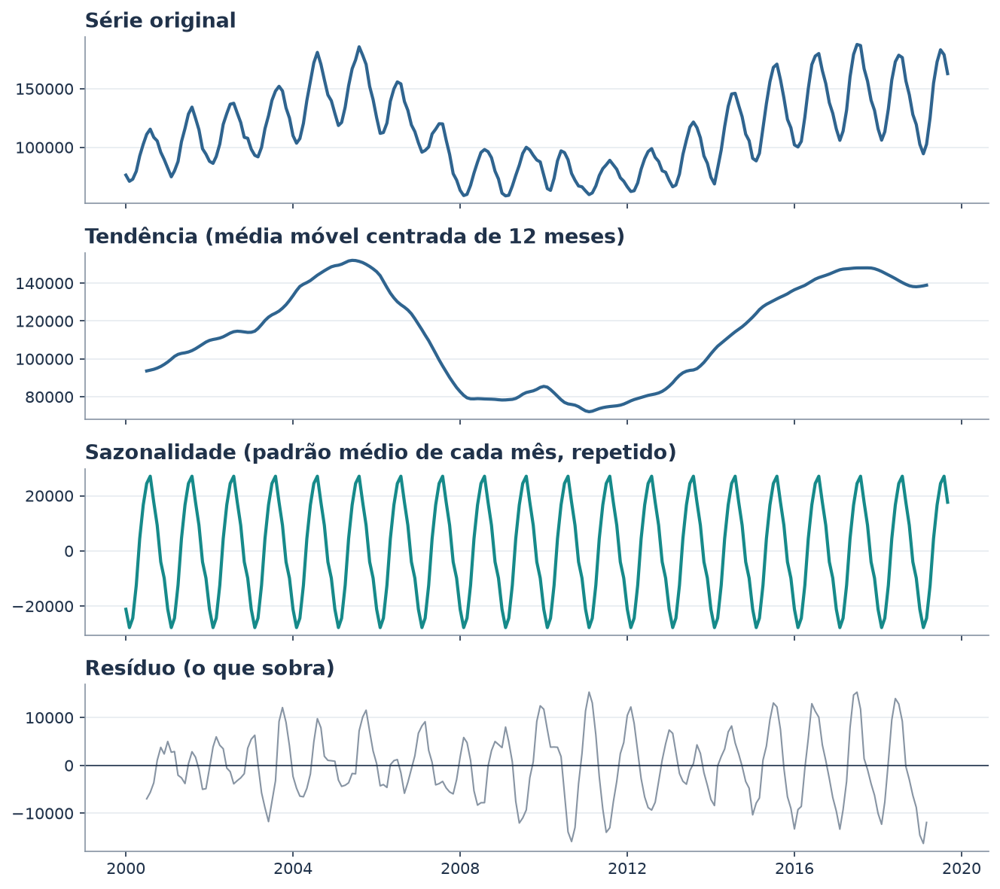
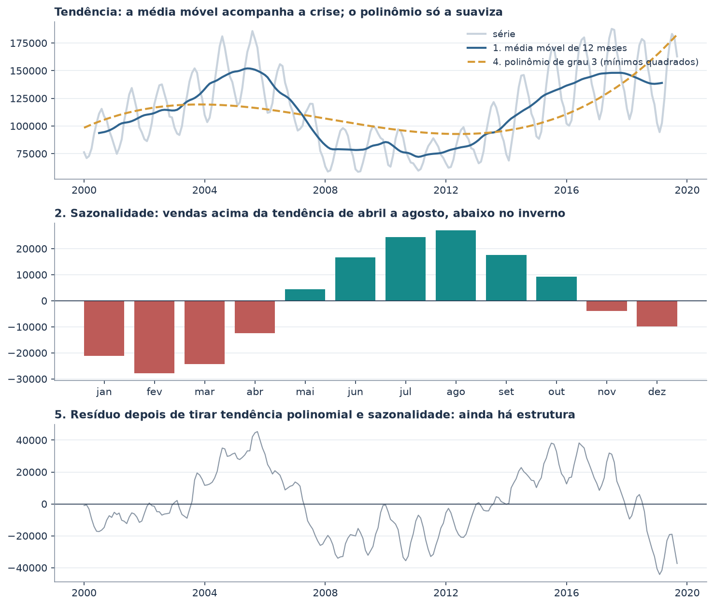
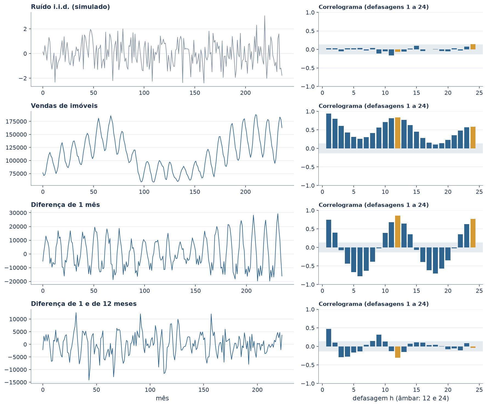
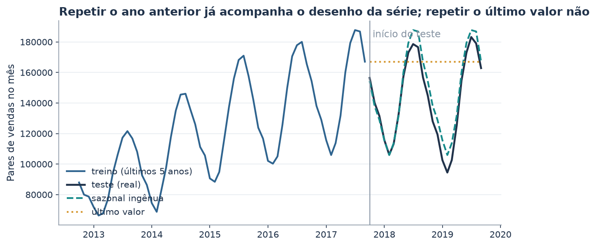
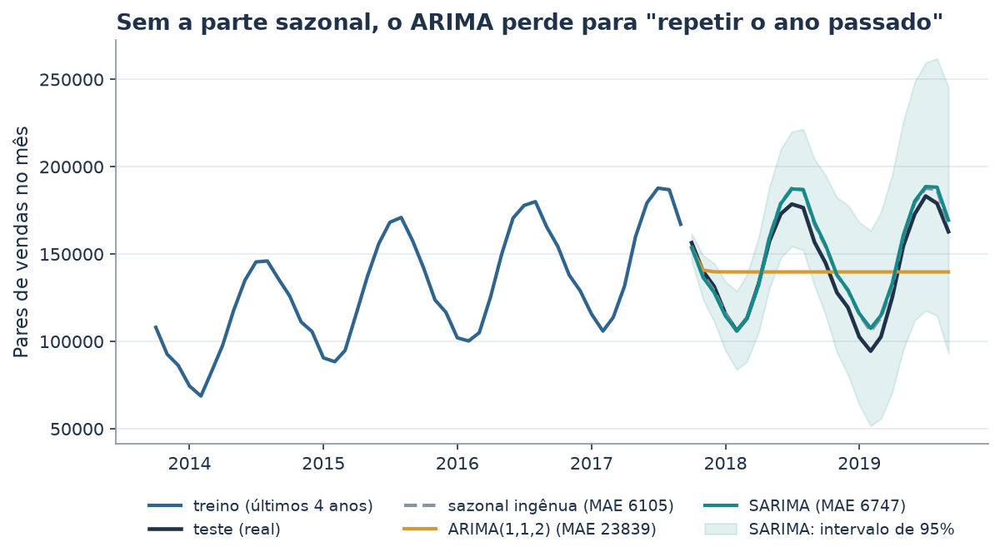
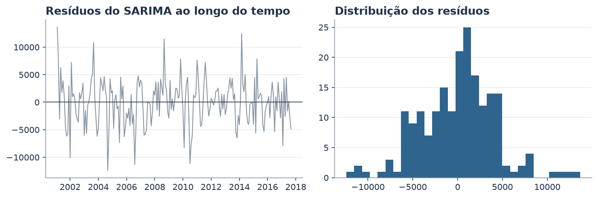
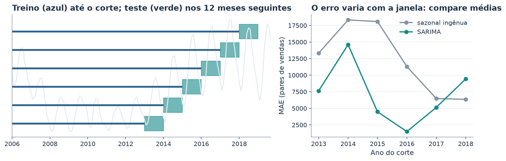

# 15 · Séries temporais

**Pergunta inicial:** as vendas de imóveis caíram de agosto para fevereiro. É o começo de uma crise ou é só o que acontece todo ano nessa época?

Uma **série temporal** é uma sequência de observações coletadas em intervalos regulares (por dia, por mês, por ano). Ela tem uma propriedade que as tabelas das unidades anteriores não tinham: **a ordem importa** e observações vizinhas costumam ser dependentes. Estudar uma série tem dois objetivos:

1. **entender o mecanismo** que a gera: há tendência? há ciclo anual? houve quebras?
2. **prever** os próximos valores, com uma medida honesta do erro.

Esta unidade segue essa ordem: primeiro conhecer os modelos básicos, depois decompor uma série real, medir a dependência (autocorrelação), e só então prever e avaliar.

## Os dados

| Arquivo | Conteúdo |
|---|---|
| `dados/SPCS20RPSNSA.csv` | Número mensal de pares de vendas de imóveis usados no índice S&P/Case-Shiller de 20 cidades dos EUA, sem ajuste sazonal, de jan/2000 a set/2019 (237 meses). Fonte: FRED, série SPCS20RPSNSA. |
| `dados/Drugs.csv` | Vendas mensais de medicamentos antidiabéticos na Austrália, 1991 a 2008. |

## Scripts, na ordem

| Script | O que faz | Figuras |
|---|---|---|
| `01_modelos_basicos.py` | Simula ruído i.i.d., processo binário, passeio aleatório e série com tendência e sazonalidade | `modelos_basicos.png` |
| `02_ler_e_visualizar.py` | Lê a série, declara a frequência mensal, média móvel e gráfico sazonal | `serie_completa.png`, `media_movel.png`, `grafico_sazonal.png` |
| `03_decomposicao.py` | Decomposição aditiva (imóveis) e multiplicativa (medicamentos) | `decomposicao.png` |
| `04_tendencia_e_sazonalidade_a_mao.py` | A decomposição em cinco etapas, com mínimos quadrados e senos | `tendencia_sazonalidade_a_mao.png` |
| `05_autocorrelacao_e_estacionariedade.py` | Autocorrelação à mão, correlogramas, diferenciação e teste ADF | `correlogramas.png` |
| `06_treino_teste_cronologico.py` | Separação no tempo e três linhas de base | `treino_teste_linhas_de_base.png` |
| `07_arima.py` | ARIMA e SARIMA comparados com a linha de base | `arima_vs_linha_de_base.png`, `residuos_sarima.png` |
| `08_janelas_de_validacao.py` | Seis datas de corte em vez de uma | `janelas_de_validacao.png` |

Animação: [`animacoes/geradas/serie_componentes.gif`](../animacoes/geradas/) soma tendência, sazonalidade e ruído e depois mostra as janelas de validação.

---

## Passo 1 · Os modelos básicos

Antes de olhar dados reais, vale conhecer a "cara" de quatro processos simulados.

| Modelo | Definição | Dá para prever o próximo valor? |
|---|---|---|
| Ruído i.i.d. | Valores independentes, mesma distribuição, média zero. Se normal: **ruído branco gaussiano** | Não: o passado não ajuda |
| Processo binário | $X_t = +1$ com probabilidade $p$, $-1$ caso contrário | Não |
| Passeio aleatório | $S_t = X_1 + \dots + X_t$: cada valor é o anterior mais um passo aleatório | O melhor palpite é o último valor |
| Tendência + sazonalidade + ruído | $X_t = m_t + s_t + Y_t$ | Sim, a parte $m_t + s_t$ |

O script mede a correlação entre cada valor e o seguinte: **−0,06** no ruído e **+0,99** no passeio aleatório. O passeio **parece** ter tendência (sobe de 0 a 25 no gráfico), mas é acaso: simulando 1 000 passeios de 240 passos, o valor final médio é +0,00 e o desvio-padrão é 16,0 (a teoria diz $\sqrt{240} = 15{,}5$). Cuidado ao ler "tendências" em séries curtas.

## Passo 2 · Olhar a série real

O script `02` lê os 237 meses (nenhum faltando) e declara a frequência mensal com `asfreq('MS')`. A média por mês do ano, juntando todos os anos, já mostra o ciclo:

| Mês | jan | fev | mar | abr | mai | jun | jul | ago | set | out | nov | dez |
|---|---|---|---|---|---|---|---|---|---|---|---|---|
| Média (mil pares) | 90,8 | 84,5 | 88,0 | 99,9 | 117,3 | 129,9 | 138,2 | 140,6 | 131,0 | 121,1 | 108,1 | 102,5 |

No gráfico sazonal, cada linha é um ano. Todos têm o mesmo desenho (vale em fevereiro, pico em julho/agosto), em níveis diferentes. **Resposta à pergunta inicial:** uma queda de agosto para fevereiro acontece em todos os anos e, sozinha, não indica crise. Para falar de crise, é preciso comparar com o **mesmo mês** de anos anteriores ou olhar a tendência.

## Passo 3 · Decompor: tendência + sazonalidade + resíduo

O modelo clássico é $X_t = m_t + s_t + Y_t$. A função `seasonal_decompose` (script `03`) estima as três partes:

- **Sazonalidade:** de −27 785 pares (fevereiro) a +27 071 (agosto), uma amplitude de 54 856 pares.
- **Tendência:** sobe até 2005, cai até 2011 (a crise imobiliária) e se recupera.
- **Resíduo:** desvio-padrão de 6 967 pares, maior em 2008-2010, quando o padrão médio deixou de descrever bem a série.

Quando a oscilação cresce junto com o nível, o modelo **multiplicativo** ($X_t = m_t \cdot s_t \cdot Y_t$) é mais adequado. Nas vendas de antidiabéticos, os fatores sazonais são 1,33 em janeiro (33% acima de um mês típico) e 0,78 em fevereiro.

## Passo 4 · A mesma decomposição, etapa por etapa

O script `04` refaz a decomposição à mão:

1. **Tendência preliminar** por média móvel centrada de 12 meses (cada mês vira a média do ano em volta dele, o que apaga o ciclo anual).
2. **Sazonalidade:** para cada mês do ano, a média dos desvios (série − tendência), centrada em zero. O resultado é idêntico ao do `seasonal_decompose`.
3. **Série dessazonalizada:** $d_t = x_t - \hat{s}_t$.
4. **Tendência final por mínimos quadrados:** ajustamos $m_t = a_0 + a_1 t + a_2 t^2 + a_3 t^3$ minimizando $\sum (d_t - m_t)^2$. A soma dos quadrados cai de 1,72×10¹¹ (reta) para 1,35×10¹¹ (grau 2) e 9,84×10¹⁰ (grau 3).
5. **Resíduo:** $\hat{Y}_t = x_t - \hat{m}_t - \hat{s}_t$.

O painel de cima mostra o limite do ajuste polinomial: um polinômio de grau 3 só suaviza a crise, enquanto a média móvel a acompanha. Por isso o resíduo do painel de baixo ainda tem ondas longas (desvio-padrão 20 422, contra 6 967 com a média móvel). **Um resíduo com padrão indica que o modelo de tendência não serve.**

A sazonalidade também pode ser escrita como soma de ondas: $s_t = \sum_j \big(a_j\cos(2\pi j t/12) + b_j\sin(2\pi j t/12)\big)$. Uma única onda anual explica 86,1% da variação dos desvios; duas, 87,2%; três, 87,5%. O ciclo destas vendas é quase uma senoide.

## Passo 5 · Autocorrelação e estacionariedade

A **autocorrelação de defasagem $h$** é a correlação da série com ela mesma deslocada $h$ passos:

$$\rho(h) = \frac{\sum_t (x_t - \bar{x})(x_{t+h} - \bar{x})}{\sum_t (x_t - \bar{x})^2}$$

O script calcula $\rho(1)$ à mão (0,9394) e confere com o `statsmodels` (0,9394). O **correlograma** mostra $\rho(h)$ para $h = 1, \dots, 24$; a faixa cinza ($\pm 1{,}96/\sqrt{n} = \pm 0{,}127$) é onde as autocorrelações de um ruído costumam cair.

Uma série é **(fracamente) estacionária** quando média, variância e autocorrelações não mudam com o tempo. Modelos ARIMA precisam de uma série estacionária, e a forma usual de chegar a ela é **diferenciar**:

| Série | $\rho(1)$ | $\rho(12)$ | Teste ADF (p) | Leitura |
|---|---|---|---|---|
| Ruído simulado | +0,03 | −0,07 | 0,000 | tudo dentro da faixa: sem memória |
| Vendas de imóveis | +0,94 | +0,84 | 0,170 | decaimento lento + picos em 12 e 24: tendência e sazonalidade |
| Diferença de 1 mês | +0,74 | +0,86 | 0,224 | a tendência saiu, o ciclo anual continua |
| Diferença de 1 e de 12 meses | +0,47 | −0,31 | 0,003 | estacionária pelo teste |

O **teste ADF** (Dickey-Fuller aumentado) tem como hipótese nula "a série **não** é estacionária". Só a série com as duas diferenças tem p < 0,05. É por isso que o modelo do Passo 7 usa uma diferença comum ($d = 1$) e uma sazonal ($D = 1$).

## Passo 6 · Avaliar no futuro: separação cronológica e linhas de base

Em séries, **o teste é o futuro**: os últimos 24 meses (out/2017 a set/2019) ficam guardados e o treino vai até set/2017. Embaralhar misturaria meses futuros no treino. Antes de qualquer modelo, medimos três previsões ingênuas:

| Linha de base | Como prevê | MAE | MAPE |
|---|---|---|---|
| Média histórica | média de todo o treino | 35 290 | 22,5% |
| Último valor | repete set/2017 | 30 125 | 25,3% |
| **Sazonal ingênua** | repete os 12 últimos meses | **6 105** | **4,5%** |

A sazonal ingênua é o padrão que qualquer modelo precisa superar. Um modelo que perde para ela não aprendeu nada sobre a série.

## Passo 7 · ARIMA e SARIMA

**ARIMA(p, d, q)** combina três partes:

- **AR (p):** o valor atual é regressão dos $p$ valores anteriores;
- **I (d):** trabalha-se com a série diferenciada $d$ vezes (Passo 5);
- **MA (q):** o erro atual é combinação dos $q$ erros anteriores.

O **SARIMA** acrescenta as mesmas três partes na escala sazonal, $(P, D, Q, 12)$.

| Modelo | MAE no teste de 24 meses |
|---|---|
| Sazonal ingênua | 6 105 |
| ARIMA(1,1,2) | 23 839 |
| SARIMA(1,1,2)(0,1,1,12) | 6 747 |

O ARIMA sem parte sazonal não reproduz o ciclo e perde de longe. O SARIMA reproduz o ciclo, mas **neste teste único** ainda fica atrás da linha de base. Os resíduos do SARIMA no treino ficam em torno de zero, sem padrão evidente:

## Passo 8 · Um teste só não basta: janelas de validação

Um único período de teste pode ser fácil ou difícil por acaso. O script `08` repete a avaliação em seis datas de corte (jan/2013 a jan/2018), sempre treinando com tudo antes do corte e prevendo os 12 meses seguintes:

| Corte | Sazonal ingênua | SARIMA |
|---|---|---|
| 2013 | 13 320 | 7 646 |
| 2014 | 18 335 | 14 604 |
| 2015 | 18 086 | 4 482 |
| 2016 | 11 298 | 1 498 |
| 2017 | 6 480 | 5 137 |
| 2018 | 6 348 | 9 422 |
| **Média** | **12 311** | **7 132** |
| Desvio entre janelas | 5 315 | 4 563 |

O SARIMA vence em 5 das 6 janelas e tem erro médio 42% menor. O teste único do Passo 7 caiu justamente numa das janelas desfavoráveis ao SARIMA. **A conclusão que se relata é a da média das janelas, com a variação**, não a de um corte escolhido.

## Para lembrar

- Olhe a série antes de modelar: tendência, sazonalidade, quebras, valores estranhos.
- Ruído não tem memória; passeio aleatório parece ter tendência, mas é acaso.
- Decomposição: $X_t = m_t + s_t + Y_t$ (aditiva) ou $m_t \cdot s_t \cdot Y_t$ (multiplicativa). Resíduo com padrão = modelo inadequado.
- O correlograma revela tendência (decaimento lento) e sazonalidade (picos em 12, 24…). Diferenciar torna a série estacionária.
- Separe treino e teste no tempo, compare sempre com a sazonal ingênua e avalie em várias janelas.

## Atividade

1. No script `01`, gere 20 passeios aleatórios e conte quantos "parecem" ter tendência de alta. O que isso ensina sobre ler gráficos de séries curtas?
2. No script `07`, escolha a ordem do SARIMA olhando só o treino (compare o `aic` de duas ou três ordens) e depois meça no teste uma única vez.
3. No script `08`, acrescente o corte `'2012-01-01'`, logo após a crise. O que acontece com os erros das duas abordagens?

## Problema de interpretação

Um relatório diz: "o modelo previu as vendas dos próximos 24 meses com erro de 5%". Que perguntas você faria sobre como esse erro foi medido? (Separação no tempo? Quantas janelas? Comparação com a sazonal ingênua? A ordem do modelo foi escolhida olhando o teste?)

Próxima unidade: [16 · Recomendação de modelos](../16_recomendacao_de_modelos/)
