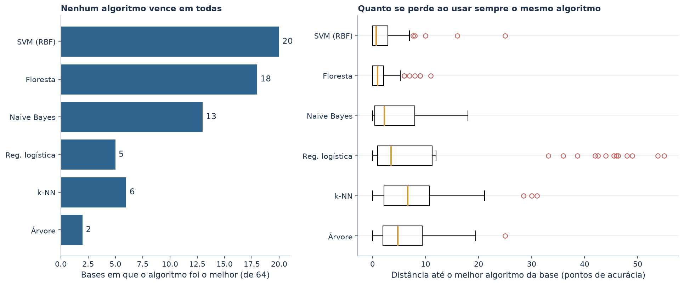
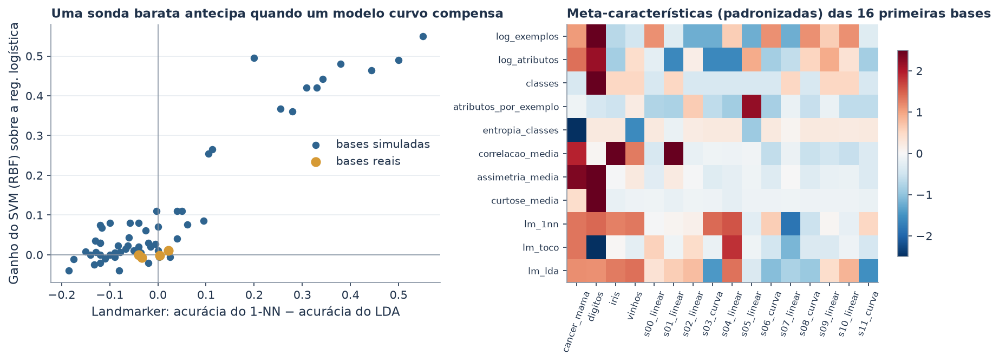
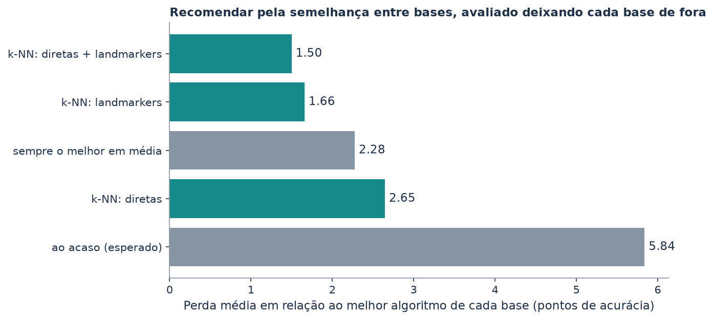
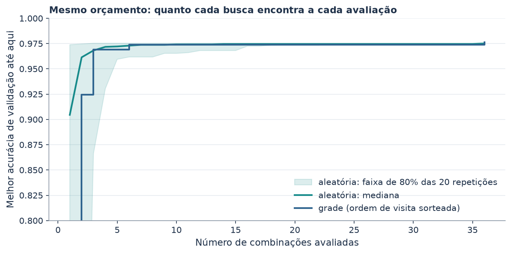

# 16 · Recomendação de modelos

Nas unidades 09 a 14 vimos seis famílias de classificadores. Diante de uma base nova, qual usar? A abordagem tradicional é testar alguns, escolhidos pela experiência de quem analisa, e ajustar até ficar bom. Ela tem três problemas: a experiência pode ser limitada, especialistas custam caro e a experimentação é demorada.

Esta unidade mostra, com experimentos, três ideias:

1. **Não existe almoço grátis**: nenhum algoritmo é o melhor em todas as bases.
2. **Meta-aprendizado**: descrever cada base por meta-características e recomendar um algoritmo para uma base nova olhando bases parecidas.
3. **Busca de hiperparâmetros**: escolhido o algoritmo, como procurar seus parâmetros com um orçamento fixo.

| Script | O que faz | Saídas |
|---|---|---|
| `01_sem_almoco_gratis.py` | Monta 64 bases e avalia 6 algoritmos em todas | `dados/bases.npz`, `dados/desempenho.csv`, `sem_almoco_gratis.png` |
| `02_caracterizar_bases.py` | Calcula 11 meta-características de cada base | `dados/metacaracteristicas.csv`, `metacaracteristicas.png` |
| `03_meta_aprendiz.py` | Recomenda por k vizinhos entre bases e avalia deixando cada base de fora | `meta_aprendiz.png` |
| `04_busca_de_hiperparametros.py` | Busca em grade × busca aleatória com o mesmo orçamento | `busca_de_hiperparametros.png` |

Rode os scripts na ordem: o 02 usa o que o 01 salvou, e o 03 usa os dois.

---

## Passo 1 · Montar uma coleção de problemas

Para estudar o comportamento dos algoritmos, precisamos de **muitas** bases. O script `01` reúne:

- **4 bases reais** que acompanham o scikit-learn: íris (150 flores, 3 espécies), vinhos (178 amostras, 3 produtores), câncer de mama (569 exames) e dígitos manuscritos (1 797 imagens, 10 classes);
- **60 bases simuladas**, sorteando tamanho (100 a 600 exemplos), número de atributos (2 a 20), número de classes, separação entre classes, rótulos trocados (0 a 20%), atributos irrelevantes (0, 2 ou 10) e escalas diferentes entre atributos. Dois terços têm fronteira linear; um terço tem fronteiras curvas (luas, círculos, quantis gaussianos).

Cada algoritmo é avaliado em cada base por validação cruzada de 5 dobras: k-NN (k = 5), Naive Bayes gaussiano, árvore de decisão, regressão logística, SVM com kernel RBF e floresta aleatória. Os que dependem de distância ou de escala recebem padronização dentro do pipeline.

## Passo 2 · Não existe almoço grátis

| Algoritmo | Vitórias (de 64) | Rank médio | Acurácia média | Pior distância ao melhor |
|---|---|---|---|---|
| SVM (RBF) | 20 | 2,35 | 0,834 | 25 pontos |
| Floresta | 18 | 2,49 | 0,838 | 11 pontos |
| Naive Bayes | 13 | 3,59 | 0,812 | 18 pontos |
| Reg. logística | 5 | 3,77 | 0,737 | 55 pontos |
| k-NN | 6 | 4,38 | 0,776 | 31 pontos |
| Árvore | 2 | 4,43 | 0,794 | 25 pontos |

Leitura:

- **Todos os seis algoritmos vencem em pelo menos duas bases.** O mais vitorioso, o SVM, é o melhor em menos de um terço delas.
- **Usar sempre o mesmo algoritmo custa caro em algumas bases.** Mesmo o SVM fica 25 pontos atrás do melhor numa base. A regressão logística, ótima nas bases lineares, perde até 55 pontos nas bases de fronteira curva (os pontos vermelhos à direita no gráfico).
- Nas quatro bases reais, as diferenças são pequenas, exceto em dígitos, onde Naive Bayes (0,851) e árvore (0,835) ficam bem atrás de SVM (0,981).

Esse é o teorema **"não existe almoço grátis"** (No Free Lunch) visto na prática: a vantagem de um algoritmo numa classe de problemas é compensada em outra.

## Passo 3 · Descrever cada base: meta-características

Se o melhor algoritmo depende da base, precisamos de uma descrição da base que ajude a prever qual vai bem. O script `02` calcula dois tipos de **meta-características**:

| Tipo | Meta-característica | O que mede |
|---|---|---|
| Direta | log do nº de exemplos, log do nº de atributos, nº de classes, atributos por exemplo | tamanho e formato |
| Direta | entropia normalizada das classes | equilíbrio entre classes (1 = classes do mesmo tamanho) |
| Direta | correlação média absoluta entre atributos | redundância |
| Direta | assimetria média, curtose média | forma das distribuições |
| Landmarking | acurácia do 1-NN | quão bem funciona "copiar o vizinho" |
| Landmarking | acurácia de uma árvore de um nó só (toco) | se um único atributo já separa |
| Landmarking | acurácia da análise discriminante linear (LDA) | se uma fronteira linear basta |

Os **landmarkers** são algoritmos rápidos usados como sondas: em vez de medir a base, medimos como algoritmos simples se saem nela.

O gráfico da esquerda mostra por que landmarkers são úteis. No eixo horizontal, quanto o 1-NN (que acompanha qualquer formato de fronteira) supera o LDA (linear). No vertical, quanto o SVM com kernel RBF supera a regressão logística. A correlação é **0,93**: uma sonda barata antecipa quando um modelo com fronteira curva compensa. As bases reais (âmbar) ficam perto de zero nos dois eixos: nelas, uma fronteira linear já serve.

## Passo 4 · Recomendar por semelhança e medir se funciona

O **meta-aprendiz** é um k-NN no nível das bases:

1. Cada base é um **meta-exemplo**: suas meta-características (entrada) e o desempenho dos 6 algoritmos (alvo).
2. Para uma base nova, encontramos as $k = 5$ bases mais parecidas (distância euclidiana nas meta-características padronizadas).
3. Calculamos o rank médio de cada algoritmo nessas 5 bases e recomendamos o de melhor rank.

**Avaliação honesta:** deixamos uma base de fora por vez, recomendamos sem olhar o desempenho dela e medimos a **perda**: acurácia do melhor algoritmo daquela base menos a acurácia do recomendado. Comparamos com duas referências: escolher ao acaso e escolher sempre o algoritmo de melhor rank médio nas outras bases (na prática, o SVM).

| Estratégia | Perda média | Perda mediana | Acertou o melhor | Perda > 5 pontos |
|---|---|---|---|---|
| Ao acaso (esperado) | 5,84 pontos | 5,1 | 21% | 35% |
| k-NN só com meta-características diretas | 2,65 | 0,9 | 39% | 19% |
| Sempre o melhor em média | 2,28 | 0,7 | 39% | 14% |
| k-NN só com landmarkers | 1,63 | 1,0 | 36% | 8% |
| **k-NN com diretas + landmarkers** | **1,50** | **0,2** | **47%** | **6%** |

O que os números mostram:

1. **Qualquer critério é muito melhor que o acaso** (perda média de 5,8 pontos).
2. **Só com meta-características diretas, o meta-aprendiz perde para a regra simples** "use sempre o SVM" (2,65 contra 2,28). Tamanho, assimetria e correlação, sozinhos, não indicam bem qual algoritmo funciona nestas bases.
3. **Com landmarkers, ele passa a regra simples.** Usando tudo, a perda média cai para 1,50 e os casos de perda acima de 5 pontos caem de 14% para 6%.
4. **A vantagem é pequena e incerta.** Base a base, o meta-aprendiz é melhor em 22, igual em 25 e pior em 17. A redução média da perda é de 0,78 ponto, com intervalo bootstrap de 95% de −0,18 a 1,86: com 64 bases, não dá para descartar que a diferença seja zero.

Exemplo: para a base de dígitos, as cinco bases mais parecidas são câncer de mama, vinhos e três simuladas. O recomendado foi o SVM (0,981), que é de fato o melhor nessa base.

**Formas de entregar a recomendação.** O script entrega só o melhor algoritmo. Outras opções: os mais promissores (os que não são significativamente piores que o melhor) ou o ranking completo. Ferramentas de **AutoML** combinam meta-aprendizado com busca automática de algoritmos e parâmetros.

## Passo 5 · Buscar hiperparâmetros com orçamento fixo

Escolhido o algoritmo, ainda falta ajustar seus parâmetros (unidade 14). Com o SVM RBF na base de dígitos e **36 avaliações** de validação cruzada:

- **busca em grade:** 6 valores de $C$ × 6 de $\gamma$;
- **busca aleatória:** 36 pares sorteados em escala logarítmica nos mesmos intervalos, repetida com 20 sementes.

| Avaliações feitas | Grade | Aleatória (mediana) |
|---|---|---|
| 5 | 0,9690 | 0,9722 |
| 10 | 0,9737 | 0,9741 |
| 20 | 0,9737 | 0,9745 |
| 36 | 0,9761 | 0,9749 |

Com orçamento pequeno (5 a 20 avaliações), a busca aleatória chega um pouco mais alto; com as 36, a grade encontra o melhor ponto (0,9761, em $C = 1000$, $\gamma = 0{,}0001$). As diferenças são de décimos de ponto: **nesta base**, qualquer das duas resolve. A faixa sombreada mostra que, com poucas avaliações, a busca aleatória pode ter azar. O modelo escolhido acerta 0,9889 no teste separado.

## Para lembrar

- Nenhum algoritmo é o melhor em todos os problemas; usar sempre o mesmo pode custar muito em alguns.
- Meta-características descrevem bases; landmarkers (algoritmos simples como sondas) costumam ser os mais informativos.
- Um meta-aprendiz precisa ser avaliado como qualquer modelo: deixando bases de fora e comparando com uma regra simples.
- Com orçamento fixo, busca aleatória e em grade dão resultados parecidos; a aleatória tende a achar bons pontos mais cedo.

## Atividade

1. No script `03`, troque $k = 5$ por $k = 1$ e $k = 15$. A perda média muda? Por quê?
2. No script `02`, acrescente um landmarker (por exemplo, a acurácia do Naive Bayes). A perda do meta-aprendiz melhora? Cuidado: o Naive Bayes também está entre os algoritmos recomendados. Isso é um problema?
3. No script `01`, acrescente 20 bases simuladas só com fronteira curva. O "melhor em média" continua sendo o SVM?

Próxima unidade: [17 · Redes sociais](../17_redes_sociais/)
