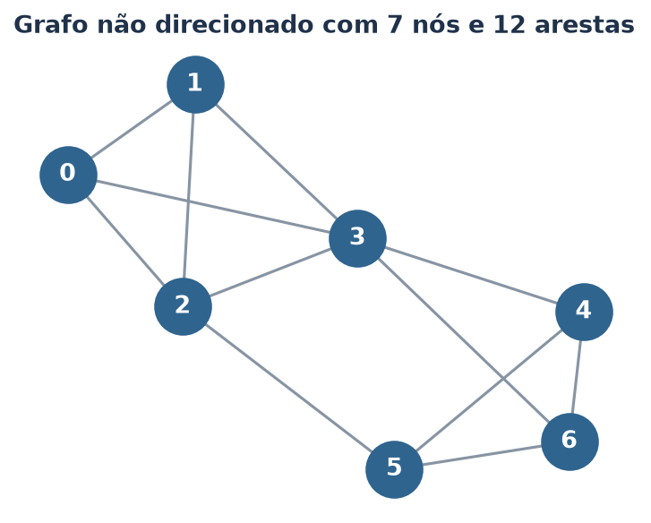
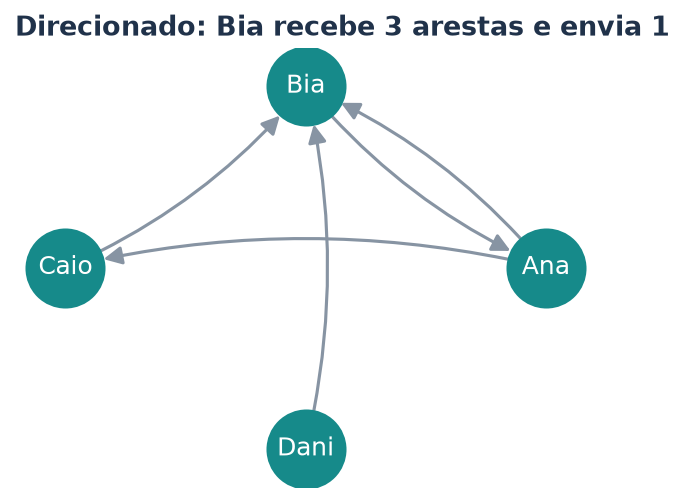
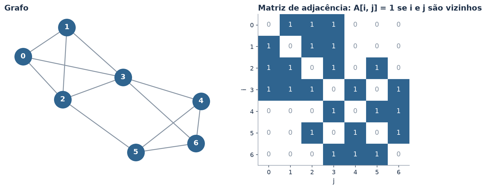
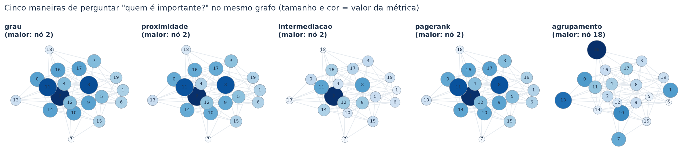
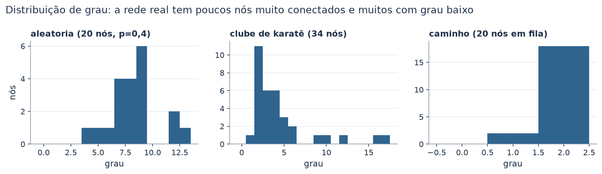
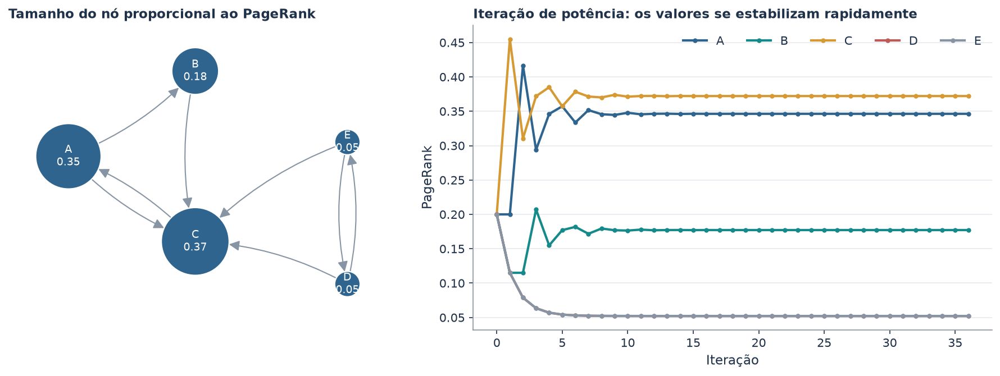
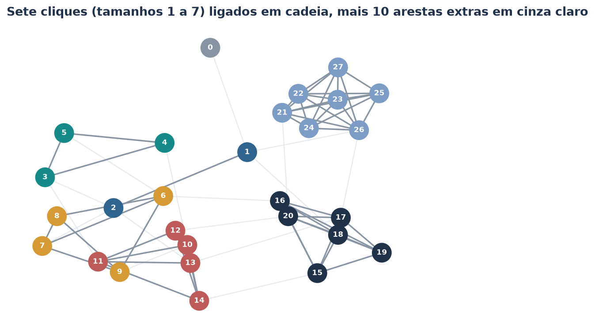
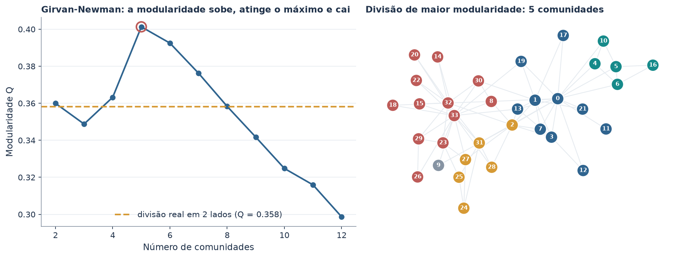
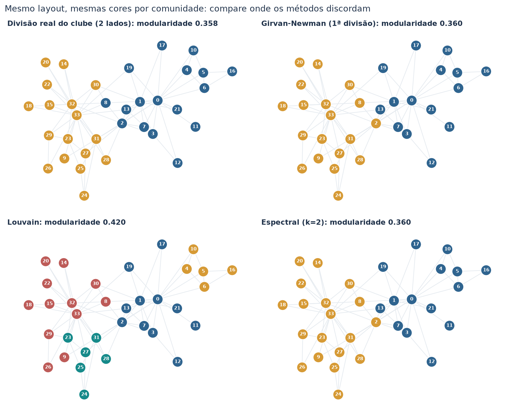

# 17 · Redes sociais

**Pergunta inicial:** em um grupo de 34 pessoas, quem é a mais importante? A resposta muda conforme "importante" signifique ter mais contatos, estar perto de todos, ser a ponte entre dois lados ou ser apontado por quem é importante. Como escolher a definição que serve à sua pergunta?

Uma **rede social** é um conjunto de atores (pessoas, páginas, contas) e das relações entre eles (amizade, mensagem, citação, voto). Matematicamente, é um **grafo**: os atores são **nós** e as relações são **arestas**. Nesta unidade construímos grafos pequenos, à mão ou clássicos, porque o objetivo é ver exatamente o que cada métrica calcula. A aplicação a uma rede real grande está no estudo de caso [07 · Votações na Wikipédia](../18_estudos_de_caso/07_votacoes_wikipedia/): lá, a semelhança entre eleitores (quantos eleitores duas eleições têm em comum) vira um sistema que sugere a cada usuário eleições para acompanhar, com acerto medido em votos escondidos e controle do efeito bolha.

| Script | O que faz | Figuras |
|---|---|---|
| `01_grafo_manual.py` | Grafo de 7 nós; grau; versão direcionada; caminho mais curto | `grafo_manual.png`, `grafo_direcionado.png` |
| `02_matriz_de_adjacencia.py` | O mesmo grafo como matriz; $A^2$ e vizinhos em comum | `matriz_adjacencia.png` |
| `03_metricas_locais.py` | Grau, proximidade, intermediação, PageRank e agrupamento | `metricas_locais.png` |
| `04_metricas_globais.py` | Densidade, diâmetro, caminho médio, pontes, componentes | `distribuicao_grau.png` |
| `05_cliques.py` | Grupos em que todos se conhecem | `cliques.png` |
| `06_comunidades.py` | Girvan-Newman, Louvain e espectral no clube de karatê | `comunidades_karate.png` |
| `07_pagerank_a_mao.py` | PageRank por iteração de potência, conferido com o networkx | `pagerank_a_mao.png` |
| `08_modularidade_e_girvan_newman.py` | Modularidade calculada à mão e Girvan-Newman passo a passo | `girvan_newman_modularidade.png` |

Animação: [`animacoes/geradas/matriz_adjacencia_construcao.gif`](../animacoes/geradas/) preenche a matriz de adjacência aresta por aresta.

---

## Passo 1 · Nós, arestas e grau

O script `01` monta uma rede de 7 pessoas (0 a 6) com 12 relações. O **grau** de um nó é o número de arestas que tocam nele:

| Nó | 0 | 1 | 2 | 3 | 4 | 5 | 6 |
|---|---|---|---|---|---|---|---|
| Vizinhos | 1, 2, 3 | 0, 2, 3 | 0, 1, 3, 5 | 0, 1, 2, 4, 6 | 3, 5, 6 | 2, 4, 6 | 3, 4, 5 |
| Grau | 3 | 3 | 4 | 5 | 3 | 3 | 3 |

A soma dos graus é 24 = 2 × 12: cada aresta é contada duas vezes, uma em cada ponta. O caminho mais curto de 0 a 6 é 0 → 3 → 6.



**Tipos de grafo.** Quando a relação tem direção (Ana segue Bia, mas Bia não segue Ana), o grafo é **direcionado** e cada nó tem **grau de entrada** (quantos apontam para ele) e **grau de saída** (para quantos aponta). No exemplo do script, Bia recebe 3 arcos e Dani nenhum. Quando a relação tem intensidade (número de mensagens, valor transferido), o grafo é **ponderado** e cada aresta carrega um peso.



## Passo 2 · A matriz de adjacência

O mesmo grafo pode ser escrito como uma tabela $A$ em que $A_{ij} = 1$ se $i$ e $j$ estão ligados:

```
     0 1 2 3 4 5 6
0  [ 0 1 1 1 0 0 0 ]
1  [ 1 0 1 1 0 0 0 ]
2  [ 1 1 0 1 0 1 0 ]
3  [ 1 1 1 0 1 0 1 ]
4  [ 0 0 0 1 0 1 1 ]
5  [ 0 0 1 0 1 0 1 ]
6  [ 0 0 0 1 1 1 0 ]
```

Propriedades que o script `02` confere:

- a matriz é **simétrica** porque o grafo não é direcionado;
- a **soma de cada linha é o grau** do nó;
- a diagonal é zero (ninguém está ligado a si mesmo);
- $(A^2)_{ij}$ conta os **caminhos de comprimento 2** entre $i$ e $j$, isto é, os vizinhos em comum: $(A^2)_{0,3} = 2$ (os nós 1 e 2).



## Passo 3 · Quem é central? Cinco respostas diferentes

O script `03` usa uma rede aleatória de 20 nós e 83 arestas e calcula, para cada nó:

| Métrica | Pergunta que responde | Fórmula (ideia) |
|---|---|---|
| Centralidade de grau | Quem tem mais contatos? | grau / (N − 1) |
| Proximidade | Quem alcança todos mais rápido? | 1 / distância média aos outros |
| Intermediação | Por quem passam os caminhos mais curtos? | fração dos caminhos mínimos que passam pelo nó |
| PageRank | Quem é apontado por quem é importante? | Passo 5 |
| Coeficiente de agrupamento | Os amigos do nó são amigos entre si? | triângulos / pares de vizinhos |

| Nó | Grau | Proximidade | Intermediação | PageRank | Agrupamento |
|---|---|---|---|---|---|
| 2 | 0,684 | 0,760 | 0,101 | 0,075 | 0,397 |
| 11 | 0,632 | 0,731 | 0,056 | 0,069 | 0,455 |
| 8 | 0,632 | 0,731 | 0,059 | 0,069 | 0,409 |



Nesta rede aleatória e densa, as quatro centralidades apontam o mesmo nó (2) e são muito correlacionadas entre si (0,90 a 1,00). O coeficiente de agrupamento aponta outro nó (18) e tem correlação **negativa** com as centralidades (−0,27 a −0,41): os nós mais conectados tendem a ter amigos que não se conhecem. Em redes com estrutura (Passo 6), as centralidades passam a discordar. **Antes de calcular, decida qual pergunta importa.**

## Passo 4 · Métricas da rede inteira

O script `04` compara três redes:

| Rede | Nós | Arestas | Densidade | Diâmetro | Caminho médio | Agrupamento médio |
|---|---|---|---|---|---|---|
| Aleatória (p = 0,4) | 20 | 83 | 0,437 | 3 | 1,57 | 0,436 |
| Clube de karatê | 34 | 78 | 0,139 | 5 | 2,41 | 0,571 |
| Caminho (nós em fila) | 20 | 19 | 0,100 | 19 | 7,00 | 0,000 |

- **Densidade:** arestas existentes / arestas possíveis.
- **Diâmetro:** a maior distância entre dois nós.
- **Caminho médio:** a distância média entre pares de nós.
- **Agrupamento médio:** a média do coeficiente de agrupamento.

O clube de karatê é pouco denso (14% das ligações possíveis), mas qualquer pessoa alcança qualquer outra em 2,4 passos em média e o agrupamento é alto. Essa combinação, **caminhos curtos e muitos triângulos**, é típica de redes sociais reais ("mundo pequeno"). A rede em fila, com quase a mesma densidade, tem caminho médio de 7.

O script também procura **pontes**, arestas cuja remoção desconecta a rede: no clube há uma, (0, 11). Removendo o **nó** 0, a rede se parte em 3 componentes, de 27, 5 e 1 pessoa.



## Passo 5 · PageRank, passo a passo

O PageRank imagina um navegador que, em cada passo, segue um link ao acaso (probabilidade $d = 0{,}85$) ou pula para qualquer nó (probabilidade $1 - d$). O PageRank de um nó é a fração do tempo que o navegador passa nele:

$$PR(v) = \frac{1-d}{N} + d \sum_{u \to v} \frac{PR(u)}{\text{saída}(u)}$$

O script `07` usa uma rede de 5 nós e 8 arcos, começa com todos em 0,2 e aplica a fórmula repetidamente (iteração de potência). Converge em 36 iterações, com os mesmos valores do networkx:

| Nó | Grau de entrada | PageRank |
|---|---|---|
| C | 4 | 0,372 |
| A | 1 | 0,346 |
| B | 1 | 0,177 |
| D | 1 | 0,052 |
| E | 1 | 0,052 |



A, B, D e E têm o mesmo grau de entrada, mas PageRanks muito diferentes. A recebe um único arco, **vindo de C** (o mais importante), e C aponta só para A, então todo o peso de C vai para A. D e E recebem arcos um do outro, que são nós pouco importantes. **Ser apontado por quem importa vale mais do que ser apontado por muitos.**

## Passo 6 · Cliques e comunidades

Um **clique** é um grupo em que todos estão ligados a todos. O script `05` constrói cliques de 3 a 7 nós, liga-os por algumas arestas e deixa o algoritmo encontrá-los: são 22 cliques maximais, e o maior tem 7 nós.



Cliques são exigentes demais para redes reais. Uma **comunidade** é um grupo com muito mais ligações internas do que externas. A medida usada para avaliar uma divisão é a **modularidade**:

$$Q = \sum_{c} \left[ \frac{L_c}{m} - \left(\frac{D_c}{2m}\right)^2 \right]$$

em que $L_c$ é o número de arestas dentro da comunidade $c$, $D_c$ é a soma dos graus dos seus nós e $m$ é o total de arestas. O primeiro termo é a fração de arestas que ficaram dentro; o segundo é a fração esperada se as arestas fossem sorteadas mantendo os graus. **$Q$ mede quanto a divisão tem mais arestas internas do que o acaso.**

O script `08` calcula $Q$ à mão para o clube de karatê, cujos 34 membros se dividiram em dois grupos depois de um conflito:

| Comunidade | Nós | Arestas internas | Soma dos graus | Parcela |
|---|---|---|---|---|
| Lado 1 | 17 | 35 | 81 | 35/78 − (81/156)² = 0,1791 |
| Lado 2 | 17 | 32 | 75 | 32/78 − (75/156)² = 0,1791 |
| **Total** | | | | **Q = 0,358** |

Colocar todos numa comunidade só dá $Q = 0$: nenhuma estrutura além do acaso.

**Girvan-Newman** encontra comunidades removendo, uma de cada vez, a aresta de maior intermediação (as pontes entre grupos concentram os caminhos mínimos). As primeiras removidas são (0, 31), (0, 2) e (0, 8), todas saindo do instrutor (nó 0). Depois de 11 remoções, a rede se parte em 2 comunidades; continuando, em 3, 4, 5…



A modularidade atinge o máximo (0,401) com **5 comunidades**, uma delas com um único nó.

## Passo 7 · Três métodos, uma rede

O script `06` compara três métodos de detecção de comunidades com a divisão real:

| Método | Comunidades | Modularidade | Concordância com a divisão real |
|---|---|---|---|
| Divisão real | 2 | 0,358 | — |
| Girvan-Newman (1ª divisão) | 2 | 0,360 | 0,886 |
| Espectral (k = 2) | 2 | 0,360 | 0,886 |
| Louvain | 4 | 0,420 | 0,736 |



A concordância é a fração de pares de pessoas que o método coloca juntos (ou separados) como na divisão real. Girvan-Newman e espectral chegam à mesma divisão, que difere da real em dois membros (2 e 8). O Louvain encontra 4 comunidades e a **maior** modularidade, mas a **menor** concordância com o que aconteceu. **Modularidade alta não significa "acertou"**: a modularidade premia divisões mais finas, e a pergunta "em quantos lados o clube se dividiu?" não é a que ela responde.

## Para lembrar

- Grafo = nós + arestas; pode ser direcionado e/ou ponderado; a matriz de adjacência é a mesma informação em forma de tabela.
- Cada centralidade responde a uma pergunta diferente; escolha a pergunta antes da métrica.
- Redes sociais costumam ter caminhos curtos e muitos triângulos.
- PageRank: importância vem de ser apontado por quem é importante.
- Modularidade compara as arestas internas com o esperado ao acaso; maximizá-la não garante a divisão "verdadeira".
- Dados como os do clube de karatê servem para estudar algoritmos; não sustentam conclusões sobre a intenção das pessoas.

## Atividade

1. No script `01`, acrescente um nó 7 ligado só ao nó 6. Recalcule as métricas do script `03` nesse grafo. Qual métrica do nó 6 mudou mais?
2. No script `07`, acrescente o arco E → A. O PageRank de A passa o de C?
3. No script `06`, rode o Louvain com `seed=1`, `seed=2` e `seed=3`. A divisão muda? E a modularidade?

## Problema de interpretação

Alguém propõe "remover o usuário de maior PageRank para desarticular a rede". Usando o script `04` (componentes após remover um nó) e o `03` (intermediação), explique por que o nó de maior PageRank pode não ser o que mais desconecta a rede, e por que nenhuma dessas métricas autoriza conclusões sobre a intenção das pessoas.

Próxima etapa: [18 · Estudos de caso](../18_estudos_de_caso/)
