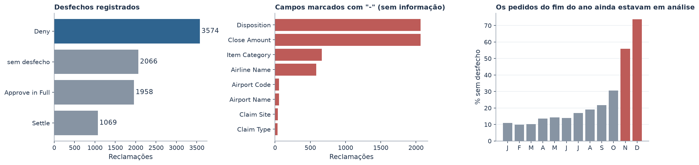
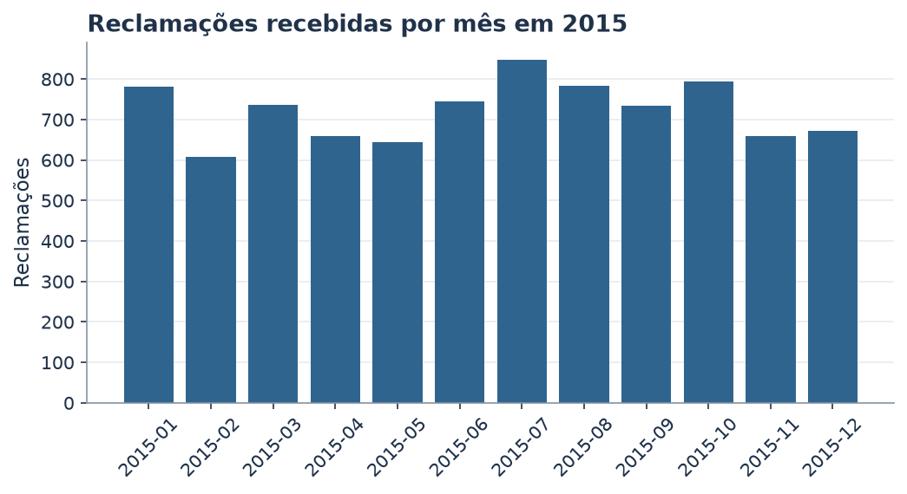
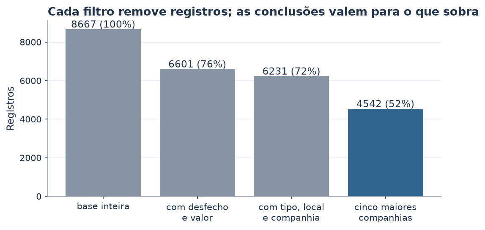
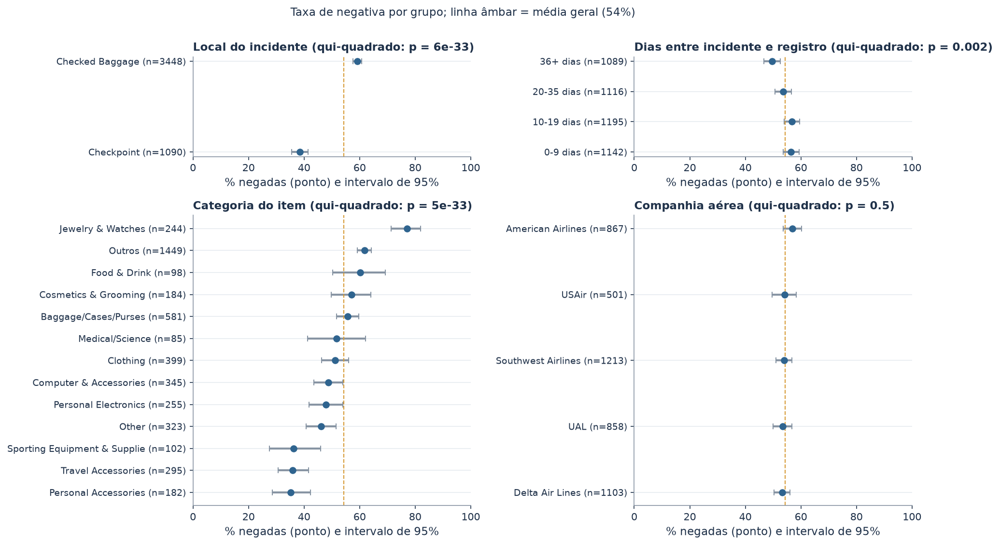
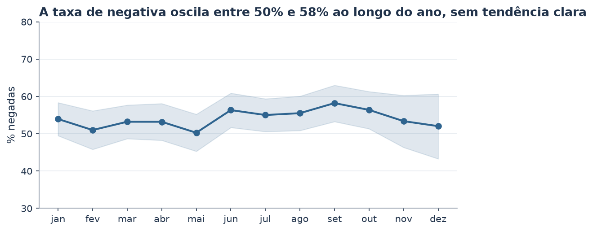
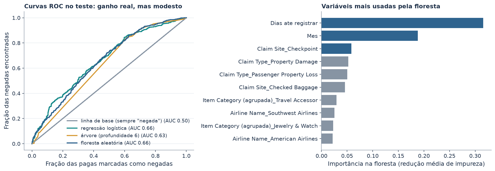
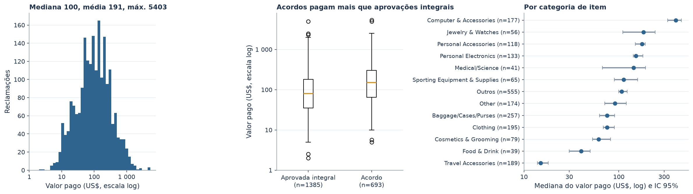
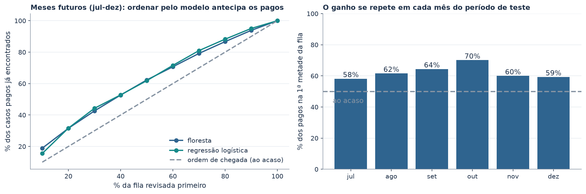

# Estudo de caso 1 · Reclamações por perdas em aeroportos (TSA)

> Estudo de caso do capítulo 11 do livro *Ciência de Dados: da teoria à prática*. Técnicas usadas: descrição de dados categóricos, limpeza, proporções com intervalo de confiança, teste qui-quadrado, classificação, regressão, validação temporal.

## A situação

Nos Estados Unidos, passageiros que têm bens perdidos ou danificados durante a inspeção de segurança dos aeroportos podem registrar uma reclamação na TSA (Transportation Security Administration). Cada reclamação é analisada por uma pessoa e termina **negada**, **aprovada integralmente** ou em **acordo** (paga-se parte do valor).

Imagine que você coordena a equipe que analisa essas reclamações. A fila é longa e você quer responder:

1. Em que situações as reclamações costumam ser negadas?
2. Quando há pagamento, quanto se paga?
3. Os dados permitem **organizar melhor a fila**, sem tirar a decisão das mãos de quem analisa?

Vamos responder em sete passos. Em cada um: a pergunta do passo, o que o script faz, o que saiu e como ler.

## Os dados

`dados/claims-data-2015-as-of-feb-9-2016.xlsx`: todas as reclamações recebidas pela TSA em 2015, na versão publicada em 9 de fevereiro de 2016 (dados abertos do governo dos EUA). São 8 667 linhas e 11 colunas:

| Coluna | Conteúdo |
|---|---|
| `Claim Number` | identificador |
| `Date Received`, `Incident D` | data de recebimento e data do incidente |
| `Airport Code`, `Airport Name` | aeroporto |
| `Airline Name` | companhia aérea |
| `Claim Type` | tipo (perda de bem, dano, lesão…) |
| `Claim Site` | local (bagagem despachada, ponto de inspeção…) |
| `Item Category` | categoria do item |
| `Close Amount` | valor pago (US$) |
| `Disposition` | desfecho: `Deny`, `Approve in Full`, `Settle` |

**O que a base não tem**: o valor pedido, as evidências apresentadas, quem analisou e o motivo da decisão. Guarde isso: vai limitar o que um modelo consegue prever.

## Scripts

| Passo | Script | Figuras |
|---|---|---|
| 1. Conhecer os dados | `01_conhecer_os_dados.py` | `01_visao_geral.png`, `01_reclamacoes_por_mes.png` |
| 2. Preparar | `02_preparar_os_dados.py` (grava `dados/reclamacoes_preparadas.csv`) | `02_filtros_aplicados.png` |
| 3. Onde se nega mais | `03_analisar_desfechos.py` | `03_taxa_negativa_por_grupo.png`, `03_negativa_por_mes.png` |
| 4. Um modelo antecipa o desfecho? | `04_prever_desfecho.py` | `04_modelos_desfecho.png` |
| 5. Quanto se paga | `05_analisar_valores_recebidos.py` | `05_valores_pagos.png` |
| 6. Validar no tempo | `06_validar_no_tempo.py` | `06_validacao_no_tempo.png` |
| Opcional | `07_shap_opcional.py` (requer `pip install shap`) | `07_shap_beeswarm.png` |

Rode na ordem: os scripts 03 a 06 leem o arquivo gravado pelo 02.

---

## Passo 1 · Conhecer os dados antes de mexer neles

**Pergunta:** o que cada linha e cada coluna registram, e onde faltam informações?

O script lê a planilha e conta valores distintos, categorias e ausências:

```python
reclamacoes = pd.read_excel('dados/claims-data-2015-as-of-feb-9-2016.xlsx')
print(reclamacoes.nunique())
print((reclamacoes == '-').sum())          # o traço marca "sem informação"
```

**O que saiu:**

| Desfecho | Reclamações |
|---|---|
| Negada (`Deny`) | 3 574 |
| Sem desfecho (`-`) | 2 066 |
| Aprovada integralmente | 1 958 |
| Acordo | 1 069 |

- A ausência é marcada com um traço `-`, não com célula vazia. Por isso o pandas não a reconhece como ausente, e `Close Amount` foi lido como texto.
- 2 066 reclamações (24%) não têm desfecho. Faltam também companhia (586) e categoria do item (663).
- Os incidentes vão de 2012 a 2015, mas os recebimentos são todos de 2015.



O painel da direita traz um detalhe importante: a fração **sem desfecho cresce no fim do ano** (11% em janeiro, 74% em dezembro). Os pedidos recebidos em novembro e dezembro ainda estavam em análise quando a base foi publicada. Ao estudar só os casos com desfecho, os meses finais ficam sub-representados, e os casos que restam deles são os que foram decididos **rápido**.



## Passo 2 · Preparar, registrando o que cada decisão remove

**Pergunta:** que recorte da base vamos analisar, e o que fica de fora?

Cada filtro é aplicado e contado:

```python
reclamacoes = reclamacoes.replace('-', np.nan)                      # traço vira ausente
reclamacoes['Airline Name'] = reclamacoes['Airline Name'].str.strip()  # "Southwest Airlines  " -> "Southwest Airlines"
reclamacoes['Close Amount'] = pd.to_numeric(reclamacoes['Close Amount'])
com_desfecho = reclamacoes.dropna(subset=['Close Amount', 'Disposition'])
```

| Etapa | Registros | % da base |
|---|---|---|
| Base inteira | 8 667 | 100% |
| Com desfecho e valor | 6 601 | 76% |
| Com tipo, local e companhia | 6 231 | 72% |
| Cinco companhias com mais reclamações | 4 542 | 52% |



Por que só cinco companhias? Há dezenas delas, a maioria com poucas reclamações. Para comparar companhias com amostras grandes, ficamos com Southwest (1 213), Delta (1 103), American (867), UAL (858) e USAir (501), que somam 73% dos casos completos. **Todas as conclusões valem para esse recorte.**

Também criamos variáveis:

- `Dias ate registrar` = data de recebimento − data do incidente (mediana 19 dias, máximo 767; nenhum negativo);
- `Negada` = 1 se o desfecho é `Deny`;
- `Item Category (agrupada)`: a coluna tinha 360 valores distintos, muitos combinando categorias com `;`. As 12 mais comuns ficam; o resto vira "Outros".

## Passo 3 · Em que situações as reclamações são negadas?

**Pergunta:** a taxa de negativa muda com o local, a categoria do item, a companhia e o tempo até o registro? As diferenças são maiores que o acaso?

Para cada grupo calculamos a taxa de negativa com **intervalo de confiança de 95%** (método de Wilson) e fazemos um **teste qui-quadrado** de independência:

```python
tabela = pd.crosstab(dados['Claim Site'], dados['Negada'])
qui2, p, gl, _ = chi2_contingency(tabela)
```

**O que saiu** (taxa geral: 54,2% negadas):

| Variável | Menor taxa | Maior taxa | Qui-quadrado (p) |
|---|---|---|---|
| Local | ponto de inspeção 38% [36–41] | bagagem despachada 59% [58–61] | p < 10⁻³² |
| Tipo | dano 45% [43–48] | perda 62% [60–64] | p < 10⁻²⁸ |
| Categoria do item | acessórios pessoais 35% [29–42] | joias e relógios 77% [71–82] | p < 10⁻³² |
| Dias até registrar | 36+ dias 50% [47–53] | 10–19 dias 57% [54–60] | p = 0,002 |
| Companhia | Delta 53% [50–56] | American 57% [54–60] | **p = 0,49** |



**Como ler:**

- **Local, tipo e categoria do item** separam bem: os intervalos não se sobrepõem e os testes dão p minúsculos. Uma reclamação por joias tem o dobro de chance de ser negada que uma por acessórios pessoais.
- **Companhia aérea não faz diferença** detectável (p = 0,49; todos os intervalos cruzam a média). Não há base para dizer que uma companhia "tem mais reclamações negadas".
- **Dias até registrar** tem efeito pequeno e no sentido oposto ao intuitivo: quem demora mais de 36 dias é negado um pouco **menos**. Uma explicação possível é que pedidos tardios sejam mais bem documentados, mas a base não permite verificar.



A taxa de negativa fica entre 50% e 58% em todos os meses, sem tendência. Isso importa para o Passo 6: o padrão que um modelo aprender no primeiro semestre tem chance de valer no segundo.

## Passo 4 · Um modelo antecipa o desfecho?

**Pergunta:** com o que se sabe no momento do registro (tipo, local, companhia, categoria, dias até registrar, mês), dá para prever se a reclamação será negada?

Separamos 70% para treino e 30% para teste (estratificado), comparamos modelos por validação cruzada no treino e medimos no teste uma única vez:

| Modelo | AUC validação | AUC teste | Acurácia teste |
|---|---|---|---|
| Linha de base (sempre "negada") | 0,500 | 0,500 | 0,542 |
| Regressão logística | 0,652 ± 0,037 | 0,662 | 0,626 |
| Árvore (profundidade 6) | 0,624 ± 0,028 | 0,627 | 0,632 |
| Floresta aleatória | 0,649 ± 0,030 | 0,655 | 0,627 |



**Como ler:**

- Os modelos superam a linha de base, mas pouco: AUC em torno de 0,65 (0,5 = acaso, 1 = perfeito). Faz sentido: o desfecho depende de evidências e do valor pedido, que a base não tem.
- **Usar o modelo para decidir seria um erro grave.** Entre os casos que a floresta classificaria como "negada", **37% terminaram pagos**. Negar automaticamente atingiria mais de um terço de pessoas com direito a ressarcimento.
- A importância da floresta destaca "dias até registrar" e "mês". Cuidado: variáveis numéricas oferecem muitos pontos de corte e ganham importância com facilidade. No Passo 3, o efeito dos dias era pequeno. Importância não é causa.

O que sobra, então? Um modelo fraco para **decidir** ainda pode ser útil para **ordenar**: se ele coloca mais casos pagos no início da fila, quem tem direito recebe antes, e ninguém é negado pelo modelo. Isso precisa ser testado (Passo 6).

## Passo 5 · Quando há pagamento, quanto se paga?

**Pergunta:** qual a distribuição dos valores pagos, e de que ela depende?

**O que saiu:** 2 078 casos foram pagos (nenhum caso não negado tem valor zero).

| Medida | Valor (US$) |
|---|---|
| Mediana | 100 |
| Média | 191 |
| Quantis 75% / 90% / 99% | 212 / 437 / 1 311 |
| Máximo | 5 404 |
| Total pago no recorte | 397 429 |

A distribuição tem **cauda longa**: a média é quase o dobro da mediana, e **os 10% maiores pagamentos somam 45% do total pago**. Por isso usamos mediana e escala logarítmica.



- **Acordos pagam mais que aprovações integrais:** medianas de US$ 150 [IC 135–164] e US$ 81 [75–90]; teste de Mann-Whitney p ≈ 10⁻²⁷. Uma leitura possível: acordos acontecem quando o valor pedido é alto e paga-se parte dele.
- **Por categoria**, a diferença é enorme: computadores têm mediana de US$ 400 [326–458]; acessórios de viagem, US$ 15 [14–18].
- **Prever o valor exato** ajuda pouco: uma floresta (treinada no log do valor) erra em média US$ 117, contra US$ 136 de prever sempre a mediana. Redução de 14%.

## Passo 6 · O achado se sustenta em meses que o modelo não viu?

**Pergunta:** se a fila fosse ordenada pela probabilidade de pagamento, os casos pagos realmente apareceriam antes, em reclamações futuras?

O Passo 4 sorteou treino e teste dentro do mesmo período. Na prática, o modelo seria treinado com o passado e aplicado ao futuro. Simulamos isso: **treino com reclamações recebidas de janeiro a junho (2 526) e teste com as de julho a dezembro (2 016)**.

```python
treino = dados['Mes'] <= 6
modelo.fit(X[treino], paga[treino])
prob = modelo.predict_proba(X[~treino])[:, 1]
# ordenar o segundo semestre por prob e contar quantos pagos aparecem na 1ª metade
```

**O que saiu:**

| % da fila revisada primeiro | % dos pagos encontrados (floresta) | Ao acaso |
|---|---|---|
| 10% | 19% | 10% |
| 30% | 43% | 30% |
| 50% | **62%** | 50% |
| 70% | 79% | 70% |

- AUC no segundo semestre: 0,661 (floresta) e 0,664 (regressão logística), iguais às do Passo 4. **O modelo não perdeu desempenho no futuro.**
- Na primeira metade da fila ficam **62,3% dos casos pagos** (intervalo bootstrap de 95%: 59,7% a 64,6%), contra 50% na ordem de chegada.
- Mês a mês, o valor ficou entre **58% (julho) e 70% (outubro)**: o ganho aparece em todos os seis meses.



**Quem iria para o fim da fila?** Entre os 25% de casos com menor probabilidade prevista de pagamento, joias e relógios aparecem 3,1 vezes mais do que no total, eletrônicos pessoais 1,6 vez e "Outros" 1,5 vez. Esses passageiros esperariam mais.

---

## Recomendação, a partir do que foi encontrado

**1. Achado.** A taxa de negativa varia fortemente com o local, o tipo e a categoria do item (Passo 3), não com a companhia aérea. Um modelo com essas informações prevê o desfecho só um pouco melhor que o acaso (AUC 0,66) e erraria 37% das negativas que fizesse (Passo 4). Mas, aplicado a seis meses que não viu, ordenar a fila por ele colocou 62% dos casos pagos na primeira metade da fila, contra 50% na ordem de chegada, em todos os meses (Passo 6).

**2. Ação.** Usar o modelo **apenas para ordenar** a fila de análise, com casos de maior probabilidade de pagamento primeiro. A decisão de negar, aprovar ou fazer acordo continua com o analista. Como o ganho é modesto, a ação só compensa se reordenar a fila tiver custo baixo.

**3. Proteção para quem vai para o fim da fila.** Joias, relógios e eletrônicos ficariam desproporcionalmente no fim. Para que ninguém espere indefinidamente, a ordenação deve vir junto com um **prazo máximo de espera**, e casos que o atingem sobem para o topo.

**4. Como acompanhar, com referências medidas aqui:**

| Indicador | Valor medido no teste (jul–dez/2015) | Sinal de alerta |
|---|---|---|
| % dos casos pagos na 1ª metade da fila, por mês | 62% no semestre; entre 58% e 70% por mês | mês abaixo de 58% (menor valor observado): revisar ou retreinar |
| AUC do modelo em cada trimestre | 0,66 (validação cruzada: 0,65 ± 0,03) | abaixo de 0,62 (média da validação menos um desvio-padrão) |
| Taxa de negativa geral | 50% a 58% por mês em 2015 | fora dessa faixa: o perfil das reclamações mudou e o modelo precisa ser reavaliado |

**5. O que não podemos afirmar.** A base não registra **quando** cada reclamação foi decidida. Logo, não sabemos quanto tempo cada caso esperou nem podemos estimar, com estes dados, quantos dias a ordenação economizaria. Para isso, seria preciso registrar a data de decisão e comparar períodos com e sem ordenação.

## Limites

- Recorte: um ano, cinco companhias, só casos com desfecho. Os casos de fim de ano estão sub-representados e são os decididos mais rápido (Passo 1).
- Sem valor pedido nem evidências: duas reclamações iguais nas colunas podem ser muito diferentes.
- Todas as associações são observacionais. "Joias são mais negadas" não diz **por que** são negadas.

## Atividades

1. **Reprodução.** Rode os scripts 01 a 06 e confira os números deste texto.
2. **Variação.** No script `02`, mantenha todas as companhias. A conclusão "companhia não faz diferença" se mantém?
3. **Outra divisão no tempo.** No script `06`, treine com janeiro a setembro e teste em outubro a dezembro. O ganho se mantém? Lembre que outubro a dezembro têm muitos casos ainda sem desfecho.
4. **Crítica.** Proponha um prazo máximo de espera para a regra do item 3. Que dado você precisaria registrar para saber se o prazo está sendo cumprido?
5. **Pergunta aberta.** O valor pago depende do aeroporto? Agrupe por `Airport Code`, mantendo só aeroportos com pelo menos 50 casos pagos, e calcule medianas com intervalo bootstrap.
