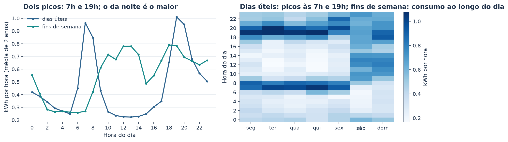
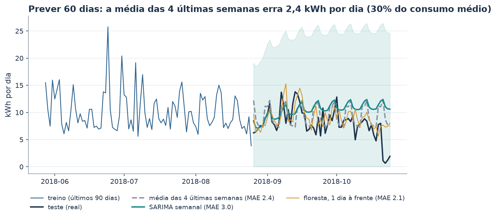
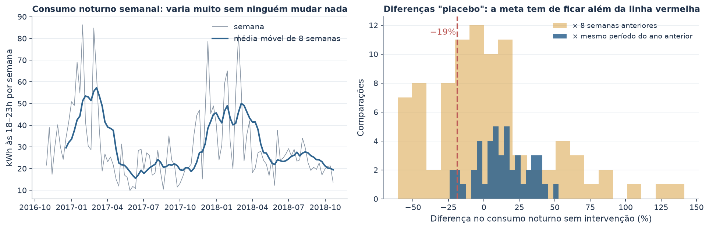

# Estudo de caso 2 · Energia doméstica

> Estudo de caso do capítulo 12 do livro *Ciência de Dados: da teoria à prática*. Técnicas usadas: leitura e limpeza de séries de alta frequência, agregação, perfis horários, comparação entre períodos, previsão com linhas de base, análise de variação natural ("placebo").

## A situação

Uma família recebe da companhia de energia o registro do consumo elétrico da casa a cada 15 minutos, com o custo de cada intervalo. Ela quer gastar menos e pergunta:

1. Em que horas, dias e meses o consumo se concentra?
2. O custo depende da hora (tarifa variável) ou só da quantidade consumida?
3. O padrão é estável, ou muda de um ano para o outro?
4. Dá para prever o consumo dos próximos dias?
5. Se a família mudar um hábito, **os dados vão mostrar se funcionou**?

A última pergunta é a mais importante e a mais esquecida. Uma recomendação só é útil se for possível verificar o resultado.

## Os dados

`dados/D202.csv`: 70 368 leituras de 15 minutos de uma residência nos Estados Unidos, de 22/10/2016 a 24/10/2018 (733 dias).

| Coluna | Conteúdo |
|---|---|
| `TYPE` | sempre "Electric usage" |
| `DATE`, `START TIME`, `END TIME` | dia e intervalo de 15 minutos |
| `USAGE` | consumo do intervalo (kWh) |
| `UNITS` | sempre "kWh" |
| `COST` | custo do intervalo, como texto ("$0.01 ") |
| `NOTES` | vazia |

**O que a base não tem:** quais aparelhos estavam ligados, a temperatura externa, quantas pessoas estavam em casa, o tipo de tarifa. Tudo o que concluirmos sobre "hábitos" é inferência a partir do horário.

## Scripts

| Passo | Script | Figuras |
|---|---|---|
| 1. Conhecer os dados | `01_conhecer_os_dados.py` | `01_consumo_diario.png` |
| 2. Preparar e entender o custo | `02_preparar_os_dados.py` (grava `dados/energia_por_hora.csv` e `dados/energia_por_dia.csv`) | `02_tarifa_implicita.png` |
| 3. Procurar padrões | `03_procurar_padroes.py` | `03_perfil_horario.png`, `03_consumo_por_mes.png` |
| 4. Estabilidade e estações | `04_estabilidade_e_estacoes.py` | `04_estabilidade_e_estacoes.png` |
| 5. Prever o consumo | `05_prever_consumo.py` | `05_previsao_60_dias.png` |
| 6. Planejar o teste de uma mudança | `06_planejar_o_teste.py` | `06_variacao_natural.png` |

---

## Passo 1 · Conhecer os dados

**Pergunta:** o que há em cada coluna, e as leituras estão completas?

```python
energia = pd.read_csv('dados/D202.csv')
por_dia = energia.groupby('DATE').size()      # cada dia deveria ter 96 leituras
```

**O que saiu:**

- `TYPE`, `UNITS` e `NOTES` são constantes ou vazias: não trazem informação.
- 733 dias; quatro deles têm 92 ou 100 leituras em vez de 96. São os dias de mudança do horário de verão (uma hora pulada em março, uma hora repetida em novembro).
- O consumo por intervalo tem mediana de 0,05 kWh e máximo de 2,36 kWh; 272 intervalos registram zero.
- `COST` veio como texto com cifrão.
- Por dia: média de 11,7 kWh, mediana de 9,0, de 0 a 39,7. Seis dias têm menos de 2 kWh (casa vazia ou falha de medição).


O gráfico já mostra o fenômeno mais forte da série: o consumo **dobra no inverno**.

## Passo 2 · Preparar e entender o custo

**Pergunta:** o custo é proporcional ao consumo, ou a tarifa muda conforme a hora?

O script junta data e hora num único instante, converte o custo para número e verifica a tarifa implícita (custo ÷ consumo):

```python
energia['Instante'] = pd.to_datetime(energia['DATE'] + ' ' + energia['START TIME'], format='%m/%d/%Y %H:%M')
energia['Custo'] = energia['COST'].str.replace('$', '').str.strip().astype(float)
diario = energia.set_index('Instante').resample('D').sum()
diario['Tarifa'] = diario['Custo'] / diario['Consumo_kWh']
```

**O que saiu:** consumo total de 8 581 kWh e custo de US$ 1 736,95, ou seja, **US$ 0,202 por kWh**. A tarifa implícita diária tem mediana de 0,203 e metade dos dias fica entre 0,191 e 0,213. O custo por intervalo é arredondado ao centavo, por isso olhamos os totais diários.


**Conclusão do passo:** não há sinal de tarifa por horário. **Economizar dinheiro é economizar kWh**, em qualquer hora. Deslocar consumo de horário não reduziria a conta.

O script grava duas tabelas agregadas, por hora (17 592 linhas) e por dia (733 linhas), usadas nos passos seguintes.

## Passo 3 · Procurar padrões: hora, dia da semana, mês

**Pergunta:** em que momentos o consumo se concentra?

Calculamos o consumo **médio** por hora do dia, por dia da semana e por mês (médias, e não somas, para que períodos com números diferentes de dias fiquem comparáveis).

**Por hora do dia** (média dos dois anos): vale às 5h (0,25 kWh), picos às **7h (0,77)** e às **19h (0,95)**.

| Faixa | Participação no consumo total |
|---|---|
| Madrugada (0–5h) | 17,0% |
| Manhã (6–11h) | 26,7% |
| Tarde (12–17h) | 19,3% |
| **Noite (18–23h)** | **37,0%** |

**Dias úteis × fins de semana:**

| | Consumo médio por dia | Noite (18–23h) | Horas de maior consumo |
|---|---|---|---|
| Dias úteis | 11,1 kWh | 39,4% | 19h, 7h, 20h |
| Fins de semana | 13,2 kWh | 32,1% | 18h, 19h, 13h |



Nos dias úteis, a casa fica quase vazia entre 9h e 17h e o consumo se concentra antes e depois desse período. Nos fins de semana, o consumo se espalha pelo dia. A noite pesa nos dois casos, mais nos dias úteis.

**Por mês:**


Dezembro (20,1 kWh/dia) e janeiro (19,5) consomem mais que o dobro de maio (7,9) e outubro (7,2).

## Passo 4 · O padrão é estável? O que muda no inverno?

**Pergunta:** um padrão observado num ano se repete no outro? E, quando o consumo sobe no inverno, em que horas sobe?

Se o perfil mudasse muito de um ano para o outro, recomendar com base nele seria arriscado. Comparamos os dois anos completos da base (out/2016–out/2017 e out/2017–out/2018):

| | Ano 1 | Ano 2 |
|---|---|---|
| Consumo total | 4 272 kWh | 4 304 kWh |
| Participação da noite | 35,7% | 38,3% |
| Hora de maior consumo | 19h | 19h |

A correlação entre os perfis horários dos dois anos é **0,91**. Mês a mês, a participação da noite varia de 25% a 48% (mediana de 38%), mas fica acima de 30% em quase todos os meses.

Depois, comparamos o inverno (dez–fev) com o verão (jun–ago), hora a hora. O inverno consome 18,4 kWh/dia e o verão 9,1: um excesso de 9,3 kWh por dia. Onde está esse excesso?

| Faixa | Excesso do inverno (kWh/dia) | % do excesso |
|---|---|---|
| Madrugada | 1,73 | 19% |
| Manhã | 2,57 | 28% |
| Tarde | 1,29 | 14% |
| **Noite** | **3,69** | **40%** |


**Conclusão do passo:** o perfil é estável entre os anos, e a noite é a faixa que concentra tanto o consumo do ano inteiro (37%) quanto o aumento do inverno (40% do excesso). O fato de o excesso aparecer em todas as horas, inclusive na madrugada, é compatível com aquecimento elétrico, mas a base não permite confirmar.

## Passo 5 · Dá para prever o consumo dos próximos dias?

**Pergunta:** o histórico prevê o consumo melhor que uma regra simples?

Os últimos 60 dias ficam como teste; o resto é treino. Comparamos:

| Método | Erro médio absoluto (kWh/dia) |
|---|---|
| Repetir a última semana | 2,76 |
| **Média das últimas 4 semanas, por dia da semana** | **2,36** |
| SARIMA com sazonalidade semanal | 3,03 |
| Floresta com defasagens (1 dia à frente, usando o dia anterior real) | 2,14 |



No teste, o consumo médio foi de 8,0 kWh/dia com desvio-padrão de 2,8. Todos os erros são **da ordem da variação diária**: o que move o consumo de um dia para o outro (temperatura, presença, aparelhos) não está na base. O SARIMA perde para a média simples; a floresta só ganha porque prevê um dia de cada vez, com o dia anterior real, uma tarefa mais fácil.

**Conclusão do passo:** os dados servem para descrever padrões, mas não para prever o consumo de um dia específico com precisão.

## Passo 6 · Se a família mudar um hábito, os dados vão mostrar?

**Pergunta:** que redução no consumo noturno seria necessária para que ela se distinguisse da variação natural?

Este é o passo que transforma uma ideia em uma recomendação testável. Usamos um **teste placebo**: em todos os períodos de 8 semanas da base, **sem nenhuma intervenção**, comparamos o consumo noturno com:

- (a) as 8 semanas imediatamente anteriores;
- (b) as mesmas 8 semanas do ano anterior.

As diferenças que aparecem sem ninguém mudar nada mostram o "ruído" contra o qual uma mudança real teria de se destacar.

```python
media8 = noite_semanal.rolling(8).mean()
dif_anterior = media8 / media8.shift(8) - 1     # 8 semanas x 8 anteriores
dif_ano = media8 / media8.shift(52) - 1         # 8 semanas x mesmo período do ano anterior
```

**O que saiu** (consumo noturno médio: 30,4 kWh por semana):

| Comparação | Comparações sem intervenção | Desvio-padrão das diferenças | 90% das diferenças entre |
|---|---|---|---|
| × 8 semanas anteriores | 89 | 42% | −55% e +84% |
| × mesmo período do ano anterior | 45 | 18% | −19% e +41% |



**Como ler:**

1. Comparar com as semanas anteriores **não serve**: a estação muda no meio do caminho, e diferenças de 50% aparecem sozinhas.
2. Comparar com o mesmo período do ano anterior é bem melhor, mas ainda assim **quedas de até 19% acontecem sem intervenção** em 5% das comparações.
3. Portanto, uma mudança de hábito que reduza o consumo noturno em 10% **não seria distinguível do acaso** com estes dados. Só uma redução acima de cerca de 20% se destacaria.

Quanto valem essas reduções (aritmética, com a tarifa de US$ 0,202/kWh e consumo anualizado de 4 273 kWh, US$ 865/ano):

| Redução no consumo noturno | kWh/ano | US$/ano | % da conta |
|---|---|---|---|
| 10% | 158 | 32 | 3,7% |
| 20% | 316 | 64 | 7,4% |
| 30% | 474 | 96 | 11,1% |

---

## Recomendação, a partir do que foi encontrado

**1. Achados.**
- A tarifa é constante (US$ 0,202/kWh): só reduzir kWh reduz a conta (Passo 2).
- A noite (18h–23h) concentra 37% do consumo, e isso se repetiu nos dois anos (35,7% e 38,3%; perfis com correlação de 0,91) (Passos 3 e 4).
- A noite também concentra 40% do aumento de inverno (Passo 4).
- Com estes dados, uma redução noturna só é distinguível do acaso se passar de cerca de 20% (Passo 6).

**2. Ação.** Concentrar a mudança de hábito na faixa das 18h às 23h, especialmente no inverno, com uma meta de **pelo menos 20%** de redução nessa faixa. Uma meta menor pode até ser alcançada, mas a família não conseguiria saber, pelos dados, se ela funcionou. A base não diz qual aparelho é responsável: a escolha da mudança (aquecimento, cozinha, lavanderia) precisa de informação que só a família tem.

**3. Como verificar, com referências medidas aqui:**

| Item | Definição | Referência medida |
|---|---|---|
| Métrica principal | consumo noturno médio das 8 semanas da mudança | comparar com as mesmas 8 semanas do ano anterior |
| Critério de sucesso | queda maior que 19% | 5% das comparações sem intervenção caem até 19% |
| Métrica auxiliar | consumo total diário | para verificar se o consumo apenas mudou de horário (o que não reduziria a conta) |
| Comparação a evitar | 8 semanas antes × 8 semanas depois | diferenças de até −55% aparecem sem intervenção |

**4. O que não podemos afirmar.** Mesmo uma queda de 20% pode ter outra causa, como um inverno mais ameno ou uma viagem. Registrar a temperatura externa e os dias com a casa vazia reduziria essa dúvida e tornaria detectáveis mudanças menores.

## Limites

- Uma única residência, dois anos. Nada aqui se generaliza para outras casas.
- As comparações placebo usam janelas que se sobrepõem; são 45 comparações anuais, mas não 45 informações independentes. O limite de 19% é uma ordem de grandeza, não um número exato.
- Seis dias com menos de 2 kWh ficaram na base e puxam médias para baixo.

## Atividades

1. **Reprodução.** Rode os scripts 01 a 06 e confira os números deste texto.
2. **Variação.** No script `06`, troque a janela de 8 para 16 semanas. O limite de detecção diminui? Por quê?
3. **Previsão.** No script `05`, mude o horizonte para 14 e para 120 dias. Qual método resiste melhor?
4. **Pergunta aberta.** No Passo 3, os fins de semana consomem mais durante o dia. Repita o Passo 4 só com fins de semana: o excesso do inverno se distribui da mesma forma?
5. **Crítica.** Um vizinho diz: "troquei as lâmpadas em março e meu consumo caiu 30% em abril". Usando o Passo 6, explique por que essa comparação não prova nada e proponha uma melhor.
