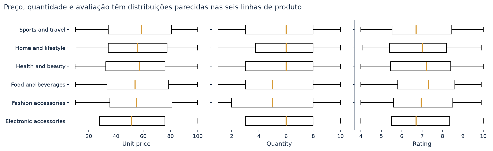
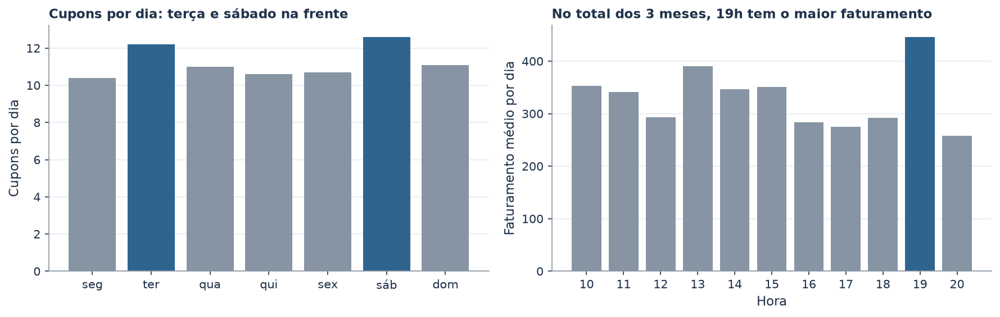
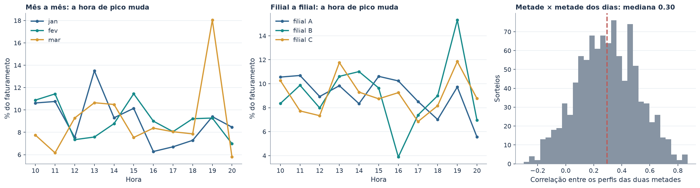
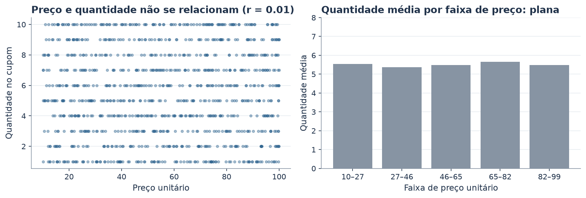
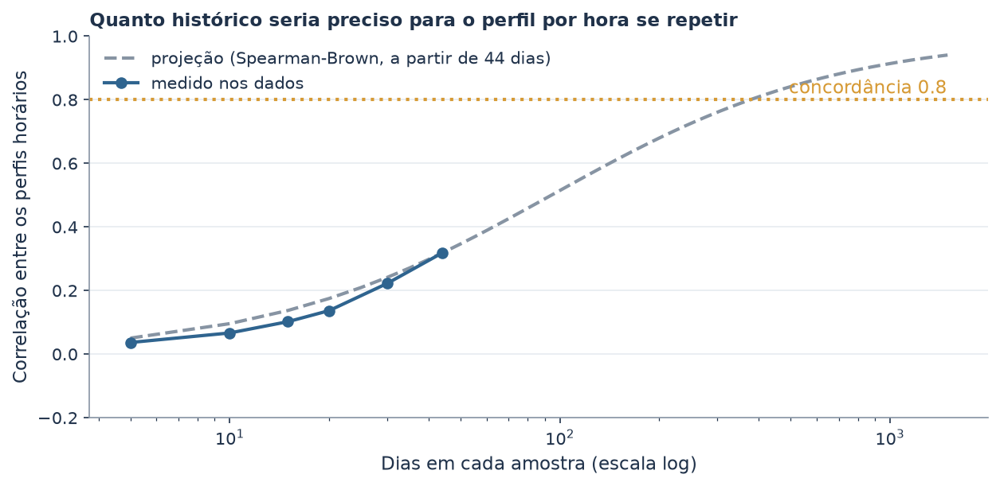

# Estudo de caso 3 · Vendas em supermercado

> Estudo de caso do capítulo 13 do livro *Ciência de Dados: da teoria à prática*. Técnicas usadas: verificação do significado das colunas, comparação de grupos (Kruskal-Wallis), decomposição de séries, verificação de estabilidade de um padrão, agrupamento hierárquico, crítica de um experimento com modelo, estimativa do volume de dados necessário.

## A situação

Uma rede de supermercados com três filiais em Mianmar entrega à equipe de dados os cupons de janeiro a março de 2019 e pergunta:

1. Alguma linha de produto ou filial se destaca?
2. Há dias ou horários de maior movimento, para organizar caixas e reposição?
3. Os clientes formam perfis diferentes?
4. Aumentar preços aumentaria o faturamento?

Este caso ensina uma lição que aparece em todo projeto real: **um padrão encontrado no total precisa ser conferido em partes dos dados antes de virar decisão**. E, quando os dados não sustentam uma decisão, a recomendação correta é dizer isso e dizer o que falta.

## Os dados

`dados/supermarket_sales - Sheet1.csv`: 1 000 cupons (base pública "Supermarket sales", disponível no Kaggle). Uma linha por cupom, com um único produto por cupom.

| Coluna | Conteúdo |
|---|---|
| `Invoice ID` | identificador do cupom |
| `Branch`, `City` | filial (A, B, C) e cidade (Yangon, Mandalay, Naypyitaw) |
| `Customer type`, `Gender` | cliente cadastrado ou não; gênero |
| `Product line` | seis linhas de produto |
| `Unit price`, `Quantity` | preço unitário e quantidade |
| `Tax 5%`, `Total` | imposto e total do cupom |
| `Date`, `Time` | data e hora |
| `Payment` | forma de pagamento |
| `cogs`, `gross margin percentage`, `gross income` | custo, margem e receita bruta (ver Passo 1) |
| `Rating` | avaliação do cliente (4 a 10) |

**O que a base não tem:** identificação do cliente (só do cupom), custo real, estoque, histórico de preços de um mesmo produto.

## Scripts

| Passo | Script | Figuras |
|---|---|---|
| 1. Conhecer e comparar grupos | `01_conhecer_os_dados.py` | `01_distribuicoes_por_linha.png`, `01_mediana_avaliacao.png` |
| 2. Análise temporal | `02_analise_temporal.py` | `02_decomposicao_semanal.png`, `02_dia_da_semana_e_hora.png` |
| 3. O padrão se repete? | `03_o_padrao_se_repete.py` | `03_o_padrao_se_repete.png` |
| 4. Perfis de vendas | `04_perfis_de_vendas.py` (grava `dados/perfis.csv`) | `04_dendrograma_perfis.png` |
| 5. O que o preço explica | `05_o_que_o_preco_explica.py` | `05_preco_x_quantidade.png` |
| 6. Quanto dado seria preciso | `06_quanto_dado_seria_preciso.py` | `06_quanto_dado_seria_preciso.png` |

---

## Passo 1 · Conhecer os dados e comparar linhas de produto e filiais

**Pergunta:** o que as colunas significam? Alguma linha de produto ou filial se destaca?

Antes de calcular qualquer média, conferimos o que as colunas de dinheiro medem:

```python
(vendas['Total'] - vendas['Unit price'] * vendas['Quantity'] * 1.05).abs().max()   # 0
vendas['gross margin percentage'].unique()                                         # um único valor
(vendas['gross income'] - vendas['Tax 5%']).abs().max()                             # 0
```

**O que saiu:** `Total` é exatamente preço × quantidade × 1,05; a "margem bruta" é a mesma constante em todos os cupons; e `gross income` é idêntico ao imposto de 5%. **A base não mede lucro.** Nenhuma conclusão sobre margem é possível.

Comparando as seis linhas de produto e as três filiais com o teste de Kruskal-Wallis (que compara as distribuições de vários grupos):

| Variável | Entre linhas de produto (p) | Entre filiais (p) |
|---|---|---|
| Preço unitário | 0,82 | 0,66 |
| Quantidade | 0,33 | 0,85 |
| Avaliação | 0,74 | 0,13 |
| Total do cupom | 0,83 | 0,81 |

As filiais faturaram 106 200, 106 198 e 110 569 no trimestre. As avaliações medianas por linha ficam entre 6,7 e 7,3.




**Conclusão do passo:** nenhum teste aponta diferença. Linhas de produto e filiais são, para todos os fins práticos, parecidas. Não há base para priorizar uma linha ou uma filial.

## Passo 2 · Há dias ou horários de maior movimento?

**Pergunta:** o movimento muda com o dia da semana ou com a hora?

O script monta a série diária (89 dias com vendas), decompõe com período semanal e agrega por dia da semana e por hora.

**O que saiu:**

- A componente semanal da quantidade por cupom tem amplitude de menos de uma unidade, e o teste de Kruskal-Wallis entre dias da semana dá **p = 0,58**: a quantidade por cupom não muda com o dia.
- Em número de cupons por dia, terça (12,2) e sábado (12,6) ficam à frente de segunda (10,4).
- Por hora, somando os três meses, **as 19h têm o maior faturamento** (446 por dia, contra 258 às 20h).




Parece haver uma recomendação pronta: reforçar caixas às 19h, às terças e aos sábados. Antes de fazê-la, o Passo 3 confere se esse padrão é real.

## Passo 3 · O padrão se repete em cada mês e em cada filial?

**Pergunta:** a hora de pico aparece em todos os meses e em todas as filiais, ou só no total?

Um padrão útil para organizar a operação precisa se **repetir**. Repetimos a análise por hora separadamente para janeiro, fevereiro e março, e para cada filial.

```python
por_mes = vendas.pivot_table(index='Hora', columns='Mes', values='Total', aggfunc='sum')
participacao = por_mes / por_mes.sum()
participacao.idxmax()          # hora de maior faturamento em cada mês
participacao.corr()            # os perfis dos meses se parecem?
```

**O que saiu:**

| | Hora de maior faturamento | Correlação entre perfis horários |
|---|---|---|
| Janeiro | 13h | jan × fev: 0,27 |
| Fevereiro | 15h | jan × mar: 0,14 |
| Março | 19h | fev × mar: −0,12 |
| Filial A | 11h | A × B: 0,16 |
| Filial B | 19h | A × C: 0,27 |
| Filial C | 19h | B × C: 0,53 |

- **A hora de pico muda a cada mês.** O "pico das 19h" vem quase todo de março (52 cupons às 19h, contra 35 em janeiro e 26 em fevereiro).
- Os perfis horários de meses diferentes quase não se correlacionam (−0,12 a 0,27).
- Testes: o número de cupons por hora vai de 74 a 113, e o teste contra "todas as horas iguais" dá p = 0,050, no limite. A distribuição por hora não difere entre os meses de forma detectável (p = 0,51), e o valor por cupom não muda com a hora (p = 0,37).
- **Metade × metade:** dividindo os 89 dias em duas metades sorteadas, 1 000 vezes, a correlação entre os perfis horários das duas metades tem mediana de **0,30** (90% dos sorteios entre −0,07 e 0,65). Metade dos dias mal prevê o perfil da outra metade.

O mesmo acontece com os dias da semana:

| Cupons por dia | seg | ter | qua | qui | sex | sáb | dom |
|---|---|---|---|---|---|---|---|
| Janeiro | 11,0 | 12,4 | 10,4 | 11,0 | 10,0 | **14,0** | 10,8 |
| Fevereiro | 10,5 | **9,5** | 11,2 | 10,0 | 12,0 | 10,8 | 11,8 |
| Março | 9,8 | **14,5** | 11,5 | 10,8 | 10,2 | 13,0 | 10,8 |

Em fevereiro, a terça é o dia **mais fraco**.



**Conclusão do passo:** os "picos" do Passo 2 são, em grande parte, ruído de uma amostra pequena (cerca de 90 cupons por hora em três meses). O movimento é aproximadamente uniforme ao longo do dia e da semana.

## Passo 4 · Os cupons formam perfis?

**Pergunta:** há grupos de compras com comportamento diferente?

Usamos agrupamento hierárquico (método de Ward) sobre preço, quantidade, avaliação e hora, padronizados. `Total` e imposto ficam de fora porque são funções de preço × quantidade.

| Número de grupos | Tamanhos | Silhueta |
|---|---|---|
| 2 | 352 e 648 | 0,127 |
| 3 | 352, 227, 421 | 0,139 |
| 4 | 352, 227, 166, 255 | 0,142 |

Com dois grupos: o perfil 1 tem preço médio de 36 e avaliação de 6,4; o perfil 2, preço de 66 e avaliação de 7,3. Filial, linha de produto e tipo de cliente se distribuem igualmente nos dois (por exemplo, 51% e 50% de clientes cadastrados).


**Como ler:** silhuetas abaixo de 0,15 indicam que **não há grupos naturais**: o algoritmo sempre devolve grupos, mas aqui eles só fatiam uma nuvem contínua. Os perfis servem para descrever (compras de itens baratos × caros), não para orientar ações por "tipo de cliente". Além disso, a base identifica cupons, não clientes.

**Um erro comum, para comparar.** Se codificarmos filial, cidade e produto como 0, 1, 2 e agruparmos junto com as numéricas, surgem grupos de 251 e 749 cupons que se separam em parte pela cidade (Yangon vira "mais distante" de Naypyitaw do que de Mandalay só por causa dos números escolhidos). A concordância com os perfis anteriores é nula (ARI = −0,01). A codificação criou a estrutura.

## Passo 5 · Aumentar o preço aumentaria o faturamento?

**Pergunta:** um modelo que prevê o total pode dizer o efeito de um aumento de preço?

Um experimento frequente: treinar, em cada perfil, uma floresta que prevê o total a partir de preço, produto, filial e cliente; depois aumentar o preço em 10% e ver o que o modelo prevê.

**O que saiu:** a mediana prevista sobe de 184 para 206 (perfil 1) e de 361 para 399 (perfil 2), com teste de Wilcoxon p < 0,0001. Parece uma evidência forte.

Mas o que o teste mediu? O total **é** preço × quantidade × 1,05. Ao ver um preço maior com tudo o mais igual, o modelo só pode prever um total maior. A pergunta real é se **a quantidade cairia** com o preço mais alto, e a base não tem como responder:

| Faixa de preço unitário | Cupons | Quantidade média |
|---|---|---|
| 10–27 | 200 | 5,54 |
| 27–47 | 200 | 5,38 |
| 47–65 | 200 | 5,48 |
| 65–83 | 200 | 5,66 |
| 83–100 | 200 | 5,49 |



A correlação entre preço e quantidade é 0,01. Cada cupom é um produto diferente com seu próprio preço; não há o **mesmo** produto vendido a preços diferentes. Para medir o efeito de preço seria preciso um experimento (o mesmo item com preços diferentes em lojas ou semanas comparáveis) ou um histórico de preços.

**Conclusão do passo:** a base não permite afirmar que aumentar preços aumenta o faturamento.

## Passo 6 · Quanto histórico seria preciso para confiar num perfil por hora?

**Pergunta:** se o padrão horário não é confiável com três meses, com quanto tempo seria?

Medimos, nos próprios dados, a concordância entre os perfis horários de duas amostras **independentes** de dias, aumentando o tamanho das amostras:

| Dias em cada amostra | 5 | 10 | 15 | 20 | 30 | 44 |
|---|---|---|---|---|---|---|
| Correlação mediana | 0,04 | 0,07 | 0,10 | 0,14 | 0,22 | 0,32 |

A concordância cresce devagar. A fórmula de Spearman-Brown, usada para estimar a confiabilidade de uma medida com mais dados, $r_m = m\,r/(1 + (m-1)\,r)$, indica que, para chegar a 0,8, seriam necessárias cerca de **9 vezes mais dias**: em torno de **377 dias por amostra**, ou seja, mais de um ano de cupons em cada metade.



A projeção supõe que exista um padrão estável e que os dias sejam independentes; ela dá uma **ordem de grandeza** para planejar a coleta, não um número exato.

---

## Recomendação, a partir do que foi encontrado

**1. Achados.**
- Linhas de produto e filiais não diferem em preço, quantidade, avaliação ou total (Kruskal-Wallis, p de 0,13 a 0,85) (Passo 1).
- O "pico das 19h" e a vantagem de terça e sábado aparecem no total, mas **não se repetem** entre meses nem entre filiais; metade dos dias mal prevê a outra metade (correlação mediana de 0,30) (Passo 3).
- Os perfis de cupons não formam grupos naturais (silhueta ≤ 0,14) (Passo 4).
- A base não informa como a quantidade reagiria a um preço diferente (Passo 5).

**2. O que fazer agora.** Com estes três meses, **não reorganizar** escalas por hora ou por dia da semana, **não alterar** preços e **não priorizar** linhas de produto. Qualquer dessas mudanças se apoiaria em diferenças que se mostraram ruído. Manter a escala distribuída de forma uniforme é a escolha coerente com o Passo 3, onde o movimento por hora não difere de forma consistente.

**3. O que coletar para poder decidir.**

| Decisão desejada | O que falta | Referência medida aqui |
|---|---|---|
| Escala por hora | pelo menos um ano de cupons | Spearman-Brown: ~377 dias por amostra para concordância de 0,8 |
| Política de preços | mesmo produto com preços diferentes (teste em lojas ou semanas) | correlação preço × quantidade = 0,01 entre produtos diferentes |
| Ações por cliente | identificação do cliente nos cupons | a base só identifica cupons |
| Decisões sobre lucro | custo real por produto | a "margem" é uma constante |

**4. Critério para agir no futuro.** Adotar uma escala por hora quando o perfil horário de um período se repetir no período seguinte com correlação de pelo menos 0,8, conferido como no Passo 3. Com três meses, essa correlação foi de 0,30.

## Limites

- Três meses e mil cupons; um único produto por cupom.
- A base é pública e foi publicada para exercícios; pode não refletir a operação de um supermercado real em todos os detalhes.
- A conclusão "não agir" vale para estes dados. Ela não diz que não existe padrão por hora; diz que três meses não bastam para encontrá-lo.

## Atividades

1. **Reprodução.** Rode os scripts 01 a 06 e confira os números deste texto.
2. **Variação.** No script `04`, inclua `Total` entre as variáveis do agrupamento. Os perfis mudam? Por que isso era esperado?
3. **Validação.** Repita o Passo 3 para a forma de pagamento: a proporção de pagamentos em dinheiro por hora se repete entre os meses?
4. **Crítica.** Um gerente lê o gráfico do Passo 2 e diz: "está claro, o pico é às 19h". Escreva, em cinco linhas, o que você responderia usando os números do Passo 3.
5. **Planejamento.** Desenhe um teste de preço para uma linha de produto: o que seria comparado, em quais lojas, por quanto tempo, e que medida diria se funcionou?
