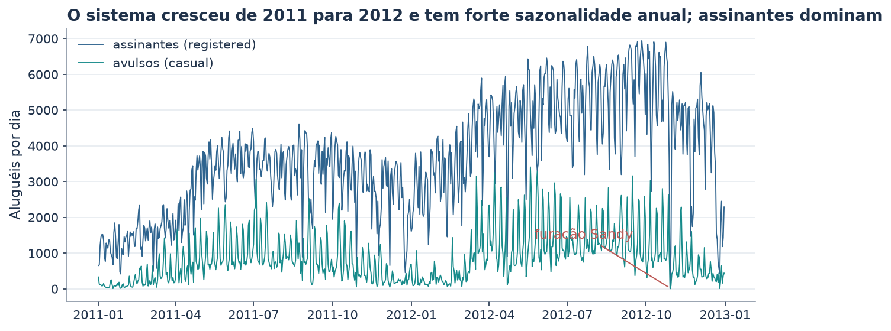
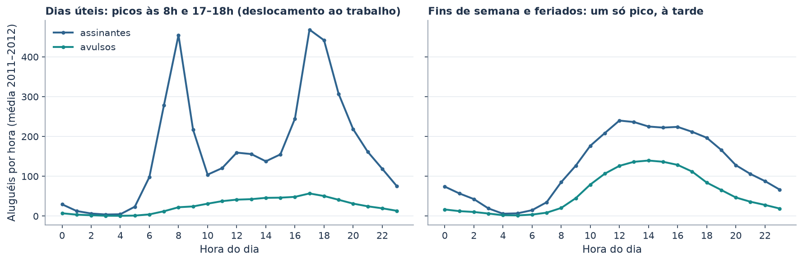
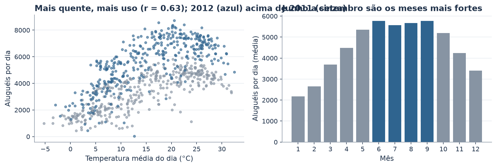
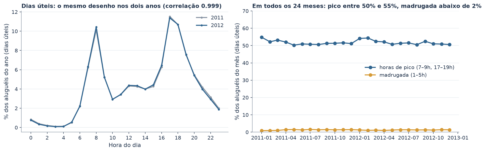
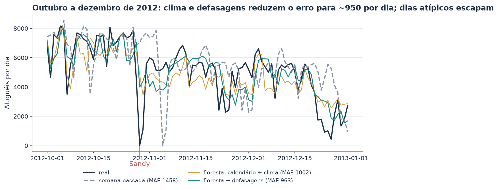
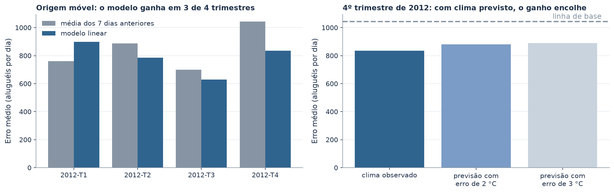
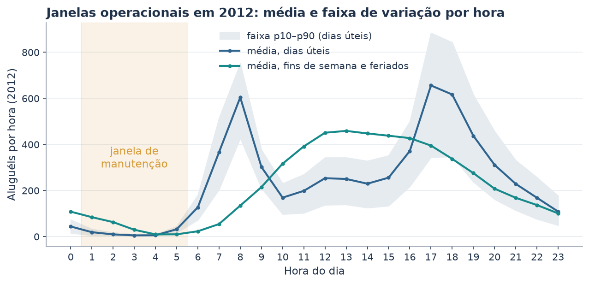

# Estudo de caso 4 · Mobilidade urbana: bicicletas compartilhadas

> **Aplicação adicional — não integra o livro.** Relaciona-se com as unidades de estatística (04), séries temporais (15) e regressão (11). Técnicas usadas: perfis horários, efeito do clima, verificação de estabilidade de um padrão, previsão com separação no tempo, origem móvel, análise de sensibilidade.

## A situação

A operadora de um sistema de bicicletas compartilhadas precisa planejar três coisas: quando fazer a manutenção das bicicletas, quando reforçar a equipe que redistribui bicicletas entre estações e quantas pessoas escalar em cada dia. As perguntas:

1. Em que horas e dias a demanda é maior? Assinantes e usuários avulsos se comportam igual?
2. Quanto o clima e a estação do ano pesam?
3. Os horários de pico e de vale são **estáveis** o bastante para organizar escalas em torno deles?
4. Dá para prever o volume do dia seguinte melhor que uma regra simples, inclusive usando a previsão do tempo?

## Os dados

*Bike Sharing Dataset*, UCI Machine Learning Repository (id 275), licença CC BY 4.0, acesso em 23/11/2026: <https://archive.ics.uci.edu/dataset/275/bike-sharing-dataset>. Aluguéis do sistema Capital Bikeshare (Washington D.C.) em 2011 e 2012, com dados de clima acrescentados pelos autores (Fanaee-T e Gama, 2013). O dicionário publicado pelos autores está em [dados/Readme.txt](dados/Readme.txt).

| Arquivo | Linhas | Conteúdo |
|---|---|---|
| `dados/day.csv` | 731 | um dia por linha |
| `dados/hour.csv` | 17 379 | uma hora por linha |

Principais colunas: `dteday` (data), `hr` (hora), `yr` (0 = 2011, 1 = 2012), `mnth`, `weekday` (0 = domingo), `workingday` (1 = dia útil), `holiday`, `season`, `weathersit` (1 = limpo, 2 = nublado/névoa, 3 = chuva ou neve leve, 4 = chuva forte), `temp`, `hum`, `windspeed` (normalizados), `casual` (avulsos), `registered` (assinantes), `cnt` (total). Os scripts convertem temperatura para °C, umidade para % e vento para km/h.

**O que a base não tem:** estações, bicicletas disponíveis, viagens que não aconteceram por falta de bicicleta ou de vaga. Ela mede o **uso realizado** na cidade inteira.

## Scripts

| Passo | Script | Figuras |
|---|---|---|
| 1. Conhecer os dados | `01_conhecer_os_dados.py` | `01_serie_diaria.png` |
| 2. Padrões de demanda e clima | `02_padroes_de_demanda.py` | `02_perfil_horario.png`, `02_clima_e_mes.png` |
| 3. O padrão se repete? | `03_o_padrao_se_repete.py` | `03_o_padrao_se_repete.png` |
| 4. Prever a demanda | `04_prever_demanda.py` | `04_previsao_trimestre.png` |
| 5. Validar a previsão | `05_validar_a_previsao.py` | `05_validar_a_previsao.png` |
| 6. Janelas operacionais | `06_janelas_operacionais.py` | `06_janelas_operacionais.png` |

---

## Passo 1 · Conhecer os dados

**Pergunta:** o que as colunas medem e a base está completa?

```python
dias = pd.read_csv('dados/day.csv', parse_dates=['dteday'])
dias['temp_C'] = dias['temp'] * 47 - 8          # a temperatura veio normalizada
(dias['cnt'] - dias['casual'] - dias['registered']).abs().max()   # 0: cnt = avulsos + assinantes
```

**O que saiu:**

- 731 dias seguidos, sem falhas. Em `hour.csv` há 17 379 das 17 544 horas possíveis: **horas sem nenhum aluguel simplesmente não aparecem**.
- Média de 4 504 aluguéis por dia (de 22 a 8 714). Assinantes respondem por 81% (3 656 de 4 504).
- O sistema cresceu: **3 406 aluguéis por dia em 2011 e 5 600 em 2012** (+64%).
- Clima: 463 dias limpos, 247 nublados e 21 com chuva ou neve leve.



## Passo 2 · Quando se usa mais, e quanto pesa o clima?

**Pergunta:** como a demanda varia ao longo do dia, da semana e do ano?



- **Dias úteis:** dois picos, às 8h e às 17h–18h, quase todos de assinantes: é o deslocamento para o trabalho. As horas 7–9h e 17–19h concentram cerca de metade dos aluguéis.
- **Fins de semana e feriados:** um pico só, à tarde (13h), com participação muito maior de avulsos.
- **Dia da semana:** a média diária varia pouco (de 4 229 no domingo a 4 690 na sexta).



| Condição do tempo | Dias | Aluguéis por dia |
|---|---|---|
| Limpo | 463 | 4 877 |
| Nublado/névoa | 247 | 4 036 |
| Chuva ou neve leve | 21 | 1 803 |

A correlação entre temperatura e aluguéis diários é **0,63**. Janeiro tem 2 176 aluguéis por dia; junho a setembro, mais de 5 500. Três fatores se misturam: crescimento do sistema, estação do ano e clima do dia.

## Passo 3 · O padrão se repete?

**Pergunta:** os horários de pico e de vale aparecem nos dois anos e em todos os meses, ou só na média geral?

Antes de organizar escalas em torno de um padrão, conferimos se ele é estável (no estudo de caso 3, um "pico" parecido desapareceu nessa verificação).

```python
perfis = uteis.groupby(['yr', 'hr'])['cnt'].sum().unstack(0)
perfis = perfis / perfis.sum()               # participação de cada hora no ano
perfis[0].corr(perfis[1])                    # 2011 x 2012
```

**O que saiu:**

| Verificação | Resultado |
|---|---|
| Correlação entre os perfis horários de 2011 e 2012, dias úteis | **0,999** (pico às 17h nos dois anos) |
| O mesmo, fins de semana e feriados | **0,998** (pico às 13h nos dois anos) |
| Participação de 7–9h e 17–19h, mês a mês (dias úteis) | entre **50% e 55%** nos 24 meses |
| Participação de 1–5h, mês a mês (dias úteis) | entre **0,9% e 1,6%** nos 24 meses |
| Hora de maior uso nos dias úteis | 17h em 15 meses, 8h em 8, 18h em 1 |
| Metade × metade dos dias úteis (500 sorteios) | correlação mínima de 0,998 |



**Conclusão do passo:** o padrão horário é **muito estável**. Mesmo com o sistema crescendo 64% de um ano para o outro, a **proporção** de uso em cada hora se manteve. Essa é a diferença em relação ao caso do supermercado: aqui há dados suficientes (dois anos, milhões de aluguéis) e um mecanismo claro (deslocamento para o trabalho).

## Passo 4 · Prever o volume do dia

**Pergunta:** com calendário e clima, dá para prever os aluguéis do dia melhor que uma regra simples?

Treinamos com tudo até setembro de 2012 e testamos em outubro a dezembro de 2012 (92 dias, média de 5 165 aluguéis por dia):

| Método | Erro médio absoluto (aluguéis/dia) |
|---|---|
| Mesmo dia da semana anterior | 1 458 |
| Média dos 7 dias anteriores | 1 043 |
| Regressão linear: calendário + clima | 957 |
| Floresta: calendário + clima | 1 002 |
| Floresta: calendário + clima + defasagens | 963 |



A regressão linear empata com a floresta: a relação com a temperatura é quase linear. Na floresta com defasagens, a média dos 7 dias anteriores responde por 71% da importância: o nível recente do sistema é a informação mais útil. O furacão Sandy (29 e 30 de outubro) e os feriados continuam mal previstos.

## Passo 5 · A previsão funciona em outros períodos e com a previsão do tempo?

**Pergunta:** o ganho do Passo 4 se repete em outros trimestres? E se, em vez do clima observado, o modelo recebesse a previsão do tempo, que erra?

**(a) Origem móvel.** Repetimos a avaliação nos quatro trimestres de 2012, cada vez treinando com tudo o que veio antes, com um modelo linear que usa calendário, clima e a média dos 7 dias anteriores:

| Trimestre | Média de aluguéis/dia | Linha de base (média 7 dias) | Modelo | Redução do erro |
|---|---|---|---|---|
| 2012-T1 | 4 008 | 761 | 898 | **−18%** |
| 2012-T2 | 6 296 | 886 | 785 | 11% |
| 2012-T3 | 6 920 | 700 | 629 | 10% |
| 2012-T4 | 5 165 | 1 043 | 834 | 20% |

O modelo ganha em 3 de 4 trimestres. Em 2012-T1 ele **perde**: treinado só com 2011, a variável "ano" era constante no treino, e o modelo não tinha como aprender o crescimento do sistema. A linha de base, que só olha a semana anterior, acompanha o novo nível automaticamente.

**(b) Clima previsto.** No último trimestre, somamos à temperatura um erro aleatório (desvio de 2 °C ou 3 °C, ordem de grandeza de uma previsão para o dia seguinte) e trocamos a condição do tempo em 20% dos dias:

| Clima usado | Erro médio | % da média |
|---|---|---|
| Observado | 834 | 16% |
| Previsto, erro de 2 °C | 880 | 17% |
| Previsto, erro de 3 °C | 890 | 17% |
| Linha de base | 1 043 | 20% |



**Conclusão do passo:** o modelo reduz o erro em 10% a 20% depois que tem pelo menos um ano de histórico, e continua melhor que a linha de base com clima previsto. O ganho é real, mas moderado: o volume de um dia continua incerto em cerca de 17%.

## Passo 6 · Janelas operacionais

**Pergunta:** quais horas concentram e quais esvaziam a demanda, com que variação?

Usamos 2012, o ano mais recente, com média e faixa entre os percentis 10 e 90 de cada hora:

| Dias úteis de 2012 | Média | p10 | p90 |
|---|---|---|---|
| 8h | 605 | 427 | 752 |
| 17h | 656 | 344 | 884 |
| 18h | 617 | 348 | 843 |
| 0h a 5h | menos de 60 | | |

Nos fins de semana, a média passa de 300 aluguéis por hora das 10h às 18h. Entre 0h e 2h, os fins de semana têm mais uso que os dias úteis (cerca de 100 por hora à meia-noite); das 3h às 5h, as duas curvas ficam perto de zero.



---

## Recomendação, a partir do que foi encontrado

**1. Achados.**
- Nos dias úteis, 7–9h e 17–19h concentram de 50% a 55% dos aluguéis em **todos os 24 meses**, e 1h–5h fica entre 0,9% e 1,6%. O perfil de 2011 e o de 2012 têm correlação de 0,999 (Passo 3).
- Nos fins de semana, o uso se concentra das 10h às 18h, com pico às 13h nos dois anos (Passos 3 e 6).
- Um modelo linear com calendário, clima e nível recente reduz o erro da previsão diária em 10% a 20% depois de um ano de histórico, inclusive com clima previsto (Passo 5).

**2. Ações.**
- **Manutenção programada entre 3h e 5h**, a janela de menor uso em todos os dias (1h–2h ainda têm uso nos fins de semana).
- **Redistribuição e equipe reforçadas antes das 7h e das 16h nos dias úteis**, e antes das 10h nos fins de semana.
- **Dimensionar a equipe do dia** com a previsão do modelo e a previsão do tempo, sabendo que o erro típico é de cerca de 17% do volume. Nos primeiros meses de um sistema novo, ou depois de uma expansão grande, usar a média dos 7 dias anteriores: foi ela que funcionou melhor quando o histórico não cobria o novo nível (2012-T1).

**3. Como acompanhar, com referências medidas aqui:**

| Indicador | Referência medida | Sinal de alerta |
|---|---|---|
| Participação de 7–9h e 17–19h nos dias úteis, por mês | 50% a 55% em 24 meses | fora dessa faixa por dois meses seguidos: o padrão mudou (por exemplo, trabalho remoto) e as escalas precisam ser revistas |
| Participação de 1–5h | 0,9% a 1,6% | acima de 3%: a janela de manutenção deixou de ser vazia |
| Erro da previsão diária, por trimestre | 16% a 17% da média (T4/2012) | acima de 20%, o nível da linha de base: o modelo deixou de compensar |

**4. O que não podemos afirmar.** A base não tem estações nem demanda não atendida. Nos picos, o uso observado pode estar limitado pela falta de bicicletas ou de vagas. Para decidir **onde** colocar bicicletas, seria preciso registrar, por estação e por hora, quantas vezes ela ficou vazia ou cheia.

## Limites

- Uma cidade, dois anos; o crescimento de 64% entre os anos se mistura com a sazonalidade.
- O erro da previsão do tempo foi simulado, não medido.
- Horas sem nenhum aluguel não aparecem em `hour.csv`; as médias por hora consideram apenas as horas presentes (165 horas ausentes em dois anos, quase todas de madrugada).

## Atividades

1. **Reprodução.** Rode os scripts 01 a 06 e confira os números deste texto.
2. **Variação.** No script `05`, troque o modelo linear por uma floresta. Ela também perde em 2012-T1? Por quê?
3. **Pergunta aberta.** Em que horas os usuários avulsos superam os assinantes? O que isso sugere sobre comunicação e preços para esse público?
4. **Crítica.** A recomendação de manutenção usa 3h–5h. Que dado adicional você pediria à operadora antes de fixar essa janela (pense em turnos de trabalho e em segurança)?
5. **Comparação.** Compare o Passo 3 deste caso com o Passo 3 do caso do supermercado. Por que um padrão horário é estável aqui e não lá? Cite o volume de dados e o mecanismo por trás do padrão.
