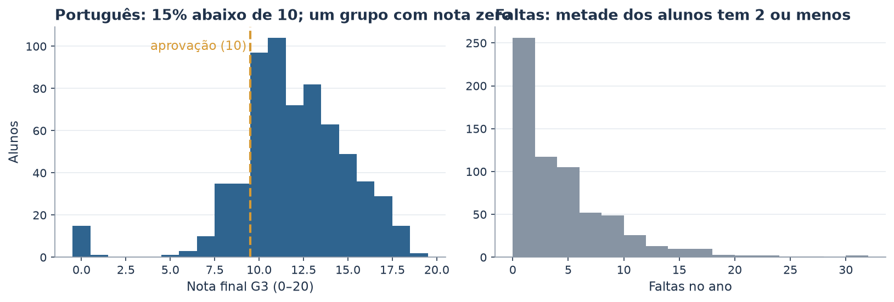
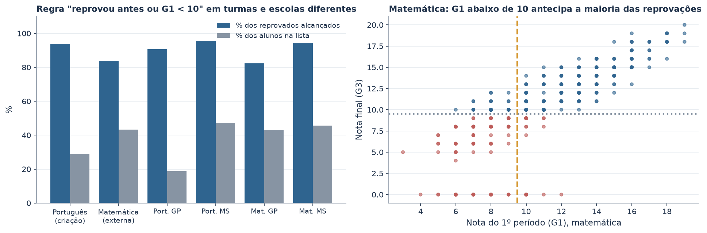
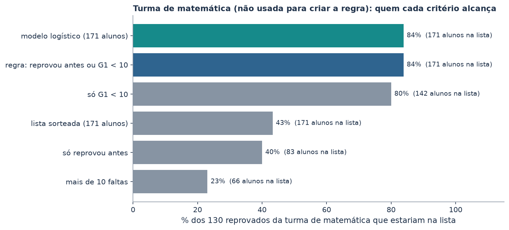

# Estudo de caso 5 · Educação: desempenho e acompanhamento preventivo

> **Aplicação adicional — não integra o livro.** Relaciona-se com as unidades de estatística (04), pré-processamento (06), avaliação de modelos (07) e regressão logística (11). Técnicas usadas: comparação de grupos com tamanho de efeito, proporções com intervalo de confiança, classificação com validação cruzada, comparação entre modelo e regra simples, validação externa.

## A situação

A coordenação de uma escola quer oferecer reforço e acompanhamento **antes** que os alunos reprovem. Os recursos são limitados: não dá para acompanhar todo mundo. As perguntas:

1. Que características observáveis durante o ano aparecem associadas à reprovação?
2. As faltas importam tanto quanto se costuma supor?
3. Dá para montar uma lista curta que inclua a maioria dos alunos que vão reprovar?
4. Essa lista funciona em **outros alunos**, que não foram usados para construí-la?

Uma lista de acompanhamento envolve pessoas. Ela deve ser um convite ao apoio, nunca um rótulo, e sempre passar por revisão humana.

## Os dados

*Student Performance*, UCI Machine Learning Repository (id 320), licença CC BY 4.0, acesso em 23/11/2026: <https://archive.ics.uci.edu/dataset/320/student-performance>. Alunos do ensino secundário de duas escolas portuguesas (GP e MS) no ano letivo 2005–2006 (Cortez e Silva, 2008). Dicionário em [dados/student.txt](dados/student.txt).

| Arquivo | Alunos | Uso neste estudo |
|---|---|---|
| `dados/student-por.csv` | 649 | turma de português: análise e construção da regra |
| `dados/student-mat.csv` | 395 | turma de matemática: validação externa (Passo 5) |

Principais colunas: `school`, `sex`, `age`, `address` (urbano/rural), `Medu`/`Fedu` (escolaridade dos pais), `studytime` (horas de estudo por semana, em faixas), `failures` (reprovações anteriores), `schoolsup` (apoio escolar), `higher` (quer fazer ensino superior), `absences` (faltas), `G1`, `G2`, `G3` (notas dos três períodos, de 0 a 20; aprova-se com 10).

**O que a base não tem:** motivo das faltas, renda, histórico de anos anteriores, o que a escola fez com cada aluno. É um retrato de um ano, em duas escolas portuguesas, há vinte anos. Não descreve escolas brasileiras.

## Scripts

| Passo | Script | Figuras |
|---|---|---|
| 1. Conhecer os dados | `01_conhecer_os_dados.py` | `01_notas_e_faltas.png` |
| 2. Comparar grupos | `02_comparar_grupos.py` | `02_grupos.png` |
| 3. Prever o risco | `03_prever_risco.py` (grava `dados/probabilidades_validacao.csv`) | `03_risco.png` |
| 4. Lista de acompanhamento | `04_lista_de_acompanhamento.py` | `04_lista_de_acompanhamento.png` |
| 5. Validar em outra turma | `05_validar_em_outra_turma.py` | `05_validacao_externa.png` |
| 6. Efeito da seleção | `06_efeito_da_selecao.py` | `06_efeito_da_selecao.png` |

---

## Passo 1 · Conhecer os dados

**Pergunta:** como se distribuem as notas e as faltas? O que significa uma nota zero?

```python
alunos = pd.read_csv('dados/student-por.csv', sep=';')    # separador é ponto e vírgula
(alunos['G3'] < 10).mean()                                 # fração de reprovados
alunos[['G1', 'G2', 'G3']].corr()
```

**O que saiu:**

- Nenhum valor ausente. Nota final (G3): mediana 12, de 0 a 19.
- **100 de 649 alunos (15,4%) reprovam** (G3 < 10). Quinze têm G3 = 0, o que costuma indicar abandono ou ausência na prova, não uma nota zero.
- Faltas: mediana de 2, média de 3,7, máximo de 32.
- 549 alunos nunca reprovaram; 70 reprovaram uma vez, 16 duas vezes e 14 três vezes.
- As notas dos três períodos são muito correlacionadas: G1 × G3 = 0,83 e **G2 × G3 = 0,92**.



Essa última correlação define uma regra para o resto do estudo: **G2 não pode ser usada para prever G3**. Seria prever a nota final com uma nota quase igual a ela, e só estaria disponível tarde demais para ajudar.

## Passo 2 · Que grupos têm notas diferentes?

**Pergunta:** quais características aparecem associadas à nota final, e com que força?

Para cada comparação calculamos o teste de Mann-Whitney e o **delta de Cliff**, uma medida de tamanho do efeito que não depende de normalidade: a probabilidade de um aluno do primeiro grupo ter nota maior que um do segundo, menos a probabilidade contrária (vai de −1 a 1; acima de 0,47 costuma ser considerado grande).

| Comparação | Medianas | Delta de Cliff | p |
|---|---|---|---|
| Sem × com reprovação anterior | 12 × 10 | **+0,71** | < 0,0001 |
| Quer × não quer ensino superior | 12 × 10 | **+0,66** | < 0,0001 |
| Estuda 5h+ × menos de 5h por semana | 13 × 11 | +0,29 | < 0,0001 |
| Urbano × rural | 12 × 11 | +0,21 | < 0,0001 |
| Até 5 × mais de 5 faltas | 12 × 11 | +0,16 | 0,001 |
| Com × sem apoio escolar | 11 × 12 | −0,16 | 0,03 |

**Faltas em detalhe** (correlação de Spearman com G3: −0,16):

| Faltas no ano | Alunos | % reprovados | IC 95% |
|---|---|---|---|
| 0 | 244 | 13,9% | 10,1% – 18,8% |
| 1–2 | 122 | 13,1% | 8,2% – 20,2% |
| 3–5 | 112 | 14,3% | 9,0% – 22,0% |
| 6–10 | 122 | 18,0% | 12,2% – 25,8% |
| mais de 10 | 49 | 24,5% | 14,6% – 38,1% |


**Como ler:**

- **Reprovação anterior é a associação mais forte.** Querer seguir estudando vem logo depois.
- **Faltas pesam menos do que se costuma supor**: a taxa de reprovação só sobe de forma visível acima de 10 faltas, e mesmo ali o intervalo é largo (49 alunos).
- **Apoio escolar aparece com nota menor.** Não é que o apoio prejudique: ele é dado a quem já tem dificuldade. É o exemplo clássico de associação que não mede efeito.

## Passo 3 · Dá para prever quem corre risco?

**Pergunta:** com o que se sabe no início do ano, e depois com a nota do 1º período, um modelo aponta quem vai reprovar?

Dois momentos de decisão:

- **Início do ano:** 29 variáveis sociais, familiares e escolares, sem notas.
- **Após o 1º período:** as mesmas, mais faltas e G1.

Avaliamos com validação cruzada estratificada de 5 dobras (cada aluno é previsto por um modelo que não o viu):

| Modelo | AUC | Revocação (limiar 0,5) | Precisão (limiar 0,5) |
|---|---|---|---|
| Linha de base ("ninguém reprova") | 0,500 | 0,00 | — |
| Logística, início do ano | 0,789 | 0,64 | 0,35 |
| Floresta, início do ano | 0,840 | 0,74 | 0,44 |
| Logística, após 1º período | 0,918 | 0,75 | 0,49 |
| Floresta, após 1º período | 0,928 | 0,87 | 0,55 |


No início do ano, o maior coeficiente da logística é o das reprovações anteriores (0,79), seguido da escola MS (0,45). Depois do 1º período, **a nota G1 muda tudo**: a AUC sobe de 0,79 para 0,92.

## Passo 4 · Uma lista de acompanhamento: modelo ou regra simples?

**Pergunta:** se a escola acompanhar uma fração dos alunos, quantos dos que reprovariam estarão na lista?

Ordenamos os alunos pela probabilidade prevista (fora da amostra, do Passo 3) e contamos:

| Alunos na lista | Reprovados alcançados: início do ano | Após 1º período |
|---|---|---|
| 10% (65) | 35% | 45% |
| 20% (130) | 54% | 69% |
| 30% (195) | 66% | 90% |
| 40% (260) | 79% | 97% |

E comparamos com uma **regra transparente**, que qualquer professor entende: **acompanhar quem já reprovou ou tirou menos de 10 no 1º período**.

```python
regra = (alunos['failures'] > 0) | (alunos['G1'] < 10)
```

A regra coloca **187 alunos (29%)** na lista e alcança **94 dos 100 reprovados (94%)**. O modelo, com 30% dos alunos, alcança 90%.


**Conclusão do passo:** a regra simples alcança tanto quanto o modelo, e pode ser explicada a alunos e famílias. Mas ela foi escolhida olhando estes mesmos alunos. Será que funciona em outros?

## Passo 5 · A regra funciona em alunos que não foram usados para criá-la?

**Pergunta:** aplicada **sem nenhum ajuste** a outra turma e a cada escola separadamente, a regra mantém a cobertura?

A turma de matemática tem 395 alunos, outra disciplina e uma taxa de reprovação muito maior (33%, contra 15% em português). É um bom teste: se a regra só funcionasse por acaso nos dados de português, falharia aqui.

| Grupo | Alunos | Reprovação | Na lista | Cobertura dos reprovados | Precisão da lista |
|---|---|---|---|---|---|
| Português (onde a regra foi criada) | 649 | 15% | 29% | 94% | 50% |
| **Matemática (validação externa)** | **395** | **33%** | **43%** | **84%** | **64%** |
| Português, escola GP | 423 | 8% | 19% | 91% | 36% |
| Português, escola MS | 226 | 30% | 47% | 96% | 61% |
| Matemática, escola GP | 349 | 32% | 43% | 82% | 62% |
| Matemática, escola MS | 46 | 37% | 46% | 94% | 76% |

O modelo logístico treinado em português e aplicado a matemática tem AUC de **0,904**. Com o mesmo número de alunos da regra (171), ele alcança **109** dos 130 reprovados, **exatamente o mesmo que a regra**.

Quem a regra deixa de fora em matemática? Os 21 reprovados fora da lista tiraram **10 ou 11 no 1º período**, logo acima do corte; 5 deles terminaram com G3 = 0 (provável abandono).



**Conclusão do passo:** a regra mantém cobertura entre 82% e 96% em todas as combinações de turma e escola, inclusive na que não foi usada para criá-la. O tamanho da lista acompanha a taxa de reprovação de cada grupo (19% numa escola com 8% de reprovação, 47% noutra com 30%).

## Passo 6 · Qual o efeito de escolher os alunos pela regra, e não por outro critério?

**Pergunta:** com vagas limitadas, a quem o acompanhamento chega quando a escolha é feita pela regra, comparada com os critérios usados na prática?

A decisão da escola é **a quem oferecer** o acompanhamento. O efeito dessa decisão se mede pelo número de alunos que de fato reprovariam e que recebem apoio, e pelo esforço gasto com quem não precisava. Comparamos, na turma de matemática (395 alunos, 130 reprovados, não usada para criar a regra), seis critérios:

| Critério | Alunos na lista | Reprovados alcançados | Cobertura | Alunos acompanhados por reprovado alcançado |
|---|---|---|---|---|
| **Regra: reprovou antes ou G1 < 10** | 171 | **109** | **84%** | 1,57 |
| Modelo logístico (mesmos 171 alunos) | 171 | 109 | 84% | 1,57 |
| Só G1 < 10 | 142 | 104 | 80% | 1,37 |
| Só reprovou antes | 83 | 52 | 40% | 1,60 |
| Mais de 10 faltas | 66 | 30 | 23% | 2,20 |
| Lista sorteada (171 alunos, média de 2 000 sorteios) | 171 | 56 | 43% | 3,04 |



**Como ler:**

- Com o mesmo número de vagas, a regra leva o acompanhamento a **109** dos 130 alunos que reprovariam; uma lista sorteada levaria a **56**. São **53 alunos a mais** recebendo apoio, sem aumentar as vagas.
- O critério mais intuitivo, "muitas faltas", alcançaria só **30** (23%), confirmando o Passo 2: faltas são um sinal fraco nesta base.
- O modelo estatístico alcança exatamente o mesmo que a regra. A regra é preferível porque qualquer professor a aplica e a explica.
- "Só G1 < 10" é mais econômica (142 alunos, 104 reprovados). Acrescentar "reprovou antes" custa 29 vagas a mais e alcança 5 reprovados a mais, que tinham nota de 1º período boa mas histórico de reprovação.

---

## Recomendação, a partir do que foi encontrado

**1. Achados.**
- Reprovação anterior e a nota do 1º período são os sinais mais fortes de reprovação; faltas pesam pouco (Passos 2 e 3).
- A regra "reprovou antes **ou** G1 < 10", criada com a turma de português, alcançou entre 82% e 96% dos reprovados em todas as combinações de turma e escola, inclusive na turma que não foi usada para criá-la (Passo 5).

**2. Decisão.** Logo após o 1º período, oferecer o acompanhamento (reforço e contato com a família) aos alunos que **já reprovaram ou tiveram G1 abaixo de 10**. A lista é revisada pela coordenação, que pode incluir alunos por julgamento próprio, e não é divulgada.

**3. Efeito medido** (turma de matemática, que a regra não viu):
- **109 dos 130** alunos que reprovariam (84%) recebem acompanhamento, com 171 vagas (43% da turma);
- uma lista do mesmo tamanho sorteada alcançaria 56, e o critério "mais de 10 faltas", 30: a regra leva o apoio a **53 alunos a mais** que o sorteio e a **79 a mais** que o critério de faltas;
- a cada 1,57 aluno acompanhado, um é aluno que reprovaria (contra 3,04 no sorteio): o esforço da equipe vai, em sua maior parte, para quem precisa.

**4. Como acompanhar, todo ano:**

| Indicador | Referência medida | Ação se sair da faixa |
|---|---|---|
| Cobertura: % dos reprovados do ano que estavam na lista | 82% a 96% nos seis grupos (84% em matemática) | abaixo de 80%: revisar o corte de G1 para aquela turma |
| Tamanho da lista | 19% a 47% dos alunos | acima de 50%: a capacidade de atendimento se esgota; priorizar G1 < 10 (80% de cobertura com 36% da turma) |
| Alunos acompanhados por reprovado alcançado | 1,37 a 1,57 | acima de 2: a regra perdeu precisão para aquela turma |

## Limites e ética

- Duas escolas portuguesas, 2005–2006. A regra precisa ser verificada com dados da escola que for usá-la, como fizemos no Passo 5.
- A turma de matemática não é totalmente independente da de português: parte dos alunos está nas duas. A validação é externa quanto à disciplina e às notas, não quanto às pessoas.
- Variáveis como escola, endereço ou escolaridade dos pais aparecem associadas à nota, mas usar características da família para selecionar alunos seria injusto; a regra recomendada usa apenas o histórico escolar do próprio aluno.

## Atividades

1. **Reprodução.** Rode os scripts 01 a 06 e confira os números deste texto.
2. **Ajuste com cuidado.** No script `05`, troque o corte para G1 < 11. A cobertura em matemática sobe? Por que essa mudança precisaria ser validada num terceiro conjunto de dados antes de ser adotada?
3. **Início do ano.** Construa uma regra que use só o que se sabe no início do ano (sem G1). Qual a melhor cobertura que você consegue com 30% dos alunos? Valide em matemática.
4. **Crítica.** Um diretor propõe usar o modelo do Passo 3 com todas as variáveis, inclusive endereço e profissão dos pais, porque a AUC é maior. Escreva um parágrafo com dois argumentos contra, um técnico (use o Passo 5) e um ético.
