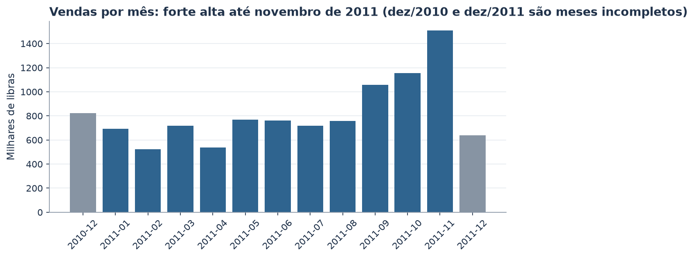
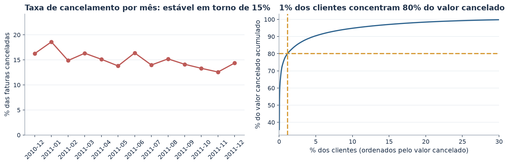
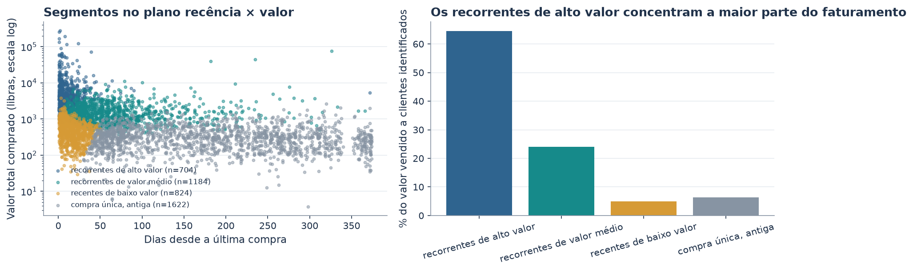
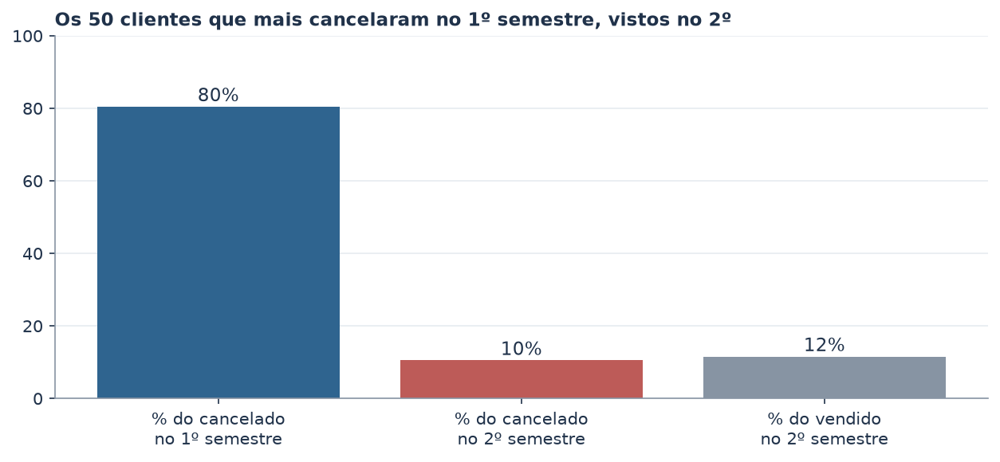
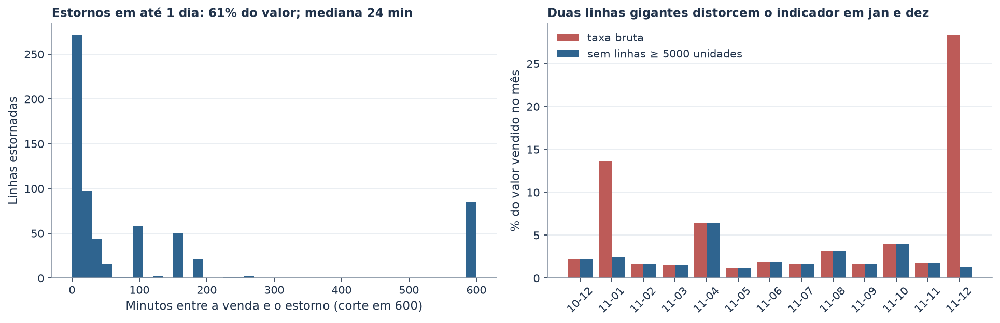

# Estudo de caso 6 · Varejo on-line: cancelamentos

> **Aplicação adicional — não integra o livro.** Relaciona-se com as unidades de pré-processamento (06), visualização (05) e agrupamento (08). Técnicas usadas: preparação de uma base grande, agregação por fatura e por cliente, concentração (curva de Pareto), segmentação RFM com k-means, validação de um achado em outro período, investigação de casos extremos.

## A situação

Um varejista on-line do Reino Unido, que vende presentes e utilidades para muitos clientes atacadistas, percebe que cerca de 15% das suas faturas são cancelamentos. A diretoria pergunta:

1. Quanto valor os cancelamentos levam, e onde se concentram?
2. Que tipos de clientes existem, e quais cancelam mais?
3. Vale a pena criar uma ação dirigida aos clientes que mais cancelam?
4. O que, de fato, explica o valor cancelado?

Este caso mostra duas armadilhas comuns: uma concentração que parece forte num período e **não se repete** no seguinte, e um indicador mensal **dominado por dois registros**.

## Os dados

*Online Retail*, UCI Machine Learning Repository (id 352), licença CC BY 4.0, acesso em 23/11/2026: <https://archive.ics.uci.edu/dataset/352/online-retail>. São 541 909 linhas, cada uma um **item de fatura**, de 1º/12/2010 a 9/12/2011. O arquivo publicado é um `.xlsx` de 23 MB; `dados/online_retail.csv.gz` (7 MB) é a mesma tabela convertida, sem alterar nenhuma linha.

| Coluna | Conteúdo |
|---|---|
| `InvoiceNo` | número da fatura; começa com `C` quando é cancelamento |
| `StockCode`, `Description` | código e descrição do produto |
| `Quantity` | quantidade (negativa nos cancelamentos) |
| `InvoiceDate` | data e hora |
| `UnitPrice` | preço unitário (libras) |
| `CustomerID` | cliente (ausente em 25% das linhas) |
| `Country` | país do cliente |

**O que a base não tem:** carrinhos abandonados, frete, custo, margem, estoque e **motivo do cancelamento**. "Cancelamento" aqui é uma fatura estornada, não um carrinho que o cliente deixou de fechar.

## Scripts

| Passo | Script | Figuras |
|---|---|---|
| 1. Conhecer os dados | `01_conhecer_os_dados.py` | `01_vendas_por_mes.png` |
| 2. Preparar | `02_preparar_os_dados.py` (grava `dados/faturas.csv`, `dados/clientes.csv`, `dados/itens_cancelados.csv`) | — |
| 3. Onde estão os cancelamentos | `03_cancelamentos.py` | `03_cancelamentos.png` |
| 4. Segmentos de clientes | `04_segmentos_de_clientes.py` (grava `dados/segmentos.csv`) | `04_segmentos.png` |
| 5. A concentração se repete? | `05_a_concentracao_se_repete.py` | `05_a_concentracao_se_repete.png` |
| 6. O que é o valor cancelado | `06_regra_de_conferencia.py` | `06_correcoes_e_regra.png` |

---

## Passo 1 · Conhecer os dados

**Pergunta:** o que é uma linha, e que problemas a base traz?

```python
vendas = pd.read_csv('dados/online_retail.csv.gz', parse_dates=['InvoiceDate'],
                     dtype={'InvoiceNo': str, 'StockCode': str})
vendas['cancelamento'] = vendas['InvoiceNo'].str.startswith('C')
```

**O que saiu:**

- 25 900 faturas, 4 070 produtos, 4 372 clientes; 91% das linhas são do Reino Unido.
- **24,9% das linhas não têm cliente** (compras de visitantes ou registros incompletos).
- 9 288 linhas de cancelamento, em 3 836 faturas.
- Há códigos que **não são produtos**: postagem (`POST`, 1 256 linhas), `DOT`, ajustes manuais (`M`), descontos (`D`), taxas bancárias.
- 2 517 linhas com preço zero ou negativo e 1 336 com quantidade negativa fora de cancelamentos.



As vendas crescem até novembro de 2011. Dezembro de 2010 e dezembro de 2011 estão incompletos.

## Passo 2 · Preparar

**Pergunta:** o que fica para a análise?

Removemos códigos que não são produtos (2 995 linhas) e preços zero ou negativos (2 485). Ficam **536 429 linhas (99% da base)**. Depois montamos duas tabelas menores:

- **por fatura:** cliente, país, data, número de itens, unidades e valor (19 773 vendas e 3 422 cancelamentos);
- **por cliente** (só os identificados): data da primeira e da última compra, número de compras, valor total, ticket médio, recência, número e valor de cancelamentos (4 334 clientes).

A fatura de venda mediana tem 15 itens e vale 303 libras; um cliente típico comprou 2 vezes e gastou 668 libras.

## Passo 3 · Onde estão os cancelamentos?

**Pergunta:** quanto valor eles levam e onde se concentram?

**O que saiu:**

| Medida | Valor |
|---|---|
| Faturas canceladas | 3 422 de 23 195 (**14,8%**) |
| Valor cancelado | 478 724 libras = **4,7% do valor vendido** |
| Fatura cancelada mediana | **1 item, 15 libras** (vendas: 15 itens, 303 libras) |
| Taxa de faturas canceladas por mês | entre 12,6% e 18,6% |
| Clientes com algum cancelamento | 1 506 de 4 334 (35%) |
| Clientes que concentram 80% do valor cancelado | **50 (1,2% dos clientes)** |



Dois produtos se destacam no valor cancelado: 80 995 unidades de "Paper craft, little birdie" (168 470 libras) e 74 494 de "Medium ceramic top storage jar" (77 480). Guarde esses números: voltaremos a eles no Passo 6.

À primeira vista, a recomendação parece óbvia: agir sobre os 50 clientes que concentram 80% do valor cancelado. O Passo 5 testa essa ideia.

## Passo 4 · Que segmentos de clientes existem?

**Pergunta:** os clientes se dividem em grupos com recência, frequência e valor diferentes?

Usamos as três medidas clássicas de **RFM**: recência (dias desde a última compra), frequência (número de compras) e valor (total gasto). Como frequência e valor têm cauda longa, aplicamos logaritmo antes de padronizar, e então k-means:

| k | 2 | 3 | 4 | 5 | 6 |
|---|---|---|---|---|---|
| Silhueta | 0,433 | 0,333 | 0,331 | 0,313 | 0,311 |

Escolhemos k = 4 por ser mais útil para descrever (a silhueta é parecida com k = 3). Os nomes foram dados **depois** de olhar os números:

| Segmento | Clientes | Recência mediana | Compras (mediana) | Valor mediano | % do valor vendido | Cancelado / vendido |
|---|---|---|---|---|---|---|
| Recorrentes de alto valor | 704 | 8 dias | 10 | 3 708 | 64,5% | 5,5% |
| Recorrentes de valor médio | 1 184 | 53 dias | 4 | 1 341 | 24,0% | 6,7% |
| Recentes de baixo valor | 824 | 17 dias | 2 | 457 | 5,0% | 1,5% |
| Compra única, antiga | 1 622 | 177 dias | 1 | 298 | 6,4% | 2,3% |



Os recorrentes concentram quase todo o valor vendido e, por comprarem muito, também quase todo o valor cancelado. A proporção cancelada fica entre 1,5% e 6,7% em todos os segmentos.

## Passo 5 · Os clientes que mais cancelam continuam cancelando?

**Pergunta:** uma ação dirigida aos maiores "canceladores" faria sentido no futuro?

Para responder, simulamos o uso real: identificamos os 50 clientes com maior valor cancelado no **1º semestre** (dez/2010 a mai/2011) e olhamos o que eles fizeram no **2º semestre** (jun a dez/2011).

```python
top_s1 = s1['cancelado'].nlargest(50).index
s2.reindex(top_s1)['cancelado'].sum() / s2['cancelado'].sum()
```

**O que saiu:**

| Medida | Resultado |
|---|---|
| Parte do cancelado do 1º semestre que vem desses 50 | **80%** |
| Parte do cancelado do 2º semestre que vem dos **mesmos** 50 | **10,5%** |
| Parte do vendido do 2º semestre que vem deles | 11,6% |
| Quantos deles continuam entre os 50 maiores no 2º semestre | 9 |
| Cancelado / vendido no 2º semestre: os 50 × os demais | 5,1% × 5,6% |



**Conclusão do passo:** a concentração **não se repete**. No 2º semestre, os "grandes canceladores" do 1º cancelam na mesma proporção que qualquer outro cliente. Uma ação dirigida a eles teria sido mal direcionada. O que, então, produz tanta concentração em cada período? A pista está nas maiores faturas canceladas:

| Fatura | Cliente | Data | Unidades | Valor |
|---|---|---|---|---|
| C581484 | 16446 | 09/12/2011 09:27 | −80 995 | −168 470 |
| C541433 | 12346 | 18/01/2011 10:17 | −74 215 | −77 184 |
| C550456 | 15749 | 18/04/2011 13:08 | −9 014 | −22 998 |

A maior fatura cancelada de cada semestre, sozinha, responde por 46% (1º) e 55% (2º) do valor cancelado do semestre.

## Passo 6 · O que é, de fato, o valor cancelado?

**Pergunta:** os cancelamentos são desistências, ou correções? E uma regra simples evitaria os maiores?

**(a) Correções imediatas.** Procuramos estornos **exatos** (mesmo cliente, mesmo produto, mesma quantidade) feitos até um dia depois da venda:

- 651 linhas, **292 827 libras = 61% de todo o valor cancelado**;
- tempo mediano entre a venda e o estorno: **24 minutos**.

As duas linhas gigantes são exemplos: 74 215 unidades vendidas às 10h01 e estornadas às 10h17; 80 995 vendidas às 9h15 e estornadas às 9h27. São, com toda a probabilidade, **erros de digitação corrigidos em minutos**.

**(b) Uma regra de bloqueio, escolhida num semestre e testada no outro.** No 1º semestre, 99,9% das linhas vendidas têm até 480 unidades. Definimos como "absurda" uma linha com **10 vezes** isso, ou seja, **5 000 unidades ou mais**, e verificamos:

| Semestre | Linhas vendidas ≥ 5 000 unidades | Parte do valor cancelado em linhas desse tamanho |
|---|---|---|
| 1º (onde o limite foi escolhido) | 1 | 45% |
| 2º (avaliação) | 1 | 55% |

Em um ano inteiro, a regra teria segurado **apenas duas linhas** para conferência, exatamente os dois erros gigantes.

**(c) O indicador mensal com e sem essas duas linhas:**

| Mês | dez/10 | jan/11 | fev | mar | abr | mai | jun | jul | ago | set | out | nov | dez/11 |
|---|---|---|---|---|---|---|---|---|---|---|---|---|---|
| Taxa bruta | 2,3% | **13,6%** | 1,6% | 1,5% | 6,5% | 1,2% | 1,9% | 1,7% | 3,2% | 1,7% | 4,0% | 1,7% | **28,3%** |
| Sem linhas ≥ 5 000 | 2,2% | 2,4% | 1,6% | 1,5% | 6,5% | 1,2% | 1,9% | 1,7% | 3,2% | 1,7% | 4,0% | 1,7% | 1,3% |



Sem as duas linhas, a taxa de valor cancelado fica entre **1,2% e 6,5%** ao mês, com mediana de **1,7%**. Os picos de 13,6% e 28,3% eram, cada um, um único erro de digitação.

---

## Recomendação, a partir do que foi encontrado

**1. Achados.**
- Cancelamentos são 14,8% das faturas, mas 4,7% do valor: em geral, estornos de um item (Passo 3).
- A concentração em "50 clientes" não se repete de um semestre para o outro: no 2º semestre, esses clientes cancelam na mesma proporção que os demais (5,1% × 5,6%) (Passo 5).
- 61% do valor cancelado são estornos exatos feitos, em mediana, 24 minutos depois da venda. Duas linhas de mais de 70 mil unidades, corrigidas em menos de 20 minutos, respondem sozinhas por metade do valor cancelado do ano (Passo 6).

**2. Ações.**
- **Não criar ações dirigidas aos "clientes que mais cancelam".** O Passo 5 mostrou que esse grupo muda de um período para o outro.
- **Bloquear para conferência linhas de pedido com 5 000 unidades ou mais.** O limite foi escolhido num semestre e funcionou no outro; no ano inteiro, isso significaria conferir duas linhas, que eram justamente os dois maiores erros.
- **Corrigir o indicador de cancelamento** acompanhado pela diretoria: reportar a taxa de valor cancelado **sem** estornos exatos feitos no mesmo dia (ou, no mínimo, sem as linhas bloqueadas), para que um erro de digitação não pareça uma crise.

**3. Como acompanhar, com referências medidas aqui:**

| Indicador | Referência medida | Sinal de alerta |
|---|---|---|
| Valor cancelado / vendido por mês, sem linhas ≥ 5 000 unidades | 1,2% a 6,5% (mediana 1,7%) | acima de 6,5%: investigar as faturas do mês, começando pelas maiores |
| Linhas bloqueadas pela regra | 2 em 12 meses | mais de 2 por mês: o limite está baixo para o volume atual e deve ser recalculado (10 × o percentil 99,9 do semestre anterior) |
| Parte do valor cancelado em estornos exatos no mesmo dia | 61% | queda forte: os cancelamentos passaram a ser outra coisa (devoluções, desistências) e merecem nova análise |

**4. O que não podemos afirmar.** Sem o motivo do cancelamento, não sabemos se os 39% restantes são desistências, devoluções ou trocas. Registrar o motivo em cada estorno é o passo que tornaria possível uma análise de desistência.

## Limites

- Um ano de um único varejista; 25% das linhas não têm cliente e ficam fora das análises por cliente.
- "Valor" é receita bruta, não lucro: não há custo nem margem.
- A identificação de "estorno exato" exige cliente identificado; estornos de visitantes não foram pareados.

## Atividades

1. **Reprodução.** Rode os scripts 01 a 06 e confira os números deste texto.
2. **Variação.** No script `05`, troque 50 por 200 clientes. A conclusão muda?
3. **Pergunta aberta.** A Alemanha tem 23% das faturas canceladas, contra 15% no Reino Unido (Passo 3). Repita o Passo 5 para países: a diferença se mantém nos dois semestres?
4. **Crítica.** Um analista propõe acompanhar "número de faturas canceladas" em vez de "valor cancelado", por ser mais estável. Que vantagem e que desvantagem você vê? Use os números do Passo 3.
5. **Investigação.** Liste os estornos exatos com mais de 1 000 libras que **não** são as duas linhas gigantes. Eles têm algo em comum (produto, cliente, horário)?
