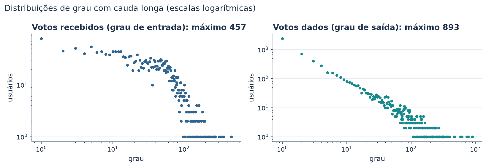
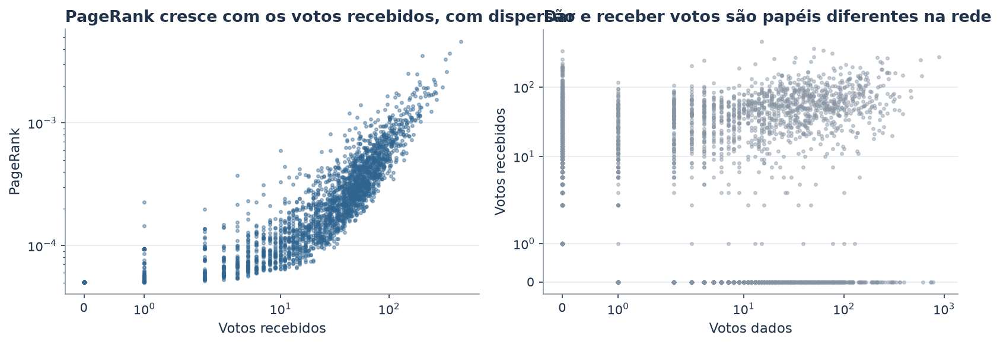
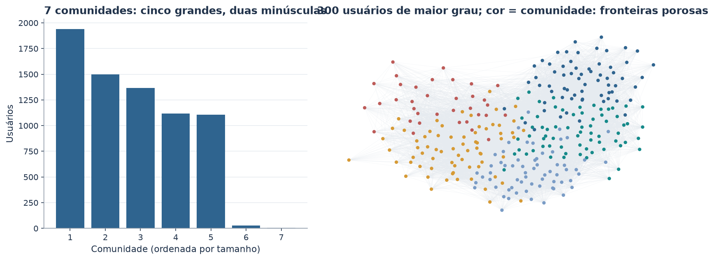
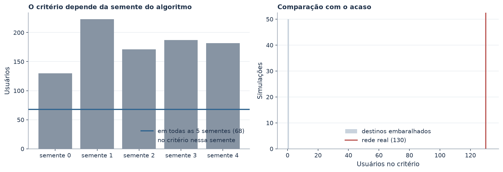
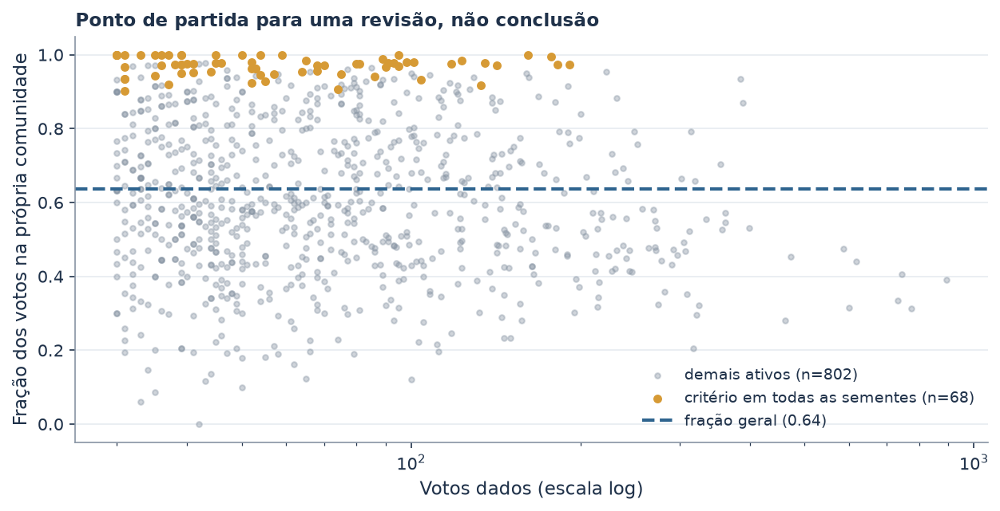
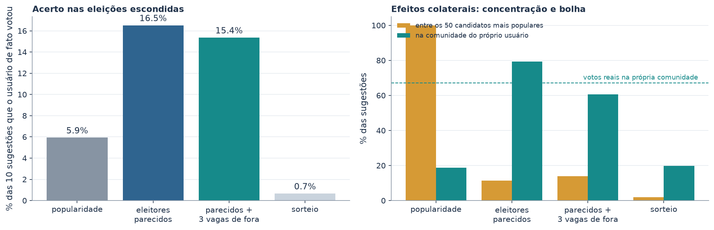

# Estudo de caso 7 · Votações para administrador na Wikipédia

> **Aplicação adicional — não integra o livro.** Aplica a unidade [17 · Redes sociais](../../17_redes_sociais/) a uma rede real grande. Técnicas usadas: grafo dirigido, distribuições de grau, centralidades, detecção de comunidades, estabilidade de um algoritmo, comparação com um modelo nulo (acaso), recomendação por similaridade avaliada em votos escondidos.

## A situação

Na Wikipédia em inglês, usuários votam para decidir quem se torna administrador. Uma pessoa responsável pela integridade do processo pergunta se há **padrões de votação que mereçam atenção**, por exemplo, grupos que votam sempre juntos.

Esta é uma pergunta delicada: envolve pessoas, e a base tem pouca informação. O caso ensina a separar com clareza o que é descrição estrutural do que seria acusação, e a usar a estrutura encontrada numa decisão sobre o **processo**, com efeito medido.

1. Como é a rede de votos: quem vota, quem recebe, quão concentrado?
2. Quem é "central", e as definições de centralidade concordam?
3. Há comunidades, e quão nítidas são?
4. O padrão "votar quase só dentro da própria comunidade" é estável e diferente do acaso?
5. O que é legítimo fazer com isso?
6. Que eleições mostrar a cada usuário experiente, para que ele encontre aquelas em que tem contexto para participar?

## Os dados

*Wikipedia vote network*, Stanford SNAP: <https://snap.stanford.edu/data/wiki-Vote.html> (Leskovec, Huttenlocher e Kleinberg, 2010). `dados/Wiki-Vote.txt` tem 7 115 usuários e 103 689 arcos. Um arco **A → B** significa que **A votou na eleição de B** para administrador, até janeiro de 2008.

Um arco não é amizade, não é "seguir" e não é influência: é a participação de A na eleição de B.

**O que a base não tem:** a direção do voto (a favor ou contra), a data, o resultado da eleição. Nenhuma métrica aqui diz se alguém foi eleito, se votou bem ou se agiu em conjunto com outros.

## Scripts

| Passo | Script | Figuras |
|---|---|---|
| 1. Conhecer a rede | `01_conhecer_a_rede.py` | `01_distribuicao_grau.png` |
| 2. Centralidades | `02_centralidades.py` (grava `dados/centralidades.csv`) | `02_centralidades.png` |
| 3. Comunidades | `03_comunidades.py` (grava `dados/comunidades.csv`) | `03_comunidades.png` |
| 4. Estabilidade e acaso | `04_estabilidade_e_acaso.py` (grava `dados/criterio_estavel.csv`) | `04_estabilidade_e_acaso.png` |
| 5. Critério exploratório | `05_criterio_exploratorio.py` | `05_criterio_exploratorio.png` |
| 6. Recomendar eleições | `06_recomendar_eleicoes.py` | `06_recomendar_eleicoes.png` |

O script 02 aproxima a intermediação com 400 nós de origem sorteados (semente fixa); o cálculo exato levaria vários minutos. O script 04 roda o Louvain cinco vezes e faz 50 simulações.

---

## Passo 1 · Conhecer a rede

**Pergunta:** quantos votam, quantos recebem, e quão concentrada é a participação?

```python
arcos = pd.read_csv('dados/Wiki-Vote.txt', sep='\t', comment='#', names=['de', 'para'])
G = nx.from_pandas_edgelist(arcos, 'de', 'para', create_using=nx.DiGraph())
saida = dict(G.out_degree())     # votos dados
entrada = dict(G.in_degree())    # votos recebidos
```

**O que saiu:**

| Medida | Valor |
|---|---|
| Usuários / arcos | 7 115 / 103 689 (confere com o SNAP) |
| Só votaram | 4 734 |
| Só receberam votos (candidatos que não votaram) | 1 005 |
| Votaram e receberam | 1 376 |
| Votos dados: mediana / máximo | 2 / 893 |
| Votos recebidos: mediana / máximo | 0 / 457 |
| Reciprocidade (A votou em B e B votou em A) | 5,6% |
| Densidade | 0,002 |
| Maior componente fracamente conexo | 7 066 usuários (99%) |



As distribuições têm **cauda longa**: a maioria participa pouco, e poucos usuários dão ou recebem centenas de votos.

## Passo 2 · Quem é central?

**Pergunta:** as diferentes definições de centralidade apontam os mesmos usuários?

| Comparação | Correlação de Spearman | Em comum entre os 50 primeiros |
|---|---|---|
| Votos recebidos × PageRank | 0,99 | 36 |
| Votos recebidos × intermediação | 0,74 | 20 |
| Votos dados × intermediação | 0,48 | 17 |
| Votos recebidos × votos dados | **0,01** | **8** |



**Como ler:** receber votos (ser candidato muito votado) e dar votos (participar de muitas eleições) são **papéis diferentes**, quase sem relação. O PageRank acompanha os votos recebidos. "Quem é central" depende da pergunta (unidade 17, Passo 3).

## Passo 3 · Há comunidades?

**Pergunta:** existem grupos de usuários que votam mais entre si do que com o resto?

Aplicamos o Louvain ao maior componente, ignorando a direção dos arcos, e comparamos com uma rede aleatória com os mesmos graus:

| | Valor |
|---|---|
| Comunidades | 7 (cinco grandes, de 1 108 a 1 941 usuários, e duas minúsculas) |
| Modularidade | **0,426** |
| Modularidade numa rede aleatória com os mesmos graus | 0,128 |
| Fração de arestas internas, nas comunidades grandes | de 38% a 58% |



A modularidade está bem acima do acaso: **há estrutura de comunidades**. Mas as fronteiras são porosas: nas comunidades grandes, de 42% a 62% das arestas saem delas.

## Passo 4 · O padrão é estável? É diferente do acaso?

**Pergunta:** se olharmos para usuários que votam quase só dentro da própria comunidade, esse grupo depende de escolhas arbitrárias do algoritmo? E ele seria encontrado por acaso?

Definimos um critério **exploratório**: pelo menos 30 votos dados e mais de 90% deles na própria comunidade. Então:

**(a) Estabilidade.** O Louvain tem uma etapa aleatória. Rodamos com 5 sementes:

| Semente | Comunidades | Modularidade | Votos dentro da comunidade | Usuários no critério |
|---|---|---|---|---|
| 0 | 7 | 0,426 | 64% | 130 |
| 1 | 18 | 0,417 | 70% | 223 |
| 2 | 8 | 0,426 | 68% | 171 |
| 3 | 6 | 0,429 | 68% | 187 |
| 4 | 5 | 0,426 | 68% | 182 |

A semelhança entre as partições (informação mútua normalizada) vai de 0,55 a 0,80: **as comunidades mudam bastante com a semente**, embora a modularidade fique quase igual. No total, **313 usuários** entram no critério em pelo menos uma semente, mas só **68 entram em todas as cinco**.

**(b) Acaso.** Embaralhamos os destinos dos votos 50 vezes (cada usuário mantém quantos votos deu; cada candidato, quantos recebeu) e aplicamos o mesmo critério com as mesmas comunidades: **nenhum usuário** o atingiu em nenhuma das 50 simulações, contra 130 na rede real.



**Conclusão do passo:** votar concentrado numa comunidade **não é acaso**. Mas **quem** aparece no critério depende muito da semente; só os 68 usuários presentes em todas as rodadas são um resultado robusto.

## Passo 5 · Quem são os 68 usuários do critério estável?

**Pergunta:** o que distingue esses usuários dos demais participantes ativos (≥ 30 votos)?

| Mediana | Critério estável (68) | Demais ativos (802) |
|---|---|---|
| Votos dados | 53 | 63 |
| Fração dos votos na própria comunidade | 97% | 59% |
| Votos recebidos | **0** | 32 |
| PageRank | 0,0001 | 0,0002 |

45 dos 68 estão numa mesma comunidade, a maior (1 941 usuários, com a maior fração de arestas internas, 58%); outros 17 estão numa segunda.



**Como ler:** são eleitores, não candidatos (mediana de 0 votos recebidos), com participação um pouco menor que a dos demais ativos. Esse perfil é compatível com explicações comuns, como usuários ativos num **mesmo período** (participaram das eleições daquela época) ou numa **mesma área temática**. Sem datas e sem a direção dos votos, não há como distinguir isso de coordenação.

**Conclusão do passo:** nenhuma decisão sobre usuários é tomada a partir deste padrão. O que ele mostra, e o Passo 6 aproveita, é que a participação em eleições segue grupos de interesse estáveis o bastante para prever onde cada pessoa participa.

## Passo 6 · Que eleições mostrar a cada usuário?

**Pergunta:** se a página de "eleições em andamento" mostrar a cada usuário experiente 10 eleições, que critério leva as pessoas às eleições em que elas de fato participam, sem concentrar a atenção em poucos candidatos nem fechar cada grupo em si mesmo?

Os Passos 3 a 5 mostraram que a participação tem estrutura: usuários votam, em grande parte, nas mesmas eleições que outros usuários parecidos com eles. Essa estrutura serve para uma decisão sobre o **processo**, e não sobre pessoas: ajudar cada um a encontrar eleições em que tem contexto para opinar. Como a base não tem o sentido dos votos, o sistema sugere **onde participar**, nunca em quem votar.

**Como medimos.** É a avaliação padrão de sistemas de recomendação: para cada um dos 1 691 usuários com pelo menos 10 votos, **escondemos 20% das eleições em que ele votou** (18 747 votos ao todo). Cada método vê só o restante, sugere 10 eleições, e contamos quantas das sugestões são eleições escondidas, ou seja, em que o usuário de fato votou.

| Método | Como escolhe as 10 eleições |
|---|---|
| Popularidade | as 10 com mais votos (o que uma página simples mostraria) |
| Eleitores parecidos | as eleições com mais eleitores em comum com as que o usuário já votou (similaridade de cosseno) |
| Eleitores parecidos, com 3 vagas de fora | 7 sugestões pelo método anterior e 3 reservadas às melhores eleições **fora** da comunidade do usuário |
| Sorteio | 10 eleições ao acaso |

```python
similaridade = (M.T @ M) / norma[:, None] / norma[None, :]     # eleição x eleição
escore = similaridade[ja_votou].sum(axis=0)
escore[ja_votou] = -np.inf
```

Também medimos dois efeitos colaterais: a **concentração** (fração das sugestões entre os 50 candidatos mais votados) e a **bolha** (fração das sugestões dentro da comunidade do próprio usuário, comparada com a fração dos seus votos reais que fica na própria comunidade, 67,1%).

**O que saiu:**

| Método | Sugestões em que o usuário votou | Entre os 50 mais populares | Na comunidade do usuário |
|---|---|---|---|
| Popularidade | 5,9% | 100% | 18,7% |
| Eleitores parecidos | **16,5%** | 11,4% | 79,4% |
| **Parecidos, com 3 vagas de fora** | **15,4%** | 14,0% | **60,7%** |
| Sorteio | 0,7% | 1,8% | 19,8% |

A diferença de acerto entre "eleitores parecidos" e "popularidade" é de 10,6 pontos, com intervalo de 95% de 9,5 a 11,8 pontos (reamostragem dos usuários).



**Como ler:**

- Sugerir por eleitores parecidos acerta **2,8 vezes** mais que mostrar as eleições mais populares.
- A página por popularidade concentra **toda** a atenção nos 50 candidatos mais votados; a recomendação por parecidos distribui a atenção entre muito mais candidatos.
- Mas ela tem um efeito colateral medido: 79% das sugestões caem na comunidade do próprio usuário, mais que os 67% dos seus votos reais. Ela **fecharia** os grupos.
- Reservar 3 das 10 vagas para eleições de fora corrige isso (60,7%, abaixo dos 67% reais) e custa pouco: o acerto cai de 16,5% para 15,4%, ainda **2,6 vezes** o da popularidade.

---

## Recomendação, a partir do que foi encontrado

**1. Achados.**
- A participação tem estrutura de comunidades bem acima do acaso (modularidade 0,43 contra 0,13), estável na escala da rede, embora a atribuição de cada usuário mude com a semente do algoritmo (Passos 3 e 4).
- O padrão "votar quase só na própria comunidade" descreve concentração de participação; a base não tem sentido nem data dos votos, então ele não identifica conduta de ninguém (Passos 4 e 5). Nenhuma ação sobre usuários é tomada a partir dele.
- Essa mesma estrutura prevê em que eleições cada usuário participa, em votos que o método não viu (Passo 6).

**2. Decisão.** Na página de eleições em andamento, mostrar a cada usuário experiente (≥ 10 votos) **10 eleições: 7 escolhidas por eleitores parecidos e 3 reservadas a eleições de fora da sua comunidade**. O sistema sugere onde participar; não sugere voto, não oculta nenhuma eleição (a lista completa continua acessível) e não usa dados além da participação.

**3. Efeito medido** (votos escondidos de 1 691 usuários):

| Medida | Página atual (popularidade) | Decisão (parecidos + 3 de fora) |
|---|---|---|
| Sugestões em que o usuário de fato participa | 5,9% | **15,4%** (2,6 vezes) |
| Sugestões concentradas nos 50 candidatos mais votados | 100% | **14,0%** |
| Sugestões na comunidade do próprio usuário | 18,7% | **60,7%**, abaixo dos 67,1% dos seus votos reais: sem efeito bolha |

**4. Como acompanhar:**

| Indicador | Referência medida | Ação se sair da faixa |
|---|---|---|
| % das sugestões em eleições em que o usuário participa | 15,4% | abaixo de 10%: recalcular as similaridades com os votos recentes |
| % das sugestões na comunidade do próprio usuário | 60,7% (votos reais: 67,1%) | acima de 67%: aumentar as vagas de fora |
| % das sugestões nos 50 candidatos mais votados | 14,0% | acima de 30%: a página voltou a concentrar a atenção |
| Votos recebidos por candidato | distribuição atual (Passo 1) | se a recomendação passar a definir resultados, a regra de vagas de fora deve ser revista com a comunidade |

## Limites

- Recorte até janeiro de 2008, sem datas: a avaliação esconde votos ao acaso, não "o futuro"; num sistema em uso, a mesma medida deve ser feita com as eleições seguintes.
- As comunidades ignoram a direção dos votos e dependem do algoritmo e da semente; a regra das 3 vagas usa a partição da semente 0.
- Centralidade e comunidade descrevem **posição** na estrutura, nunca **intenção**.

## Atividades

1. **Reprodução.** Rode os scripts 01 a 06 e confira os números deste texto.
2. **Variação.** No script `04`, troque o critério para "pelo menos 50 votos e mais de 80% dentro". Quantos usuários ficam estáveis nas cinco sementes?
3. **Pergunta aberta.** Repita o Passo 2 só para os 1 376 usuários que votaram e receberam votos. As centralidades passam a concordar mais?
4. **Crítica.** Alguém propõe "remover o direito de voto dos 68 usuários estáveis". Escreva um parágrafo explicando, com os números dos Passos 4 e 5, por que essa decisão não se apoia nos dados.
