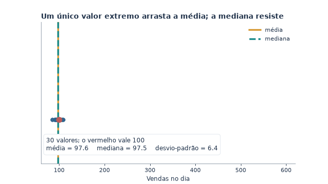
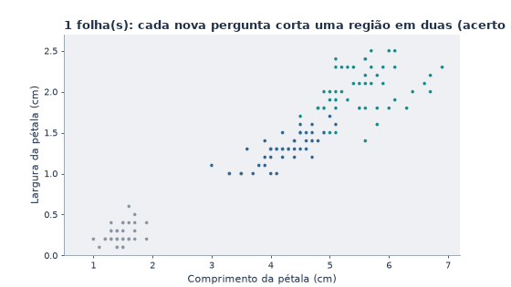

# Ciência de Dados

> Material da disciplina de Ciência de Dados do Instituto de Computação da Universidade Federal de Alagoas (UFAL). Os slides das aulas, em PDF, estão no [site da disciplina](https://sites.google.com/ic.ufal.br/ciencia-de-dados/documentos?authuser=0). Tudo o que é preciso para estudar e executar está aqui; só a parte de Big Data da unidade 01 baixa, na primeira execução, dados públicos grandes demais para o repositório.

**Uma loja vendeu mais neste mês. Ela deveria comprar mais estoque para o próximo?**

Parece uma pergunta simples. Basta olhar as vendas, certo?

Mas e se o aumento aconteceu em um único dia? E se foi uma promoção que não vai se repetir? E se as vendas cresceram, mas alguns produtos ficaram encalhados? Uma tabela pode mostrar que alguma coisa mudou. Entender o que mudou, e decidir o que fazer, exige um pouco mais.

É disso que trata este repositório.

A ideia é começar do básico e, aos poucos, aprender a investigar dados de verdade: contar, comparar, visualizar, testar hipóteses, construir modelos e, principalmente, reconhecer quando uma conclusão ainda não está sustentada. No final, você deverá conseguir defender uma recomendação diante de alguém que pergunte: **"Como você sabe?"**

## Por onde começar?

Não precisa saber Python. Comece pela primeira unidade e siga no seu ritmo. Cada unidade tem um README com a explicação passo a passo, scripts numerados que rodam sozinhos e as figuras que eles geram.

| Unidade | O que você vai investigar |
|---|---|
| [00 · Como começar](00_como_comecar/) | Instalar o Python e executar os primeiros comandos |
| [01 · Conceitos e Big Data](01_conceitos_e_big_data/) | O que é Ciência de Dados, o processo de análise e os Vs do Big Data; Apache Spark com 41 milhões de corridas de táxi e com o fluxo ao vivo de edições da Wikipédia |
| [02 · Python do zero](02_python/) | Como transformar perguntas simples em instruções |
| [03 · Primeiros dados](03_primeiros_dados/) | Como ler uma tabela e encontrar padrões com `pandas` |
| [04 · Estatística](04_estatistica/) | Medidas, distribuições, intervalos, testes, tabelas de contingência, Simpson, sobrevivência |
| [05 · Visualização](05_visualizacao/) | Que gráfico responde a cada pergunta, quais enganam, como contar uma história |
| [06 · Pré-processamento](06_preprocessamento/) | Ausentes, ruído, integração, categorias, escala, redução, vazamento de dados |
| [07 · Aprendizagem de máquina](07_aprendizagem_de_maquina/) | Matriz de confusão, curva ROC, custo do erro, validação, sobreajuste |
| [08 · Agrupamento](08_agrupamento/) | k-means, agrupamento hierárquico, escolha do número de grupos e seus limites |
| [09 · k vizinhos mais próximos](09_knn/) | Classificar pela vizinhança; escala, escolha de k, condensação |
| [10 · Naive Bayes](10_naive_bayes/) | Teorema de Bayes, classificação à mão e um filtro de spam real |
| [11 · Regressão](11_regressao/) | Mínimos quadrados, diagnóstico de resíduos, regressão múltipla e logística |
| [12 · Árvores de decisão](12_arvores_de_decisao/) | Entropia, ganho de informação, ID3 à mão, poda, florestas |
| [13 · Redes neurais](13_redes_neurais/) | Perceptron, XOR, retropropagação à mão, redes de múltiplas camadas |
| [14 · Máquinas de vetores de suporte](14_svm/) | Margem máxima, margem suave, kernels, ajuste de parâmetros |
| [15 · Séries temporais](15_series_temporais/) | Decomposição, autocorrelação, estacionariedade, ARIMA, validação no tempo |
| [16 · Recomendação de modelos](16_recomendacao_de_modelos/) | "Não existe almoço grátis", meta-aprendizado, busca de hiperparâmetros |
| [17 · Redes sociais](17_redes_sociais/) | Grafos, centralidades, PageRank, comunidades e modularidade |
| [18 · Estudos de caso](18_estudos_de_caso/) | Sete problemas reais, do dado à recomendação verificada |
| [19 · Projeto final](19_projeto_final/) | Como responder uma pergunta e recomendar uma ação verificável |

## Sua primeira experiência

Instale o [Python](https://www.python.org/downloads/), baixe este repositório e, na pasta principal, execute:

```powershell
python 02_python/01_operadores_e_variaveis.py
```

Mude os números. Tente prever o resultado antes de executar. Fazer perguntas ao código é uma boa maneira de aprender a programar. A unidade [00](00_como_comecar/) explica a instalação completa, com ambiente virtual e as bibliotecas de `requirements-basico.txt`.

Se algum termo ainda for desconhecido, volte uma unidade. Não é preciso entender tudo de uma vez.

## Quando uma imagem explica melhor

Uma média pode mudar muito por causa de um único valor. Uma animação mostra isso em um instante.



*Animação gerada em Python por [animacoes/fontes/media_e_mediana.py](animacoes/fontes/media_e_mediana.py). Dados simulados com semente fixa.*

O repositório tem mais de uma centena de figuras e onze animações, todas geradas pelos próprios scripts: o histograma que se forma, o k-means que se move, a árvore que divide o plano, o perceptron que corrige a reta, a reta de mínimos quadrados que se ajusta. O objetivo não é enfeitar: é tornar visível o que o cálculo está fazendo. As regras visuais estão no [manual visual](materiais/manual_visual.md).



## Sete problemas para investigar

Os estudos de caso seguem sempre a mesma ordem: **encontrar o resultado, verificá-lo em dados que não foram usados para encontrá-lo, decidir e medir o efeito da decisão**. Cada um termina com uma frase do tipo "observamos isto, portanto decidimos aquilo, porque o efeito medido é este", com número e unidade, e também com o custo da decisão.

**Reclamações em aeroportos** ([caso 01](18_estudos_de_caso/01_reclamacoes_tsa/)). Um modelo fraco para decidir pode ser útil para ordenar a fila? Simulando a fila com os desfechos reais de quatro meses que o modelo não viu, ordenar por ele reduz em 25% a espera até o pagamento, com teto de 20 dias para quem espera mais.

**Energia doméstica** ([caso 02](18_estudos_de_caso/02_energia_domestica/)). Onde cortar, numa casa com tarifa única? Medindo cada madrugada contra o nível de verão, a carga extra noturna custou 229 kWh, US$ 48, 5,3% da conta do último ano.

**Vendas em supermercado** ([caso 03](18_estudos_de_caso/03_vendas_supermercado/)). O "pico das 19h" não se repete de um mês para o outro, e é justamente a demanda sem padrão que indica a política de estoque certa: em semanas que ela não viu, as semanas com falta de produto caem de 48% para 7%.

**Bicicletas compartilhadas** ([caso 04](18_estudos_de_caso/04_mobilidade_bicicletas/)). Quando fazer a manutenção e quantas pessoas escalar? A janela 3h–5h atinge 0,8% dos aluguéis do ano, e dimensionar a equipe pela previsão quase reduz à metade os dias de equipe insuficiente.

**Desempenho escolar** ([caso 05](18_estudos_de_caso/05_educacao_desempenho/)). A quem oferecer reforço com vagas limitadas? Uma regra simples, criada com uma turma, leva o apoio a 109 dos 130 alunos que reprovariam em outra; uma lista sorteada do mesmo tamanho alcançaria 56.

**Varejo on-line** ([caso 06](18_estudos_de_caso/06_varejo_online/)). Quem cancela vai embora? Não: para de comprar menos. A quem ligar, então? Uma lista com 10% dos clientes, ordenada pela perda esperada, contém 55% da receita em risco do trimestre seguinte.

**Votações na Wikipédia** ([caso 07](18_estudos_de_caso/07_votacoes_wikipedia/)). O que a estrutura de uma rede permite fazer sem julgar pessoas? Sugerir a cada usuário eleições para acompanhar acerta 2,6 vezes mais que a página por popularidade, sem fechar os grupos em si mesmos.

## A pergunta final

No [projeto final](19_projeto_final/), você escolherá um problema e construirá uma análise capaz de sustentar uma decisão: o que foi observado, como foi verificado, que ação decorre disso, qual o efeito medido dessa ação e que indicador permitirá acompanhá-la.

## O livro

Para quem quiser a fundamentação teórica e o desenvolvimento das aplicações em mais detalhe, escrevi o livro **_Ciência de Dados: da teoria à prática_** (UICLAP, 2025). A Parte I (capítulos 1 a 10) trata de conceitos, Big Data, estatística, pré-processamento, classificação, avaliação de classificadores, aprendizagem não supervisionada, séries temporais, análise de redes sociais e meta-aprendizagem. A Parte II desenvolve três aplicações, que aparecem aqui como estudos de caso:

| Capítulo do livro | Estudo de caso |
|---|---|
| 11 · Aplicação 1: Reclamações por Perdas | [18_estudos_de_caso/01_reclamacoes_tsa](18_estudos_de_caso/01_reclamacoes_tsa/) |
| 12 · Aplicação 2: Energia Doméstica | [18_estudos_de_caso/02_energia_domestica](18_estudos_de_caso/02_energia_domestica/) |
| 13 · Aplicação 3: Vendas em Supermercado | [18_estudos_de_caso/03_vendas_supermercado](18_estudos_de_caso/03_vendas_supermercado/) |

Os casos 04 a 07 não fazem parte do livro. A correspondência entre unidades, temas e capítulos está em [materiais/mapa_capitulos_aplicacoes.md](materiais/mapa_capitulos_aplicacoes.md).

Você pode conhecer o livro na [página oficial](https://github.com/bapimentel/livro), na [Amazon](https://www.amazon.com.br/gp/product/6501351715) ou na [UICLAP](https://loja.uiclap.com/titulo/ua86619/). O livro é o aprofundamento. Este repositório é uma tentativa de trazer os assuntos do livro de forma resumida e didática, com implementação em Python.

## Como está organizado

```
00_como_comecar/ … 19_projeto_final/   uma pasta por unidade: README passo a passo, scripts numerados, figuras/
18_estudos_de_caso/0X_.../             cada caso com dados/, figuras/, scripts numerados e README
dados/                                 bases pequenas usadas pelas unidades
figuras/  animacoes/                   estilo.mplstyle, fontes/ (geradores) e geradas/ (saídas)
materiais/                             roteiro de temas, mapa com o livro, manual visual
scripts/                               executar_todos.py e verificar_links.py
requirements-basico.txt                bibliotecas das unidades (instaladas na unidade 00)
requirements-aplicacoes.txt            extras dos complementos dos estudos de caso
requirements-bigdata.txt               Spark para os scripts 08 a 12 da unidade 01 (precisa também do Java 17)
```

Para conferir que tudo roda, da pasta principal e com o ambiente ativado:

```powershell
python scripts/executar_todos.py
```

Os scripts rodam com `matplotlib` em modo não interativo e gravam as figuras; o resultado fica em `scripts/relatorio_execucao.txt`. Para rodar só uma unidade, passe o nome da pasta: `python scripts/executar_todos.py 12_arvores_de_decisao`. Os scripts de Spark da unidade 01 só rodam com o `requirements-bigdata.txt` instalado; sem ele, aparecem como `PULADO` e não contam como erro.

Material organizado por **Bruno Pimentel**, professor do Instituto de Computação da UFAL.

*Licença: defina a licença do código antes da publicação e confira a de cada base de dados ([dados/README.md](dados/README.md) e os READMEs dos estudos de caso). As bases da UCI usadas nos casos 04 a 06 estão sob CC BY 4.0.*
