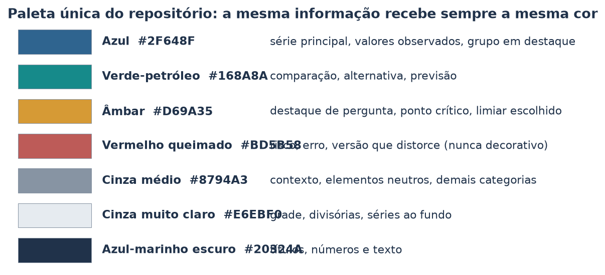

# Manual visual

Regras seguidas por todas as figuras e animações deste repositório, com o motivo de cada uma e um exemplo. O arquivo de estilo que aplica as regras no Matplotlib é [figuras/estilo.mplstyle](../figuras/estilo.mplstyle); os scripts o carregam com `plt.style.use(...)`. Toda figura tem o script que a gera ao lado (na pasta da unidade) ou em `figuras/fontes/` e `animacoes/fontes/`.

Os princípios da seção 1 seguem a abordagem de Cole Nussbaumer Knaflic, *Storytelling com Dados* (Alta Books, 2019), a referência usada na disciplina para visualização. A unidade [05 · Visualização](../05_visualizacao/) mostra cada princípio com código.

## 1. Princípios

| Princípio | Regra adotada | Exemplo |
|---|---|---|
| Visualizar serve para comunicar um significado e apoiar uma decisão | Toda figura responde a uma pergunta escrita antes dela; figuras decorativas não entram | todos os READMEs trazem a pergunta do passo antes da figura |
| Entender o contexto: quem vai ler, o que deve fazer; análise exploratória é diferente de explanatória | Figuras das unidades mostram o mecanismo; figuras dos estudos de caso mostram o achado para quem decide | [antes](../05_visualizacao/figuras/antes_rating_por_produto.png) e [depois](../05_visualizacao/figuras/depois_rating_por_produto.png) |
| Um ou dois números não precisam de gráfico | Números isolados vão no texto ou no título | estudo de caso 02: "US$ 0,202 por kWh" no texto |
| Tabelas leves; mapa de calor em vez de tabela densa | Tabelas em Markdown sem decoração; mapas de calor para hora × dia | [perfil horário](../18_estudos_de_caso/02_energia_domestica/figuras/03_perfil_horario.png), [grade de C e γ](../14_svm/figuras/grade_C_gamma.png) |
| Pontos, linhas e barras são os gráficos mais eficientes | Barras para categorias, linhas para tempo, dispersão para relações, histograma e boxplot para distribuições | unidade [05](../05_visualizacao/), scripts 01 a 04 |
| Barras horizontais quando os nomes são longos; ordenar pelo valor | Categorias ordenadas pelo valor, salvo quando a ordem natural (hora, mês) importa | [mediana da avaliação](../18_estudos_de_caso/03_vendas_supermercado/figuras/01_mediana_avaliacao.png) |
| Barras começam em zero | Base zero obrigatória em barras; eixo cortado em linhas só com aviso | [escalas que enganam](../05_visualizacao/figuras/escalas_que_enganam.png) |
| Evitar gráfico de pizza | Pizza só aparece como contraexemplo | [pizza × barras](../05_visualizacao/figuras/pizza_vs_barras.png) |
| Saturação: cada elemento compete pela atenção | Sem molduras superior e direita, grade só horizontal e clara, poucas cores, legenda sem caixa | [saturação passo a passo](../05_visualizacao/figuras/saturacao_passo_a_passo.png) |
| Atributos pré-atentivos (cor, tamanho, posição) dirigem o olhar | Uma cor de destaque por figura; cinza para o resto | [atributos pré-atentivos](../05_visualizacao/figuras/pre_atentivo_digitos.png), [importância na floresta](../12_arvores_de_decisao/figuras/importancia_floresta.png) |
| Rótulo direto em vez de legenda quando há poucas séries | Legenda só quando necessária | [gráfico sazonal](../15_series_temporais/figuras/grafico_sazonal.png) |
| O texto é um aliado | Títulos afirmam o achado; anotações explicam picos e eventos | [série diária de bicicletas](../18_estudos_de_caso/04_mobilidade_bicicletas/figuras/01_serie_diaria.png) (furacão Sandy) |
| Contar uma história: início, meio e fim | READMEs dos estudos de caso: situação → dados → passos → verificação → recomendação → limites | [história em quatro quadros](../05_visualizacao/figuras/historia_quatro_quadros.png) |

## 2. Paleta e convenção de cores



| Papel | Cor | Hex |
|---|---|---|
| Fundo | Branco | `#FFFFFF` |
| Títulos, números e texto | Azul-marinho escuro | `#20324A` |
| Série principal, valores observados, grupo em destaque | Azul | `#2F648F` |
| Comparação, alternativa, previsão | Verde-petróleo | `#168A8A` |
| Destaque, ponto crítico, limiar escolhido | Âmbar | `#D69A35` |
| Risco, erro, versão que distorce | Vermelho queimado | `#BD5B58` |
| Elementos neutros, demais categorias | Cinza médio | `#8794A3` |
| Grade, divisórias, séries ao fundo | Cinza muito claro | `#E6EBF0` |
| Cor extra, quando há mais de cinco grupos | Azul claro | `#7A9CC6` |

A mesma informação tem a mesma cor em todas as figuras: observado = azul; previsão ou alternativa = verde-petróleo; limiar = âmbar; erro ou alerta = vermelho. Vermelho nunca é decorativo. Escalas sequenciais usam tons de azul (`Blues`); nada de arco-íris.

## 3. Tipografia, eixos e formato

- Fonte sem serifa (DejaVu Sans, a padrão do Matplotlib); corpo 11 pt, títulos 13 pt em negrito, alinhados à esquerda.
- Título com uma frase que afirma o achado ou a pergunta; o README diz o limite ("dados simulados", "n = 49").
- Unidade em todo eixo; período e tamanho da amostra no título quando mudam a leitura.
- Painéis lado a lado compartilham escala quando se comparam. Sem dois eixos y.
- Proporção padrão 16:9 (8 × 4,5 polegadas); painéis múltiplos usam larguras próprias. PNG a 150 dpi; animações GIF a 70–80 dpi, sempre acompanhadas de um PNG com o quadro final.

## 4. Acessibilidade e leitura crítica

- O significado nunca depende só da cor: tracejado para a alternativa, marcadores, rótulos diretos e `n` por grupo.
- Pontos sobrepostos recebem tamanho pequeno e transparência ([dispersão com sobreposição](../05_visualizacao/figuras/dispersao_sobreposicao.png)).
- A incerteza aparece quando existe: intervalos de confiança ([intervalos](../04_estatistica/figuras/erro_padrao_e_intervalos.png)), faixas de percentis ([janelas operacionais](../18_estudos_de_caso/04_mobilidade_bicicletas/figuras/06_janelas_operacionais.png)), intervalos de previsão ([ARIMA](../15_series_temporais/figuras/arima_vs_linha_de_base.png)), barras de erro ([poda](../12_arvores_de_decisao/figuras/poda.png)).
- Filtros e remoções ficam registrados no título ou no README.
- Gráficos de correlação vêm com texto que nega causalidade; [correlação não é causalidade](../figuras/geradas/correlacao_nao_causalidade.png) é o lembrete.
- Texto alternativo informativo em todas as imagens dos READMEs.

## 5. Animações

Onze animações em `animacoes/geradas/`, geradas por `animacoes/fontes/`:

| Animação | Mostra | Unidade |
|---|---|---|
| `media_e_mediana` | um valor extremo desloca a média, não a mediana | 04 |
| `histograma_crescendo` | a forma da distribuição aparece com o tamanho da amostra | 04 |
| `limiar_matriz_confusao` | mudar o limiar troca um tipo de erro pelo outro | 07 |
| `kmeans_passo_a_passo` | atribuir e recalcular centros até estabilizar | 08 |
| `dendrograma_formacao` | fusões sucessivas do agrupamento hierárquico | 08 |
| `knn_variando_k` | a fronteira do k-NN suaviza conforme k cresce | 09 |
| `minimos_quadrados` | a reta que minimiza a soma dos quadrados dos resíduos | 11 |
| `arvore_particionando` | cada nova pergunta da árvore corta uma região em duas | 12 |
| `perceptron_aprendendo` | a reta do perceptron corrigida a cada erro | 13 |
| `serie_componentes` | tendência + sazonalidade + ruído, e janelas de validação | 15 |
| `matriz_adjacencia_construcao` | a matriz de adjacência preenchida aresta por aresta | 17 |

Regras: eixos e paleta fixos durante toda a animação (só se move o que muda), um quadro parado no fim e um título que diz o que está acontecendo.

## 6. Como regenerar

Da pasta principal, com o ambiente ativado:

```powershell
python scripts/executar_todos.py figuras/fontes animacoes/fontes
```

Cada unidade e estudo de caso regenera as próprias figuras ao executar seus scripts (por exemplo, `python scripts/executar_todos.py 05_visualizacao`). Sementes fixas garantem o mesmo resultado a cada execução.
